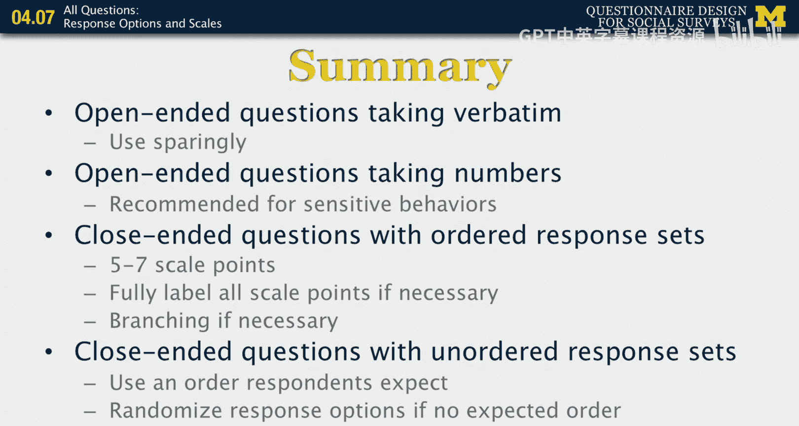

# 密歇根大学《调查数据收集和分析（2-6：方法、社调问卷设计、抽样、缺失数据、分析）｜Survey Data Collection and Analytics》 p67 24_所有问题的应答选项与量表设计.zh_en -BV1fw4m1e7Zh_p67-

So this segment is really related to all kinds of different question types。

 where we'll be talking about response options and scales。When you design a question。

 you always have to make a choice on what to put in there as a response option。

 remember early on we said you have to map your answers to a particular response option。

 so it really matters what those response options are。

To fully complete the process the cognitive process of questionnaire or question and answer formation。

 if you will。So different types of response options are available to us as questionnaire designer。

 you have open ended questions that ask orbatim， what do you like most about living in an A would be one example？

And we have open questions that ask for numeric responses， for example。

 how many days during the past 12 months，lalah， bh，lah， blah。

It's a little debatebatable whether those are really open questions in the question because it's clear that the numeric answer is asked for。

 but here too you could imagine breaking these numbers up into scales and making it a closed form question which is often done for example。

 with income questions to make the response to those somewhat easier。😊。

The closed- ended questions let me introduce those to you here are a few examples have you ever used would be a closed ended question with the yes no option。

 they are frequency type questions that have a scale at the end during the past 30 days。

 how often did you use vitamins regularly often seldom really this would be a four point scale as we talk it and another example for a scale is this five point scale all of the time most of the time some of the time a little of the time none of the time so this would be a typical five point scale for a question like during the past 30 days how often did you feel nervous。

Attitude questions often have these kind of skills and we talked about agree and disagree items at length。

 here are a few other examples that are pretty common。

 the first one is a very popular five point scale excellent very good good far and poor。

Likelihood can be asked in similar ways the two bottom examples here are basically scaled with two endpoints in the middle category。

And finally， response options where interviewer can select from a list of items。

 all that apply either this list was read out to the respondent or not。

 but this would be usually often a show card and the respondent has seen all these different things in this case here which of the following magazines have you read in the past seven days was the question that goes with this scale。

Now on these opened questions， you know you can turn many opened questions into closed ended questions。

 for example， this one here， the first one， this question is on the subject of work。

 people look for different things in a job， what would you most prefer it's asked very openly if very little control for what the respondent might recall and think as belonging to the set。

 whereas if you give these items high income or danger of being fired。

 working hours are short and like these examples come from an experiment that Stanley president and colleagues did you'll see that people are of course more likely to fill in something of those then something that has not part of this particular listium。

So there are pros and cons with these open-end questions in general it can be said that you know it's a extended question。

 many of our normal conversations are open- ended questions so that is good。

 it's possible to get richer deeper， fuller information and unique answers from the respondents if you don't suggest answer alternatives。

 the problem though is that with this you know free exchanges of ideas。

 you also fall into a few traps one is there can be a lot of discussion about these ideas and it gets expensive and time consuming。

It's very hard to analyze the verbatium transcripts。

 the coding time can be very much prone to error and is not just time consuming but with that also costly and of course the administration takes more time overall。

Crosnk has in this 2012 paper talk a lot about open endeded question and sort of showed for the American National election studies the percent of question that were open endeded。

 and you see that has gone down dramatically over the time。

 but both Ksnik and Pressso and their paper discussed that there are still a good reasons for open- ended questions and on a variety of features these open endeded questions actually might perform better than the close- endeded ones。

 a little bit of issue with possibility for interview effects that we talked about in the very first unit。

 so this could be a good piece to review。Frequency scales is one form of closed ended questions here's a typical frequency scale this comes from an experiment from Nobo Schwartz in from the 80s how many hours of television do you watch in the average day they in this experiment gave two options low options and high options and the list of response category so respondent would either see this set or this set here。

And if you look at the distribution of answers to these questions here to these questions。

 you can see that in the low response option， respondents clearly took a hint from the set of response options on where their answer should fall because 16。

2% said more than2 a half hours and more than two and a half hours。

 that's many more of the respondents in the alternating set。

Another type of answer categories that you can consider are rating scales。

 this is an example for rating scales here there are you know scale points from one to five and we can either have them fully labeled in a unipollar way which goes from extremely happy to not at all happy but they all have happy as a word here at the end of the scale that indicating unippolar this that's even a word you can decide to just label the endpoint so this would be from extremely happy to not at all happy。

 you can have a fully labeled bipolar scale， extremely happy， somewhat happy neutral。

 somewhat unhappy， extremely unhappy， and then an endpoint labeled for this bipolar scale。

So the design decisions you have to make， the number of scale points。

 whether you include a middle alternative or not， whether you use verbalable labeling or not。

 and whether you use numeric labels or not。We give you a couple of pointers from the research literature here。

 as you might have noticed， this class is not about a cookbook。

 that is for a particular setting of particular question and context。

 not necessarily a default answer to these questions。

 but these pointers might help you make the right decision for your own questionnaire。So again。

 pointing to these two references， crossn and Pressor 2010 and Crossnick in 2012 on the number of scale points。

 they summarize what we've learned on various dimensions， so on completion error。

 longer scales seem to perform better than shorter。Time wise。

 longer scales require more time than shorter。Reliability suggestions lead to bipolar scales having seven points un polarlar scale five points you see this coming up in all of them。

 so that seems to be the best number of gay points depending on which polarity you pick most of the research that they summarize here is done in visual mode so self-addministered or some form of interview administered with the showcard in telephone surveys this might look a little different now on the including a middle alternative and you have seen you know this recommendation was7 in five point scales so they all have a middle alternative。

Earlier studies from Gron and Fabria did not point to that。

 so they were concerned about satisfying that people in the presence of a middle alternative would just pick that and not make a decision on one or the other。

 later research by various other authors and Crone again in 2010 with the papers present they actually do recommend the use of a middle alternative。

 definitely in a bipolar scale。Then the question is whether you label your scale points or not。

 the unlabeled scale requires interpretation and the labeled scale requires reading and interpretation of the labels。

 obviously， however， in general， fully labeled works better than end labeled in all of the evaluative dimension that you find here in the literature respondent satisfaction reliability。

 correlation of validity， dirgent validity， Inter agreement。

 object differentiation and question order effects。In general。

 it's good to have more widely spread endpoints， this leads to higher reliability and note though that the respondents presume equal spacing is intended so it's best to choose labels to reinforce this。

Here's an interesting example for the use of numeric labels from Noba Schchwartz from 1991 this is a classic experiment replicated a few times now they had two scales here。

 one with scale from0 to10 and the other one from minus5 to plus5 the question for this experiment was you know do you consider yourself extremely successful or not at all successful and when people rate themselves on the scale you can see that they are in the red condition here so these are the scales from minus5 to5 much more likely to report higher numbers because the negative numbers so the interpretation might indicate complete failure whereas the zero is just the absence of success that's one interpretation of this another scale answer type that we can consider which is the issue of ranking items or rating you have choices of full ranking of options for example here below。

There's a list of 18 values in alphabetical， whatever you're interested in finding out the relative importance of these values plays one。

 place one to the next value， that's the first important one and so on。

The partialure ranking would be on half of that pick the three that are most undesirable。

 the minimum ranking would be to say which one of them is most important to you。Now。

 rating on the other end would be using those rating skillss that we just talked about。

Extremely satisfied， somewhat satisfied， and so on。

Here's a comparison again from the CrossNe 2012 review paper comparing rating and ranking questions in you know difficulty these tasks where quite a big in ranking you have to make comparison among many objects and in the other one it's one object at a time。

 you often need a visual displayplay for the ranking task which you don't need for the rating task。

 people tend to be slower on the ranking than they are on the rating。

 and the costs for ranking is usually more expensive than for rating。

 the information you gain from the ranking task is a rank order whereas the rating can give you both absolute levels and rank order。

The level of data in the ranking is usually ordinal。

 you don't know what the distance is between them if you have a good rating scale this can be more in an interval level scale。

The analysis of the ranking data is more difficult than of the rating data and the translation function is harder for the ranking as well。

Differentiation on the ranking is forced， you have to put cases in an order。

 whereas on the rating task， this is not forced。嗯。So， you know。

 this is a summary of these two comparisons here。 A lot of this might speak for rating。

 but it does depend on what the。The issues really are or the typical setting you really work with。

Finally， this last type of question mark all that apply。

 which of the following magazines have you read in the past seven days。

 we have a few studies here that show and this is one paper from Jon Smith and colleagues from 2006 that comparing Mark all that apply to series of yes。

 no question that the two formats are not comparable， you get more responses endorsed with the yes。

 no question， people spend longer time answering the yes no question。

 however these authors did not find acquience bias and yes no questions and not much item nonrespon。

So in summary on the scales。Open mind that question， taking abing， use those sparingly。

 in the questions that take numbers， they can be recommended for sensitive behaviors。

You then don't force scales to shift in one or the other direction。

 remember that TV example that we showed you from Nova Schwartz closed to question with order response sets are good five to seven point scales recommended fully labeled scale points good if you have good labels that fit the topic branching of questions is nice we haven't talk about that in detail but。

That basically means if you have longer scales， you split them up。

 you first ask above or below the median， for example， and then you branch out。

 this can help for the telephone。And close in question with unaued responses。

when you have that kind of thing， you know try to get an order in there that the respondent expect and if not randomize the response option if you don't have an expected order。

 we have seen this before when we talked about the list of items rating。

The quality that a child have， we talked about context effect。

 and you saw those video clips in an earlier segment on this。

