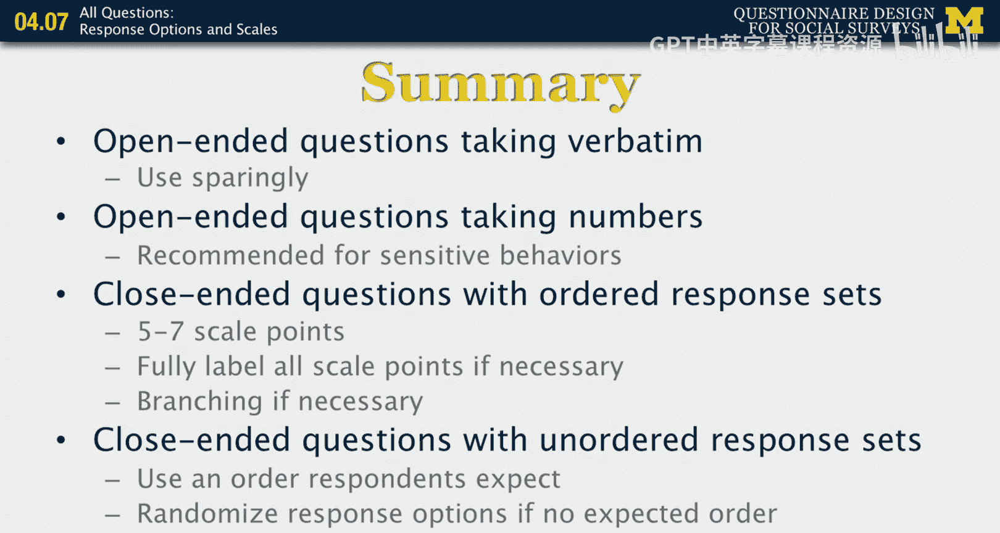

# 调查数据收集与分析：2-6：应答选项与量表设计 📝

在本节课中，我们将要学习问卷设计中一个至关重要的环节：应答选项与量表的设计。问卷中的每一个问题，其应答选项的设定都直接影响着数据的质量和受访者的回答方式。我们将探讨开放式与封闭式问题的区别，介绍不同类型的量表，并基于研究证据提供设计建议。

## 开放式问题

上一节我们提到了问题类型，本节中我们来看看开放式问题。开放式问题允许受访者用自己的语言自由回答，不提供预设选项。

以下是开放式问题的两种主要形式：
*   **文字型开放式问题**：例如，“您最喜欢居住在A地的哪一点？”
*   **数字型开放式问题**：例如，“在过去12个月里，您有多少天……？”

开放式问题有其优缺点。其优点在于能获得更丰富、深入和独特的答案，更接近自然对话。然而，其缺点也很明显：分析逐字稿耗时费力、编码过程容易出错、整体实施成本更高。

研究显示，尽管开放式问题的使用比例已大幅下降，但在某些情境下，其表现可能优于封闭式问题。

## 封闭式问题

在了解了开放式问题后，我们转向更常见的封闭式问题。封闭式问题为受访者提供一组固定的选项以供选择。

以下是几种常见的封闭式问题示例：
*   **是否型问题**：例如，“您是否曾经使用过……？” 选项为“是/否”。
*   **频率型问题（四点量表）**：例如，“在过去30天里，您使用维生素的频率是？” 选项为“经常/时常/很少/从不”。
*   **态度型问题（五点量表）**：例如，“在过去30天里，您感到紧张的程度是？” 选项为“总是/大多数时候/有时/偶尔/从不”。
*   **评价型问题（五点量表）**：例如，“您认为健康状况如何？” 选项为“优秀/很好/好/一般/差”。
*   **“全选”型问题**：例如，“过去七天您读过以下哪些杂志？” 受访者可从列表中勾选所有符合的项。

设计者常需决定是否将开放式问题转为封闭式。例如，将“您在工作中最看重什么？”改为提供“高收入”、“不被解雇”、“工作时间短”等选项的封闭式问题。这能提高回答率，但可能限制受访者的思考范围。

## 频率量表与等级量表

封闭式问题中，量表设计是关键。频率量表用于测量行为发生的频次。

一个经典实验（Schwarz等人，1980年代）询问“您平均每天看几小时电视？”，并提供了两组不同的选项范围。结果发现，受访者的答案分布显著受到所提供选项范围的影响，这提示选项的设定会暗示“合理”的回答区间。

另一种常见类型是等级量表，用于测量态度或评价。

设计等级量表时，需要考虑以下决策点：
*   **量表点数**：用几个等级？
*   **中间选项**：是否包含“中立”或“无所谓”的中间点？
*   **标签类型**：是否对每个点进行文字标注？是否使用数字标签？
*   **量表极性**：使用单极量表（如“极其快乐”到“一点也不快乐”）还是双极量表（如“极其快乐”到“极其不快乐”）？

研究文献（如Krosnick & Presser, 2010; Krosnick, 2012）提供了一些指导原则：
*   **量表点数**：在视觉模式下（如自填问卷），双极量表建议使用7点，单极量表建议使用5点。更长的量表通常信度更高，但也更耗时。
*   **中间选项**：早期研究担心中间选项会导致“趋中”反应，但近期的研究推荐在双极量表中包含中间选项。
*   **标签**：通常，**对所有点进行完全文字标注**的效果优于仅标注端点。标签应尽量等距分布，以符合受访者的预设。
*   **数字标签的影响**：一项实验（Schwarz等，1991）发现，使用“-5到+5”量表的受访者比使用“0到10”量表的受访者更倾向于报告更高的成功度，因为“-5”可能被解读为“彻底失败”，而“0”仅代表“没有成功”。

## 排序与评分

除了简单的选择，有时我们需要了解多个项目的相对重要性。这时有两种方法：排序和评分。

排序要求受访者对一组项目进行顺序排列。
*   **完全排序**：对所有项目进行完整排序（如将18个价值观按重要性从1排到18）。
*   **部分排序**：只选出最重要的几项或最不重要的几项。
*   **最值排序**：仅选出最重要的一项。

评分则是使用我们刚才讨论的等级量表，对每个项目进行独立评分（如“极其满意”到“极其不满意”）。

根据Krosnick（2012）的综述，以下是两者的比较：
*   **任务难度**：排序任务通常比评分更难，因为它需要在多个对象间进行比较。
*   **呈现方式**：排序通常需要视觉辅助（如展示卡），而评分不需要。
*   **耗时与成本**：排序更慢，成本也更高。
*   **信息量**：评分能同时提供**绝对水平**和**相对顺序**，而排序只提供**相对顺序**。
*   **数据水平**：好的评分量表可产生**等距数据**，而排序数据通常是**顺序数据**。
*   **分析与区分**：排序数据分析更复杂，且强制区分所有项目；评分则不强制区分。

## “全选”型问题

最后，我们来看“全选”型问题（Mark all that apply）。研究（如Smyth等，2006）比较了“全选”格式与一系列独立的“是/否”问题格式，发现两者并不可比。
*   “是/否”系列问题通常能获得**更多被勾选的答案**。
*   回答“是/否”系列问题耗时**更长**。
*   但该研究未在“是/否”问题中发现明显的默许偏差或更高的无回答率。

## 总结与设计建议

本节课中，我们一起学习了问卷应答选项与量表设计的核心要点。以下是关键的设计建议总结：
*   **开放式问题**：谨慎使用。对于敏感行为，数字型开放式问题可能是好选择。
*   **避免引导**：设计量表时，避免选项范围无意中引导回答方向（如电视时长的例子）。
*   **封闭式问题**：推荐使用**5到7点**的量表。
*   **量表标签**：推荐使用**完全文字标注**，并确保标签贴合主题且间距合理。
*   **问题分支**：对于长量表（如0-10），可考虑使用分支问题（先问“高于还是低于5”，再细问）以简化电话访问。
*   **选项顺序**：对于没有自然逻辑顺序的列表式选项（如杂志列表），应考虑**随机排列**选项顺序，以避免上下文效应。
*   **排序 vs. 评分**：根据研究目标权衡选择。评分通常更高效、提供信息更丰富，且易于分析。

通过精心设计应答选项和量表，我们可以更有效地收集到高质量、易于分析的数据，从而为研究结论打下坚实基础。