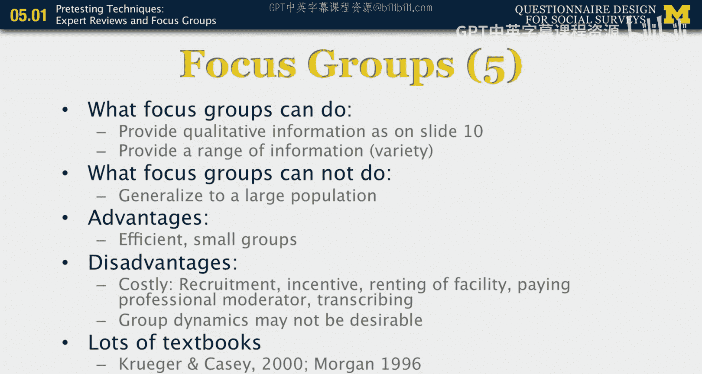

# 密歇根大学《调查数据收集和分析（2-6：方法、社调问卷设计、抽样、缺失数据、分析）｜Survey Data Collection and Analytics》 p68 25_预测试技术：专家评审与焦点小组.zh_en -BV1fw4m1e7Zh_p68-

So this unit is a lot about preting techniques and making sure that your questionnaire is in the best possible format。

We'll start out with a subset of techniques。But let me first tell you why we do pretesting in the first place。

Overall， we tried to do pretest to identify and reduce any possible error that there is now any that's a hard claim remember it took them 400 years to measure the longitude so don't expect that you can build a good measurement instrument。

😊，You know， within two weeks or the six weeks of this course。

 but these techniques that we present here are a good step to get better at identifying specification error。

 seeing if your decomposition has worked， if you really tap into all the concepts that we discussed at the beginning。

 it will help you to identify opera analyzeization error。

Is the question really measuring the construct？Do you see variability across the respondent。

 the interviews， the times。Issues with measurement on that regard。

 and then measurement error in general。 remember the sensitive questions。

 Do you have question characteristics that are leading the respondents to answer a certain way。

 Are there typical interviewer characteristics that interfere with a certain question and issues of that nature。

 So all of that， hopefully you can detect and pretest。

It is rather uncommon that you would be able to administer a survey。

Perfectly measurement error free without any pretesting。know。

One of these techniques you should use ideally a multitude of these techniques。

We'll show a comparison of the techniques at the end of the segment and you will see they're not suitable for all settings。

And you certainly get the best picture if you use several techniques at once。

The first set expert reviews， focus group， cognitive interviews。

 they are all more qualitative techniques and then we have behavioral coding and other statistical methods that I guess behavioral coding can be done on the qualitative interviews as well but all of the others are sort of assuming that you have a larger set of cases for which you test whether they measure or the questions the answers match what we try to measure so let's start with the expert reviews。

First thing you need to ask yourself is who's an expert Okay so who's a questionnaire design expert in that matter。

 that's one said， but also you should probably enroll subject matter experts to review your questionnaire to make sure that it also matches the concept that the subject matter expert told you to begin with。

Questionre administration expert is another good set for trying to enlist it into a review those would be interviewers and then there are some computer based systems。

 expert systems like Qua that have been developed and the link is available here you can test that out what do these expert do they identify potential response problems and make recommendations for improvement。

Now， how do they do that either individually or in a group setting。

 sometimes you have open ended comments， sometimes you can solicit codes for a particular problem that would be in form of an app system。

In the end， you hopefully have a report with comments that help you to improve noted problems and revisions a summary report that shows you the distribution of the problems。

You wanna definitely have a few experts review this and not just rely on the answers from one。

They're really qualitative in nature， though， so that you won't be able to make any statistics of the problems you found。

Now experts are good at identifying problems related to the data analysis question。

 they are good at looking at issues that pop up in a quantitative analysis of comparing expert reviews with you know more statistical techniques like latent class analysis。

 we found considerable agreement， but we'll come back to that point once we look closer at these LCAs。

What's definitely good is they are relatively cheap and fast。

And what's not so good is the quality varies in practice much a lot。

 We don't have a lot of literature on this。 And there is this one thing known。

 large inconsistency and disagreement between experts。So with that， let's move to the next technique。

 which are focus groups， focus groups。Small groups。

 five to  ten0 people that you bring together to investigate a research topic。

You try to find out what people think when they hear this topic。

 when they hear a particular question， so you can mix this with an open discussion and an evaluation of survey question themselves。

 try to figure out how people think about the vocabulary， about the terms used。

 about any key concepts that appear in the questionnaire。And keep in mind。

 interviewer and respondents don't always agree on this context， you know， let's say， for example。

 sources of income， a questionnaire administered in low SES neighborhood。

 the investigator and you know as an extension the interviewer， they might think of job salary。

 interest income dividends， whereas the respondent would think of ad hoc work， illicit activities。

 drug use， prostitution gambling， you have it。So the key task of the focus group is to explore what the respondent thinks and how the respondent thinks about the topic maybe be both。

You have to think about recruiting what the moderator does， identify good moderators。

 decide on whether to tapepe and videotape， but at least you should audio records very difficult to take sufficient notes and then have a report written。

Attle bit more recruitment。 you really would like to target participants that are also part of your target population in the survey。

 You want to decide if you want to have a homogeneous group or a more heterogeneous group。

 if you have the means to have several groups it could be good to vary that a little bit you will get a different group discussion whether you do one or the other。

 but in general it's probably a good idea if you only have one focus group to have it diversified but not too much so each group has a little bit of a mixture in it。

As for the moderator， you want to give the moderator a guide where you make clear what the purpose is that they study here。

 you can talk about the flow。Where you write out questions with open ends。

 and then you can see what the respondents will answer those。

And keep in mind what problem should be solved and what information you search for here's an example for points that should be mentioned in the moderator guide。

 flow ground rules， introduction， open questions， in depth investigation and some statements on how they can close the focus group。

It's also good to give them a guideline for good questions inside the focus group。

Tell them that they should ask short questions to get long answers。

 They should ask questions that are easy to say。 They should address one issue at a time。

 use a conversational tone， ask open ended questions。And ask positive before negative ones。

A focus group is very good at providing qualitative information as we had earlier。

They are good in providing a range of information， lots of a variety。

But what you learn there is hardly generalizable， so it's qualitative， just like the expert reviews。

The advantages， they are efficient and small。The disadvantage is they are more costly because you have to recruit。

 you have to incentivize， you often have to rent a facility in particular if you want to have outsideet observers through one way mirror and things of that nature。

 there are lots of good textbooks on focus groups， a couple of them are listed here。

 more are listed in the syllabus on Cosera。

Our next segment will move into cognitive interviewing another qualitative technique that can be used to test questionnaires。

