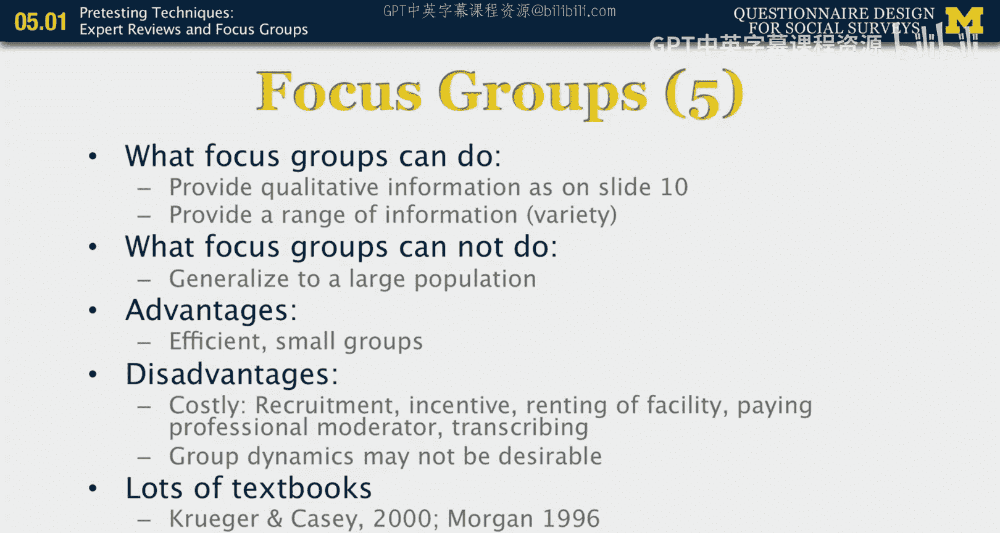

# 调查数据收集与分析：2-6：预测试技术：专家评审与焦点小组

在本节课中，我们将学习两种关键的问卷预测试技术：专家评审与焦点小组。预测试旨在确保问卷格式达到最佳状态，并识别和减少测量过程中可能出现的各类误差。

## 为何进行预测试

我们进行预测试，是为了识别并减少所有可能存在的误差。构建一个完美的测量工具是困难的，但本节介绍的技巧能帮助你更好地识别**规范误差**，检验你的概念分解是否有效，是否涵盖了所有核心概念。它还能帮助你识别**操作化误差**（例如，问题是否真的测量了目标构念？）以及一般的**测量误差**（例如，敏感性问题、问题措辞或访员特征是否导致特定回答模式）。理想情况下，你应该使用多种预测试技术，综合运用能获得最佳效果。

## 专家评审

上一节我们介绍了预测试的目的，本节首先来看第一种定性技术：专家评审。

首先需要明确谁是“专家”。这包括问卷设计专家、相关领域的主题专家（确保问卷匹配核心概念），以及问卷实施专家（如经验丰富的访员）。此外，还有一些基于计算机的专家系统（如Qua）可供使用。

以下是专家评审的实施要点：
*   **专家职责**：识别潜在的回答问题，并提出改进建议。
*   **操作方式**：可以单独或分组进行。反馈形式可以是开放式评论，也可以是针对特定问题的编码系统。
*   **最终产出**：一份包含改进建议的问题报告，以及一份显示问题分布情况的总结报告。务必请多位专家评审，而非依赖一人意见。

专家评审的优势在于能有效识别与数据分析和量化分析相关的问题，并且**成本相对较低、速度较快**。其不足之处在于评审质量在实践中**差异很大**，且专家之间常存在**显著的不一致和分歧**。

## 焦点小组

在了解了专家评审之后，我们来看看另一种定性预测试技术：焦点小组。

焦点小组是由**5到10人**组成的小组，旨在探究某个研究主题。通过组织讨论和评估具体的调查问题，研究者可以了解当人们听到某个主题或问题时是如何思考的，探究他们对问卷中使用的词汇、术语及关键概念的理解。需要记住，访员和受访者对上下文的理解可能不同。

以下是组织焦点小组的关键步骤：
*   **招募参与者**：应尽量从调查的目标总体中招募。需决定组建同质化还是异质化小组。如果资源允许，可以组织多个不同特点的小组。
*   **准备主持人指南**：为主持人提供明确的指南，说明研究目的、讨论流程、具体的开放式问题，并明确需要解决的问题和寻找的信息。
*   **主持人提问技巧**：应提出简短的问题以获得详尽的回答；问题应易于表述；一次只涉及一个议题；使用对话式语气；多提开放式问题；先问正面问题，再问负面问题。

焦点小组能提供丰富的**定性信息**和多样化的观点。然而，其发现**难以推广**到更大总体。其优点是**效率高、规模小**；缺点则是**成本较高**，涉及招募、激励、场地租赁（如需使用单向镜等设备）等费用。

关于焦点小组有大量优秀的教科书可供参考。

## 总结

本节课我们一起学习了两种重要的问卷预测试技术。**专家评审**依靠领域内外的专家经验来发现问题，快速但质量可能不均。**焦点小组**则通过组织目标人群的小组讨论，深入探究受访者的思维过程和理解，能获得丰富见解但成本较高且结果难以推广。下一节，我们将继续学习另一种定性预测试技术：认知访谈。