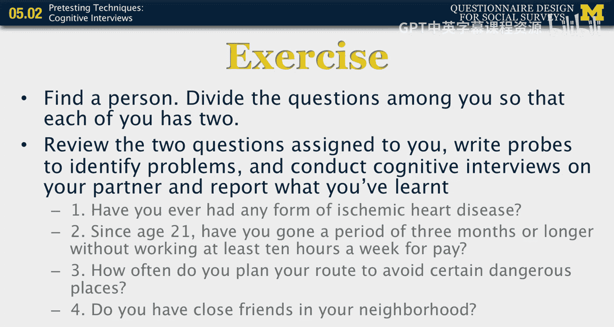

# 密歇根大学《调查数据收集和分析（2-6：方法、社调问卷设计、抽样、缺失数据、分析）｜Survey Data Collection and Analytics》 p69 26_预测试技术：认知访谈.zh_en -BV1fw4m1e7Zh_p69-

So the next segment is about another qualitative technique to test your questionnaire。

 We call them cognitive interviews。These cognitive interviews。You know。

One of the most popular ones by now in this group of qualitative interviews and certainly done by a lot of agencies。

 not entirely without debate， but let's look first at what they are。Cognitive interviewing is。

 and I quote here from BDN Vlas in 2007， the administration of draft survey questions while collecting additional information about the survey responses。

This whole thing is used to evaluate the quality of responses and used to determine whether the question is generating the information that the author intends。

 So in a sense， similar to what we discussed earlier on expert reviews and focus group。

 But here really now with the question at hand。I leave these two quotes for you to read by yourself。

And just want to point out that it is good if you have the survey response process as a guiding framework for your cognitive interviews。

How are they different from focus groups here， it is really on the cognitive process that respondent uses to answer the question。

 so you use techniques to mimic or to see or hear the process of answering a certain。Question。

Usually， cognitive interviews are done with small， convenient sample。

 They should still though represent the population that you try to target interviewers。

Should be specially trained to conduct these kind of interviews。

 it's very different from their regular task and often they are done in laboratory environments and not out in the field so that you can record or observe what's going on。

4 techniques， sort of key here， thinklouds verbal probings。

 paraphrasing and response latencies in between here you see the button vignettes and CA sorting task that is another technique that you can use as part of this cognitive interview and we're not going to talk about them though。

Let's done with thinklo。Based on Wilber report methods， if you look at Erson and Simon's piece。

The idea is that you assume the reports and the thought processes are available to the respondent and the respondent can report these thought processes。

Reporting the process does not change the thought process。

 so these are key assumptions in these Wil Report methods。So in this think aloud technique。

 the respondent is asked both to answer the question and to verbalize his or her thoughts。

Here's an example from Gordon Villas， from his 2005 book。

How many times have you talked to a doctor in the last 12 months。

 and then you see the respondent going on here。There's a lot of interesting information in this slide。

 you know you see that the respondent is not sure what Dr wheelie means is a chiropractor， a doctor。

He doesn't know necessarily when it happened， was it really in the past year。

 so things that you as an expert already might have picked up。

 that they couldn be difficult in answering this question is certainly something that the respondent also referred to as being difficult。

In order to do that， there is thinking out loud rambling。Which we usually you。You know。

 fail to do after age3 requires that you train your participant and that they are very comfortable in thinking out loud。

 It's an unusual behavior。 you know， usually we try to avoid this。

 so you have to resure the participant that there's no right or wrong answer。

 it's okay to admit that he or she uses a heuristic that generates a response。

So here's a training example that has been floating around a lot。

Try to visualize the place you live in and then think about how many windows they are in that place。

 as you conduct these windows， tell me what you are seeing and thinking about。

What you will see most happen often happen， and you can do that as the next party that you go to is that people go from one room to the next in their house and they count the number of windows until they have the final count。

 Really do people have that number already stored in the head。

 So this is a pretty good training task。Here's another thinkout example again from Gordonville spoke。

 how many times have you talked to the doctor in the last 12 months we talked about this before。

 what did we learn？What the respondent included in the answer。

 what counts and what does not count to the respondent and the uncertainty about the past year。

So outcomes in general are informal， qualitative assessments。

You probably need a coding scheme to summarize what the respondent problems were。And if you're lucky。

 you can do a little bit of automatic coding if you have recording and some voice to text software and then a computer based coding scheme。

That I personally have rarely seen， but technology is advancing fast， so this might work。

Pros and cons of the single out method。The pros are its you know if you use standardized probe。

 it's a very simple technique to implement the interview effects on the data are minimized and you hopefully get the thought process。

 but it's very burdensome for the respondent and without additional probing you might not get the information you need training is hard。

At the end， we'll have a little task for you to try that out yourself。

Other cognitive interviewing elements are probes， they are different types of probes。

We differentiate between concurrent and retrospective probing。

 meaning you ask why the interview is going on or you ask afterwards what they thought about the particular question or about all of the questions together here。

 probing examples。 You can come back to them again。 They are part of Gordon Willow's book。

 Just picked out here as nice examples for you in case you want to design your own probes。

There's also the differentiation between proactive and reactive probes。

 proactive probes are probes in which the researcher actively searches for a problem。

 they know maybe from other interviews that this could be a problem to the respondent that they go in and see to find if that was a problem indeed for this person as well the reactive probes are just reactions to the respondent you see a respondent struggling with the problem and then a probe is issued。

They are neutral probes that can also be differentiated into proactive probes and reactive probes here a couple of examples proactive would be remember to tell me what you are thinking。

 that's proactive you are anticipating that the respondent might likely not remember to tell you and falls into silent thinking。

 for example。What makes you think that would be a proactive probe， whereas reactive probes。

 you look puzzled， what are you thinking， or I appreciate the effort you're making to recall this information would be a reaction to a think a lot task。

Cognitive interviews are very good at uncovering problems with comprehension。

They are good at discovering difficulty recalling and estimation。

 but again they're qualitative in nature and so they are not so good to really generalize to large population。

 but they also have an element of interviewer involvement that makes the comparison across these very difficult。

And we do see a lot of variation from cognitive interview to the next cognitive interview。

 and so it is good not to jump to conclusions too quickly and you know。

 make a healthy set a study by Fred Conrad and some of his students showed that。

You know you rather err on the larger side of respondents for your cognitive interviews that。

 of course， then can be costly and requires personnel that you might not have。

So the practice of these cognitive interviews varies by organizations。

 as I mentioned the results vary by cognitive interviewers， there are lots of good textbooks。

 a good starting point is Gordonville's book， that's why we quoted from that so much。

 but there are other very interesting comparison of cognitive interviewing techniques by Preer others and Rothgap and others。

😊，Now， before we close the session， I encourage you to find a person in your neighborhood and try out cognitive interviews with these four sets of questions that you see here。

 we'll be happy to see in the discussion board what you learned about them and what problems you saw with these questions。

In the next segment， we'll talk about behavioral coding。

