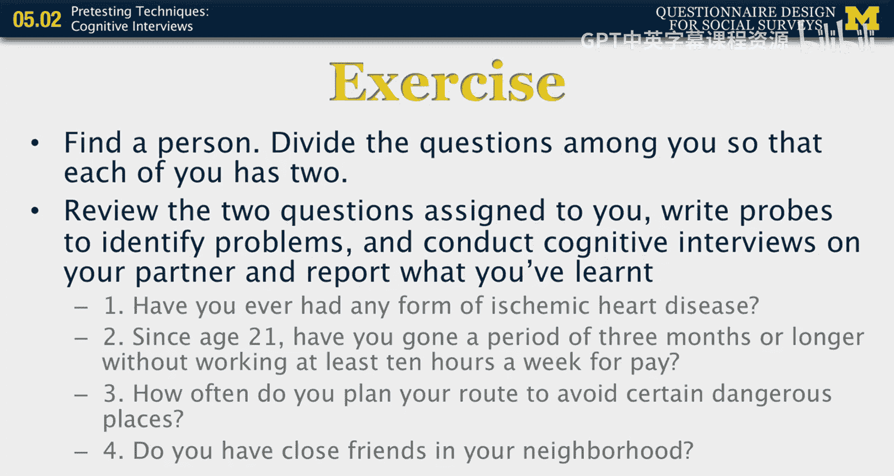

# 调查数据收集和分析：2-6：预测试技术：认知访谈

## 概述
在本节课中，我们将要学习一种重要的问卷预测试定性技术——认知访谈。我们将了解它的定义、核心方法、实施步骤以及优缺点，帮助你理解如何利用这种技术来评估和改进调查问卷的质量。

---

## 什么是认知访谈？
上一节我们介绍了专家评审和焦点小组等预测试方法，本节中我们来看看另一种定性技术：认知访谈。这是一种目前非常流行且被许多机构广泛采用的问卷测试方法。

认知访谈，引用BDN Vlas在2007年的定义，是指在受访者回答问卷草稿问题的同时，收集关于其回答过程的额外信息。这种方法用于评估回答的质量，并判断问题是否能够引出问卷设计者所期望的信息。

从本质上讲，它与之前讨论的专家评审和焦点小组有相似的目标，但更聚焦于具体问题本身。以下两段引文可供你自行阅读。需要指出的是，在进行认知访谈时，以调查回答过程作为指导框架是非常有益的。

## 认知访谈与焦点小组的区别
认知访谈与焦点小组的关键区别在于，它专注于受访者回答问题时所使用的**认知过程**。访谈者会使用特定技术来模拟、观察或聆听受访者回答某个问题的思考过程。

通常，认知访谈采用小型的便利样本，但这些样本仍应尽量代表你的目标人群。访谈者需要经过专门培训才能进行此类访谈，因为这与他们常规的访谈任务非常不同。访谈通常在实验室环境中进行，以便记录或观察整个过程。

## 核心访谈技术
以下是认知访谈中常用的四种核心技术：

*   **出声思考法**
*   **口头探查法**
*   **复述法**
*   **反应潜伏期测量法**

此外，你还可以看到“按钮情境法”和“CA分类任务”等技术，它们也可作为认知访谈的一部分，不过我们在此不作详细讨论。

### 出声思考法
让我们深入了解出声思考法。该方法基于“出声报告法”，如果你参考Ericsson和Simon的研究，其核心假设是：受访者的思维过程是可获取的，并且他们能够报告这些过程；同时，报告过程本身不会改变其思维过程。这些是出声报告法的关键假设。

在出声思考技术中，受访者被要求既回答问题，又同时口头表达出他/她的思考内容。

以下是Gordon Willis在其2005年著作中给出的一个例子：
> **问题**：在过去12个月里，你和医生交谈过多少次？
> **受访者思考过程**：“嗯……‘医生’指的是什么？脊椎按摩师算医生吗？我不太确定具体是什么时候发生的，真的是在过去一年内吗？这有点难回答。”

这张幻灯片包含了许多有趣的信息。你可以看到受访者对“医生”的定义不确定，也不清楚事件是否发生在过去一年内。这些可能被你作为专家早已预见到的答题难点，受访者也确实提到了。

为了有效实施出声思考法，需要应对“出声思考时的漫谈”现象。通常，人们在3岁以后就不再习惯这样做了。因此，你需要训练参与者，并让他们在出声思考时感到非常自在。这是一种不寻常的行为，通常我们会避免这样做。所以，你必须向参与者保证没有对错答案，并且承认自己使用了某种启发式方法来生成答案是完全可以接受的。

这里有一个流传很广的训练示例：
> **训练任务**：试着想象你居住的地方，然后思考那里有多少扇窗户。在你数窗户的时候，告诉我你看到了什么以及在想什么。

你经常会看到（也可以在下次聚会时试试），人们会在脑海中从一个房间走到另一个房间，数着窗户的数量，直到得到总数。人们真的会把这个数字记在脑子里吗？因此，这是一个相当不错的训练任务。

再来看一个Gordon Willis书中的出声思考例子：
> **问题**：在过去12个月里，你和医生交谈过多少次？（我们之前讨论过）
> **我们学到了什么？** 我们了解到受访者在答案中包含了什么、对受访者而言什么算数什么不算数，以及关于“过去一年”的时间不确定性。

总的来说，出声思考法的产出是非正式的定性评估。你可能需要一个编码方案来总结受访者遇到的问题。如果幸运的话，如果你有录音和一些语音转文字软件，再加上基于计算机的编码方案，你可以进行一点自动编码。我个人很少见到这种情况，但技术发展很快，所以这可能会实现。

### 出声思考法的优缺点
以下是出声思考法的优点和缺点：

**优点：**
*   如果使用标准化的探查问题，这是一种非常易于实施的技术。
*   访谈者对数据的影响被最小化。
*   你很有希望获取到真实的思维过程。

**缺点：**
*   对受访者负担很重。
*   如果没有额外的探查，你可能无法获得需要的信息。
*   培训受访者进行出声思考比较困难。

在本节最后，我们会有一个小任务让你亲自尝试。

## 其他认知访谈要素：探查法
认知访谈的其他要素是探查法，它有不同类型。

我们区分**同步探查**和**回顾性探查**。同步探查指在访谈进行中间询问原因；回顾性探查指在事后询问他们对某个特定问题或所有问题的想法。

这里有一些探查法的例子，你可以再次回顾。它们都出自Gordon Willis的著作，在此选出作为很好的示例，供你设计自己的探查问题时参考。

探查法还可以区分为**主动性探查**和**反应性探查**。
*   主动性探查是研究者主动寻找问题。他们可能从其他访谈中知道这可能是受访者的问题，于是主动去验证对当前受访者是否也是如此。
*   反应性探查则只是对受访者的反应作出回应。你看到受访者在某个问题上遇到困难，然后提出探查问题。

中性探查也可以区分为主动性探查和反应性探查。这里有几个例子：
*   主动性探查：“记得告诉我你在想什么。”——这是主动的，你预见到受访者可能忘记告诉你而陷入沉默思考。
*   反应性探查：“你看起来有些困惑，你在想什么？”或者“我很感谢你努力回忆这些信息。”——这是对出声思考任务的一种反应。

## 认知访谈的总结与评价
认知访谈非常擅长揭示**理解**方面的问题，也善于发现**回忆和估算**的困难。但同样，由于其定性本质，它们不太适合推广到大规模人群。此外，访谈者的介入元素使得不同访谈之间的比较变得非常困难。

我们确实看到不同认知访谈之间存在很大差异。因此，最好不要过早下结论。Fred Conrad及其学生的一项研究表明，在进行认知访谈时，宁愿受访者数量多一些（当然，这可能会增加成本，并且需要你可能不具备的人力资源）。

不同机构实践认知访谈的方式各不相同。正如我提到的，结果也因访谈者而异。有很多优秀的教科书，Gordon Willis的书是一个很好的起点（这也是我们多次引用它的原因）。此外，Presser等人以及Rothgeb等人的著作中，也有对其他认知访谈技术非常有趣的比较。

## 实践任务
在结束本节之前，我鼓励你在周围找一个人，用下面这四组问题尝试进行认知访谈。我们很乐意在讨论区看到你从中学到了什么，以及发现了这些问题存在哪些不足。

（此处应有一张包含四组示例问题的图片，内容涉及健康行为、财务状况、时间使用和产品满意度等方面的问题，用于实践认知访谈。）

---

## 总结
本节课中，我们一起学习了认知访谈这一重要的问卷预测试技术。我们了解了它的定义、与焦点小组的区别、四种核心方法（特别是出声思考法），以及它的优缺点和应用注意事项。掌握这项技术，将帮助你更深入地理解受访者的答题过程，从而设计出更清晰、更有效的调查问题。

在下一节中，我们将讨论行为编码。