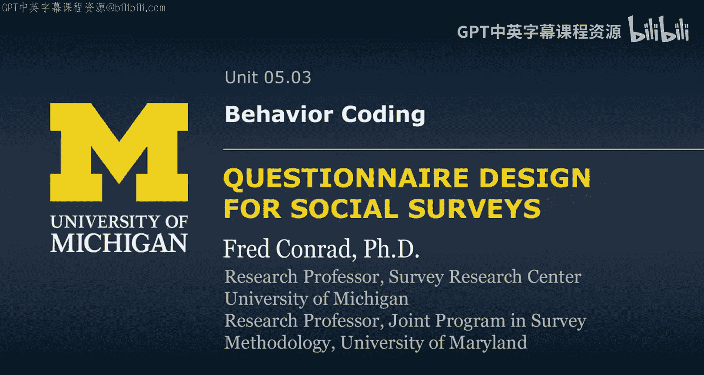
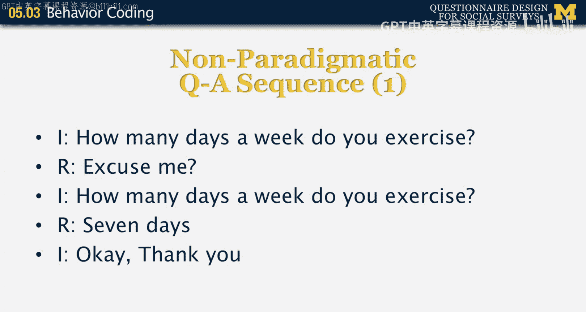
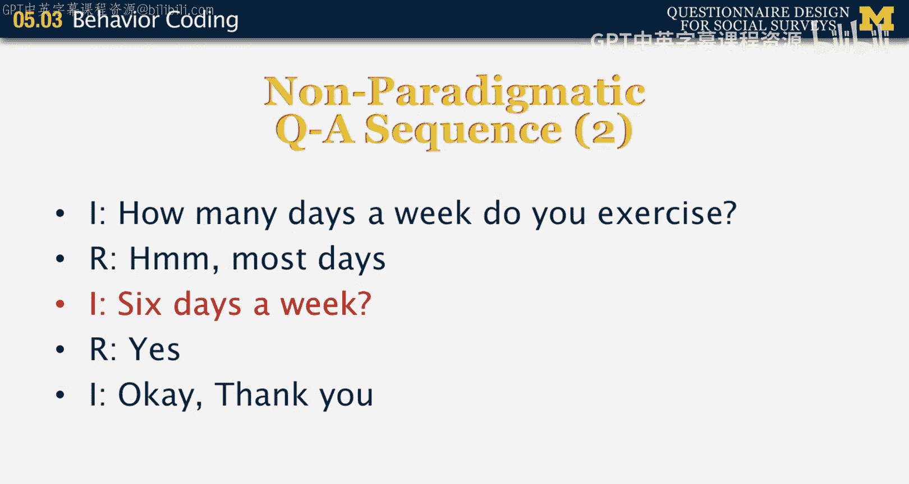
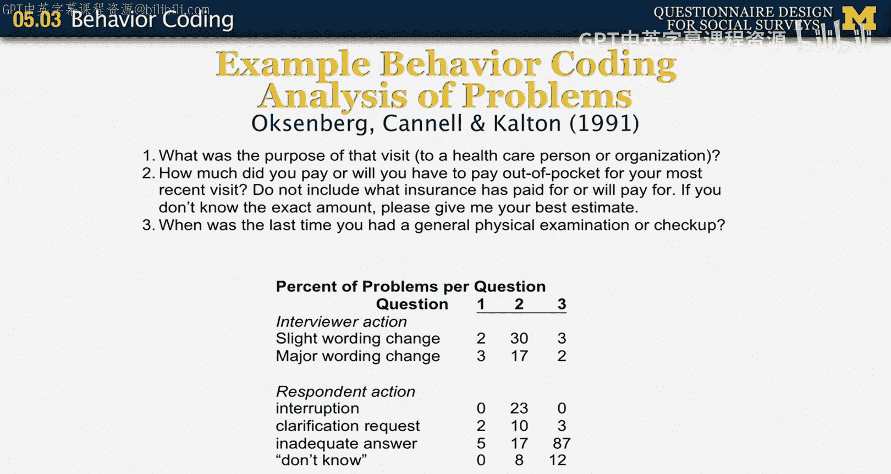
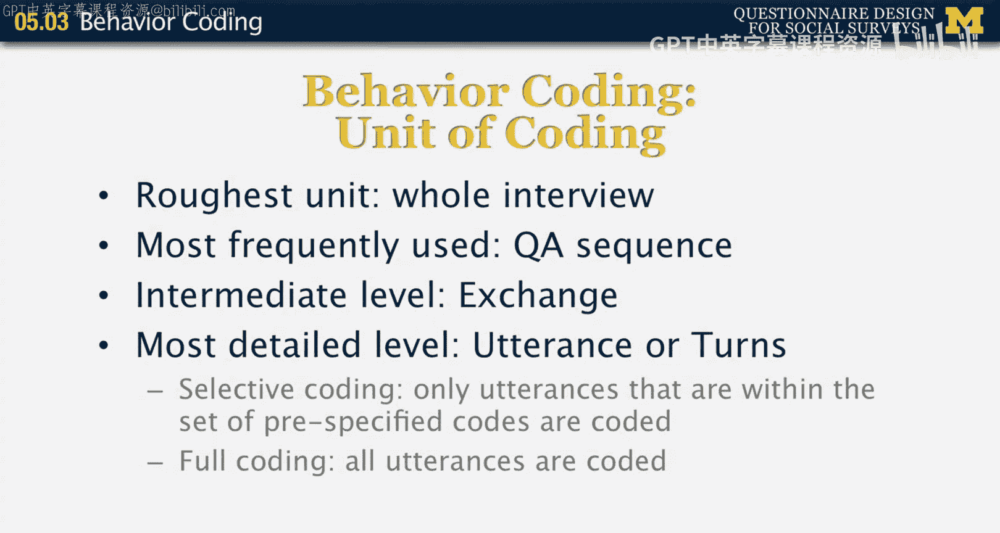
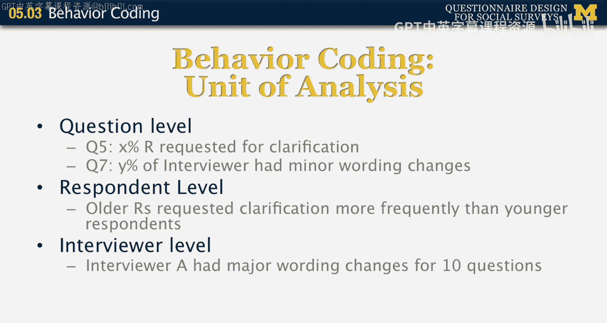
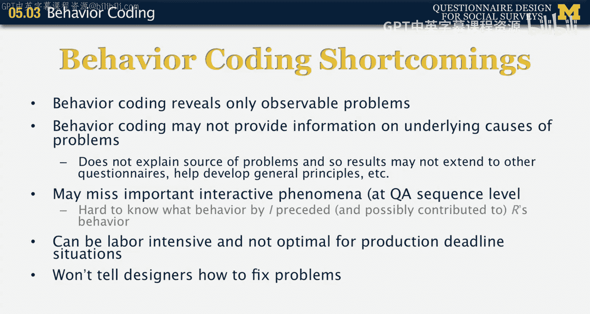
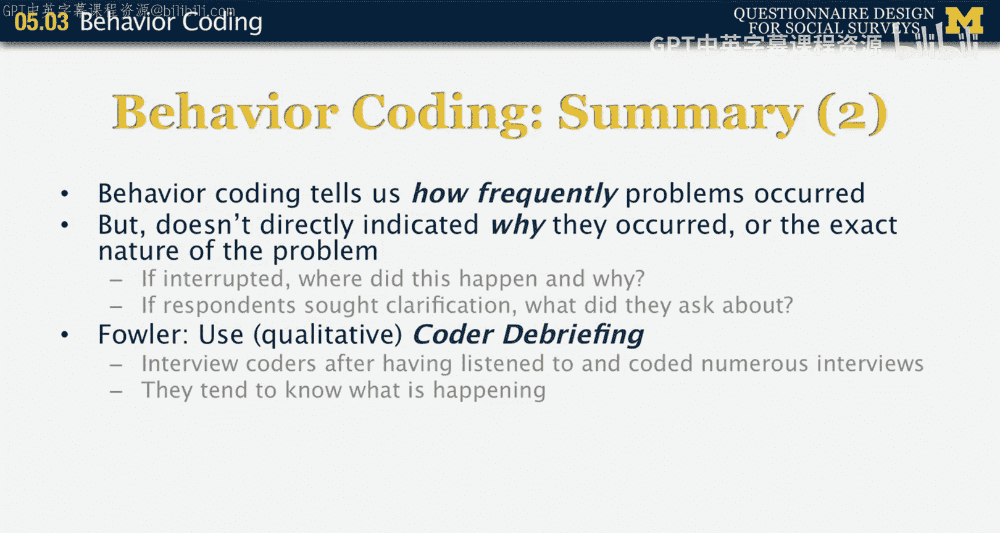

# 密歇根大学《调查数据收集和分析（2-6：方法、社调问卷设计、抽样、缺失数据、分析）｜Survey Data Collection and Analytics》 p70 27_行为编码.zh_en -BV1fw4m1e7Zh_p70-

。Continuing with our discussion of qualitative techniques for testing survey questions。

 our focus in the current segment is on behavior coding。

Behavior coding is a set of methodical observations of interviewer and respondent behaviors from recorded interviews。

 usually audio recorded interviews。They provide objective measures of problems with questions。

They're systematic， replicable and reliable。What happens in behavior coding is that a coder observes usually listening to interviewer respondent interactions。

 either live or recorded interviews in person or on the telephone。

The coder assigns a code that is classifies an observed problem。

The coding takes place over multiple interviews by multiple interviewers。

And can help us understand the question answer process in particular。

 can help us identify deviations from the ideal question answer sequence。

 that's how we define a problem with behavior coding。In the end。

 behavior coding produces a quantitative summary of codes that identify problematic questions。

Behavior coding can be used in different ways at different points in the survey process。

It can be used prior to actual data collection to pretest questions。

 which is how it's predominantly used。But it can also be used at this point to pretest the data collection procedure。

It can be used during data collection to monitor interviews。

 and it can be used after the data collection process to evaluate the quality of the data that have been collected and to explore the causes and effects of particular behaviors。

This is an example of what Maynard and Schchaffer have called a paradigmatic question answer sequence or an ideal question answer sequence in which the interviewer reads the question exactly as worded。

 the respondent provides an adequate answer or an acceptable answer。

And the interviewer acknowledges that answer before moving on to the next question。

 its departures from paradigmatic sequences like this that behavior coding is designed to detect。

This is one type of departure from a paradigmatic sequence that actually behavior coding would probably not flag when used in its most typical form at the kind of overall question answer sequence level。

How many days a week do you exercise， Excuse me， How many days a week do you exercise7 days， Okay。

 thank you。 There really isn't a problem here aside from the respondent's failure to hear the question。

It could be that it's coded， but as we'll discuss shortly。

 the units of analysis depend on whether something like this is coded or not。

The following sequence， though， is a more clear departure from the paradigmatic sequence that indicates a problem。

How many days a week do you exercise， most days。Six days a week。Yes， okay。 thank you。

Here， the interviewer has clearly engaged in what's known as a directive intervention or a directive probe and offered the respondent an answer that the respondent didn't provide this would almost surely be flagged under most behavior coding schemes。

Speaking of behavior coding schemes， here is a well known set of codes that are reported by groves at all。

 but really come from work by Charlie Cannell and colleagues at the University of Michigan。

There are a set of interviewer codes and a set of respondent codes。The interviewer codes include。

 the interviewer reads the question exactly as worded。Reads questions with minor changes。

Reads questions so that the meaning is altered。Responddent codes include。

Respondent interrupts the question as the interviewer is reading it。

The respondent asks for clarification。The respondent gives an adequate answer。

The respondent gives an answer that's qualified。The respondent gives an inadequate answer。

Respondent answers don't know， respondent refuses to answer。Using a coding system like this。

 Oxenberg Cannel and Calton demonstrated how effective this approach can be。

 here are three questions， and then three sets of codes and the frequency with which they were used。

What was the purpose of that visit to a healthcare person or organization？

How much would you pay or will you have to pay out of pocket for your most recent visit。

 Do not include what insurance is paid for or will pay for If you don't know the exact amount。

 please give me your best estimate。When was the last time you had a general physical examination。

If you look at the numbers in the table， you can see that two of the codes kind of leap out for interviewer behaviors。

 slight wording change， major wording change for question two。And similarly。

 the respondent behavior interruption kind of leaps out for question two， so what might be going on？

Well， question two has a number of components to it。

 and interviewers might stumble over their words and rephrase the question or parts of the question with either little impact on meaning or substantial impact on meaning。

And because it's so long it has these three parts， each of which is a grammatical unit。

 respondents might begin to answer before the question is completely spoken by the interviewer。

 and this can be a problem because it can lead to the interviewer not presenting the entire question。

If you look at column 3， there are two respondent behaviors。

 one in particular that leaps out inadequate answers。

When was the last time you had a general physical examination or checkup？

Well notice the timeframe isn't provided or the desired format for the answer isn't provided in this question。

 so if the question requires a month and a day and the respondent only provides a month。

 this will be flagged with a code。

It's pretty clear how you would fix either of these sets of problems。

 but the behavior coding makes it apparent in a way that。

Clearly wasn't evident to the designers prior to testing the question。

Recall that behavior coding is used for a number of different purposes。

 when it's used for pretesting， certain codes are particularly diagnostic。

Responddent codes that are particularly indicative of problems include requests for clarification or requests to repeat the question。

And qualified answers or inadequate answers or don't know or refusal answers。

Problems with questions may be visible in very subtle ways。

Interviewer codes that are particularly indicative of problems include changes in question wording。

 whether they're minor or major changes， when the code indicates the changes are frequent。

 it's important to identify the exact words that have been changed because these are the words that will presumably need to be replaced with better wording。

The benefits of behavior coding are that they're reliable。

 it's easy to obtain high levels of agreement between multiple coders。And they're quantitative。

So they allow a very quick translation from something that's very qualitative to something that's quantitative that can be counted。

Behavior coding can be conducted at a number of different levels of analysis or with different units of analysis。

The coursesist unit is the whole interview， and this is rarely used because it's just not that helpful in pointing designers to questions that need。

Changes。The most frequently used approach is that the question answer sequence and the examples we've been looking at are all the question answer sequence where the interviewer's question is coded and respondents answers are coded in a fairly global way。

This can get more detailed looking at pairs of utterances or the most detailed approaches at the utterance level or the turn level。

So an example of what behavior coding can tell us at the question level is that， for example。

 in question 5， X percent of respondents requested clarification。In question7。

 why percent of interviewers had minor wording changes？At the respondent level。

 behavior coding can tell us that older respondents requested clarification more frequently than younger respondents。

And at the interviewer level， behavior codingting can tell us that interviewer A。

Produced major wording changes for 10 of the questions。

Turn level analyses are。Certainly more detailed than question answer sequence level analyses。

But they provide additional information that's just not available at the more global level in question answer sequence coding。

The kind of thing that a turn level analysis can tell is sometimes called sequential analyses。

Is whether， for example， the interviewer reread the question when the respondent's answer was not one of the response categories。

 so there's a sequential relationship between multiple turns。

Or whether the respondent answered the question after receiving a neutral or a non directive probe。

 like， let me reread the question。This can help explain how different interviewing techniques are working or not working。

Here's an example， turn level transcript from Schin Conrad's study of conversational interviewing that we talked about earlier。

Last week did Pat have more than one job， including part time evening or weekend work say that again because。

She has many clients with she， but it's the same kind of job。 Okay， that would， in other words。

She is， well， what kind of work does she do， but she babysits and she has different clients。Okay。

 that would be considered all as one job。This is a directive intervention in standardized interviewing。

Because it provides substantive information to respondents beyond the information and the question。

It's acceptable in conversational interviewing because it helps explain the intentions and the meaning behind the question。

What this type of turn level analysis is able to tell us is that interviewers engage in this type of behavior for 85% of the conversational interviews。

Or you might ask when did conversational interviewers intervene and this type of analysis can tell you that for 37% of the complicated situations they intervene that is provided clarification after respondents provided a report。

 which was a description of their situation rather than an answer。

9ine% of the complicated situations when respondents requested repetition of the question。

6% of complicated situations when respondents indicated uncertainty about an answer。

Although behavior coding clearly provides helpful insights。There are shortcomings to the technique。

Behavior coding reveals only observable problems。Behavior coding may not provide information on the underlying causes of problems。

Does't explain the source of problems， and so the results may not extend to other questionnaires。

Or help to develop general principles and so on。 It may miss important interactive phenomena when the coding is at the question answer sequence level。

It's hard to know， for example， what behavior by the interviewer preceded and possibly contributed to the respondent's behavior if this isn't explicitly coded。

 behavior coding can be labor intensive and not optimal for production deadline situations。

And it won't tell designers how to fix problems。To summarize。

Behavior coding usually makes use of sets of codes that can be divided into interviewer oriented codes and respondent oriented codes。

Typical of interviewer oriented codes are reading error and other probing behaviors and errors involving other probing behaviors。

Typical respondent oriented codes include request for question repetition， request for clarification。

Respondents providing uncoable or unacceptable responses。

Respondents interrupting the interviewer as the interviewer is providing the question and indications that the respondent is uncertain。

Behavior coding tells us how frequently problems occur。

But doesn't tell us directly why they occurred or the exact nature of the problem。

If the respondent interrupts the interviewer， where did this happen and why？

If respondents seek clarification， what did they ask about？To address some of these limitations。

Fowler has suggested using qualitative debriefing of the coders。To address some of these limitations。

After having listened to and coded numerous maybe hundreds of interviews。

Coders are very close to the data and they tend to know what's happening。As a result。

 they can provide insight into the origins of many of the problems that are captured in behavior codes。

This concludes our discussion of qualitative pre testinging techniques。

 In the next segment we turn to an introduction to quantitative techniques for testing questions。

