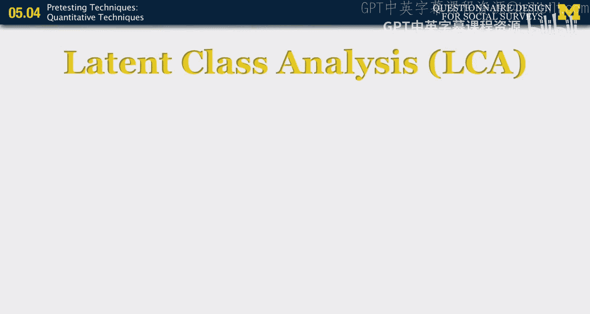
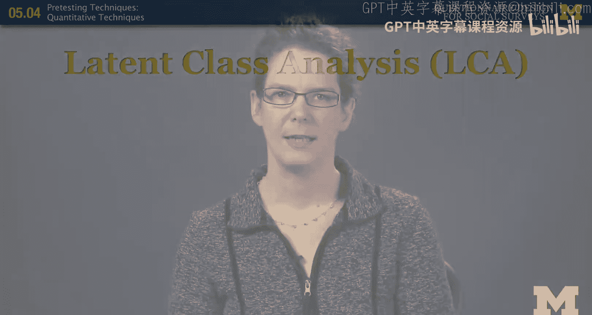
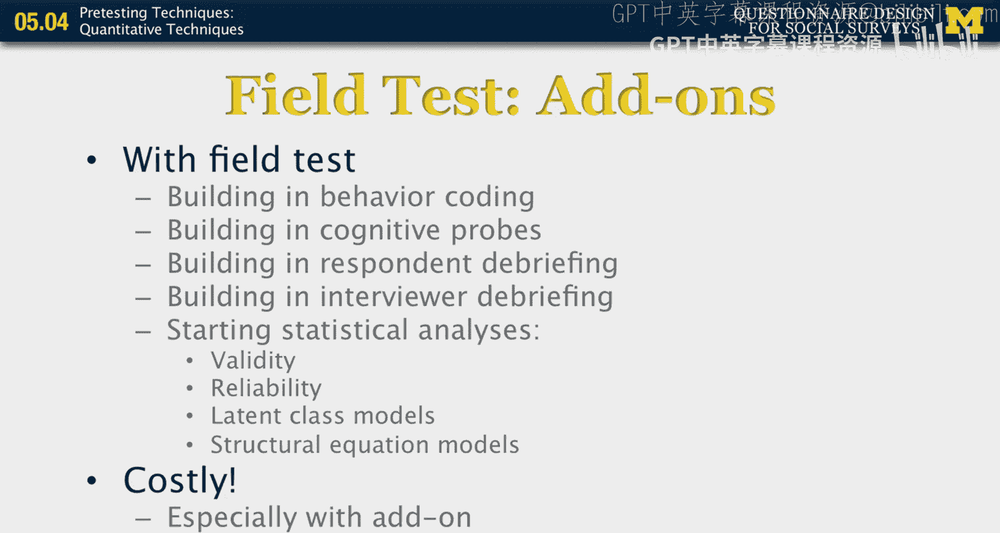

# 密歇根大学《调查数据收集和分析（2-6：方法、社调问卷设计、抽样、缺失数据、分析）｜Survey Data Collection and Analytics》 p71 28_预测试技术：定量方法.zh_en -BV1fw4m1e7Zh_p71-

So far， we talked about a variety of different more less qualitative techniques to test questions。

In this segment we'll shift the focus a little bit on more quantitative techniques and this shouldn't turn into a statistics class even so we will talk about statistical models for question testing。

 latent class analysis。A hint at structure equation modeling。

So you know we're not going to talk about these techniques in general just to give you a sense。

 this is out there and if you were to dig divva where to look in what kind of arena you'll find the research on the practical tools there。

I'll also talk a little bit about field tests and then in the final segment we'll talk about other question testing methods that have come up more recently。

So latent cloud analysis is nothing specific for questionnaire assignment that's used in all kinds of fields。

 but it is a technique that sort of allows for know mitigating the effect of measurement error or estimating measurement errors with particular items brief background you basically have a set of questions that you observe that you measure multiple indicators and observables in the variable modeling notation are displayed in boxes here。

😊。

And they all are the function of e latent variable。

 so let's say someone is pregnant or not pregnant right that would be the well in the early weeks unobservable construct that you try to measure and then you do tests of various sorts you know you can ask the person she may or may not know you can take your own sample that these days it's usually pretty good but maybe in earlier days they weren't quite as good so maybe you want to take a few of those well let's say we have flawed urine tests in three of them any error associated with that you know。

Should be independent of each other， so each sample。

 if they weren't bought in the same place and produced in the same batch should have a different likelihood to show up erroneous or not。

 but given that the person is pregnant or not pregnant。

 in principle should all lead to the same result， so that's the spirit here。

 meaning that you have you know in latent class analysis。

 a setting where you have indicators that don't necessarily have to be ever free。

Any error associated with the error is assumed to be independent condition on the latent variable that you actually try to measure。

And so what you estimate are unconditional and conditional probabilities that's sort of happening in that process for question testing。

 two conditional probabilities are important， one is false positive rates and the other one falls negative rates。

Indicators with high air rates， they are usually assumed to be bad questions。

So if you think of this in a two by two table， you can have an indicator。

 U1 and U2 and your latent class outcome C1 and C2 every indicator can be correct。

 so your indicator you won the question， for example， drug use in your survey says yes。

 and in your latent class， the actual construct， this is a drug user， it is also yes。

 this would be a correct measurement and likewise this one no in both would be a correct measurement。

What you don't want is a lot of values in these off diagonals where your measurement device has a false negative。

 so it would be no in the measurement， but yes in the true underlying construct and likewise here a false negative。

 the unconditional probabilities is what we refer to as the actual probabilities to be in one or the other latent class。

So inside the cells， the conditional probabilities down here， the unconditional probabilities。

In a study that we did at the University of Maryland alumnini， Tingyang Raja Tranjan。

 I had fielded three different questions that all got rates whether students ever had a failing rate in their time at the University of Maryland and we had administrative records to compare these answers to we didn't know who these respondent were this is all stripped of identifierifies。

 but we were able to link the true score record to the respondent answers so we can examine the error rate relative to the actual values and so what you see here the error rates for these three different questions relative to the truth in this particular study。

 so know Q12 as a very low error rate and Q18 very low error rate and Q18 had a very high error rate so these are all false negative rates that you see going up here。

 and these are all false positive rates。You see a dashed in a solid line。

 while the solid line is the comparison to the actual records， just comparing the two。

 the dash line is the result of the LCCA， the latent class analysis and you see that technique gave us the same pattern although it did not quite give us the same point estimate for the false negative rates。

 you can read more about this in the paper that provide to you。There are some limitations here。

 you know you need have a separate data collection the sample size can't be too small for late in class with two classes。

 you need at least three items in order for the model to be identified。

 if you don't have that that can assumptions be made to achieve identifiability a lot of work that Paul Beama and colleagues have done is going through these assumption he's using earlier work from Hui and Walter to have grouping variables that help with the identifiability however。

 you can get biased estimates of these error rates when the assumptions are not met and that also is discussed in the paper that I just mentioned and you have in your coursep。

You can identify bad survey items this way if the model assumptions are held or you have enough indicators。

 one problem though is that it doesn't help you to know why a particular problem exists in the question。

 so it doesn't suggest a fix unless the fix is to take out that question that you didn't like。

Another sort of latent variable modeling slash structure equation modeling technique that's out there is at the core of the SQP software。

This is a piece of software written by Daniel Obbesky and William Saes and developed in that group from William Saes。

 the link is provided online for this unit's coursep。With this SQP software does。

 it has a collection of results from a series of multitrade multi method experiments that were conducted on multiple items across multiple countries in order to assess generally validity and reliability of survey questions。

 so the idea being if you try to measure the same thing， the same underlying trade。

With different methods， then all these method all these results should correlate highly if they are related to this trade and they should be you know correlated these answer to this question should be correlated much less so with different trade。

 but there is of course some method effect going on the kind of scale use or the way you ask the question that might contribute to measurement error and so you would see correlations across items of different traits measured with the same methods so you can separate out methods effect and。

Others， you know in generally trying to estimate validity and reliability so huge amount of work way too we could have a whole lecture just on how this was done。

 but a good tool to look up and we have the references in the back when you use this piece of software you code your question characteristic in it。

And it uses underlying regression models to sort of fit overall reliability and village scores for you。

When you use， as I said， when you used the program， you enter your survey questions。

 you code your question and then you get these predicted validity in reliability scores。

So when you use SQP program， as I said， you enter your survey question。

 you quote your questions and then you get the in reliability scores I strongly encourage you to try that out。

Look at the website for the link that gives you more information here。

Now after these two more quantitative techniques， I'll move to the last one that we had here field tests so field tests。

Sometimes referred to as conventional preest， sometimes referred to as dress rehearsal or pilot study。

 any of those have the notion that they implement the questionnaire for a smaller sample could be you know 15 to 35 respondents similar to you actually respondent or if it's an real dress rehearsal or maybe even thousands if you're rehearsing the next US census。

The goal is to adopt a similar data collection protocol and that you will actually use in fielding the survey with the goal to find out practical problems is then issue with interviewers is then issue with the respondent that the links work you want a time on the question level on the section level for the full instrument to see if you are in the scope if you match your production targets and definitely you want to look at the actual distribution on your key variable about tabulation missing data this field test data is also a great resource to actually use the results。

And start coding up your analysis in accordances with the analysis plan that we talked about in unit one。

 because now you can double check， triple check for that matter。

 do I really have all the variables in my dataset？Are there any issues should I have measured them on a different scale。

 do I need to make any changes in order to implement this in the right way？

This being your analysis at the end。With the field test you can also do in addition behavioral coding what we talked before。

 you can build in cognitive probes we learned about those， you can do some respondent debriefing。

 ask the respondent afterwards know any experience you want to share with us with respect to this questionnaire you can debrief the interviewer and then you can start your statistical analysis。

 validity reliability， the latent class models， the structure equation models although that is possible if your field test is large enough and you actually have enough cases to do any of the more quantitative techniques。

 the more of these cases you have the more costly of course this will be。

 especially if you add these add on in your goal here。

So in the next segment， we will talk about a few other techniques。 in particular。

 if you have larger pilot tests， those can be nicely implemented。

