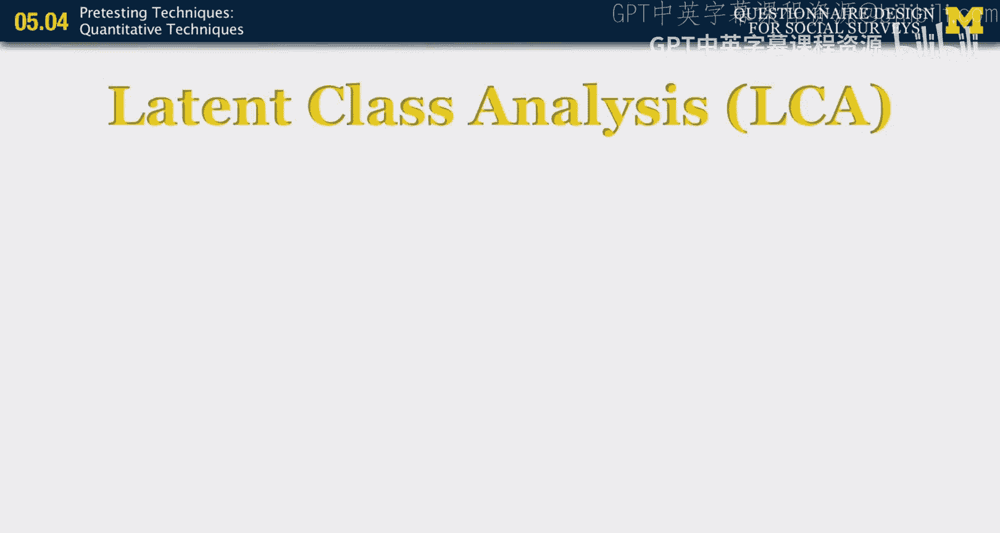
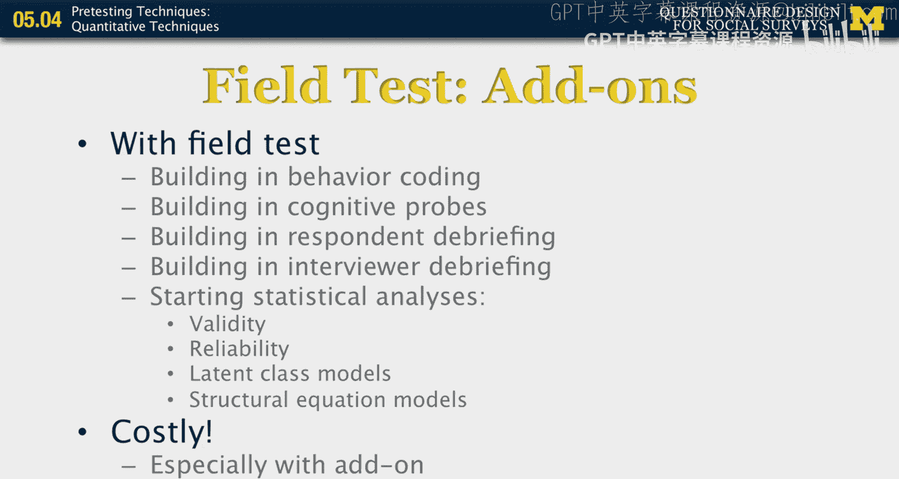

# 调查数据收集和分析：2-6：预测试技术：定量方法 📊

在本节课中，我们将学习用于问卷预测试的定量方法。我们将探讨两种基于统计模型的技术：潜在类别分析和结构方程建模，并介绍实地测试（或称试点研究）的作用与实施方法。

到目前为止，我们已经讨论了多种偏向于定性的问题测试技术。

在本节中，我们将把重点稍微转移到更定量的技术上。这不会变成一门统计课，尽管如此，我们仍会讨论用于问题测试的统计模型，包括潜在类别分析，并简要提及结构方程建模。我们不会深入探讨这些技术本身，只是为了让您了解这些方法的存在。如果您想深入研究，可以知道在哪些领域可以找到相关的研究和实用工具。

我还会简要谈谈实地测试。在最后一部分，我们将讨论一些近年来出现的其他问题测试方法。

## 潜在类别分析

潜在类别分析并非问卷评估所特有，它被广泛应用于各个领域。这项技术有助于减轻测量误差的影响，或估计特定题项的测量误差。

以下是简要背景：您有一组观察到的题项（即多个指标）。在变量建模符号中，可观测变量用方框表示。

它们都是某个潜在变量的函数。例如，某人是否怀孕（在怀孕早期这是一个无法直接观测的构念）。您可以通过各种测试来测量它，比如询问本人（她可能知道也可能不知道），或者进行化验。假设我们有三个有缺陷的尿液测试，每个测试相关的误差应该是相互独立的。只要样本不是在同一地点购买或同一批次生产，每个样本出现错误的可能性就不同。但假设这个人怀孕与否，原则上所有测试应该得出相同的结果。这就是潜在类别分析的核心思想。

在潜在类别分析中，您有一个设定，其中的指标不一定完全没有误差。任何与误差相关的部分，在给定您试图测量的潜在变量的条件下，都被假定为是独立的。

您估计的是该过程中发生的无条件概率和条件概率。对于问题测试，有两个条件概率很重要：一是假阳性率，二是假阴性率。具有高错误率的指标通常被认为是糟糕的问题。

如果用一个2x2的表格来思考，您可以有一个指标U1和U2，以及您的潜在类别结果C1和C2。每个指标都可能是正确的。例如，在您的调查中，关于吸毒的问题回答“是”，而在潜在类别中，真实的构念（吸毒者）也是“是”，这就是一次正确的测量。同样，两者都是“否”也是正确的测量。

您不希望看到的是这些非对角线单元格中有很多值，即您的测量工具出现了假阴性（测量为“否”，但真实潜在构念为“是”）或假阳性（测量为“是”，但真实潜在构念为“否”）。无条件概率指的是处于某一潜在类别的实际概率。

在马里兰大学进行的一项研究中，我们提出了三个不同的问题，都是询问学生在校期间是否曾有过不及格成绩。我们有管理记录来比较这些答案。我们不知道受访者是谁，所有身份信息都已剥离，但我们能够将真实的成绩记录与受访者的答案联系起来，从而检查相对于实际值的错误率。

您在这里看到的是这三个不同问题相对于真实情况的错误率。在这个特定研究中，Q12的错误率非常低，Q18的错误率也非常低，而Q18的错误率非常高。您在这里看到的上升趋势都是假阴性率，而虚线则是假阳性率。实线是与实际记录的比较结果，虚线是潜在类别分析的结果。您可以看到，该技术给出了相同的模式，尽管对于假阴性率的点估计并不完全相同。您可以在提供的论文中阅读更多相关内容。

这种方法存在一些局限性：您需要进行单独的数据收集；样本量不能太小；对于具有两个类别的潜在类别模型，您至少需要三个题项才能使模型可识别。如果没有，可以通过做出一些假设来实现可识别性。Paul Biemer及其同事的许多工作就是研究这些假设，他利用Hui和Walter的早期工作，使用分组变量来帮助实现可识别性。然而，当假设不满足时，您可能会得到这些错误率的偏差估计，这在我刚才提到的论文和您的课程材料中也有讨论。

如果模型假设成立或者您有足够的指标，您可以通过这种方式识别出糟糕的调查题项。但有一个问题是，它无法帮助您了解某个问题存在的原因，因此除非解决方案是直接删除您不喜欢的那个问题，否则它无法建议具体的修正方法。

## 结构方程建模与SQP软件

另一种潜在的变量建模/结构方程建模技术是SQP软件的核心。这款软件由Daniel Oberski和Willem Saris编写，并在Willem Saris的研究小组中开发。本单元课程材料中提供了该软件的链接。

SQP软件收集了一系列多特质-多方法实验的结果，这些实验在多个国家针对多个题项进行，旨在普遍评估调查问题的效度和信度。其理念是，如果您尝试用不同的方法测量相同的潜在特质，那么所有这些结果应该高度相关。当然，会存在一些方法效应，例如使用的量表类型或提问方式，这些可能导致测量误差。因此，您会看到使用相同方法测量的不同特质的题项之间存在相关性，从而可以将方法效应分离出来。

总的来说，它试图估计效度和信度。这是一项巨大的工程，我们完全可以就此开设一整堂课。但这是一个值得查阅的好工具，我们在后面提供了参考文献。当您使用这款软件时，您需要编码您问题的特征，它会使用基础的回归模型来为您拟合整体的信度和效度分数。

当您使用SQP程序时，正如我所说，您输入您的调查问题，对问题进行编码，然后就会得到预测的效度和信度分数。我强烈建议您尝试一下。查看网站上的链接以获取更多信息。

## 实地测试

在介绍了这两种更定量的技术之后，我将转向我们要讨论的最后一种方法：实地测试。实地测试有时被称为常规预测试，有时被称为彩排或试点研究。这些概念都包含了对较小样本实施问卷的想法，样本量可能是15到35个与您实际受访者相似的受访者；如果是一次真正的彩排，或者比如为下一次美国人口普查做彩排，样本量甚至可能达到数千。

其目标是采用与您在实际开展调查时相似的数据收集协议，目的是发现实际问题：是否存在访员问题？是否存在受访者问题？链接是否有效？您需要记录问题层面、章节层面以及整个工具的时间，以查看是否在计划范围内，是否匹配您的生产目标。您肯定希望查看关键变量的实际分布、交叉表、缺失数据等。实地测试数据也是一个极好的资源，可以用来实际使用结果。

并开始根据我们在第一单元讨论的分析计划来编写您的分析代码。因为现在您可以反复检查：我的数据集中是否真的包含了所有变量？是否存在任何问题？我是否应该用不同的尺度来测量它们？为了以正确的方式实施分析，我需要进行哪些更改？这是在您分析的最后阶段。

在实地测试中，您还可以额外进行我们之前讨论过的行为编码，可以内置我们学过的认知探针，可以进行一些受访者汇报（在事后询问受访者关于填写问卷的任何体验），可以向访员进行汇报，然后就可以开始您的统计分析，包括效度、信度、潜在类别模型、结构方程模型等——当然，前提是您的实地测试规模足够大，有足够的案例来进行任何更定量的技术。您拥有的案例越多，成本当然也就越高，尤其是当您添加了这些附加目标时。

在下一节中，我们将讨论其他一些技术。特别是，如果您有较大的试点测试，这些技术可以很好地实施。

## 总结

本节课我们一起学习了问卷预测试中的定量方法。我们介绍了**潜在类别分析**，它通过估计**假阳性率**和**假阴性率**来识别测量误差高的题项。接着，我们了解了基于结构方程建模的**SQP软件**，它能预测问题的效度和信度。最后，我们探讨了**实地测试**（或试点研究）的作用，它通过模拟真实调查环境来发现实际操作问题，并为后续分析提供数据基础。这些方法共同帮助研究者优化问卷，提升数据质量。