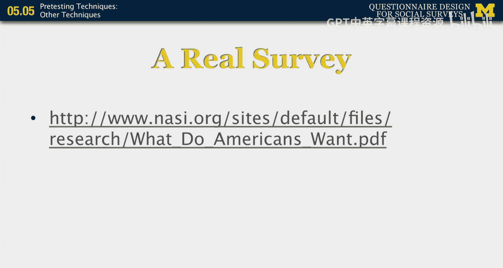

# 密歇根大学《调查数据收集和分析（2-6：方法、社调问卷设计、抽样、缺失数据、分析）｜Survey Data Collection and Analytics》 p72 29_预测试技术：其他方法.zh_en -BV1fw4m1e7Zh_p72-

。Okay， so a random collection of other techniques， not quite as random and certainly not random in the statistical sense。

 but you know in this flow of qualitative and quantitative techniques。

 there are a few others that we do want to mention。

Some we just mentioned in the adds for the pilot test， which would be an interview debriefing。

And that of course could also be done after a regular questionnaire in particular if you have a panel study and you will be asking those questions several times。

 the interviewer debriefing can be done in individual setting or in a group setting。

 you would have an interviewer questionnaire that you feel there in the individual setting。

 certainly in the group setting this could be a focus group with the interviewers。

 you might want to ask the interviewer even to note some comments on the questionnaire during the administration to help their memory when you debrief them later on。

Interviews are generally good in uncovering skipping errors， typos。

 misalignments you know in questionnaire， so this would be in the pilot phase。

 hopefully they can tell you afterwards which questions were difficult for the respondents and where respondents were unwilling to answer。

They also might have a separate sense of the length of the questionnaire and particular question。

 so while you can measure the time， you might not know how time is experienced by interview or respondents so that would be a good thing to pick up here。

The interview debriefing is relatively cheap compared to some of the other testing methods。

 but certainly compared to the survey that you are doing， and so this is worthwhilety to invest。😊。

You can also do a debriefing with the respondent， you can embed additional questions in the questionnaire。

 examples are given here for a general question specific question。

 this is not unlike some of the more cognitive interviewing techniques that we had but it shouldn't turn into one right so this is really just debriefing at the end of the questionnaire。

This is more typical in lab settings， it's very rare in wheel field surveys。Other methods common。

 the bread and butter of seven methodologist researchers would be question wording experiments。

Spit ballot AB testing， you have two versions of the same thing that you feel。

 we talked about randomizing items， randomizing context before。

 so this could be something done here or this forbid in La asymmetry is another example we've talked about this prior。

Vignettes are sometimes used to study a substantive question。

 but also to get at different wordings of a question and see how that works。

 if you're interested in a couple of several examples that are pretty successful in that lookout for the research done by Eleanor Singh and M Cooper on using vignettes for survey research。

Vignettes generally means that you have hypothetical situations and you can vary the factors and dimension in these vignettes and get at different responses that way。

😊，Pretty flashy picture here。 This is just to visualize another set of data that you have。

 you can in at least in a telephone setting， but also increasingly in others certainly on the web and laptop administered also in personal interviews measure response time so this is the time and second that it takes to answer a survey question their interview is reading out a question how many hours per week does and then she ask about some person。

 the household usually work at her job and the answer would be 45 what we can assess is you know if the respondent answers too slow。

 too fast or just write relative to everybody else and probably condition on some covariate So this is one assessment of questions that you can do this is in the whole bopark realm of using paraadata to investigate the quality of survey response and we have some separate examples for you on the web for these paraadata issues。

Let's wrap this segment up with comparing pretesting methods。

 there are three general approaches to evaluation exploratory。

 you can compare methods in terms of their effectiveness of detecting a problem。

 confirmatory where you compare the methods in terms of the effectiveness confirming or disconfirming problems that are suspected based on other results。

And then you can compare your methods in terms of effectiveness for suggesting revisions that can improve the data。

 Remember how we said latent class analysis might be very good at detecting a problem or confirming a suspicion of a problem。

 but not necessarily suggesting what is the fix。So in summary， pros and cons for expert reviews。

 expert reviews are on the pro side cost effective and they can identify a variety of problems and hopefully suggest some revisions。

 but they really depend on the type of review behalf have and they don't have actual respondents from your survey。

Focus groups， on the other hand， they are useful when there's very little information on the topic。

 particularly for some subgroups， you're trying to get better at the understanding of the topic for the subgroups。

The approach is flexible enough for unexpected information。

 so it's good to do that early on in the questionnaire and design process。

And the information is directly obtained from the type of individual that you want to reach so this is great on the negative side the small group dynamics must be control form the analysis can be real time consuming。

And because you have only a small number of subjects， you should interpret the results with care。

The cognitive interviews think alouds， we talk about those。

 the nice thing is that they can free you up from interview and post bias。

 there are no additional comments from the interviewer and the think aloud respondent is just narrating what they think。

However， as we discussed in detail you need to train the respondent。

 they need to be able to actually think aloud， it's pretty big good and it's you know not always that useful what you get out of it because it might be unclear if the respondent would be able to answer the question if the success depends on the question and they might just violate the technique when applying it so you know。

T well， this kind of work well， but is it risk involved？

The probing in the cognitive interviews is a little easier to do。

 you get the comments directly from the respondent。

 they question specific comments that can be used and the interviewer can focus on particular problems。

 confirmatory in that sense that you can hone in where you thought there might be a problem。

It's easy to introduce to the respondent as well。There can be a reactivity with in between probes。

 so it's not longer the same questionnaire flow that you have。

 you know the mind gets put somewhere else， people might remember other things in that conversation that will hide problems of recall and memory in later questions。

 for example。Also， you have an underlying assumption that the respondent is willing to admit confusion。

 you know， so can't be sure that that is true for all of them。

La in class analysis we just talked about it as a quantitative measure for error rates and if you have enough multiple measures you don't need a gold standard so that's quite nice。

 but you do rely on other statistical assumptions in this case that the error rates， for example。

 are independent of each other condition on the true score and the violation of these assumptions are sometimes not testable or not known。

Interviewer debriefing， this add on that we talked about is a good way to evaluate what makes the process of administering the question difficult and you can take advantage of a variety of interviewer situation。

 so that's quite nice， the interview's attribution of respondent difficulty might be incorrect though not everything the interviewers say is to be taking at face value。

😊，The netette studies we only touched on briefly， they can be a less threatening way to study sensitive topics。

 so that's quite nice as a technique， you can systematically vary key variables and see how that alters the responses and then settle on a way to ask a particular question。

But you， the responses are not based necessarily on actual behavior。

 so that's the downside of these vignettes。And generally make sure that you write an organized testing report after you're done pretesting。

 the intersection should have the purpose of the pretest。

 the nature of the subject population and the recruitment process you should have in it the number of subjects tested with the tabo summary。

 describe the number and experience of interviewers。

Describe the techniques you used and then give a question by question or a review of the results with recommendations。

It's good to have a section in there with limitations of the testing and next steps that you will be doing。

Useful links here， are those from the CDC or PP of mind。

 the QDDS project here that helps you to document revisions in a questionnaire and then of course the SQP database to get estimates for validity and reliability for your own questions that you find in the Netherlands。

Always good to look at a real survey， so here's one and we'll have some exercises related to questions on the survey。

And in our next unit， we'll put this all together。