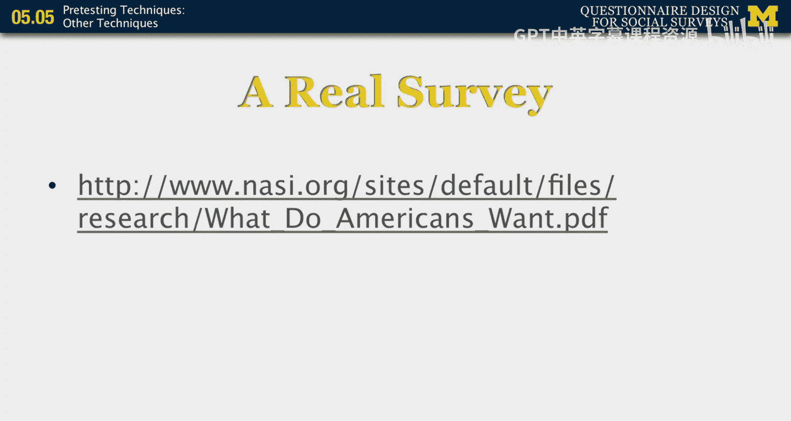

# 调查数据收集与分析：2-6：预测试技术：其他方法 📊

在本节中，我们将探讨预测试阶段中除核心方法外的一系列其他技术。这些方法有助于从不同角度评估问卷，确保其质量和有效性。

上一节我们介绍了认知访谈等核心预测试方法，本节中我们来看看其他一些实用的补充技术。

## 访谈员汇报会 🗣️

访谈员汇报会是一种在预测试或正式调查后，与访谈员进行交流以收集反馈的方法。这种方法成本相对较低，但能有效发现问卷在实地执行中的问题。

以下是访谈员汇报会的关键点：
*   **形式**：可采用一对一访谈或小组焦点团体形式进行。
*   **目的**：旨在发现问卷中的逻辑跳跃错误、排版问题、受访者感到困难或不愿回答的题目。
*   **优势**：访谈员能提供关于问卷或特定题目耗时的主观感受，这是单纯计时无法获取的信息。

## 受访者汇报与嵌入式问题 ❓

除了访谈员，直接向受访者获取反馈也是一种方式。这通常在实验室环境中进行，在实地调查中较为少见。

具体做法是在问卷末尾嵌入一些额外的汇报性问题。例如：
*   **通用问题**：`“您觉得这份问卷的难度如何？”`
*   **具体问题**：`“关于‘您的工作满意度’一题，您是如何理解‘满意度’这个词的？”`

这种方法类似于简化的认知访谈，但目的更侧重于收集整体反馈，而非深入探究认知过程。

## 问卷措辞实验与拆分样本测试 (A/B Testing) 🧪

对于调查方法学家而言，问卷措辞实验是常用工具。其核心是通过对比不同版本的问卷，评估措辞、题目顺序或选项格式的影响。

常见的实验设计包括：
*   **拆分样本测试**：将样本随机分为两组，分别使用问卷的A版本和B版本。
*   **随机化**：随机化题目顺序或选项顺序，以测试顺序效应。
*   **题支不对称性**：我们之前讨论过，通过调整肯定/否定选项的数量来测试反应偏差。

## 情境问卷法 (Vignettes) 📖

情境问卷法通过描述一个假设情境（即“情境”），并系统性地改变情境中的关键变量，来研究人们如何回应。它既能用于研究实质性问题，也能测试不同的问题措辞。

其基本公式可表示为：
`响应 = f(情境特征1， 情境特征2， ...， 受访者特征)`

例如，在研究公众对政策的态度时，可以构建不同版本的情境描述，改变政策成本、受益群体等变量，观察公众态度的变化。需要注意的是，受访者的回答基于假设情境，而非实际行为。

## 利用辅助数据：响应时间分析 ⏱️

在现代调查中（特别是电话、网络或电脑辅助调查），我们可以收集辅助数据，例如回答每个问题所花费的时间。

通过分析响应时间，可以评估题目质量：
*   **响应过快**：可能表明受访者未认真思考或存在“满足”现象。
*   **响应过慢**：可能表明题目难以理解或令受访者感到困惑。
分析时通常将单个受访者的时间与整体分布进行比较，并可能控制一些协变量（如受教育程度）。

## 预测试方法比较总结 📋

我们可以从三个维度评估和比较各种预测试方法：

1.  **探索性**：该方法在**发现问题**方面的效果。
2.  **验证性**：该方法在**确认或排除**其他结果所怀疑问题方面的效果。
3.  **修订建议**：该方法在**提出改进建议**以提升数据质量方面的效果。

以下是主要方法的优缺点简述：

**专家评审**
*   **优点**：成本效益高，能识别多种问题并提供修订建议。
*   **缺点**：依赖于评审专家的类型，且缺乏真实受访者的视角。

**焦点小组**
*   **优点**：适用于对某主题或子群体了解甚少时；方法灵活，能捕捉意外信息；信息直接来自目标群体。
*   **缺点**：小组动态需妥善引导；分析耗时；样本量小，需谨慎解读结果。

**认知访谈（出声思考法）**
*   **优点**：能避免访谈员偏差和事后偏差，直接获取受访者思维过程。
*   **缺点**：需要训练受访者；效果因题而异；可能干扰正常的答题流程。

**认知访谈（探查法）**
*   **优点**：直接从受访者获取反馈；问题针对性强；访谈员可聚焦于疑似问题点；易于向受访者介绍。
*   **缺点**：探查可能改变问卷流程（反应性）；假设受访者愿意承认困惑。

**潜在类别分析**
*   **优点**：提供误差率的定量测量；在有多重测量时无需“金标准”。
*   **缺点**：依赖于统计假设（如误差条件独立），且这些假设有时无法检验。

**访谈员汇报会**
*   **优点**：能评估题目执行过程的困难；可利用访谈员的多样经验。
*   **缺点**：访谈员对受访者困难的归因可能不准确。

**情境问卷法**
*   **优点**：研究敏感话题时威胁性较低；能系统操纵变量以测试不同问法。
*   **缺点**：回答基于假设情境，而非实际行为。

## 撰写预测试报告 📄

预测试结束后，务必撰写一份结构清晰的测试报告。报告应包含以下部分：
*   预测试的目的。
*   测试对象群体的性质及招募过程。
*   测试的受访者数量及简要统计。
*   访谈员的数量和经验描述。
*   所使用的测试技术。
*   按题目逐条总结的结果与修订建议。
*   测试的局限性。
*   后续步骤。

可以参考美国疾控中心（CDC）的“问卷设计诊断系统”（QDDS）等项目，来帮助记录问卷修订过程。此外，荷兰的“调查质量预测”（SQP）数据库可用于评估所选问题的效度和信度。

本节课中我们一起学习了多种预测试的补充技术，包括访谈员/受访者汇报、问卷实验、情境法以及响应时间分析。我们比较了各方法的优缺点，并强调了撰写规范测试报告的重要性。掌握这些方法将帮助您更全面地评估和优化调查问卷。

在接下来的单元中，我们将把这些知识综合运用起来。