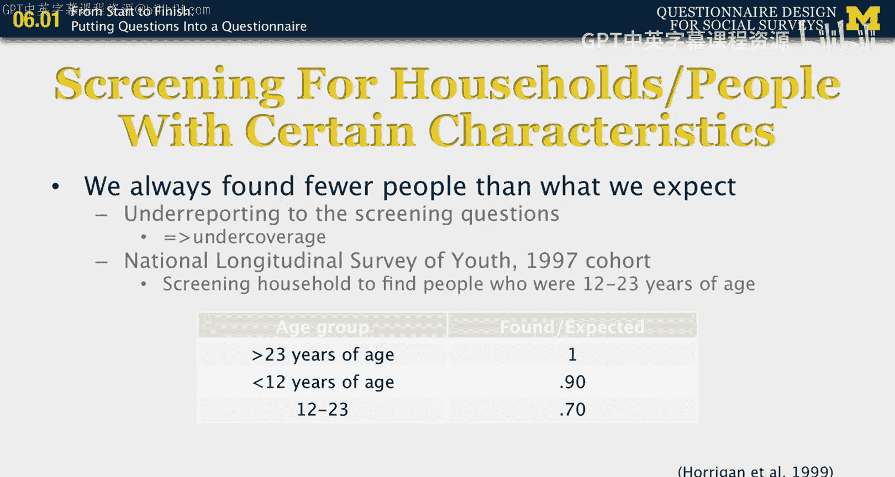

# 密歇根大学《调查数据收集和分析（2-6：方法、社调问卷设计、抽样、缺失数据、分析）｜Survey Data Collection and Analytics》 p73 30_从设计到实施：问卷编排全流程.zh_en -BV1fw4m1e7Zh_p73-

So you have heard a lot about designing different questions so far。

 but what we haven't talked about yet is how you actually put everything together into a questionnaire。

 so this is what this unit is all about， where to place things。

 when to place them and how to create a good layout that helps respondents and interviews to administer the question correctly。

The steps， you， after a little bit of introduction。

 the steps we're talking about here are screening modules。

 the main questionnaire issues with demographic questions。

 and how you should structure the end of the questionnaire。

Then that will be followed by segments on mode and mode selection。

Another consideration that you should keep in mind when deciding how to administer your questionnaire。

So the first piece is， of course， a good introduction。How can you get the respondent started。

 easing into the questionnaire。You can' start your survey with have you ever used cocaine in your life right obviously that wouldn't work respondents while this is very topical and starting with something topical is good。

 they need to be eased in to the data collection so the first thing that you should keep in mind is your introduction should include information on who it is that conducts this research。

What the research is about， how long， roughly the questionnaire will be and any issues that will be confidential IB boards usually will require that those are institutional review boards that respondents know what is coming in a questionnaire it's also important to tell the respondent that the participation is voluntary。

And if you have such thing。It is good to give names of local national institutional removal board representatives。

The content of the questionnaire， of course， will vary by mode of administration。

The introduction for an interview administered survey has informations that will be provided as part of the doorstep introduction。

 which means when the interviewer is approaching the house and talking to the respondent。

 they might explain what the survey is about。Often。

 those are less scripted introductions because the interviewer are trained to react to the respondent's needs as they try to convince them to participate in the survey。

There will， however， be information provided to the interview of what they should say in order to address respondents concern。

In self surveys， all of this needs to be spelled out or be available either in an advanced letter or through a help link in a web survey。

The content of the introduction also varies by the nature of the survey in panel surveys。

 only some information is needed in subsequent wave because a lot of that has been given already in the first wave of recruitment in crossal surveys you usually need to tell and respond much more than that。

So here are the examples of introductions。This is from the National Health Interview Survey in 2012。

 it's an interview administered the cross sectionional Sur。

And you can see what the default text is that's read by the interviewer I am and then usually the name of the interviewer will appear here from the US Census Bureau。

 this is a face to face service so the interviewer can show the identification card and say who's the sponsor of the survey。

Often face to face service are paired up with advanced letters。

 in which case the interviewer can refer to that advanced letter and the information that was given there。

 Here's another introduction。From the Pan studyudy of Ine Dnas。

 that is a study run here out of the University of Michigan。And this is a telephone survey。

 at least this segment here。And the respondents asked if they agreed for this interview to be recorded more and more that is。

Been done， because it allows。Much better quality control。 Many of the issues we talked about before。

 you know， problems that you can't pick up in。Cognitive interviews or any kind of pretesting。

 you can still detect if your monitor listen to the recordings afterwards。Likewise。

 you want to mention that the survey is voluntary and confidential。

The respondent should always know that they have the chance to either decline to participate in the survey or at least decline to answer certain questions。

Here's a third example from a web survey。A survey on the Recreation and National parks。

And you see here， the same is true。 confidentialdentity is mentioned the fact that they don't have to answer if they don't want to。

And not uncommon in Web surveyvey， the need for respondents to click yes that they have read that particular statement here。

 the first question launches into the survey， but it's still on the same page hoping that the respondent really have read this particular piece of introduction。

After the introduction， mini service have screening questions。

These screening questions are necessary if you have targeted population surveys。

 so let me start with the second bullet point in targeted population surveys。

You might not be interested in anybody that you reach in the household， but only for example。

 in households with at least one child or of a certain age group， for example， adults age 35 to 55。

If you are planning to study how people are save up for retirement before they actually hit possible retirement ages。

But even in general population surveys， you might have some form of screening ahead of time because you only to want to select one person from the household or not everybody in the household。

And that probability of selection is a process that need to be scripted and is part of your questionnaire。

 we haven't covered it in the questionnaire and design piece so far。

 so let me use this opportunity here to tell you a little bit more about the difficultiesiness of administering screening questions。

This within household selection is usually done as follows。

 We have a couple of probability methods that require a full household roster。

 most known is the Kish method。Another researcher here from the University of Maryland。

 former researcher， I guess。And it's usually a sequence of questions first。

The respondent will be asked to name all names and ages of adults in the household。And you know。

 sometimes this is done separately for males and females。

The individual units are listed and then fish table is used to randomly choose one adult。

That kish table is like a random number table， goes a little bit too far to explain that in detail here。

 but any good survey methodology book will show you those data collection details。

The weakness of such procedure is its very time consuming。

 in particular if this household has many household members。

 and it's burdensome for both respondent interviewer。

It's also seen where people feel that it's seen as intrusive by the respondent。 However。

 if done correctly， this will give you a known selection probability for the target person。

The variances of this that we call quasi random probability methods。

There are no household roster is needed。 Most popular and done often on telephone surveys is the next or the last birthday method。

There the interviewer would usually start the interview。

By saying in order to determine whom to interview， could you tell me of the people who currently live in your household who are 18 years of age or older？

And had the last birthday so in particular， person selected。

 assuming that the birth order has nothing to do with when the survey takes place and what the respondent would say and therefore being less burdensome procedure to the respondent in the interviewer and much less intrusive。

 but still，Given the assumption。That birth is random。 It will allow a quasi probability sample。 Now。

 we do know birth is not random and decreasing less so。

 but often this assumption is made nevertheless。 And then there are some nonpro methods。

Where no household listing is needed， they are mostly tailored to actually do get cases according to demographic characteristics。

 sacrificing randomness， but making sure that， for example。

 young males are selected at a decent rate， they are often underrepresented in survey and these methods。

 they do help mitigating that effect。There are as a mixed selection methods that are based on household size。

 R's method is one of those。Now， a screening for household characteristics。

 not for the selection of a respondent with a certain characteristic。

In order to get a random person into your survey， but actually。

 because you're only interested in that subset has also been done a lot or is done a lot。

 Here's an example from the Longitudinal surveyve of youth in 1997。

There's an interesting paper where Hrigan and colleagues from 1999 and you can see the table here。

 but this graph also shows you these results quite nicely。

 you can see that of all the age groups down here on the x axis。

 the expected number of persons in the survey and the target population are compared here on the Y axis。

This is an old paper， not a great graph， but。What you see here in the background are the expected number according to the current population survey and in the front in black are the numbers from the National Longitudinal Survey of Youth。

 So let me go back and report a little bit more on the findings here。

 what is curious that dip that you see at that age group 12 to 23 is the target age group。

And in the advanced letter to the survey， it was mentioned that that's the target age group。And。

 you know， oddly enough， we don't find these people when we look for them。 Now you could say， okay。

 it's always hard to find the young people and when you screen for them， they don't show up。

 but turns out that the health and retirement survey that the University of Michigan runs here has the same problem。

 So this is not unique to a survey of young people。 this can happen in the survey of old people。

 a survey with， you know infants。

Whatever you look for seems to be not there and so。For that reason。

 I'm going to show you a loan research project in the next segment that will。

Show some manipulation to see if we can tease out the effects that lead to this。

 what we call motivated under reporting。