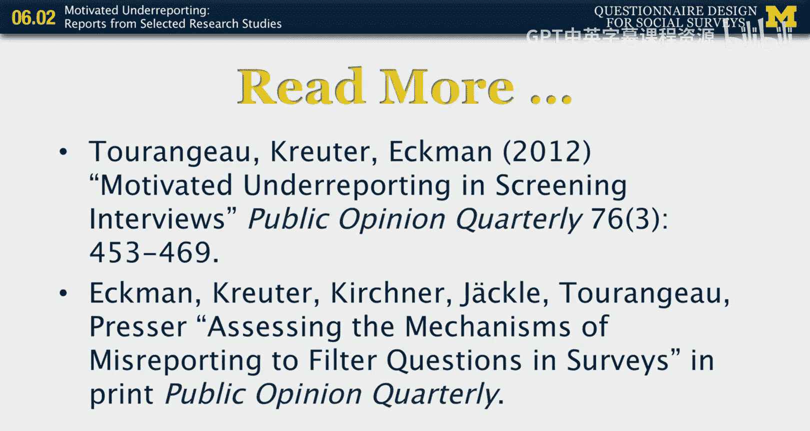

# 密歇根大学《调查数据收集和分析（2-6：方法、社调问卷设计、抽样、缺失数据、分析）｜Survey Data Collection and Analytics》 p74 31_动机性低报：精选研究案例.zh_en -BV1fw4m1e7Zh_p74-

I promised to report on a study that we did un motivatedated under reporting this is a project that I did together with Roger Trenjo and Stephanie Ekman。

 Roger Trener and I， we got a grant from NSF to study misreporting in surveys。In general。

 not going to report all of these results， but our research question has three related forms of measurement error that we are interested in。

 screener questions， filter question and repeated questions in panel surveys。For each of these types。

 we do see evidence of motivated misreporting。The mechanisms we think behind the scenes are that respondents may answer this question in ways that reduce the burden of the interview。

So in order to have to do the interview， they make themselves ineligible in screening interviews。

Think of respondents who are shy and don't want to offend the interviewer and want to decline the participation in a survey。

They could simply say， oh no， I'm not part of the age category， or we don't have a small child。

If that is what is looked for。Likewise， we talked about filter questions before they could avoid triggering filter questions in these formats where they see that each filter question is followed by a series of follow up questions。

 We talked about that in prior sections of this class。 Now， of course， you could argue。

 this can also reflect interview or motivation to reduce the burden。

Interviewers are judged and evaluated by their response rates。

 and so it might be an incentive for interviewers to suggest to the respondent that well。

 just answer a few questions you might not be eligible to the survey and therefore avoid non-response and suggesting implicitly to the respondent that they make themselves ineligible。

To study this， as I mentioned， we got funding from the National Science Foundation。

The ground numbers are listed here。We funded from these grants two telephone surveys that were done in the US。

 the first one had a target population of 35 to 55 years of age。

We had about two and a5 thousand00 households screened， and within those we had 958 eligibles。

We stacked the sample of it。 We had voting records and on purpose。

 selected cases that could fall into this age range at a higher rate。

And then we had about 7750 completed interviews and within the survey。

 three experimental manipulations， I'll come to those in a second。

The second study was a face to face survey done more recently。

 our attempt here was to replicate the findings we found on the phone。

You have to read those papers if you want to see the results。

 I'm only gonna to report on the phone survey here。

So the experimental manipulation was a manipulation of screening wording。

The first experimental condition was， is anyone in the age range 35 to 55， the second one？

So imagine all of the screened households were randomly divided into one of these three conditions。

 so one third of the cases。Got that direct question。 The next third， got the compliment。

Which was all household members， less than 35， the question to。

 the household or over 55 right so screening out， if you will， in them。

And then we had a full household roster and the control condition which would usually be done and in addition we asked for H sex and raise and ethnicity of all household members。

 the survey got an advanced letter that revealed the target population or hit the target population and this experimental condition was crossed with the other。

There were also an interviewer manipulation again crossed with the other conditions。

 and we wanted to test the interviewer contribution to this undercoverage phenomenon。

And in this interview manipulation we varied the payment scheme。

 some interviewers got the bonus for completed screener interviews， $2 in size。

Others got a bonus for the completed interview so they would have had an incentive。

 a monetary incentive for respondents to actually select into the survey rather than just the incentive to finish the screener and be done with the survey and the last condition was no bonus at all。

We had 12 in other years who worked in each of these conditions。So， here are the results。

They are separated by the three types question of the screener wording， the letter。

 whether they revealed the age range of the target population or not， and the bono scheme。

In the columns， you see the screen completion rate， the eligibility rate。

The interview completion rate。The response rate and the actual yield。 So how many cases do we。

 in the end have to analyze。And let me start with the yield。

 So what is interesting is that the roster， the method that's usually done。Has the highest yield。

 So you end up with the highest number of cases。 However， it has the lowest response rate。

And that is because you have higher eligibility and even so there is higher eligibility。

 you find the cases that you need， but you have lower completion rates。

 more people decide to not be respondent actively。But because you stand out high。

 you still have a higher end yield。Another way to say this is。

You move coverage error or undercover error into an non response error。

 which in a way is a fair thing because that is a statistic we often report in surveys。

The other two experimental condition you can see here， we have higher rates of completed screeners。

 which makes sense these conditions are much easier。 It's a quicker question to do。

 whereas the whole household of roster people might not finish the entire screeninger。

But it's easier to hide。 No， no， I'm not in that age group。

 or everyone is between these two age ranges， which would be this condition here。

 But then of those that did say they are eligible， a higher rate completed。

Now it is also interesting that we see effects of the advanced letter on the completion rate。

 though not on the eligibility rate and finally on the interviewer payment scheme。

 we didn't see big effects of payment on the overall response rate and the overall eligibility rate。

 but a slight effect on the screener completion， so interviewers that got additional money to complete a screener。

 completed screener at a higher rates， an interviewer that got a bonus for completing the interview completed interviews at a higher rate。

There was a lot of variance within the interview across the interviewer。

 so there is a strong interview effect on how they react to these bonus schemes and how they perform the task overall。

 which was much larger than any other variance component in here。

So there's a trade off with these screening questions。We have。

 you non-respon and measurement error and undercover that you need to consider here when you have these screen a question in place and likewise。

 you have a tradeoff between the accuracy of the information a Buin and the perceived threat on the side of the respondent。

 If you want to read more about these questions， the references are out here and on the cror website。

 you will see the actual listings of the papers and can download them from there。

