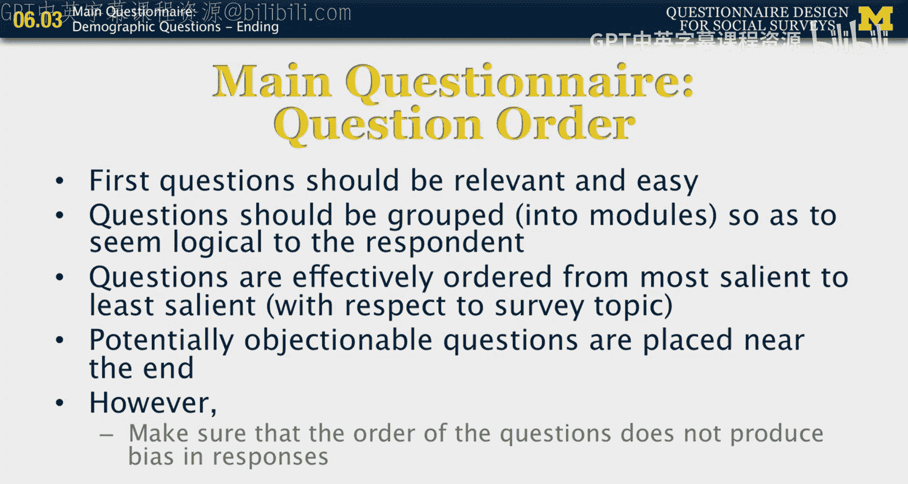
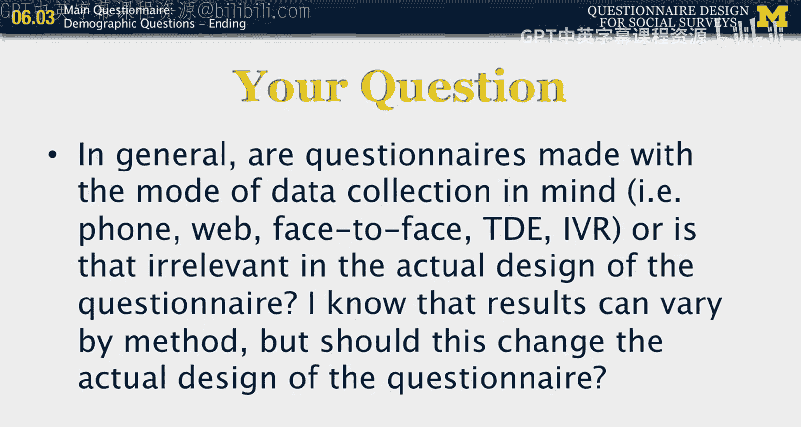

# 密歇根大学《调查数据收集和分析（2-6：方法、社调问卷设计、抽样、缺失数据、分析）｜Survey Data Collection and Analytics》 p75 32_主问卷：人口统计问题收尾.zh_en -BV1fw4m1e7Zh_p75-

Yeah。The core is， of course， the main questionnaire and the whole course was about getting a good main questionnaire going。

 but there's a little bit of structure in the main questionnaire that we do want to talk about and then of course。

 also talk about what comes at the end of the questionnaire。

So the first piece to think about is the question order。

Questions should be relevant and easy when you feel them at the beginning of the questionnaire。

You get the respondent interested in participating in the survey because you mentioned the survey topic and the respondent decided to participate。

And you want to start with the relevant question that's easy to answer。

 even if that is not a central question to your analysis， if you end up not using this question。

 it's still good if you have something that respondents can easily answer at the beginning。

It is tempting for any novice in questionnaire design to start a questionnaire with the demographic questions。

 I'm not sure what's the psychology behind that， but without failure so far I've seen every single class project if students do not know about the order that a questionnaire should be in they start with demographics。

 you know， not quite what's your name because those would be confidential information。

 but what's your age and you know what's your。Gendnda or your major if it's a school project。

So don't do that。 stand with a relevant and easy question。

Then a questions should be grouped into modules。And these modules should have a logical sequence for the respondents。

In a way， they are ordered from most salient to least salient with respect to the survey topic。

However， there are divergs from that because sensitive questions should be moved towards the end。

 So if your key research topic is on sensitive questions。

 there's tension here that you have to keep in mind。

You have also to make sure that the order of the question does not produce any bias。

We did discuss context effects in questions throughout the course。

 So make sure you you review those segments if you don't remember these pieces。

When you structure your questionnaire， make sure that you always number your questions。

 it's okay to number them sequentially。It's okay to number them within a module。

 but something that makes it easy to look at the questionnaire， look at the data。

 move between one and the other and give the analyst also an idea of what is the logical order of the question。

That you have。Then you need numbers for your response options。

 It is interesting how different survey companies have different numbers as default。So， you know。

 it was for a long time popular to use 98- 97， 99，9999 S codes for don't know or refusal。

 I personally prefer if the real answer categories do not have numbers below zero to use negative numbers who have refused and don't know or does not apply。

The reason for that is that later on when you analyze your data。

 you can assign missing value codes for a string of variabless and you don't have to look what is the range。

 the numeric range of the possible answers， it might be that you have some questions in there。

 for example， age or weight or I don't know， day since something happened that could hit these numbers 98。

999 and so on and so then you have to be much more careful in how you code and assign missing value codes。

It is also helpful for a coder， so if the questionnaire is not filled in automatically like it would be in web surveys。

 but if a code assigns these question after looking at the questionnaire that you are somewhat consistent on how yes and no is coded you know just so that。

Whoever puts in these numbers doesn't accidentally switch these numbers around。 So that is。

A thing to keep in mind， you know， when you design the questionnaire and when you think of numbers for response option that you do match that up into an easily quotable questionnaire。

There are transitions that you have to keep paying attention to and there's a lot of text on this slide。

 but it's there for you to see some good transitions or some transition that are in place。

 Often they are as easy as now I like to ask you and then there's a little bit about what is' going to happen now。

If there are additional items that respondents use like a booklet or a showar or something。

 then attention can be drawn to those and people move on。To a different topic。 But in general。

 it's good that you don't appear to be jumping from topic to topic and back。Now。

 sometimes people overdo it with these traditions and it is surprising how much tolerance respond and half。

Too much text is always bad and in particular， if you have a self administered survey。

 you probably need less transitions than you have an interview administered survey just because interview and respondent have somewhat of a conversation and in a conversation you wouldn't just jump around either。

Speaking of jumping around， so sometimes you might jump around in a questionnaire right because you have a topic that doesn't apply to a respondent and then we move on。

 we talked about these filter questions。Now， it is very important that you never leave it up to the interview and the respondent to decide where to go you want to have clear branching instructions。

Otherwise， you will have two types of error， a so called error of commission。

 which is an era where the respondent fails to branch when he or she is instructed to do so。

And an era of a， which is when the respondent skips， even so they shouldn't。

 The first one is frustrating for the respondent。 Okay， they get confused。

 They get question that don't apply to them。 And it's also knowing for an analyst because they don't necessarily know was the filter question answer correctly or whatever the respondent might have ended up putting into the follow up question do those really belong to the respondent answers。

The areas of o， they can't be repaired even with the judgment column because the respondents skipped over a section or a segment of the questionnaire that they shouldn't have skipped。

 the result is missing data and the only thing that you might have left is imputing the values that should be there。

In general， errors of commission are more common than errors of o。

 at least that's the result of a research study by Clear@line and Don Dllman published in 2002。

 he has a snippet from that study you see the control condition and then two other conditions。

 one in which they try to prevent this error and one in which they modulated how the skipping instruction can be enhanced。

 you know with this additional error here that leads the respondent to the next question。

And here are the results， you see in the control condition， you have about 20% of commissions and 1。

6% of omissions。 So this one here is a typical format for a self administered questionnaire。

In these other two conditions， they were able to significantly lower the commission era。

I'll buy it at the expense of some omission， so。Again， a trade of decision just like we saw before。

So finally， after the main part of the questionnaire， you have your demographic questions。

There's often a transitional introduction to those， Lastly some question for classification purpose。

 sometimes it's called statistical purpose only。You can look at all the questionnaires we pointed you to at the beginning of the survey and this class to see what kind of transitions would work for you here。

Keep in mind， you do need the demographic questions and they should be in line with your waitinging plan and your analysis plan。

 So these thinking ahead is really necessary and you always should check that you do have the right questions that match up with whatever external source you want to use for waiting。

 So if you want to use the demographic questions for post stratification to some data that's collected by the US census Bureau your demographic questions better translate back to those census questions。

 Otherwise you will be in trouble。That also means that you choose your question wording based on those questions that you will be using in comparison for waiting and of course。

 so that they match your substantive interests。Reflects itself in the analysis plan。

And then at the end， you should think your respondent， make sure that you never forget that。

 Often it's also good to leave a little bit of open space for additional feedback。

 any other things that they want to tell you。Often at the end you'll see contact information for the project again the local IIB information should either be there or in the front and additional contact information from the respondent is sometimes necessary if you plan to follow up for a quality control check or if you want to actually mail and incentive to them that you promised a conditional incentive to participate in the survey。

 for example。Or if it's part of a panel study and you want to track them further。

 remember to ask for cell phones， maybe ask them for cell phone numbers from family members and the like。

 it can get difficult to find respondent a year or two years after your study。Now。

 in the online discussion board， you submitted some questions and one of them was。

Pointing at this tension between salient question being in the front。

 but that objectionable or sensitive question should be in the bank， you know。

 to balance these criteria， that is a challenging piece and one way out can be more decisions and will come to that in one of the further segments。

Similarly， mode in which you field the survey will also affect how you design certain question elements and well come back to that in one of the next segments。

 so more choice and implication for layout will be coming up。

