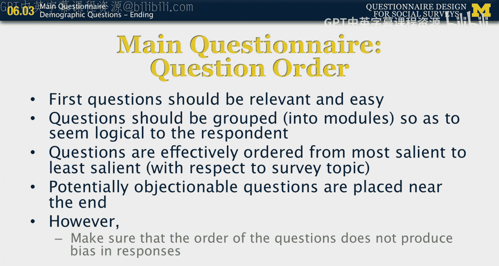
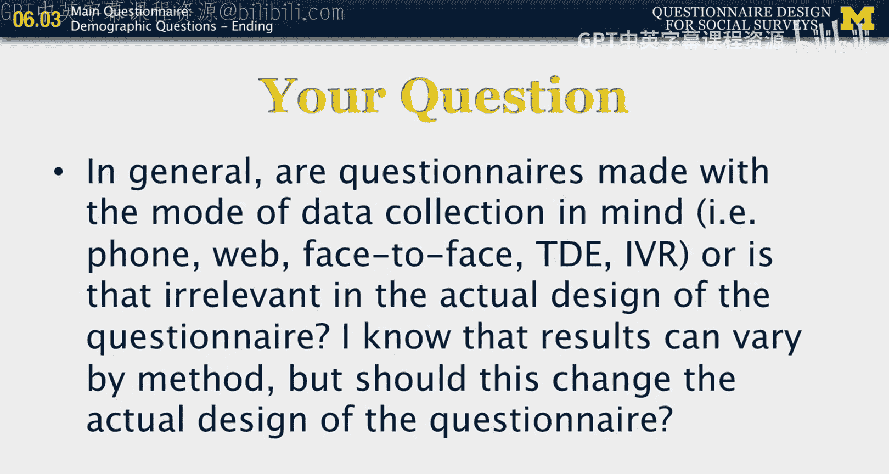

# 调查数据收集与分析：2-6：主问卷结构与收尾设计

在本节课中，我们将学习主问卷的结构设计，特别是问题顺序、模块划分、过渡、分支指令以及问卷收尾部分的安排。这些设计元素对于确保数据质量、降低无回答误差和提升受访者体验至关重要。

上一节我们介绍了问卷设计的核心原则，本节中我们来看看如何将这些原则应用到主问卷的具体结构设计中。

## 问题顺序与模块化

问卷应以相关且易于回答的问题开始。即使该问题并非分析的核心，它也能帮助受访者轻松进入状态，提升参与意愿。

以下是设计问题顺序与模块的关键点：

*   **避免以人口统计问题开头**：新手常犯的错误是以年龄、性别等问题开始问卷。这并非理想做法。
*   **按模块分组问题**：将相关问题归入同一模块，并按逻辑顺序排列。通常，顺序是从与调查主题最相关（最显著）到最不相关。
*   **敏感问题置后**：敏感问题应放在问卷靠后的位置。如果研究的核心就是敏感问题，则需要在此原则与其他设计目标之间权衡。
*   **警惕顺序效应**：问题顺序不应引入偏差。需回顾课程中关于“语境效应”的内容，以避免此类问题。

## 编号、编码与过渡

清晰的结构有助于数据管理和分析。所有问题都应编号，无论是顺序编号还是模块内编号。

为回答选项分配数字代码时需谨慎。一种推荐做法是：如果真实答案的数值范围不含负数，则使用负数（如-1， -2）来编码“拒绝回答”、“不知道”或“不适用”。这样在后续分析中为变量分配缺失值代码时，可以避免与真实答案（如年龄98岁）混淆，操作更简便。

编码一致性对数据录入员也很重要，能防止意外混淆“是”与“否”等选项的代码。

问卷中不同模块之间需要自然的过渡语句，例如“现在，我想请问您...”。过渡能引导受访者，避免话题跳跃感。但需注意，过多的过渡文本，尤其是在自填式问卷中，可能适得其反。

## 分支指令与跳转逻辑

当问卷包含不适用于所有受访者的问题时，需要使用筛选问题进行分支跳转。

必须提供清晰的分支指令，绝不能让访员或受访者自行决定跳转逻辑。否则会产生两种错误：

*   **执行错误**：受访者本应跳转但未能跳转，回答了本不该回答的问题。这会让受访者困惑，并为分析带来困难。
*   **遗漏错误**：受访者本不应跳转但错误跳转，导致漏答了本该回答的问题。这会造成无法修复的缺失数据，只能通过插补来估计缺失值。

研究表明，执行错误比遗漏错误更常见。通过优化指令设计（如在自填问卷中使用箭头等视觉指引），可以显著减少执行错误，但有时可能轻微增加遗漏错误。这需要设计者进行权衡。

## 人口统计问题与问卷收尾

在问卷主体部分之后，通常安排人口统计问题。常以“最后，为了分类目的...”等过渡语引入。

设计人口统计问题时，需与加权计划和分析计划保持一致。例如，若计划使用美国人口普查局的数据进行事后分层加权，则人口统计问题的措辞应能与普查问题对应。

问卷结束时，务必感谢受访者。通常可留出开放空间供受访者提供额外反馈。此外，可能需要再次提供项目联系信息或IRB（机构审查委员会）信息。如果涉及后续质量检查、邮寄激励报酬或是固定样本组研究，则需在此处询问并记录联系方式（如手机号、家人联系方式等），以便未来跟进。

在在线讨论中，有学员指出了“显著问题置前”与“敏感问题置后”之间的张力。平衡这些标准具有挑战性，我们将在后续章节中探讨更多决策方案。同样，调查实施的模式也会影响具体问题的设计，这也将在接下来的章节中讨论。

本节课中我们一起学习了主问卷的结构设计要点，包括问题顺序、模块化、编码、过渡、分支逻辑以及收尾部分的设计。这些细节共同作用，旨在提升数据质量与受访者合作体验，为后续的数据分析奠定坚实基础。