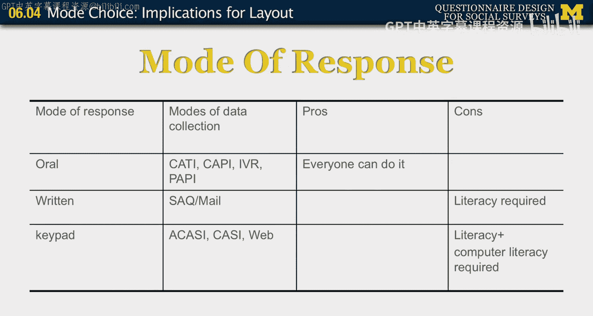
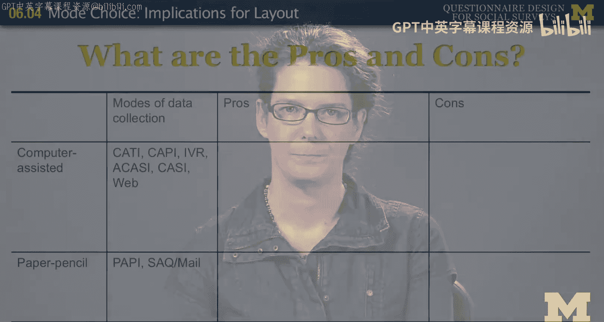
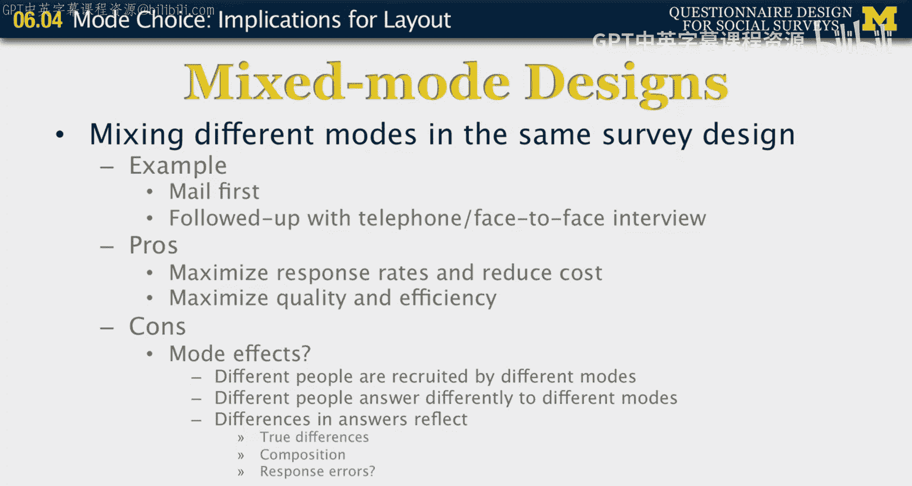

# 密歇根大学《调查数据收集和分析（2-6：方法、社调问卷设计、抽样、缺失数据、分析）｜Survey Data Collection and Analytics》 p76 33_模式选择对版式设计的影响.zh_en -BV1fw4m1e7Zh_p76-

Choosing a mode that can be a hard thing。 So I'll talk in this segment a little bit about different data collection modes and some of the implications they have for layout of your questionnaire。

The choices you have are plentiful。And it is good to think of different modes a little bit structurally。

 So here you have a table that shows you the channel of presentation。

 whether it's auditory or visual， the mode of response with its oral through keypad。Or written。

Whether it's computer assistant or paid to a pencil。

And whether there's an interviewer involved in the administration or whether it's self administered。

And here on the right， you have all the different acronyms that a methodologists like to use。

You know， you by now have read so many papers that I'm sure you've come across all these acronyms。

 but mapping them back to these features might help you to think through what in terms of layout you have to do for your questionnaire design。

So let's look at the effect。That the mode of data collection can have。Moode is a bundle of features。

 Mo affects which sampling frame and which sampling method you can use。

Moode affects how you train and supervise your interviewers mode affects how you contact and recruit your respondents。

And of course， it affects the method of administration and without the mode of response。

All of these features can affect air sources。They are related to coverage， sampling。

 nonresse and measurement error。 the last one is the focus in this class。

 but as we showed you at the very beginning， it is really important that you keep the entire total survey error framework in mind when you design your questionnaire。

Sometimes you want to include a question in your questionnaire that is also on your sampling frame。

Because then you have the chance to compare measurement error elements relative to what you have on the frame。

Sometimes it can be helpful to have you know things that you collect during the recruitment phase also be measured on the questionnaire。

 for example， interview observations become increasingly of interest in responsive design models or when you try to predict nonrespon。

But in order to evaluate the quality of these interview observations。

 you better have on the questionnaire the same question that you ask the interviewer to observe so that you can lay on at least the further respondents that decide on the quality or evaluate the quality of those interview observations。

The channel of presentation has a couple of interesting pros and cons that we should keep in mind if the channel of presentation is auditory。

There is no literacy requirement and depending on which country you work in or if you do a comparison among race and ethnic groups or different countries。

 that might very well affect your overall result because you automatically lose some cases that do not fit these literacy requirement if you are in a visual mode that does require reading。

So， you know， this is a negative part for visual， but positive for auditory。

The problem with auditory modes is though that working memory is much more taxed when you listen to question answer categories。

You will likely see recency effects and we talked about this in the segment on ordering questions。

 order effect and the like。 So that's something to keep in mind。If it's auditory。

 you probably want to have the set of answer categories that are listed out by an interviewer to be much shorter than the set would be in a visual structure of the questionnaire。

Now， the motor response has also implications that are positive and negative。Oral mode。

 pretty much everyone can do written and keypa requires literacy， and it requires computer skills。

Technology will help sooner or later， and you know I wouldn't be surprised if there are already some mobile device services out there where the respondents can give their answer in an oral way and it is automatically transferred into a text。

 So these tables of course， get outdated very quickly。

Now what are the pros and cons for computer assisted with this paper pencil？

In this different mode of data collection。Well， computer assisted is fantastic to get the skip patterns right。

 you click a box， you automatically transfer to another segment in the questionnaire and there is no threat of omission and commission at least not accidentally。

You also have control over the sequence with which the questions are delivered。

And you have the possibility to randomize question and response options。And with that。

 mitigate order effects that we have seen throughout the course。 However。

 in a computer assisted questionnaire。You have no control of who does the questionnaire， except。

If this were。Computer assisted portion in a survey administered by an interviewer where the laptop is just turned around。

In a paper and pencil survey， there is a big advantage from the part of the respondent that they can flip through the questionnaire and sort of get a feel for how long this is and whether they really want to do it。

But then the same time， researcherser relyli on the respondent to navigate through the questionnaire and they have no control on which question is answered when and therefore these things might be subject to context effects that weren't plan for or studied by the researcher。

A few more pros and cons for interviewers are self administered questionnaires。

So the first row is interview Admin Que。They tend to run。

I'm actually not sure if we can say this so generally。

But they tend to have better data quality because the interviewer has the chance to motivate the respondent。

 probe and clarify。Now they also have interview effects and it is， I mean。

 we've discussed about this in the sensitive question section。

Considerable social desir biases when you have sensitive question。

 but for a survey that doesn't have sensitive question。Or where really motivation is important。

 there's nothing like an interviewer administered questionnaire。So the question is。

 on the other hand， they do have the advantage of having no interview effect and no social desir bias。

If the interview is present。And it still self administered， then the interviewer can motivate。

 but we have a reduced social desir bias and reduced interview effects。 these days。

 if you look in the lower right corner here， web surveys tried to experiment with ways to pick up when the respondent has a question or might need clarification。

And there's an attempt to have， then the computer automatically react and provide additional explanations and feedback。

 Some of the research that Fred is doing will show you that and we have extra segments for you to see how this might work。

Now， the question is how to choose modes。One way to determine this is。

How is the respondent sample reached and contacted， right。

 This might determine which mode you have to use。Or which mode you might not want to use depending on your target population。

So in CAT and IVR surveys， respondents have to have a telephone number can be landline or a cell phone in computer personal interviews。

 respondents must have an address to be reached。In web surveys， they must have internet access。

And you must have the respondent email address or mailing address to send them the information for the web survey。

Now， of course， they are a combination of these modes possible and will come to that。

 but you could envision a situation where you do a telephone survey for the recruitment。

And then I come back to and ask the respondent for their email address。Nevertheless。

 they need an email address， or you could tell them a web page and log in information。Over。

 the telephone required the respondent to have at least internet access。

Which mode is also affected by the sensitivity of the topic。 If you have sensitive topic。

 then you would prefer a selfaddministered mode if the topics are very easy。

 you also can do easily a self administered mode， complex questionnaires， long questionnaires。

Preferity administered in person。The topics are very difficult than interview administered modes are also advisable。

Most important， though， budget and the time frame that you have。 fits quick and dirty。

Should be cheap， most people end up on the web survey。Let me point out， though， one more thing。

 the responder must have internet access。Some surveys do provide the responder with Internet access to make sure that they don't lose those that don't。

 So they you see increasingly if the field moves towards a mix and match of these modes。

So let's look at examples for this MI mode design。The idea of mixing different survey modes in the same survey design。

This could， for example， be May  first and then follow up with telephone and face to face interview。

 The US Census Bureau has that in place。 The pros， you maximize response rate and you reduce the cost。

You can maximize quality and efficiency。The cons， well。

 you might have mode effects people react to the mode of administration。

 oral or visual presentation in different ways， and likewise。

 the response option might have an effect。Also， different people are recruited by different modes。

 they answer， as I said， differently by the different modes。

And these differences in the answer reflect true differences。

 the composition or response errors you don't know。

 so it's good to look at many of these mixed boat studies that are out there now to see what can you build into your design so that you can at least measure some of these effects or disentangle in them as you have the data。

Here's another question that was posted online。And the general answer to these types of question is you should always try to maximize quality in any given mode。

The research is not has not solidified yet to clear answers。

 you know what is best in which situation and what not。

But keeping it the same across all modes seemed unfortunate because you end up with the smallest denominator instead of maximizing the potential for each particular survey mode and getting the best data quality possible in each of the modes。

In the next segment， well talk about a few。Precaities of self administered questionnaires also with respect of maximizing the potential of those。

