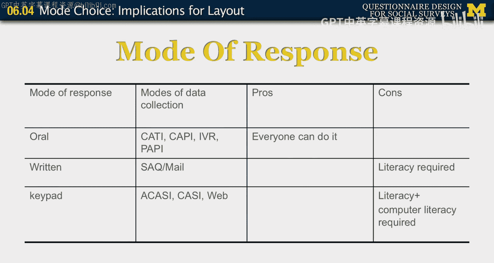
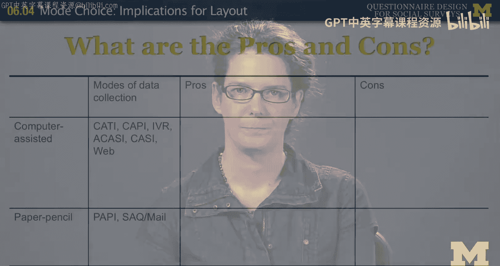
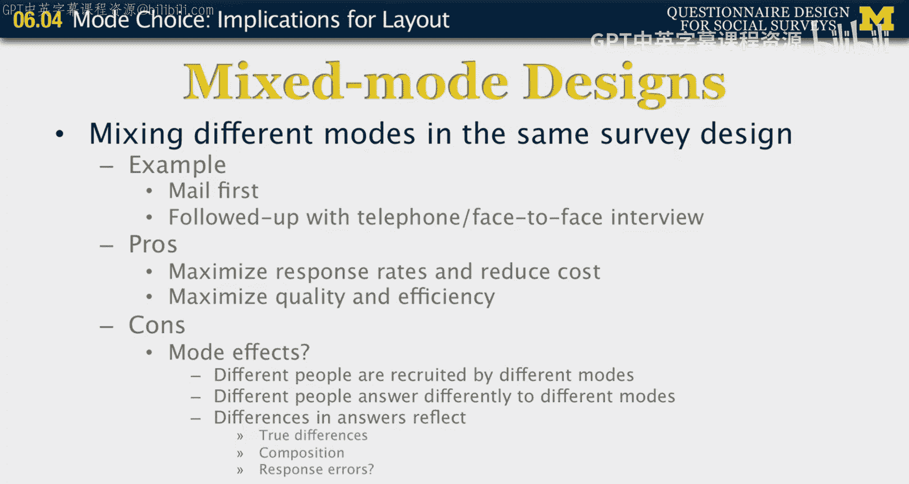

# 调查数据收集和分析：2-6：模式选择对版式设计的影响 📝

在本节课中，我们将学习数据收集模式的选择如何影响问卷的版式设计。我们将探讨不同模式的特点、优缺点，以及如何根据研究目标、受访者群体和资源限制来选择合适的模式。

---

## 模式选择的重要性

选择数据收集模式可能是一个难题。本节将讨论不同的数据收集模式及其对问卷版式设计的影响。

可选择的模式很多。从结构上思考不同模式是有益的。

以下是一个表格，展示了不同模式的特征：

*   **呈现渠道**：是听觉的还是视觉的。
*   **回答模式**：是口头的、通过键盘的，还是书面的。
*   **辅助方式**：是计算机辅助的还是纸笔的。
*   **执行方式**：是有访员参与的，还是受访者自填的。

表格右侧列出了方法论学者喜欢使用的各种缩写。你可能已经在许多论文中见过这些缩写。将它们映射回这些特征，有助于你思考在问卷设计中需要为版式做些什么。

---

## 数据收集模式的影响

现在，我们来看看数据收集模式可能产生的影响。模式是一系列特征的集合。

*   **模式影响**：你可以使用的抽样框和抽样方法。
*   **模式影响**：你如何培训和监督访员。
*   **模式影响**：你如何联系和招募受访者。
*   **模式影响**：当然，它也影响执行方法和回答模式。

所有这些特征都可能影响误差来源。它们与覆盖误差、抽样误差、无回答误差和测量误差相关。测量误差是本课程的重点，但正如我们在最开始展示的，在设计问卷时，将整个**总调查误差框架**记在心中非常重要。

有时，你希望在问卷中包含一个也在抽样框上的问题。这样你就有机会将测量误差与抽样框上的信息进行比较。有时，在招募阶段收集的信息也在问卷中进行测量会很有帮助。例如，访员观察在适应性设计模型或预测无回答时越来越受关注。但为了评估这些访员观察的质量，你最好在问卷中包含要求访员观察的相同问题，这样你至少可以评估这些观察的质量。

---

## 呈现渠道的优缺点

呈现渠道有几个有趣的优缺点，我们应该记住。

*   **听觉渠道**：
    *   **优点**：没有识字要求。根据你工作的国家，或如果你在不同种族、民族群体或国家之间进行比较，这可能会显著影响你的整体结果，因为如果你使用需要阅读的视觉模式，你会自动失去一些不符合识字要求的案例。
    *   **缺点**：当受访者听问题和答案选项时，工作记忆负担更重。你可能会看到**近因效应**，我们在关于问题顺序的章节中讨论过顺序效应等。这是需要注意的。如果是听觉的，你可能希望访员念出的答案选项集合比问卷视觉结构中的集合短得多。

*   **视觉渠道**：
    *   **优点/缺点**：与听觉渠道相反。它要求阅读能力，但减轻了工作记忆负担，并允许呈现更长的答案列表。

---

## 回答模式的优缺点

回答模式也有积极和消极的影响。

*   **口头回答**：几乎每个人都能做到。
*   **书面和键盘回答**：需要识字能力，并且需要计算机技能。

技术迟早会提供帮助。如果已经有一些移动设备服务允许受访者以口头方式给出答案，并自动转换为文本，我也不会感到惊讶。因此，这些表格当然会很快过时。

---

## 计算机辅助与纸笔模式的优缺点

在计算机辅助与纸笔这两种不同的数据收集模式中，各自的优缺点是什么？

*   **计算机辅助问卷**：
    *   **优点**：能完美处理跳转逻辑。点击一个框，会自动跳转到问卷的另一部分，至少不会意外地出现遗漏或错误执行。你可以控制问题呈现的顺序。你可以随机化问题和回答选项，从而减轻我们在整个课程中看到的顺序效应。
    *   **缺点**：在计算机辅助问卷中，你无法控制谁在做问卷，除非这是在由访员执行的调查中，访员只是将笔记本电脑转过来。

*   **纸笔问卷**：
    *   **优点**：对受访者来说，他们可以翻阅问卷，大致了解问卷的长度以及他们是否真的想做。
    *   **缺点**：研究人员依赖受访者浏览问卷，他们无法控制何时回答哪个问题，因此这些情况可能会受到研究人员未计划或未研究的上下文效应的影响。

---

## 访员执行与自填问卷的优缺点

以下是访员执行与自填问卷的一些更多优缺点。

*   **访员执行问卷**：
    *   **优点**：往往数据质量更好，因为访员有机会激励受访者、追问和澄清。对于没有敏感问题或激励非常重要的调查，没有什么比访员执行问卷更好的了。
    *   **缺点**：存在访员效应，并且在涉及敏感问题时，可能存在相当大的社会期望偏差。

*   **自填问卷**：
    *   **优点**：没有访员效应，没有社会期望偏差。
    *   **缺点**：缺乏访员的即时激励和澄清。

如果访员在场，但问卷仍是自填的，那么访员可以激励，但社会期望偏差和访员效应会减少。如今，如果你看这里的右下角，网络调查尝试实验一些方法，以捕捉受访者何时有疑问或可能需要澄清，并尝试让计算机自动反应并提供额外的解释和反馈。Fred 的一些研究将向你展示这一点，我们也有额外的章节让你了解这可能如何运作。

---

## 如何选择模式

现在，问题是如何选择模式。一种确定方法是：受访者样本是如何被联系和接触的？这可能会决定你必须使用哪种模式，或者根据你的目标群体，你不想使用哪种模式。

*   在**CATI**和**IVR**调查中，受访者必须有一个电话号码（可以是固定电话或手机）。
*   在**CAPI**调查中，受访者必须有一个可以联系的地址。
*   在网络调查中，他们必须能访问互联网，并且你必须拥有受访者的电子邮件地址或邮寄地址来发送网络调查的信息。

当然，这些模式可以组合使用，我们稍后会谈到。但你可以设想一种情况：你先进行电话调查招募，然后回头向受访者索要他们的电子邮件地址。尽管如此，他们需要一个电子邮件地址，或者你可以告诉他们一个网页和登录信息。通过电话进行网络调查要求受访者至少能访问互联网。

模式选择也受主题敏感性的影响。如果你有敏感话题，那么你会倾向于选择自填模式；如果话题非常简单，你也可以轻松地进行自填模式；复杂的问卷、长的问卷，则更倾向于面对面执行；如果话题非常困难，那么访员执行模式也是可取的。

不过，最重要的是**预算**和**时间框架**。如果需要快速且成本低廉，大多数人最终会选择网络调查。但让我再指出一点：受访者必须能访问互联网。一些调查确实会为受访者提供互联网接入，以确保不会失去那些没有接入的人。因此，你会看到该领域越来越多地转向这些模式的混合与匹配。

---

## 混合模式设计示例

让我们看看混合模式设计的例子。混合模式设计是指在同一个调查设计中混合使用不同的调查模式。

例如，可以先进行**邮件调查**，然后通过**电话**和**面对面访谈**进行跟进。美国人口普查局就采用了这种方法。

*   **优点**：你最大化了回答率并降低了成本。你可以最大化质量和效率。
*   **缺点**：可能存在**模式效应**——人们对管理模式的反应不同（口头或视觉呈现方式不同），同样，回答选项也可能产生影响。此外，不同的人通过不同的模式被招募，他们通过不同模式的回答也不同。这些回答上的差异反映了真实的差异、构成差异还是回答误差，你不得而知。因此，最好看看现在已有的许多混合模式研究，看看你可以在设计中加入什么，以便至少能够测量其中一些效应，或者在拥有数据后将其区分开来。

---

## 跨模式问卷设计的一致性

这里有一个在线发布的问题。对此类问题的一般回答是：你应该始终努力在**任何给定模式下最大化质量**。

研究尚未固化到给出明确的答案，即在哪种情况下什么是最好的。但在所有模式中保持完全相同似乎是不幸的，因为你最终得到的是最小的公分母，而不是最大化每种特定调查模式的潜力，并在每种模式下获得可能的最佳数据质量。

---

## 总结

本节课中，我们一起学习了数据收集模式的选择如何深刻影响问卷的版式设计和整体数据质量。我们分析了不同模式（如听觉/视觉呈现、口头/书面回答、计算机辅助/纸笔、访员执行/自填）的优缺点，并探讨了如何根据抽样框架、主题敏感性、受访者特征以及预算和时间限制来选择或组合模式。记住，关键在于在总调查误差框架下，为你的特定研究目标和情境选择能最大化数据质量的模式，而不是盲目追求跨模式的一致性。在下一节中，我们将讨论自填问卷的一些注意事项，特别是关于如何最大化其潜力。