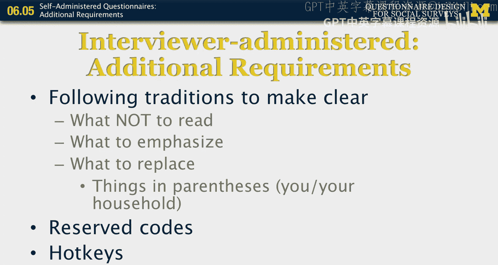

# 密歇根大学《调查数据收集和分析（2-6：方法、社调问卷设计、抽样、缺失数据、分析）｜Survey Data Collection and Analytics》 p77 34_自填问卷的额外要求.zh_en -BV1fw4m1e7Zh_p77-

So self Win questionnaires， they have a couple of additional requirements that we want to talk about。

The key requirement really overall user friendliness。If it looks user friendly。

 you'll reduce unit on response。 So a lot of work beheaded by Dllman。

Various colleagues that show that。It also reduces item non response and improves data quality。

 If it's really clear to the respondent what they need to do， the whole thing。

Should motivate the respondent to take care in answering。 And if it looks important。

 then the respondent will feel that it's worth while to spend the time on it。

If the questionnaire looks as though the researcher doesn't care。

 why should the respondent respond however。Don't go overboard。It had happened to me that you know。

 the other day I was sitting in a doctor's office in the waiting room and I saw some magazine like glossy paper。

 a few pages here。And then flipping through it， I realized that it actually was a questionnaire。

 but it was so nice that it kept sitting out there in the waiting room rather than be filled out so you have to find the right balance of still looking like a scientific research questionnaire。

 but enticing the respondent to answer。😊，So what do you need， a cover page。

 the cover page usually has the name of the survey， a sample ID。

Or some other form to detect who is the respondent， because as these things come back。

 you want to make sure you can check them off your list and so that you know who's an nonresponent and who might cause an nonresponse bias or where do you have to send additional reminders。

 It's not a bad idea to collect the data of data collection at the cover page。

Let is actually true all of these things for computer aid。Interview administered surveys。

 but often that is programmed into the instrument， and you don't have to worry about it yourself。

 but they can be helpful for your analysis in an interview administered survey， because you can see。

 for example， effects of interviewers over time。 you know， as they administer more and more surveys。

 there might be interviewer effects that creep in because interviewers tend to read much faster or they anticipate the respondent answer and plug that in。

Of course， you need instruction for the respondent what they should do with the questionnaire that also can be on the cover page or in the advanced letter。

 although who reads that letter so you want to make sure that respondents have that information handy。

Often there are some quick frequently asked questions。

 maybe what's done with the data or how survey should be filled out and mailed back。

And then there could be a nice picture image， although here too。

 I would say don't go overboard there are a couple of interesting new studies out there by Don Dillman experimenting with cover pages and features of those pictures on the cover page of a survey showing good effects of pictures that are somewhat related to the respondent when it comes to surveys about their own area and such。

So something to look out for in papers to read as you plan your self administered mail survey。

Here's a survey example for a cover page for the National household Education Survey。

 and you see here a couple of pictures of people who have engaged in educational activity and a frequently asked question page that is part of this question。

Inside， you see a lot of design features that are sort of typical for mail surveys that are still machine readable right so there are codes here on the side that help align the questionnaire for an automatic reading device。

And you see and we saw that in some of the examples of the census questions。

Color coding and then invite very prominent where the respondent should fill in their answer。

Boxes clearly marked。 how many digits you expect them to give for a certain answer。

 There's a clear sort of sequence of question to be answered。

 Atten is drawn to the answer categories。 All of these are good features for a question here。

In an older wisdom of his spoke， Don Dllman had a couple of nice。

Guidelines on formats to avoid and formats to consider when creating a self administered questionnaire。

He suggests to avoid printing on both sides of a sheet of paper。

 if you have a single sheet of paper that you basically just hand over to the respondent because they do tend to overlook the backside。

 so it might flip this open， even if it's stapled， in the upper left corner， you know。

 flip over the page and then you overlook the backside and might respond less to that。Also。

 if you only sta them up in the upper right left corner or I guess right corner depending on where you are。

Chances are that you might lose a page， you know， the last page can get lost and with it the defographic information that you have there。

 so that might be an unnecessary source of error that you can easily avoid， for example。

 by printing pages in landscape format and then folding them over so that you have a little booklet and then you can sta with that along the spine。

This way， you don't lose pages and it's more in the book format style so that respondents also consider back sides of a sheet of paper when they flip through this questionnaire。

If you want something to be not noticed， you have to make that clear either through visual designs or to specify that。

Decrease the fund is a sheer thing yet people don't pay attention to it。Some question is。

 we'll have next to the boxes the coding for the answer categories。

 which can help when you have people keying this in and if you can't avoid having them。

 then you should make them as small as possible so don't distract the respondent。

You can play around with color and shades， all of that is changing of course rapidly as we change the way we print or have layouts on the web。

It is certainly helpful to consider elements that visual clues on what belongs together。

 so a close proximity in spacing or shading indicates for the respondent that this is sort of a common theme。

 maybe one question and you can use that feature of similarity to help the respondent move through the questionnaire。

There's a nice book design of everyday Things that I can recommend when you want to think about general design features。

When it comes to questions， you want to make sure that you vertically align all the questions。

 it's not such a good idea to have questions horizontally and vertically because then it's not clear in which order people should go。

You can use narrow columns， you know， to encourage more complete reading of the words， you know。

 if it's too long， like this format of the slides， sometimes a too long to easily grasp what is in a row。

And it also gives the respondent the feeling to make continuous progress and move quickly from one page to another。

 so you want to know space out your questions in a way that it doesn't feel like a tax form。

 that's sort of the overarching goal that you want to have should be easy。

 fun to fill out and they should want to do it when they look at it。

Don't split the questions across separate pages that can lead to missing data that you don't want。

 and it's good to ask one question at a time。Here's a snapshot of some of the's examples。

 the original question raised version here you have an evaluation of services of an organization。

 how important they are and the frequency they have been used and I have seen several surveys like from cities that evaluate their customer satisfaction。

 for example， to save space they often do this， you know there's a question on one topic or a couple of items and then a follow up to each of these items。

Tucked right behind it and there too we have seen a lot of missing data rates for those righthand side questions if you will so in that sense it is better to repeat the question you know while this takes up more room you will have the respondent answer both of these elements before now you can play around with the order might make sense to first talk about the number of times a certain service was used and then ask how important it is to avoid context effects although here you probably would need an experiment to decide which order is preferable。

Here's another example of an inefficient structure of repeating question after question after question because here the answer category is exactly the same。

 the only thing that changes is the item itself， you know lack of rental housing and this is poor road and street repair so instead you could have one grouping and then each item listed separately and then response scales that is common across these questions。

Don't force common response scales if they don't make sense。

 if you don't remember what we said on response scales。

 Good to go back to that segment and rewatch the video。

A couple of additional requirements for interview administrative surveys。

It is important that you make clear to the interviewer what should not be read out loud。

 what to emphasize when talking and what to replace。 So in parenthees， often you have。You know。

 something that gets filled in either automatically， if it's a computer aided survey。

 if it's a paper survey， you can fill in the name of the respondent or maybe the day of the week we are currently at if you're asking for what happened the past seven days since。

Fill in the day and move on。It's also good to provide in a computeraied questionnaire。

 the interviewer with hotkeys so that they can get to help functions quickly and that they know which codes to use for don't know or maybe additional behavioral coding that you want to do if there was a lot of discussion about a question and you ask the interviewer to record and mark that they should need to know those codes。

All right。So much for the design and layout of a questionnaire and as we said。

 at the end of questionnaires， you say a big thank you and so thank you。

