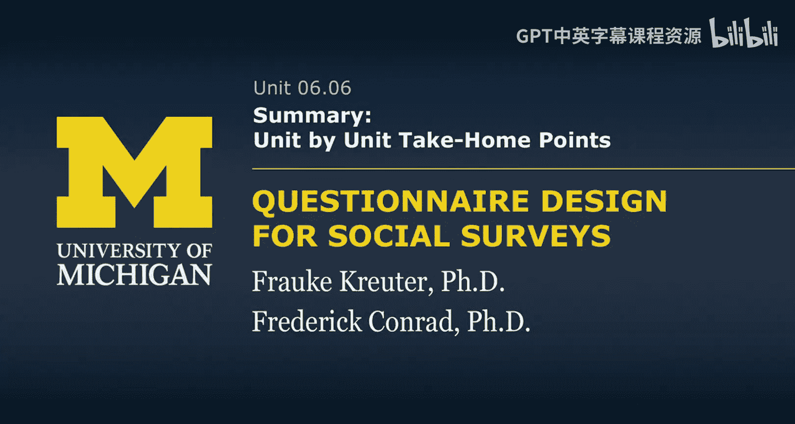
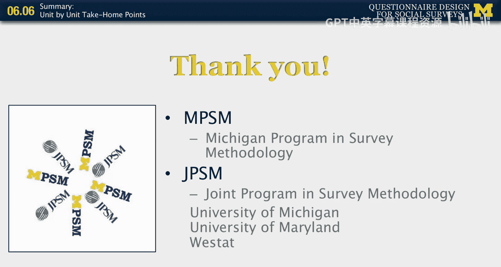

# 密歇根大学《调查数据收集和分析（2-6：方法、社调问卷设计、抽样、缺失数据、分析）｜Survey Data Collection and Analytics》 p78 35_单元要点总结.zh_en -BV1fw4m1e7Zh_p78-

Yeah。Welcome to our last video in this course。We provided for you a short summary of unit by unit take on points。

 those won't capture everything we taught in this class and also not all the important take on points。

 but some things that we thought I'm put to highlight as we close out this course。In unit one。

 we started out introducing three sources of measurement error， interviewer。

 respondents and questionnaire。And we discussed that measurement error can manifest itself in bias and variance。

If you come from a different discipline， you might think of these terms as validity and reliability。

 and we had a great discussion on the forum about these two different elements。嗯。

We also introduce to you to different interviewing techniques。

Standardized interviewing and conversational interviewing。

 And we discussed that standardized interviewing really promotes。

Delivering the same stimulus to everybody。Keeping the question or the question of wording constant。

 whereas conversational interviewing promotes the uniform form interpretation of the survey questions。

 particularly with definitions， this can be quite important。The first unit then ended with。

I strong appeal to you that you have a good concept specification at the beginning of your questionnaire planning。

And that you have an analysis plan in mind before you even start filling the survey。

 that way you can ensure that you have all items you need in your questionnaire。In unit 2。

 we talked about the psychological processes in the response process。

 so everything that happens in respondents minds between the time they're exposed to the question and the time they answer it。

So there must be a comprehension process in which respondents make sense of what it is they're being asked to provide information about。

Presumably after that comprehension process， they need to retrieve。

 recall relevant information in order to formulate an answer， but often what they recall。

 what they're able to bring to mind through retrieval processes isn't adequate。

 and so they need to supplement what they can recall through judgment and estimation processes。

Finally， after going through those three stages， they need to map what's in mind to the response options that they've been provided in a typical closed form question。

 and we talked about how error can be introduced at each of these different stages。

And that then brought us to unit 3 in which we looked at different question types。

And related the information that you learned in unit2 to good practices in delivering questions on each of these question types。

 we started out with a quick discussion on facts and quasi effects。

 pointing out that not everything that looks like a fact is easy to report for the respondent。

Then moved into a pretty long discussion on memory problems similar to what this was discussed in Uni2。

 and in particular pointing out that one good way to avoid recall error is that you have shorter reference periods。

 it's tempting to ask people for things that happened a long time back。

 but you probably would want to have different devices to ask for things that are long time ago。

However， short recall periods or reference periods and better recall cues can help you with those questions。

😊，Unit3 also had several videos on how to ask sensitive questions and we introduced to you that the reduction of social pressure will help with reporting on sensitive behavior or attitudes。

Self administration is one of those question wording can be another factor that you can manipulate here。

 and of course anonymity and privacy are important issues to keep in mind when you plan on asking sensitive questions。

The fourth unit concerned attitude or opinion questions among the main points is that attitude questions can be very sensitive to the context in which they are presented。

 so this can refer to the order in which questions are presented within a questionnaire or the order in which particular answer categories appear and each of these can affect respondents answers。

Question context can also refer to the external context to the media exposure， for example。

 that a respondent engaged in shortly before taking part in the survey in the interview or in the self administered survey。

We talked about how if you give respondents a don't know option， they will use it。

 so whether the question is designed with a don't know option really depends on the goal of the project。

We spent time discussing agree， disagree scales and noted that they can promote acquiescence。

 the tendency to give answers that respondents think are polite or will present them in a positive light because they make explicit what is positive and what is negative。

Finally， we talked about the notion of satising and the idea that survey respondents want to minimize their effort and will take shortcuts。

 so in order to reduce this tendency to satisfy， it's good for designers to keep the tasks simple。

And whether the task is simple enough or not is something that you can find out through preting。

 So we discussed in length in unit 5 that it's always good to them。Try at least for some pretesting。

As part of this course， we weren't able to。Give you assignments that made you。Test you。

Draft questionnaires in all kinds of different formats。

 but you at least got some expert reviews from your fellow classmates throughout this course。

And we were excited to see the network forming in the forum and in other venues。

 and I hope that people you got in touch with through this course will be a source for future expert reviews as you keep working in this field。

But of course， the other techniques， getting feedback from the potential respondent from that respondent pool set using cognitive interviewing or techniques that like are very important and so we want to reemphasize that you shouldn't forget to budget for this kind of thing it's often a place where people cut and just like interview your training。

 the pretesting is not that expensive relative to the entire survey data collection and so it is good to keep that in mind as you plan your study or the next project you work on。

You also should remember from this unit that designing a questionnaire is an iterative process and pretests and each iteration are good to improve your product。

And then finally， once you have tested the question here you actually see also the iterative nature right because you might test certain segments and then put the whole thing together or you will have a first draft of the entire questionnaire and then test it so here too some iterative process but in unit6 we did talk about how you put this all together in an entire questionnaire we pointed out and that's an important thing to reiterate that you should start with the topic of a question。

 something that is related to whatever you told your respondent the questionnaire will be about。

That it's important to make the questionnaire appealing and have a good flow of topics in the questionnaire。

 although you can switch topics and that will be okay。But in general。

You will be well served if you have your question as short as possible。

 which loop back to the very beginning in unit one when we discussed that it is important to have your analysis plan in mind because that allows you actually to cut out all the questions that you don't really need later on for your study。

We did not have enough time in this course to talk about all the different design features that they are out there for the different modes of interviewing。

 whether you have a web survey or interview administratived survey or surveys on the phone。

But we touched on some of them and we do want to point out again that any kind of computer assistance can help with the flow and filtering as well as with the administration of sensitive questions so you know in an interviewer administered survey you might still face to face survey。

 you might still have the chance to， for example， turn a laptop around or if interviews are done on a tablet to have respondent work on that tablet themselves for a moment。

So there mode things we can play with and we introduce some of those in unit6 in general。

 the most important thing to keep in mind is that the respondents are doing us a favor in answering these survey questions and so making the task for them as easy as possible should be the goal。

So it became evident from some of the posts on the discussion board that some of you。

Really we're looking for information beyond questionnaire design。

 but information from elsewhere in the survey process。

 this graphic which you may recall from an earlier lecture。

 lists all the different sources of error we focus just on measurement error。

 but the survey process is full of other sources of error there are other courses that focus on error besides measurement error。

 but that was our focus here。And this is not to say that there aren important things to learn about these other a sources and our two programs at the University of Michigan at the University of Maryland。

 you know， we do our best to provide additional information on that and we constantly increase our online offerings and hopefully we'll see you at one of those in the future。

Thank you。 Thank you。