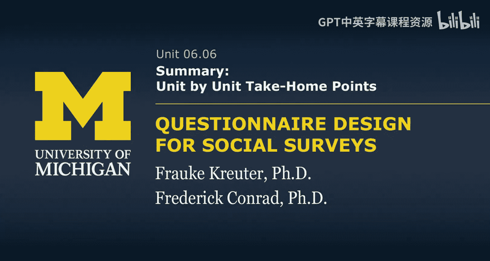
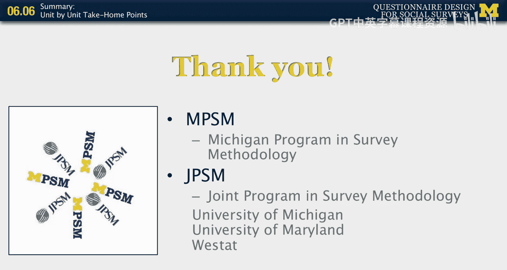

# 调查数据收集和分析：课程总结：单元要点回顾 🎯

在本课程中，我们学习了调查问卷设计、数据收集与分析中的核心概念与最佳实践。本节是课程的最后一讲，我们将回顾每个单元的关键要点。这些要点虽未涵盖课程全部内容，但突出了我们希望在课程结束时强调的核心思想。

## 第一单元：测量误差与访谈技术 📝

上一节我们介绍了课程概述，本节中我们来看看第一单元的核心内容。第一单元介绍了测量误差的三个来源：**访谈员**、**受访者**和**问卷本身**。我们讨论了测量误差可能表现为**偏差**和**方差**。来自不同学科背景的读者，可以将其理解为**效度**和**信度**。

我们还介绍了不同的访谈技术：
*   **标准化访谈**：旨在向所有人提供相同的刺激，保持问题措辞恒定。
*   **对话式访谈**：旨在促进对调查问题（尤其是定义）的统一解释。

第一单元结束时，我们强烈建议在问卷规划之初就进行良好的**概念界定**，并在开始调查前就构思好**分析计划**，以确保问卷包含所有必要项目。

## 第二单元：受访者的回答心理过程 🧠

在了解了误差来源后，我们深入探讨了受访者的内心活动。第二单元探讨了受访者从听到问题到给出答案期间的心理过程。

以下是回答过程的四个主要阶段：
1.  **理解**：受访者理解被要求提供什么信息。
2.  **提取**：回忆相关信息以形成答案。
3.  **判断与估计**：当回忆的信息不足时，通过判断和估计进行补充。
4.  **映射**：将心中的答案映射到封闭式问题提供的选项上。

我们讨论了每个阶段都可能引入误差。

## 第三单元：问题类型与设计实践 ✍️

基于对心理过程的了解，第三单元我们研究了不同的问题类型，并将第二单元的知识与每种问题类型的最佳设计实践联系起来。

我们首先简要讨论了**事实**与**准事实**，指出并非所有看似事实的信息都易于报告。然后深入探讨了**记忆问题**，并指出避免回忆误差的一个好方法是使用**更短的回忆期**。虽然研究者可能想询问很久以前发生的事，但更好的做法是使用不同的方法（如更短的回忆期、更好的回忆线索）来提问。

第三单元还有多个视频讲解如何询问**敏感问题**。我们介绍了减少社会压力有助于报告敏感行为或态度。**自我管理**、**问题措辞**、**匿名性**和**隐私**都是设计敏感问题时需要考虑的重要因素。

## 第四单元：态度与意见问题 🗣️

第四单元关注态度或意见问题。主要要点之一是，态度问题对呈现的**语境**非常敏感。这包括问卷中问题的**顺序**、答案选项的**顺序**，这些都会影响受访者的回答。语境也指外部环境，例如受访者在参与调查前接触的媒体信息。

我们讨论了如果提供“不知道”选项，受访者就会使用它。因此，是否设计“不知道”选项取决于项目目标。我们还花时间讨论了**同意-不同意量表**，指出它们可能助长**默许偏差**（受访者倾向于给出他们认为礼貌或能展现积极形象的答案）。最后，我们探讨了**满足感**的概念，即受访者希望最小化努力并走捷径。为了减少这种倾向，设计者应保持任务简单，而**前测**是判断任务是否足够简单的好方法。

## 第五单元：问卷前测与迭代设计 🔄

在讨论了各类问题设计后，第五单元我们详细讨论了**前测**的重要性。作为课程的一部分，我们无法让大家以各种格式起草并测试问卷，但大家在整个课程中至少从同学那里获得了一些专家评审。我们希望在本课程中结识的人能成为未来工作中的专家评审来源。

当然，其他从前测受访者那里获得反馈的技术，如**认知访谈**，也非常重要。我们想再次强调，不应忽略这方面的预算。与整个调查数据收集相比，前测和访谈员培训并不昂贵，在规划研究时应牢记这一点。

还应记住，问卷设计是一个**迭代过程**，每次迭代中的前测都有助于改进最终产品。

## 第六单元：整体问卷设计与整合 📑

最后，在第六单元，我们讨论了如何将所有部分整合成一个完整的问卷。我们指出，应以与问卷主题相关的问题开始。让问卷具有吸引力并保持良好的话题流很重要，尽管切换话题是可以的。总的来说，**尽可能缩短问卷**对调查有利，这又回到了第一单元我们讨论的：在心中有分析计划很重要，因为这允许你剔除研究中后期并不真正需要的问题。

本课程没有足够时间讨论所有不同访谈模式（网络调查、访谈员管理调查、电话调查）的所有设计特点，但我们触及了一些。我们想再次指出，任何形式的**计算机辅助**都有助于流程控制、跳转逻辑以及敏感问题的管理。最重要的是要记住，受访者回答调查问题是帮我们的忙，因此**尽可能简化他们的任务**应是目标。

## 超越问卷设计：调查中的其他误差源 📊

从讨论区的帖子可以看出，一些学员希望获得问卷设计之外、关于调查过程其他环节的信息。下图（源自早期课程）列出了所有不同的误差来源。本课程仅关注**测量误差**，但调查过程中充满了其他误差源。有其他课程专门关注测量误差以外的误差，但那是本课程的焦点。这并非说学习其他误差源不重要，密歇根大学和马里兰大学的两个项目会尽力提供相关信息，并不断增加在线课程，希望未来能在其中见到大家。

## 总结

在本节课中，我们一起回顾了《调查数据收集和分析》课程各单元的核心要点：从测量误差和访谈技术，到受访者的回答心理过程、各类问题的设计实践、态度问题的语境敏感性、前测与迭代设计的重要性，以及最终的整体问卷整合。核心在于理解受访者，并通过精心的设计尽可能减少误差、降低受访者负担，从而收集到高质量的数据。感谢大家。