# 密歇根大学《调查数据收集和分析（2-6：方法、社调问卷设计、抽样、缺失数据、分析）｜Survey Data Collection and Analytics》 p79 0_1.0 课程导论.zh_en -BV1fw4m1e7Zh_p79-

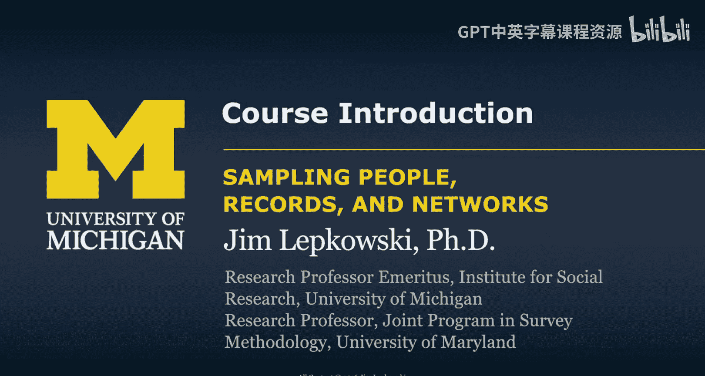

Hello， welcome to our course on sampling people， records and networks。

 part of a specialization on data collection methods being done through the University of Michigan。

 My name is Jim Lepowski， and I'm a professor and research professor Emeritus at the University of Michigan。

And we'll be conducting this course teaching through these lectures as well as assembling materials for you。

 the students to work through to help you understand the material that we're talking about in lecture。

We're interested here in sampling methods as applied in a particular set of areas。

 sampling methods in this particular case， we're going to be dealing with with respect to the social sciences。

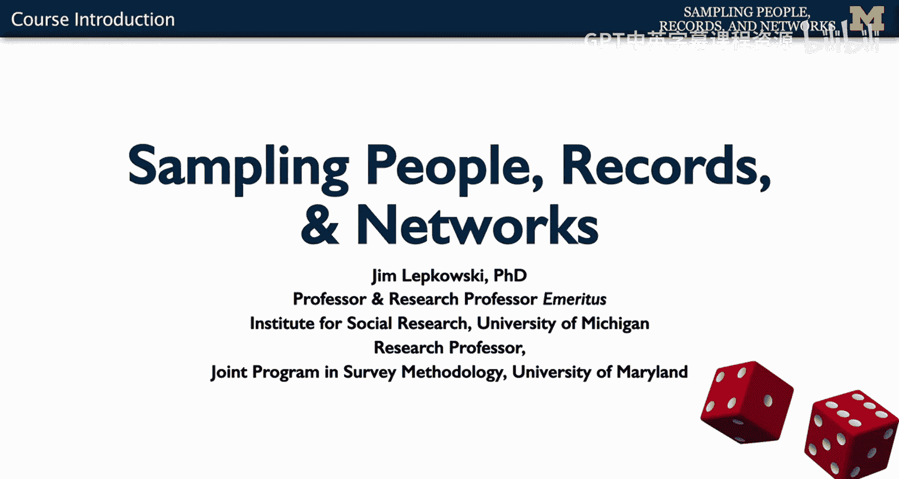

It's an activity that we all do in many different ways and so I don't want to restrict our labeling of sampling to just what we're going to talk about here。

 but we're going to do a restricted range of sampling activities here。

But we want to acknowledge that sampling can have a lot of different applications。

And we do sampling in our everyday lives， for example， without even knowing we're doing it。

 sometimes we're all used to sampling foods， I think we'll have a little of this or a little of that。

Or entertainment events。Let's just see what it's like to do this or to do that。

Or sometimes experiences'。Let me try it one time to see what it's like。

Our bodies are sampling machines， even when we do something like vision。

 where we're constantly sampling only a part of the environment around us。

 and it's done very quickly， We are not really conscious of it for the most part and。

So what we see is what our mind controls in terms of sampling the environment around us。

But that sampling is ubiquitous in the science as well。For example。

 physicians use samples of patients all the time to draw conclusions about risk factors for disease for everyone。

They will draw conclusions on the basis of the patients that they see in a clinical practice and then use that and their training to draw conclusions about what happens to an individual patient who's coming in next or just to generalize。

Physicists use samples of an environment to draw conclusions about the entire universe。

 they only are able to directly observe certain things that are in an immediate environment。

 and then they extrapolate to an entire universe， that's a sampling process as well chemists do this where they use samples of chemicals to see how processes operate in the laboratory and elsewhere in the social science social sciences。

 psychologists use samples， they use sometimes psychologists will use samples of undergraduate students to make inferences about how everyone regardless of age will behave in different settings。

And so this kind of thing goes on because that's the material we have to work with。

 we can't observe all， we observe a portion， and that makes it an operation based on a sampling。

Often when we think about these things， though， in science or even in our everyday life。

 we're making an assumption that the environment around us that we're using to examine a particular phenomena is uniform。

 That is we're willing to assume， for example， that risk factors for disease affect everyone in the same way。

 even though we've only observed those risk factors in the disease in a particular setting in a particular location in a particular point in time。

 where。Willing to make inferences about what would happen in another time， in another setting。

And oftentimes， that kind of conclusion is perfectly sound。But we are。

Here are going to be more careful about looking at what the sample tells us than if。

 if our assumptions are correct about the the uniform mixing。

 what happens for the particular happens for all。So for a physicist。

 it's probably a safe assumption to make that the environment is well mixed and one sample from one location will have the same properties as a sample from another location and similarly for the chemist and so on。

But in the social and health sciences， and in many other areas。

 it can be misleading to assume uniformity or random mixing as it's sometimes called。

And that one sample is as good as another for drawing conclusions about all。

 about the population from which the sample was drawn。In this course。

 what we're going to do is look at what we know about how sampling can be done to deal with the non uniform。

 the non mixed world we live in。We're not going to rely on assumptions about how the atmosphere or chemical compounds or people or diseased etiology is distributed。

 We're going to be looking at sampling methods that instead force the mixing。

 not in the population or assumptions about the population or the environment or the flask or elsewhere。

 but in the sample。 We're going to look at how we can use random processes in selection。

To avoid the need for assumptions weak or strong about the population and to avoid the kind of bias that can sometimes arise when our assumptions are wrong。

Hence， on this slide， the appearance of the dice， we're going to play dice with the sample。

 not as Albert Einstein once speculated with the universe。

 but with the sample and how we assembledsem that sample。

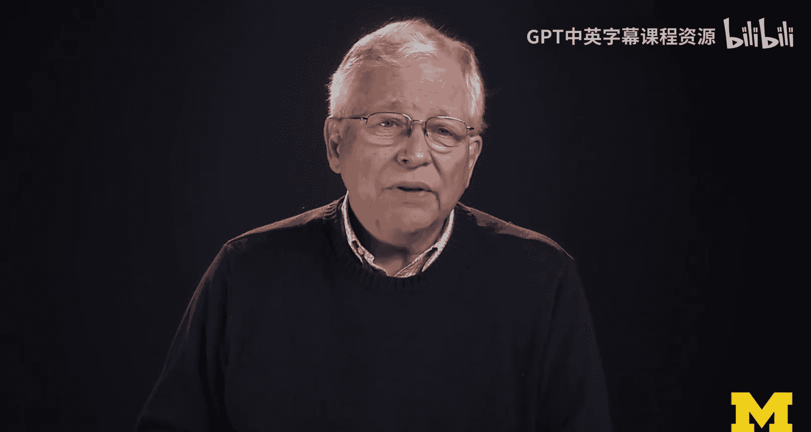

We're going to address the problem in several steps。

Here we have the units that we're going to be discussing these issues and six of them。

In the first in unit one， what we're going to do is talk about research design。

And how sampling and its use in surveys work together as research tools。

 We're not going to look at all kinds of research designs。

 We're going to look at the survey and the survey sample and data collection that goes with that kind of an operation。

As a subset of the many tools that we could use in research。

But in this particular case， we're going to be talking about the ideas of sampling in a survey setting。

 and typically I'm thinking about survey samples of people hence the name of the course。

 although when we sample records we're thinking about people。

 those are typically records about people， although they don't have to be。As well as networks。

 which are groups of people， so it's mainly about sampling human beings here that we're going to be talking about then we're going to move in unit two to talking about sampling techniques and by techniques we're referring to the processes that are used by researchers to select samples。

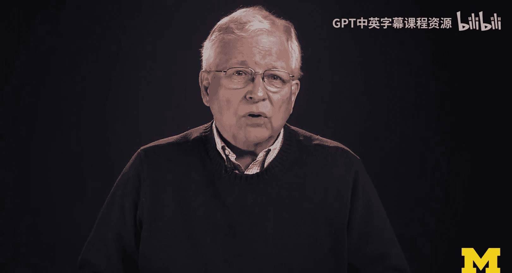

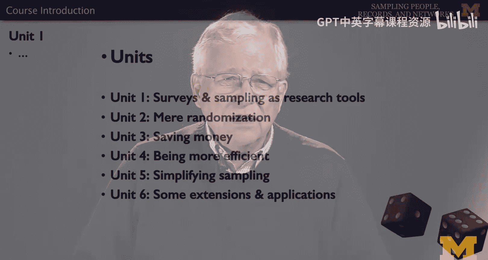

Now there are actually three basic tools that we're going to consider in this course。

 they're not the only ones， but three basic ones。And the first in unit2 is random selection。

Usually sampling that uses just random selection is referred to as simple random sampling and I've used the title here。

 mere randomization， only randomization， that's what I mean by that。

 we've used the term here that is somewhat unusual to make the point the usual term simpleple random sampling actually connote something else then just randomization but it's got the same meaning that was the intended terminology。

 but that's what we're going to do in unit2 is just what happens if we only use randomization in the selection process。

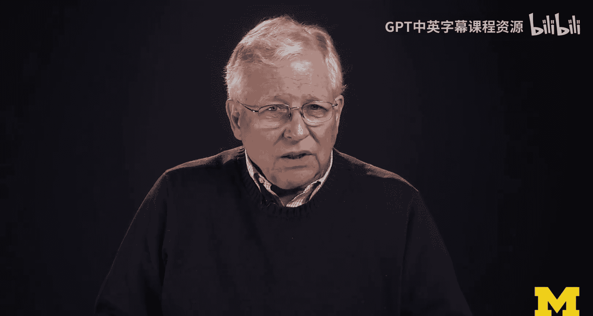

Units 3 and 4 introduce the other two factors。 and these lead to a set of techniques that are related to each of those factors that we use in sample selection。

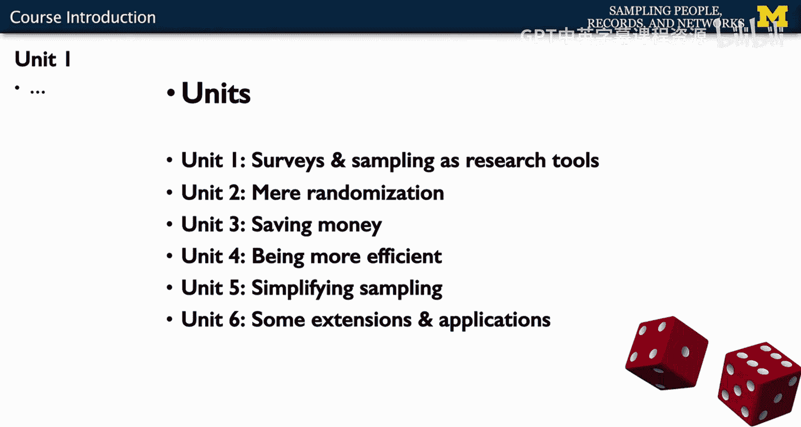

One。Technique or set of approaches have to do with grouping the elements of the population and selecting groups instead of selecting individual units。

This is done to reduce costs。 This is what's called cluster sampling。

The second technique that we deal with is one that also does grouping。

 but here the grouping of the sample of the population into various groups or strata as they'll be called。

 so called stratification is used to control the efficiency of what we're doing。

 the effectiveness of what we're doing。Sttraatification can actually be used as we'll see to give us better quality at almost the same cost as mere random sampling。

 and so it becomes a technique that is automatically used because。

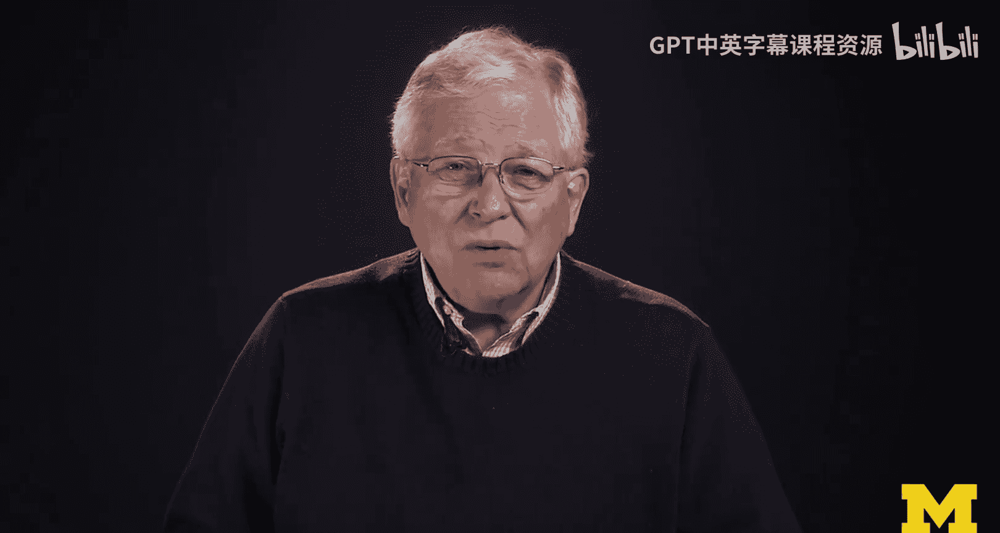

Randomization serves as a foundation， but stratification。

 grouping and these kinds of efficiency gains are very inexpensive to obtain and when's going to do those almost automatically。

Regardless of whether we group and then select or we select groups as in cluster sampling。

We're only going to talk about how to do this when we use randomization in them。Now unit5。

 we're going to go back to a technique that sometimes people introduce first。

 it's a very easy way to draw a sample， something that we do automatically。

 it's what's called systematic selection or just counting。

Counting and taking every so many。There are some pitfalls to be aware of。

 and we will go through those because we want to provide you with some tools that make you a little more sophisticated in your application of the technique。

And we'll emphasize when these kinds of pitfalls that we run into are important。

 how to remedy them and when one might not want to use that particular technique。

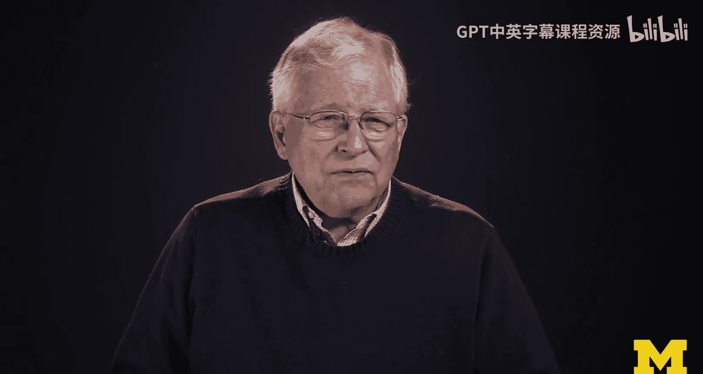

Then we're going to wrap up the course in unit6 by dealing with a couple of extensions that make sampling easier to do for records and for networks。

And we're going to deal with those briefly such issues as how to deal with the complexity as opposed to the simple nature of simple random sampling。

 the complexity of the design when using clusters and strata and its impact on the conclusions that we draw and about the quality of our data。

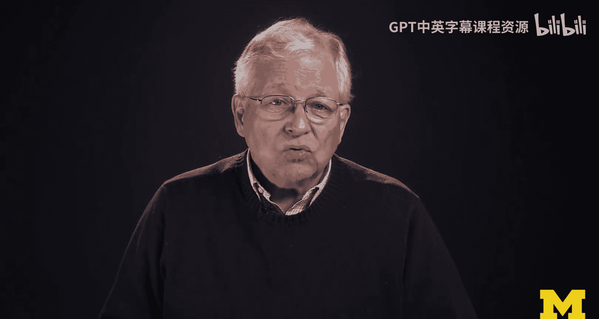

As we do this， I'm going to organize this with some additional sidebars in our display。

 and I just wanted to illustrate that here。We're going to have multiple lectures in each unit and as we jump to a unit。

 we'll have two things to keep track of the units and lectures。

 I'm going to use a box like this in the upper left of our slides to alert us to when we're talking about units as here。

Or about lectures as shown here。 So here I've expanded unit1 into seven lectures that we're going to be doing。

And before the lecture， I'll remind us me， as well as you what it is we're talking about in the context of this unit。

 So here we see that there are 7 lectures planned for unit 1。

 They're displayed in both the main box on the center of the screen， as well as to the left。

And that's just to help me keep track of it I'm actually going to highlight those those issues。

 So for example， here highlighting lecture one to say that that's what we're going to be talking about today and as we do that highlighting then and move into lecture one we'll introduce the topics that we're going to discuss in lecture  one。

And then we've got a reminder that yes， we're in lecture one。

 but these are the particular topics that we're talking about。

 and then finally we're going to move into each of the topics one by one。

 but on the upper left we'll have a smaller box that displays what topics within the lecture we've got。

And I hope that will help you understand as sometimes these things we will go a little long just where we are in the progression and the flow。

But that's enough about format， I just want to say a few more remarks before we get started about our consideration of research design。

We're going to open unit one on sampling as a research tool and lecture one about research design and sampling。

 where we get a little more into the context， the setting for sampling that we'll be talking about。

My hope is that as we go through these lectures， you'll come to appreciate how the techniques we talk about in the context of surveys of people。

 records and networks can be applied to other areas。

 especially as we understand how they are applied to these particular kinds of research subjects。

Two last things before we start， you may find that as we go through these lectures。

 I express some enthusiasm。 it's a little hard for me to do as a statistician a mathematician。

 but I can be enthusiastic about this stuff because I like it。 I've done this a long time。

 I've really find this a very powerful research tool。

 and I've seen some of my colleagues do amazing things with these kinds of approaches to research design。

😊，And that I find that these are a very powerful set of methods， they're not perfectly structured。

There are some fundamental flaws to these kinds of things， philosophically to these approaches。

 But on the surface， in the theory， what we have are a set of methods that don't require us to make assumptions upfront about what we're doing。

🤧And。Provide us with a very good starting point for beginning to think about how we should do our samples。

So when I think about doing a sample design， a sample for a particular research problem。

 I come back to the fundamentals I'm going to be talking about。

 so I'm going to talk about fundamentals and principles as though they could exist in practice as we talk about them。

In actual practice， we have to depart from these kinds of approaches all the time。

But if you're going to make departures， you better know what you're departing from。

 and so that's the point here， we're providing a baseline。

 a foundation from which once we understand that foundation。

 we could make some departures and make practical decisions that mean that the difference between whether we can conduct a piece of research or we can't。

So I think about these as foundational kinds of issues。

 and this is particularly true with respect to randomization。

 I'm going to make some statements here that for teaching purposes are exaggerated， for example。

 I'm going to say that randomization gives us the ability to draw conclusions without making assumptions。

Technically， that's true， but in practice， it's not because we end up having to depart from true。

 randomized selection。

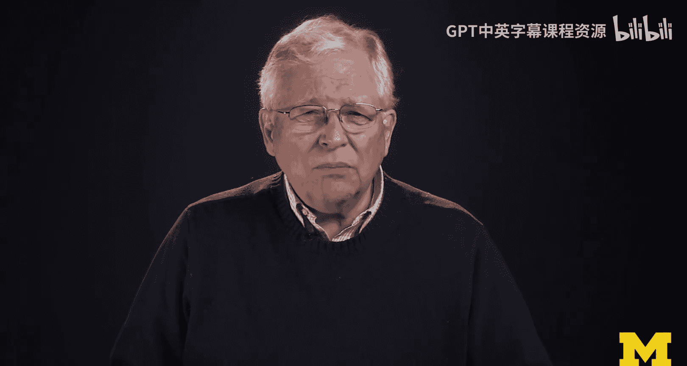

When we deal with deficiencies in our sample， units failing to respond， we can't get data for them。

 And in those cases， we actually begin to make assumptions that help us post collection。

 post selection。Address some of those deficiencies。

 This is what's sometimes called a frequentist approach。 I won't go into the discussion of that。

 Others prefer more of a model based approach to these kinds of things。

 but I'm going to stick with that approach because it's fairly standard in the field。

 It's not to say that the the alternative is wrong or or inferior。

 It's just to say that's what we're emphasizing here。 Let's understand this approach。

 before we attempt to do something along the lines of dealing with more principled approaches。Okay。

 I'm ready， if you are， let's turn to our first lecture and look at what happens in research design and how survey samples fit into the context of research design。

 Thank you。