# 密歇根大学《调查数据收集和分析（2-6：方法、社调问卷设计、抽样、缺失数据、分析）｜Survey Data Collection and Analytics》 p80 1_1.1 研究设计与抽样(上).zh_en -BV1fw4m1e7Zh_p80-

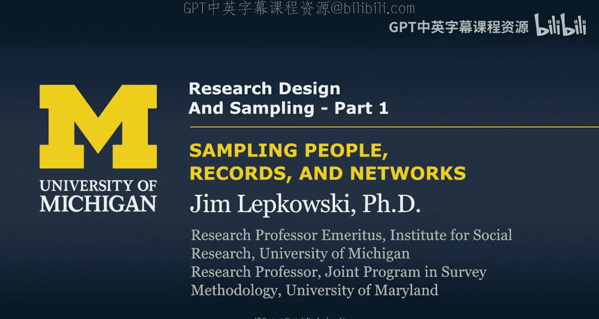

Hello and welcome back to our course on sampling people， records and networks。

 My name again is Jim Lepowski， the instructor for this course。

 and we're going to be talking about our first lecture here under our first unit。

 where we're going to be talking about sampling as a research tool。

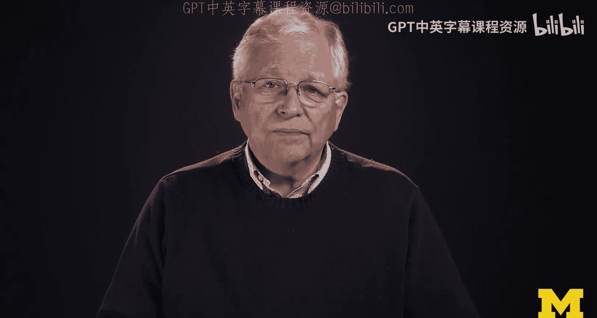

And so in this particular set of materials， what we're going to be doing is opening our early lectures about sampling as a research tool where this is a lecture on research in general。

 research design and how sampling fits in。And sampling will fit in in the context of surveys which we're going to classify as a type of research design。

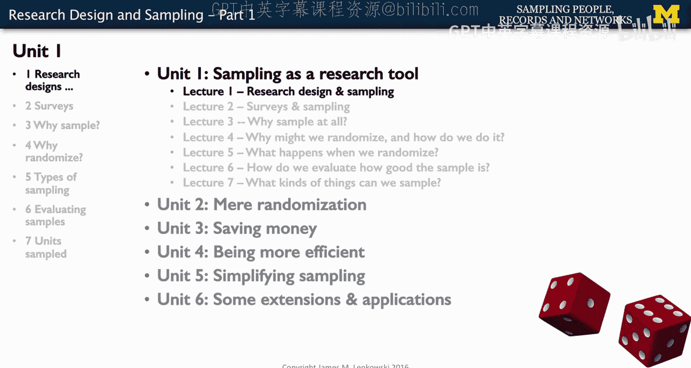

Now there are basically two parts to this lecture and we'll pause between the two parts as we go along。

 The first part will be about research design and we're really going to talk there about experiments and quasi experiments and have a couple of illustrations to set in our minds the nature of experiments with human populations。

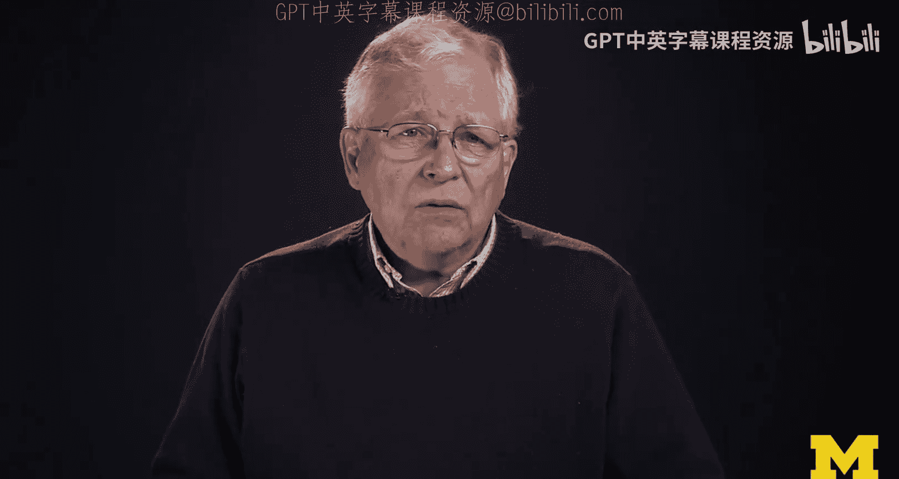

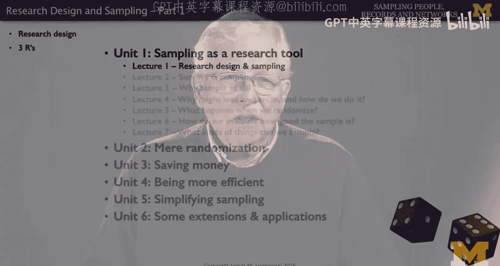

And then we're going to in the second part， talk about the principles of these designs in the context of survey samples。

 we'll move in to talk about survey samples then in the second part and about the underlying principles what I'm calling the three Rs of research design。

 but that brings us to then talking about research designs and surveys。

 how do these two things fit together and as I said。

 we've got these two parts that we're going to be examining。

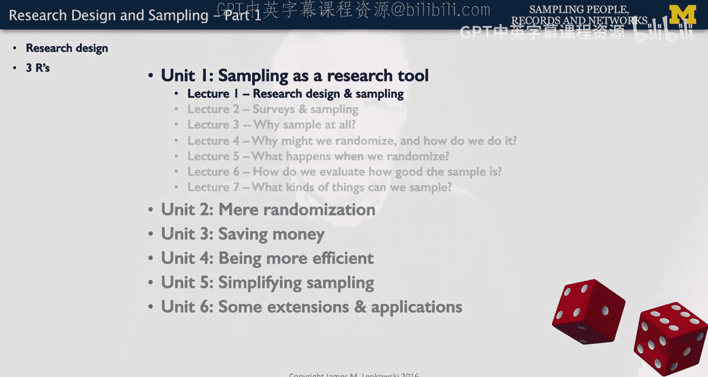

And I'm going to be operating under the assertion that surveys are a part of scientific research。

Surveys are used in other contexts too， as are other research designs。

 but here for scientific research， we're going to be thinking about surveys that are formally done to address particular research problems and hypotheses that go with those particular problems。

 we're going to talk about them in terms of idealized designs as we do this。

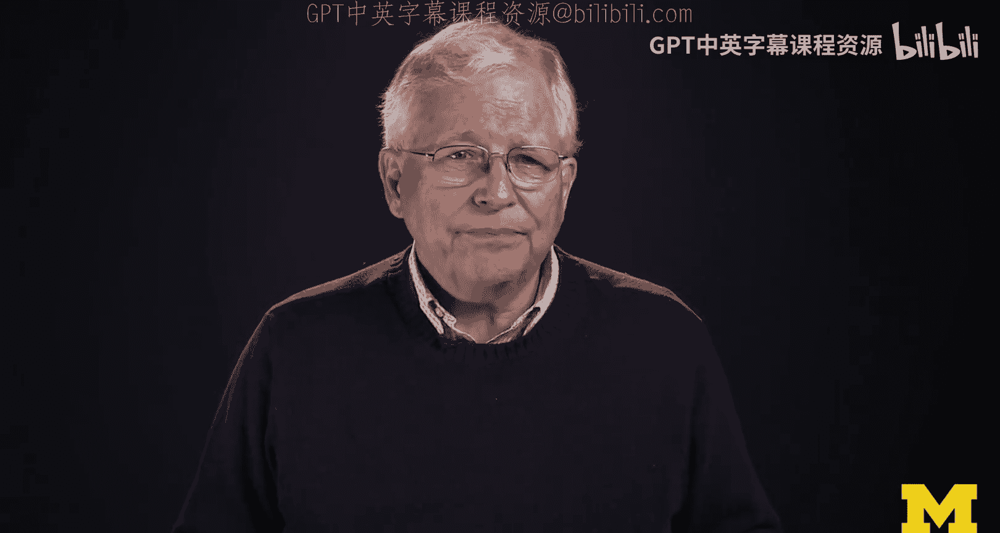

Now， within research design， when people talk about research， they typically think about experiments。

 experiments in which there's some kind of a scientific novelty。

 there's something that we're looking at that's new and we're comparing and contrasting it with something that we already have in place or're never had。

 we're going to look at something new and contrasting。

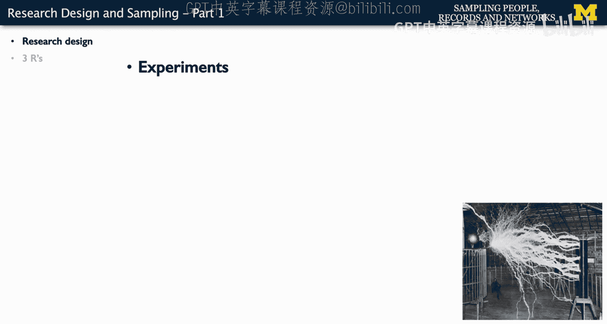

And so we tend to think of a laboratory with these kinds of things。

 a scientist working quietly away on some observational studies。

 carefully documenting findings and reporting them to other scientists before they are shared with a larger public Now you notice an image here in the lower right composite one from Nicholas Tesla's laboratory。

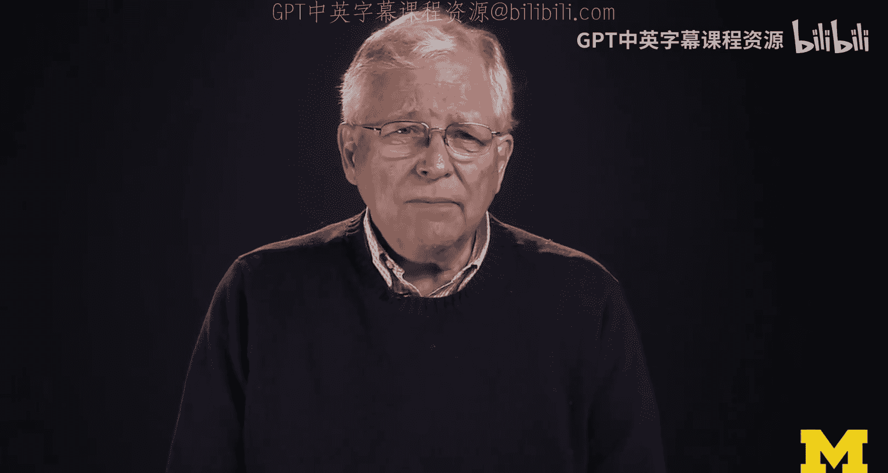

And， of course， this one's a composite。 This is several pictures。

 imagesm laid one over the other of something was going on。 This didn't happen all at one time。

 but it's very striking。 Now， this looks like experimental science in action， right， Well， well。

 yes and no。 This is fine for studying natural phenomena。 What about phenomena involving people。

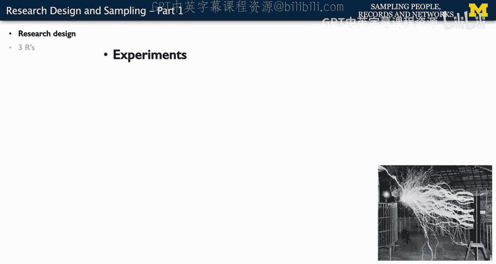

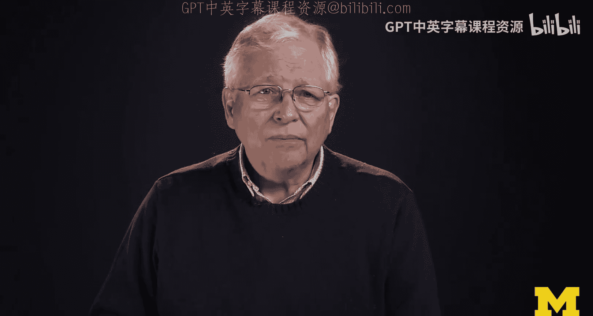

And so in doing that here， we need to be a little more refined。

 and these are not principles that Tesla wouldn't have used。

 but just ones that we need to think about more explicitly when talking about what we do with human beings。

Experiments are idealized manipulations， idealized manipulations of major kinds of phenomena。

 a thing that we're tempting to examine a phenomena we're attempting to examine。

And contrasting it with something else。 So there's a comparison that's going on。

 And there is a a major variable that we're interested in and then something that we are using as a background to compare to。

 And we'll talk about that in the context of one experiment in the middle in a minute。

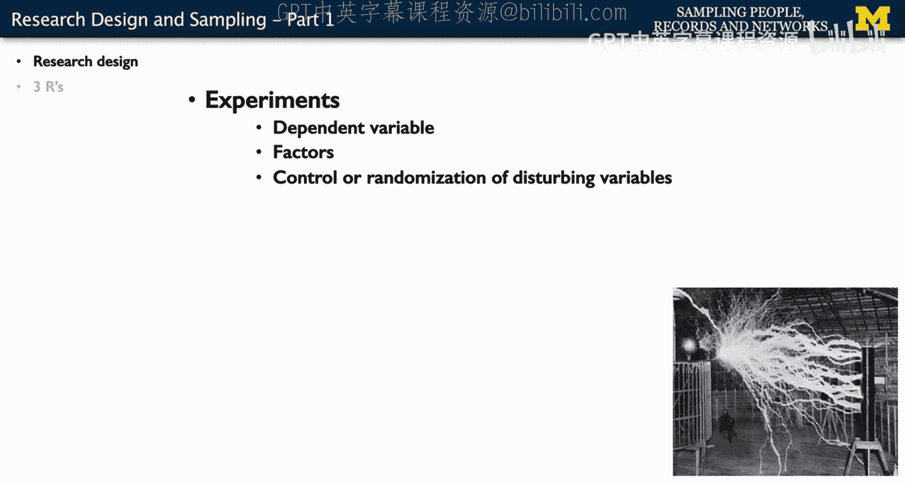

There are in the background， though， disturbing variables that could interfere with our ability to compare treatment A to the standard treatment。

 treatment B， disturbing variables that could interfere with our ability to compare the application of a new set of pharmaceuticals to a condition and compare them to not having those pharmaceuticals at all。

And these are disturbing variables that can。Cause us to assume that cause us to conclude that there's an effect when one is there or cover up an effect。

 even when one is there。

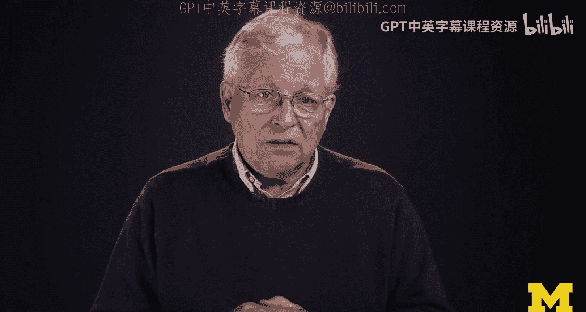

And in order to deal with those disturbing variables。

 something called randomization is used in the designs so that subjects are either given treatment A or treatment B。

 given alternative A or the control and which they get is determined by a chance mechanism。

 not by an individual investigator's choice， but by some mechanism that is external to them。

 therefore being objective， rather than internal to them and subjective。Now。

 let's consider a classic example and in matter of fact。

 the first large scale randomized trial of human subjects。

That was conducted in 1954 in a field trial of the SoC polioomyelitis vaccine， the polio vaccine。

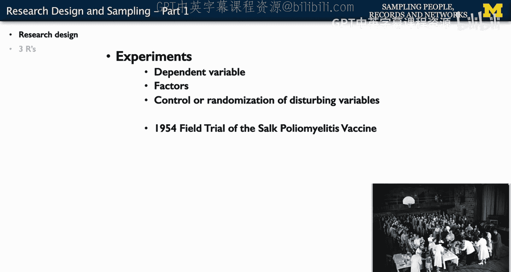

Poo is a virus， it's an infectious condition， it's transmitted by what's called the fecal oral root。

 it's transmitted through unsanitary conditions。 Our particular story here has to do with the more recent history about it when it became more prominent in the public's thinking after World War I。

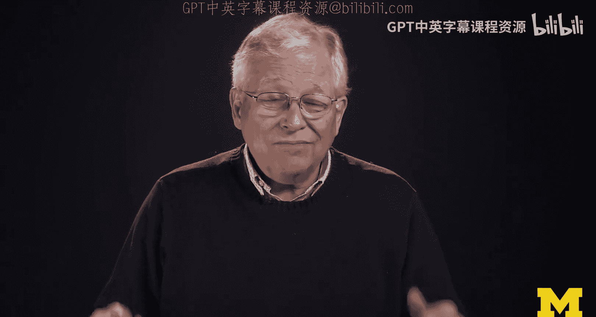

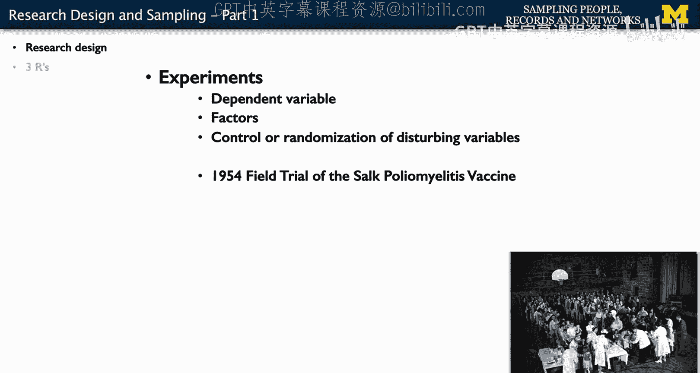

People were very concerned about this。 And the first vaccines that were thought to be effective were developed by a meend named Doctor Jonas Sack。

But no one was sure that the vaccine would be effective and safe in a general population。

 They knew that it worked in the clinical studies that had been done。

 but they were very small and they needed。 They thought a large scale field trial to find out what would happen。

The study had to be large because the disease instance is very rare。

 the occurrence of new cases is quite low。

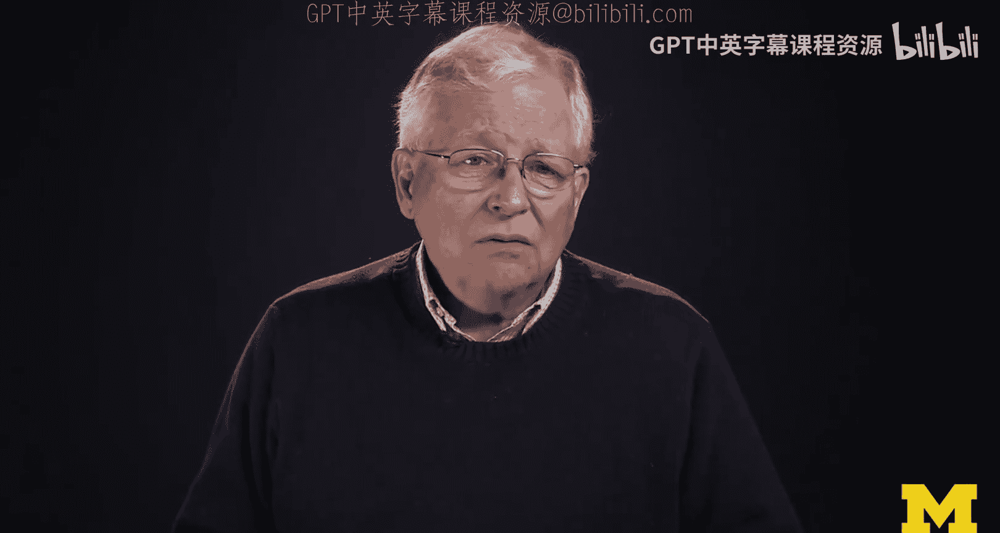

A study was proposed in which one group of children would be immunized and another group would not。

 That's the comparison。 That's the essence of the scientific approach。

 comparing these different outcomes。 The rates of polio and the two groups would be compared and the idea would be。

 let's immunize one group and not another and then compare what happens to them。

 And they decided that they would do this among first through fourth grade children design that was proposed is that first and third grade children would receive the immunization and the other second and fourth grade would not。

Now， everybody would know what window had had gone on， but this， this design was because of that。

 widely criticized， because everyone who would know who was immunized。

 including the parents and their doctors， and they would be more aware of。

 especially if their child did not receive the immunization， what was going on。

 and there may be increased attention and the rates that might be observed among those children might actually be different than the background rate that they were interested in studying and contrasting to what was happening under the vaccine。

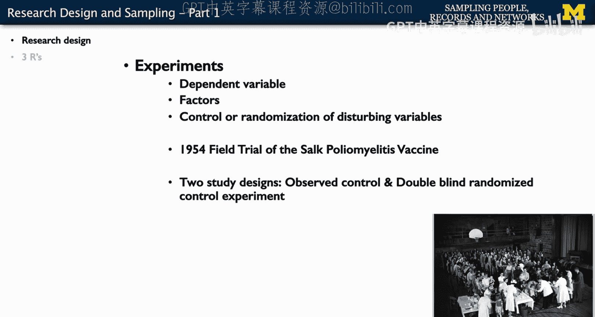

So that would tend to narrow the gap and thereby not demonstrate the full effectiveness of the vaccine。

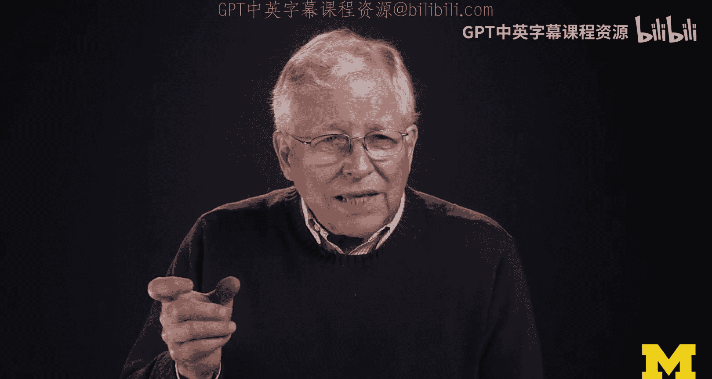

Even though the first and second and third grade students came out of the same schools。

 one could not be sure that the backgrounds of the immunized and the not immunized children would be on average the same。

 there could be differences with respect to immunization background with respect to the s exposure to the virus。

 and so there could be other factors here that were interfering with that comparison。

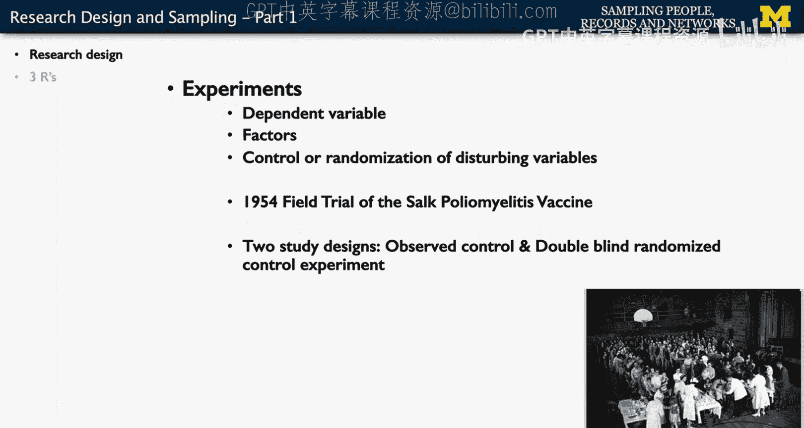

As a result of this concerns， a second study was proposed to run simultaneously。

 So let's do it with the first， the second and the third grade children。

 We're going to immunize the first and third grade children and not the second grade children。

 We're going to compare them。 But then at the same time， let's do the following。

 Let's get another sample of first second and third grade children。

And these were done through volunteering schools and communities， so it was never imposed。

And then all of those children would be given an injection。However。

 a randomly chosen half of the children would get the vaccine， and the others would get a placebo。

 a salt water kind of solution， not not having any known effectiveness and certainly not any property that would would hurt the child。

But no one would know about who got the vaccine and who did not except this， the study investigators。

 All the children were to be followed。

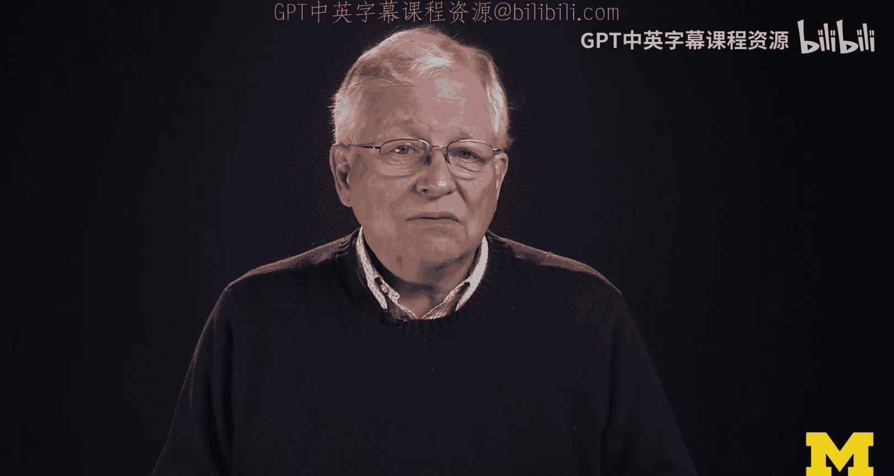

So those getting the vaccine and those not getting the vaccine。

That was on the basis of a randomization， Not not a choice of first and third graders versus  second graders。

 but among all those children， randomly deciding， objectively deciding who would get the vaccine。

 statisticalically， this has valuable properties。 It evens out the background variables。

 We don't have to worry about， on average， the background variables。 Now。

 as you see that the study was enormous。 It evolved over 1。8 million children。

And for the observed control design， just to see what was going in the background。

 there's a million children involved。 Now they weren't directly affected by this。

 they didn't get the vaccine， but they weren't directly affected。

 but the other two parts of the study， the nonranized study。

 comparing first and third graders to second graders and the randomized comparing those first。

 second and third graders randomly assigned to the vaccine。

 to those first second and third graders randomly assigned to the placebo to the non vaccine were two arms of the same study。

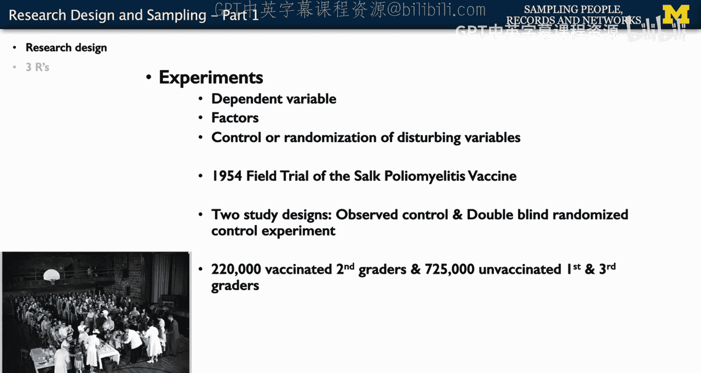

This provides a wonderful piece of evidence about the value of randomization。

 because now we can compare two different research designs。

 one randomized and one not randomized to see what difference in conclusions we might have had。

 Maybe there's no difference。 And in that case， we don't have to worry about randomization。

 Randomization is controversial。 How can you randomly objectively with no sense of perspective。

 assign one child a vaccine and another， not the vaccine and then risk that other child possibly being afflicted with polio。

Well， these are important， moral and ethical questions and they still exist for experiments。

 especially among human populations。

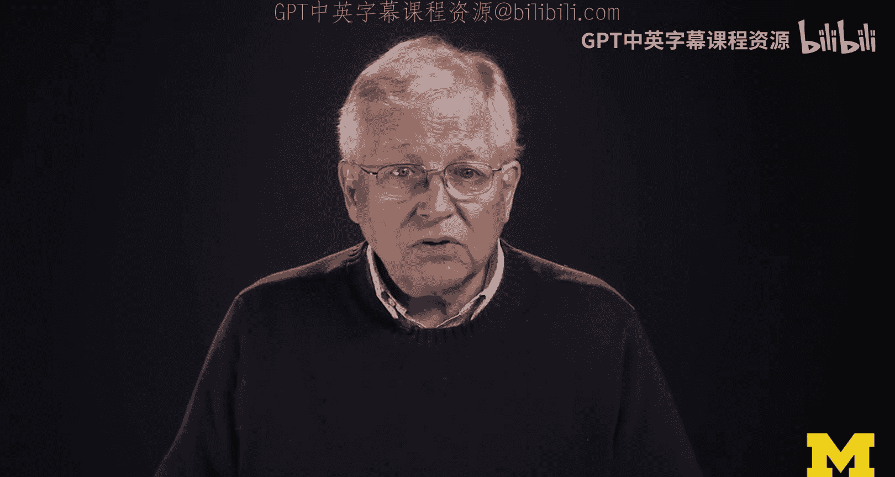

Okay， so we got what some would characterize as not such a good research design and a very modeled research design being contrasted here。

The one that involved the randomization involved what was called a double blind randomized experiment。

 nearly half a million children were involved in this arm of the study。

Parents and physicians knew that the children had been given an injection。

 but they didn't know whether it was the vaccine or the placebo。

They were on alertt for signs of disease， but this was equally true for vaccinated and not vaccinated groups。

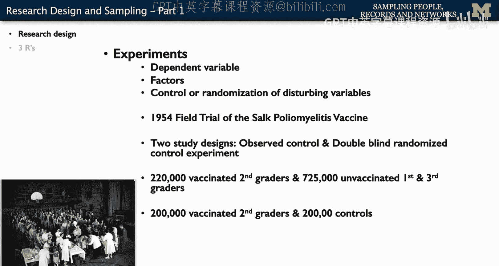

And at the baseline control incidence rate， that background would be actually proved to be higher than what was observed in the population because people were on alert。

 no matter what， but nonetheless， both groups had the same attention to paid to them because no one was sure who was getting the vaccine and who wasn't。

And so this allowed an evaluation of the effectiveness。

 the difference in incidence rates between the two。

But this is a massive study first to randomly assign subjects。 In this case。

 children to treatment and control。

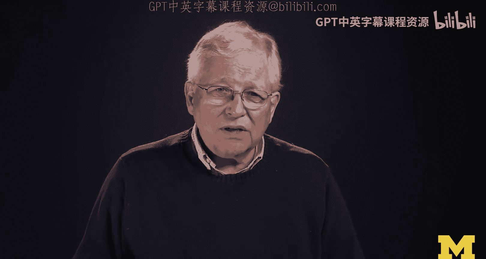

Now， after following the study children for a year， the results were conclusive。

And in the randomized model。It was found the vaccine was safe and effective。

 And the incidence of polio among immunized children was less than half of that among unimmunized。

 Now， that's not to say that children who received the immunization then were completely protected。

 Some of them did get polio， but their rate， their instance rate was much lower。

 And by all statistical measures significantly lower than those who' received a placebo。

The public health action was almost immediate。 The very next year。

 children all across the US were being immunized as fast as they could manufacture the vaccine。

 No one waited for another study。 They just went out。

 manufactured the vaccine and began to immunize children。 There were shortages， and sadly。

 some children who could not get vaccinated right away did get polio。

 But its the study and its effects on public health were dramatic。 Now。

 We should understand the nonranized study show differences as well。

 but they were very much narrower。 were very the differences were much smaller。

 and they were less willing to draw the conclusion that the vaccine was effective with that study。

 So randomization LED to a faster， more rapid approach to an emergent health public health condition。

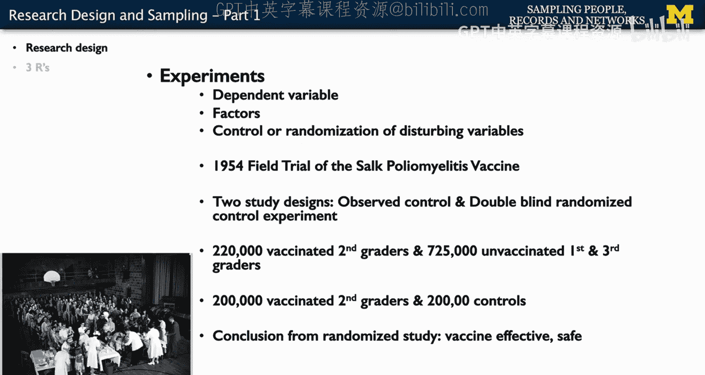

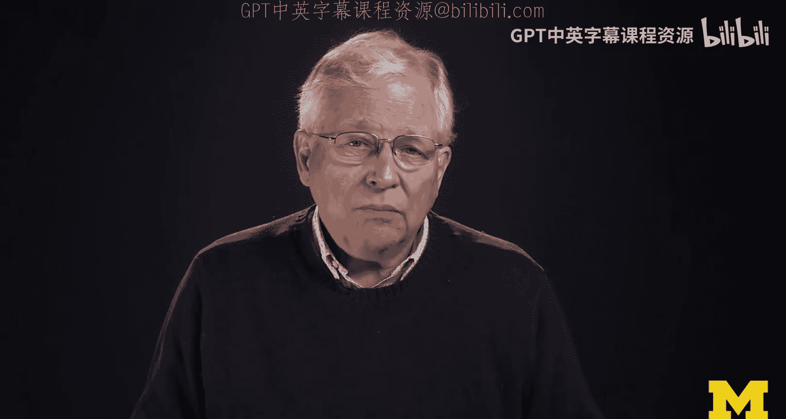

So the randomization in the experiment showed precisely what the nature of the effect was。

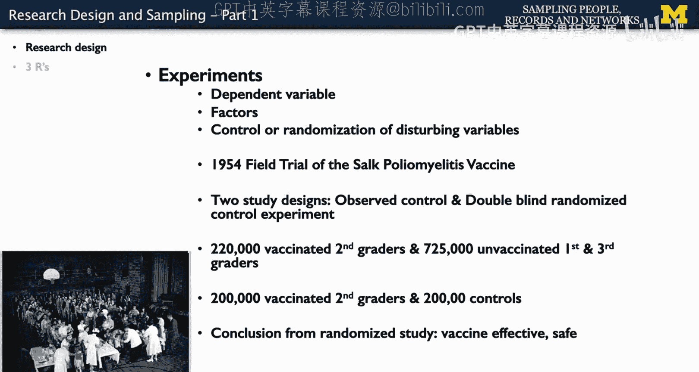

It's hard enough to randomize with human subjects in many circumstances。

 I picked a particularly poignant one involving disease， a disease that can lead to paralysis。

 a disease that can lead to death。And so it's very dramatic and stark in this contrast。

But there are other conditions in which we wouldn't even dream of randomizing because of the practical difficulties。

 So let's talk about another one and then about observational studies。

 And this will lead us to talk about surveys that are used to deal with how do we determine what the differences between those exposed and not exposed。

 those who got the vaccine and didn't get the vaccine or in our case。

 those who smoked cigarettes and those who did not smoke cigarettes and what the differences were。

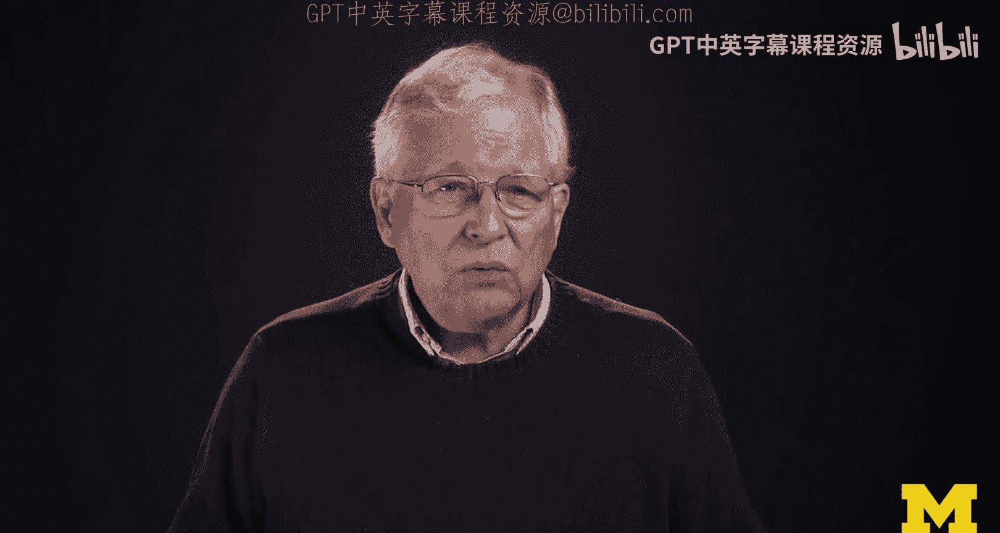

Let's consider another classic study。 This one conducted by two British physicians named Dal and Hill。

 and their pictures are shown here， in which they were studying the relationship between cigarette smoking and various causes of mortality。

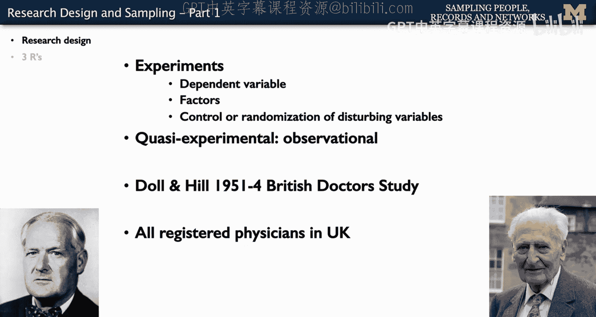

And they did a non-ranized study of physicians in the United Kingdom。 there were around 60。

000 of them， and the registry was readily available and the two physicians who did the study took that registry and they wrote to all of them and asked them to fill out a questionnaire about tobacco use。

 and so they did more than cigarette smoking， snuff chewing tobacco pipes， cigars and so on。

 they did exclude a small number of physicians， female physicians it was， after all， a different era。

 but there weren't very many of them to begin with so this was just strictly male physicians in the United Kingdom who then returned the questionnaire to them。

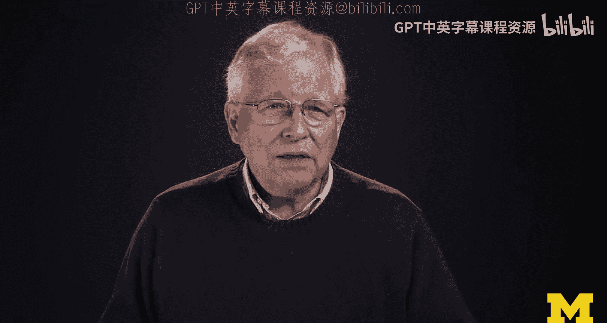

40000 of them returned the questionnaire。 two thirds responded。

 and then what they did was they followed them through the registration system。

 the death registration system in the United Kingdom。

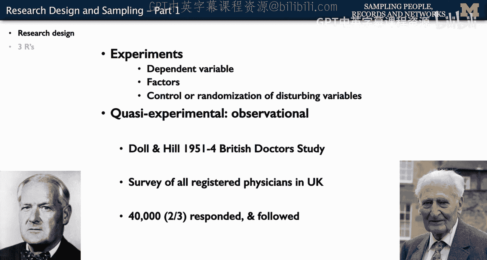

They examined every death record over the course of several years to find any of the 40。

000 respondents who had died， and then they noted the cause of death。

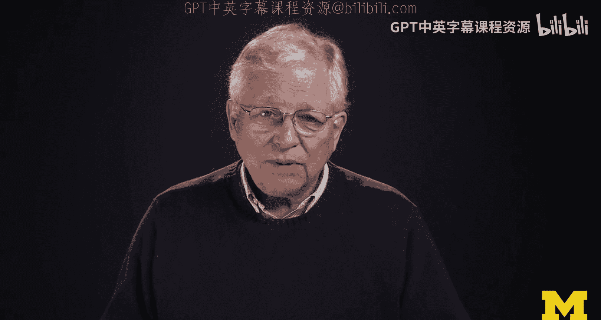

Well， then there's no randomization now because what they're observing is from the questionnaire that they sent out。

 did you smoke or didn't you smoke， they didn't assign them to be smokers or non smokers。

 they just observed who smoked and who did not。And so the study physicians chose on their own volition。

 whether to smoke or not， had done so for a long period of time in many cases。

It would have been impossible to assign them randomly to smoker and non smoker treatment and control groups。

But still， Doll and Hill were able in a few short years to establish that there were much higher rates of lung cancer。

And cardiovascular disease among smokers， the results were the size of these differences were very large。

 they found huge differences in prevalence。That was very striking。

 but no one took their study as definitive。

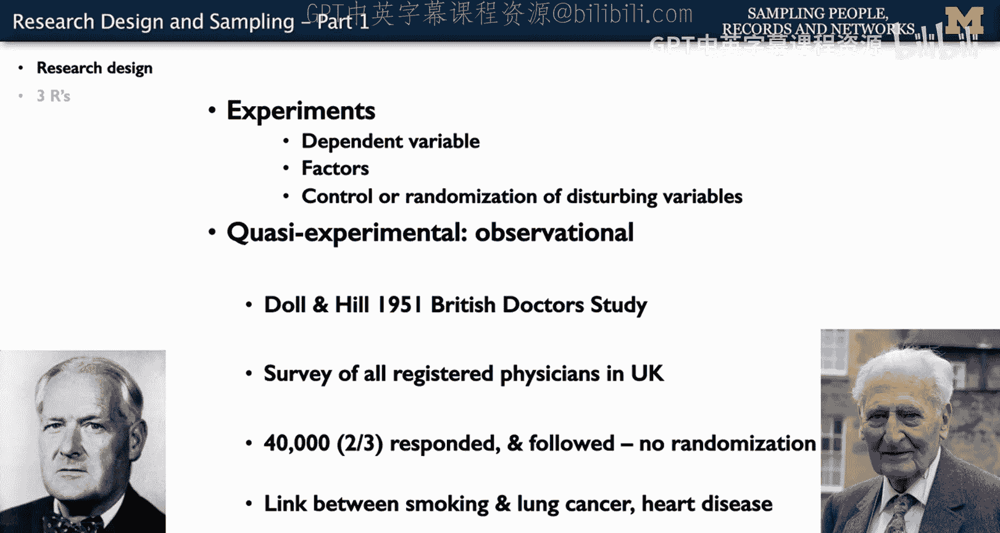

It was challenged on the basis of the same issues we were talking about for polio。

 How do you know that the smokers and the non smokers are somehow not different for other reasons with respect to lung cancer。

 Isn't there possibly another factor， a genetic factor that predispos smokers to want to smoke and also to lung cancer。

 And that it's the genetic factor that's in the background。

 This was one of the arguments that was was put forward。🤧嗯。

And so there was controversy about this and the largescale public health action was lacking for a long time。

 matter of fact， it wasn't， this study was conducted in the 1950s。

 it wasn't until the mid-1960s that in the US， the Sur General。

 the chief medical officer of the United States declared a link between cigarette smoking and lung cancer based on this study and a number of other non-ranized trials。

As because the randomization was lacking， they couldn't draw a definitive conclusion。

Rranomization is a very powerful tool。 then in the mind of the scientist。

This kind of thing that Dalin Hill did was considered to be a pseudo experiment。

 It wasn't a true experiment。 It was based on where people were currently observed in terms of their exposure and then what the consequence。

Was in terms of their cause of death。Granandomization matters。 It renders in science A here。

 in this case， it can be a very powerful tool for establishing effectiveness of a treatment versus control or treat one treatment versus another。

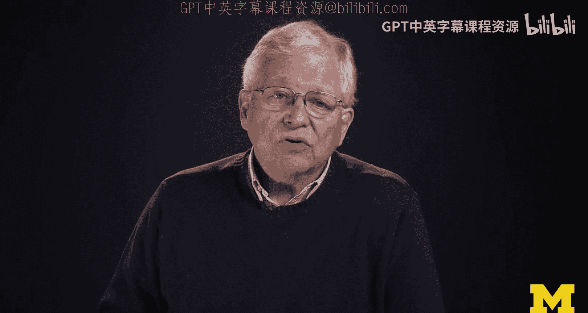

So we've seen now something about the nature of research design。

 two examples of research design and a key part that randomization plays。 and in one case。

 randomization playing such a key part that it leads to immediate action In another case。

 it's absent and it takes much longer to establish that a causal mechanism exists。

 At least that's the history。 Now it's not always the history in all cases。

 but I'm using these to help fixing your minds， the importance of this odd statistical thing of objectivity。

 randomly assigning people to treatment and control。

 This is going to be important when we do samples because what we're going to do is use the same tool。

 randomization to assign people to the sample or not sample。

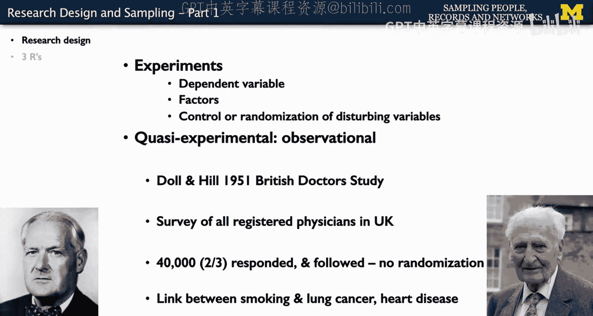

And it's going to allow us to be able to act immediately on that basis to say what we found in the sample applies to the population。

 That's the the purpose of what we're doing with this kind of thing。But for our purposes。

 let's pause at this point， our discussion about research design。

 and we will resume and go on in our next section to talk about。

How randomization is used in survey sampling in a different way and a different aspect of the process as we continue our first lecture on research。

 design and sampling， thank you。

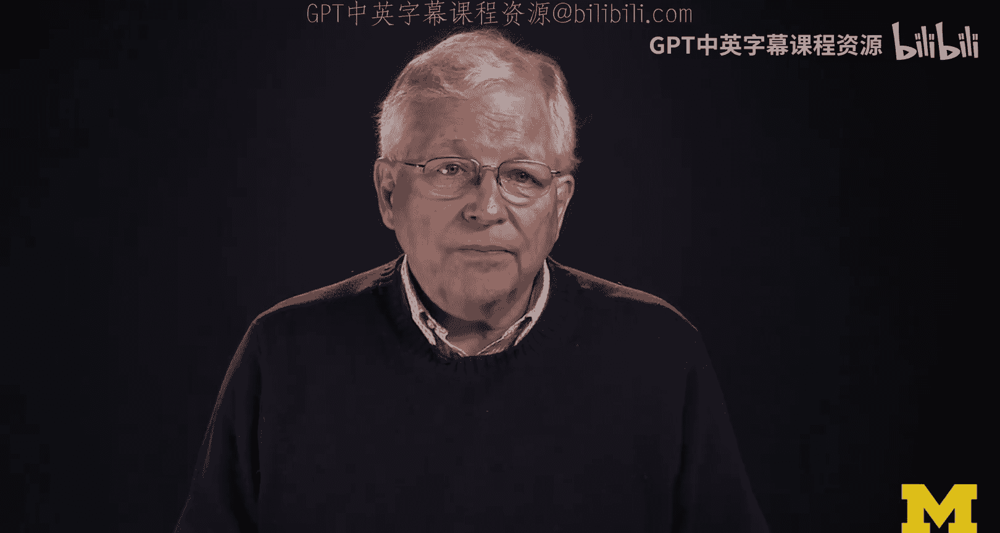