# 密歇根大学《调查数据收集和分析（2-6：方法、社调问卷设计、抽样、缺失数据、分析）｜Survey Data Collection and Analytics》 p81 2_1.1 研究设计与抽样(下).zh_en -BV1fw4m1e7Zh_p81-

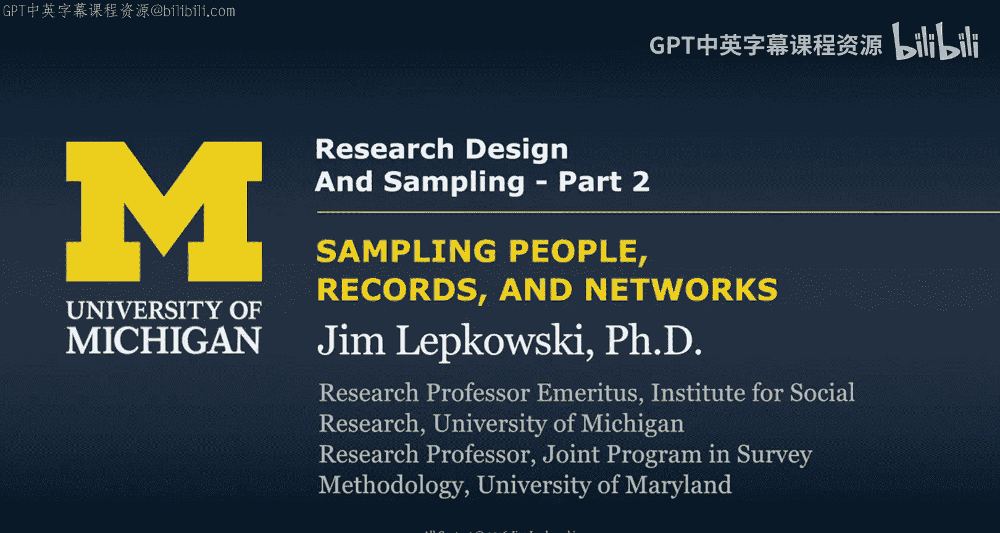

Hello again。Welcome back to our continuation of our discussion about research design and sampling and the role of randomization and sampling in research design。

 We've just discussed in our first unit here in first lecture。

 some of the basics about research design and two kinds of research designs that are often used experiments and quasi experiments or pseudo experiments。

 one involving randomization and the other involving no randomization but observation。

 and what we're going to do here is talk about the same set of issues。

 but now we're going to move on to talk about a third kind of research design。

 one in which we talk about survey samples。

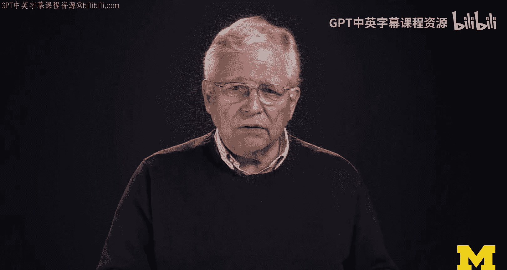

Now， experiments are considered to be non observational in the sense that， yes。

 you're observing things， but the exposure to a background characteristic such as a treatment is determined on the basis of an objective system such as randomization。

Quite experiments are one in which the assignment is based on purely history or observation of where people are。

 cigarette smokers or people who don't smoke cigarettes。In survey samples。

 this is observational as well with regard to how people get assigned to different groups。

 different comparisons that we may want to make， and so it's again observational。

 but randomization appears here in a different context and we want to talk about that to begin to understand something about research design and how this fits in。

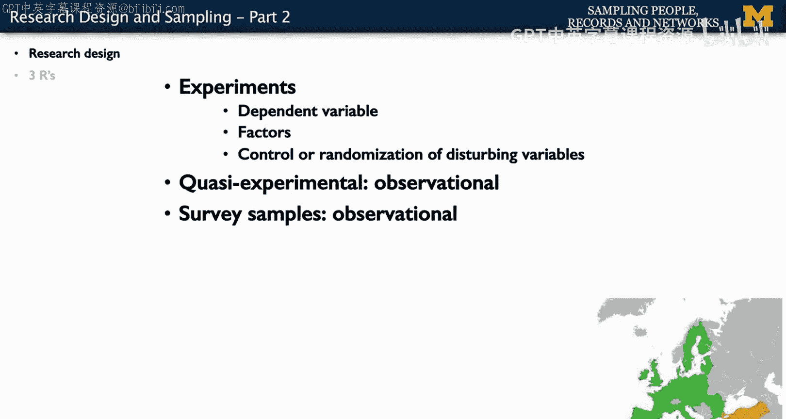

So sample surveys originated in western， northern and Northwestern Europe in the 19th century。

 and they really were originally designed to deal with describing populations， matter of fact。

 some statisticians like to make the distinction between two types of surveys。

 so that they maybe surveys should be thought of as like experiments and non experiments。

 experiments in quasi experiments。Some surveys in their minds are purely descriptive。

 they're designed to describe a population what's going on in this population。

s get a snapshot of the population at a particular point in time。And other surveys though。

 are designed for as they would determine analysis comparing testing hypotheses。

 so they'll sometimes divide them into enumerative and analytic。

 but the distinction between them actually is almost irrelevant in practice because I know a few surveys that are purely enumerative descriptive and no analysis is done and I know of。

Analytic surveys in which almost no analytic surveys where there isn't some description that has to be done first。

 so it's kind of a general distinction that doesn't exist。

 but both functions occur in the same survey typically。The key aspect of survey samples， though。

 is not the distinction between description and analysis。 It really is that they are observational。

 that we're not。Taking something and putting it an artificial setting or doing it as it naturally occurs in everyday life for people。

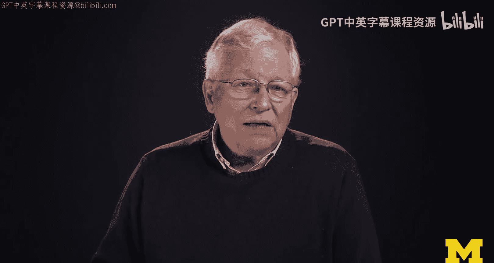

Now the observational study may be observational for a national sample。

 and I'm going to take as an example here， a survey done in Turkey。

 the country between the Black Sea on the North and the Mediterranean Sea to a certain extent on its south and west。

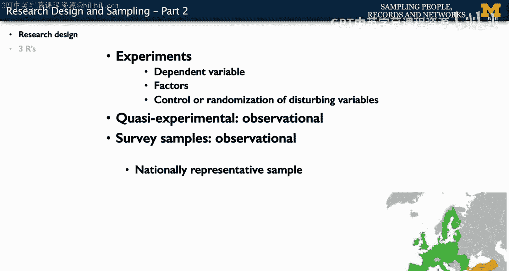

And Turkey is an interesting case because it does a nationally representative survey to collect data that represents the demography and the population characteristics of the Turkish population。

 it examines such things as births and deaths and fertility and family change and health characteristics。

This is the demographic and health Sur of Turkey。Now。

 from the point of view of an experiment or a quasi experiment。

 the best we can say scientifically about the use of survey data such as this for analysis is that we're going to be explaining what's going on in the health and fertility of the Turkish population and we can't establish causal mechanisms。

 we can describe we can alsore these things correlate them。

 but we cannot conclude from a survey like this that there is a cause like polio vaccine that leads to an outcome。

 we have strong evidence as in the doll and Hill study that there's a relationship between cigarette smoking and lung cancer that there is a relationship between。

 let's say， nutritional status and certain kinds of health outcomes。

And that strong association made be so strong as to say， well。

 we really don't need to do an experiment or test this any further。

 we're very confident that this is indeed an association that we need to pay attention to and maybe develop some new policy around。

All right， so there's no randomization people into poor nutrition and good nutrition that occurs through a complex set of processes。

 we observe what's there， and then we observe the outcomes。

 what outcomes are like for the two different groups。But there is randomization in these surveys。

 there was randomization in the demographic and health survey in Turkey。

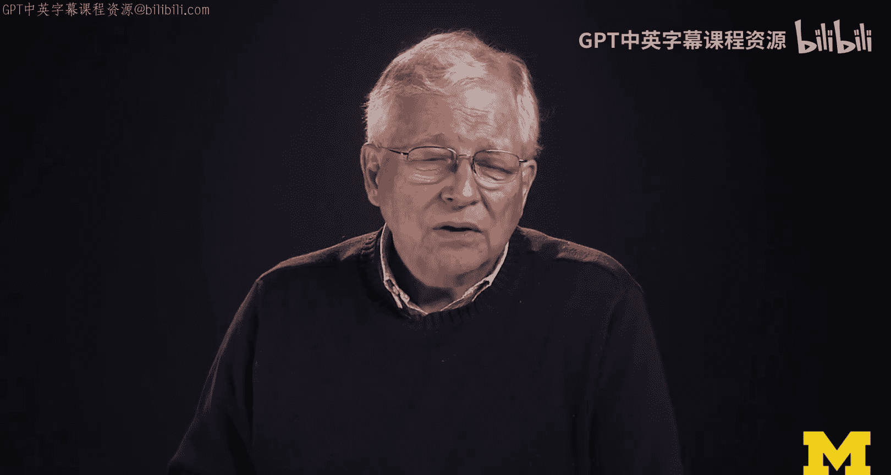

And this particular study that we're referring to the demographic and health Survey in Turkey has over the years。

 every five years been done as a measure of trends in these characteristics。

 but it only makes sense if to compare trends if the data are collected in such a way as to be representative of the population each time。

Otherwise， if the samples were arbitrary or haphazardly assembled and not entirely clear whether they were represented each time when we go to compare what happened in 1995 and 2000 and 2005 and 2010 and 2015。

 we wouldn't know why there were differences if we saw them。

 Was it because of the sample or was it because of changes in the population。

 So what we'd like is a sample that gives us a snapshot of that population at each of those time points so that we can compare across those time points and see what kinds of trends are going on。

 So these surveys are done in five year intervals。

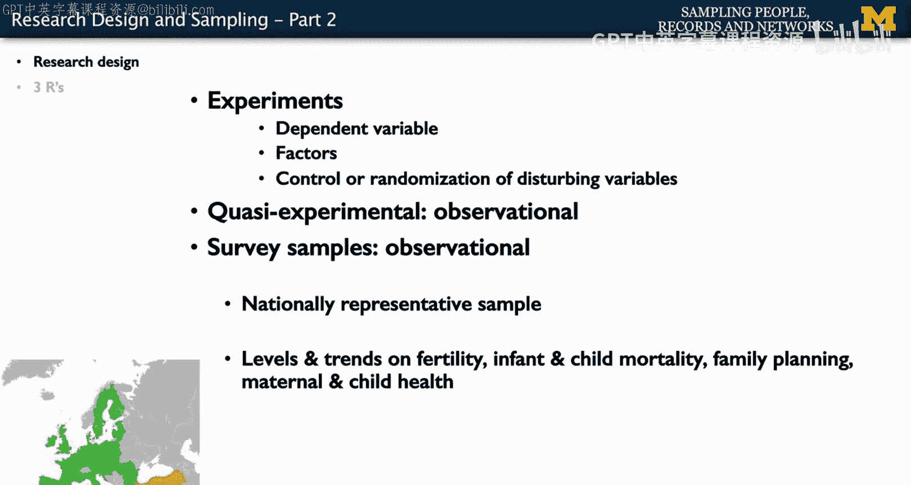

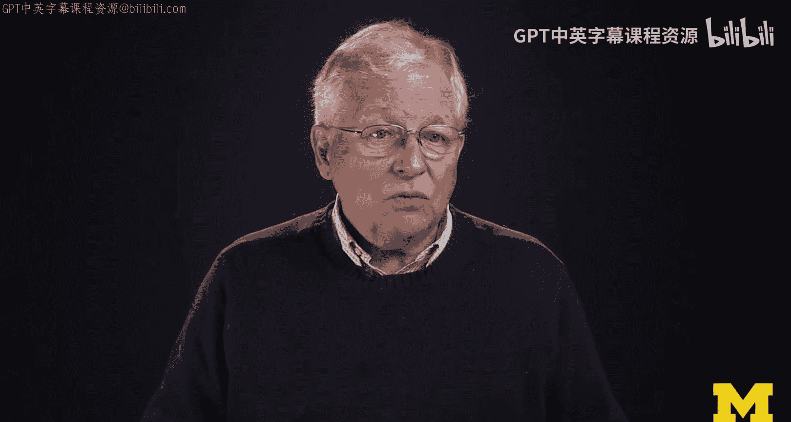

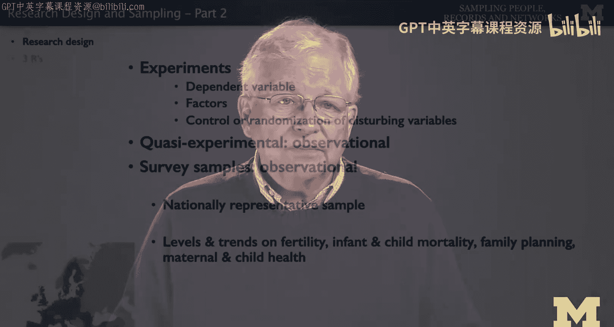

And if we've got good snapshots at each time interval， then we can say， well。

 the differences that we observe really have to be due to changes in the population。

 not changes in how the sample was selected。Okay， so Turkey has a population of about 77 million people in the latest demographic and health survey。

 which was conducted in 2014， and that study had 12，000 households and it had nearly 10。

000 women ages 15 to 49 who were examined from those 12，000 households。

 so it was a fairly large scale operation and they're doing fertility estimation， for example。

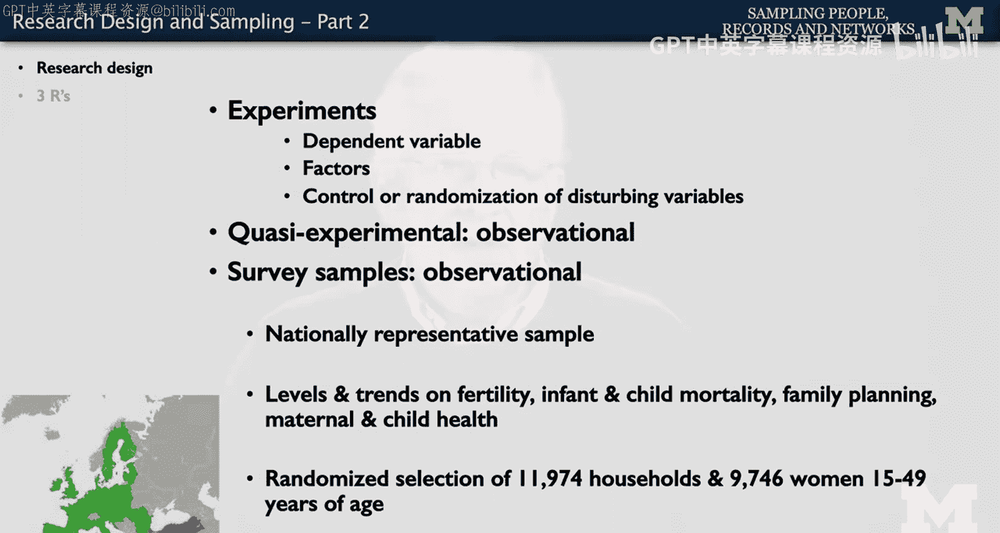

So how do they select the sample？They use the kinds of techniques that we're going to be discussing and talking about in the remainder of this course。

A key component of the selection was that it was random。

There were were no subjective selections made。 It wasn't selections made either by， by ch。

 by happenstance， by， by convenience。 It was a carefully selected sample in which the women in each household。

Each household was selected through a random process。And。

The selection carefully controlled for geographic distributions and age distributions in the selection。

One can trace through the procedures that were used to select a sample such as this one。

The probabilities of selection of each of the individuals in the sample and and ultimately want to do that for those who are not in the sample。

 but we can identify much like in the randomized case。

 who was to receive the vaccine and who was not， We know who was to receive the sample administration and the data collection and exactly what their characteristics were。

And thereby。Who the non sampleamp cases were as well。

The observations are then made on the households and the people。

There was no randomization to treatment groups to women having been exposed to， let's say。

 a particular form of contraceptive and those who were not。 No， that was that was an observation of。

 What did they actually do， How many women had actually used a particular method and who were those women and who were the women who did not。

The data were realistic。 Then they were collected at a particular point in time in settings where people live in their households。

And because of the procedures used in the sample selection。

 the sample was representative of the population in Turkey， not only overall all the households。

 but also for a subgroup of the residents of this households， women， 15 to 49 years of age。

There was not an experimental manipulation。 The randomization was in the selection mechanism。

And as I've said， this was where the randomization mechanism is applied to divide that population into two groups。

 a group that's in the sample and a group that's not now the group that's in the sample is very small relative to the group that's not in the sample that's very different than experiments where most experiments will tend to allocate the same number of individual stitch treatment group。

In sample surveys， it's a very small fraction that are getting the treatment， if you will。

 of being in the sample。But they use randomization， nonetheless， just in a different way。

 And for a different purpose， the purpose here is to establish a group that represents the full population。

 at least represents them in terms of， on average， has the same characteristics as the full population。

And so this gives us a way of avoiding any kind of subjective bias that might have gone into the selection where we've arbitrarily chosen locations or particular individuals who have particular characteristics and then our sample doesn't resemble the population。

We're being objective about it to these probability selections and thereby eliminating some of the difficulty that we face with subjective choice and subjective and bias a due of subjective choice。

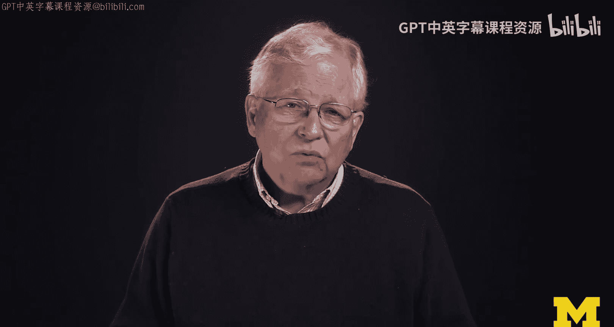

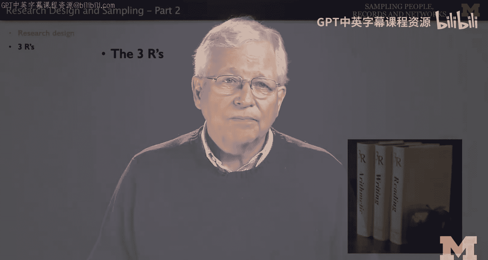

Going back now， thinking back through our experiment， our polio vaccine trial， our quasi experiment。

 our study of smoking and lung cancer， and now thinking about a sample survey describing and understanding the nature of fertility。

 demographic characteristics， health and how those are interrelated。

We see that there are some principles that are emerging， some things that have happened。

 and I'm going to describe something that， as I mentioned。

 a sociologist named Leslie Kisish defined three principles that he extracted from this process。

And he labeled them as the three R's because of the first letter of each of these Now in education。

 in English， there are three R's as basic principles of learning or education。

 or at least there used to be for a student to have a well rounded education。

 they need to be prepared in three areas。 The first was reading， which begins with an R。

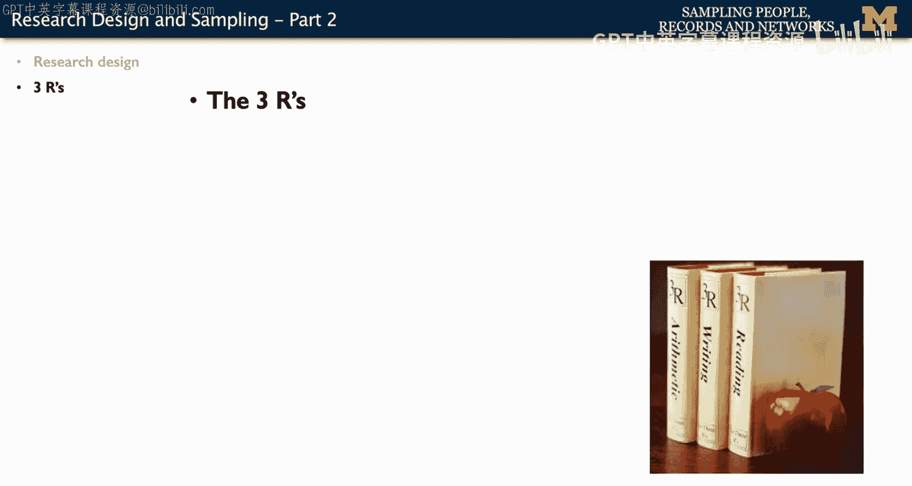

To to study requires that basic tool， but the second principle was that of being able to express themselves to write。

 except the wordright doesn't begin with an R， but it sounds like it does， begins with a W。

 but right the second R。And the third was that they needed to be able to do computation manipulation of numbers。

 to be able to succeed in commerce or in many other areas。 simpleple basic arithmetic。 Now there。

 again， it's the third R doesn't begin with an R。 The third word arithmetic begins with an A。

 but nonetheless， the R is the second sound。 So those three R's would be what every student should have reading。

 writing and arithmetic is basics for learning and understanding in school。

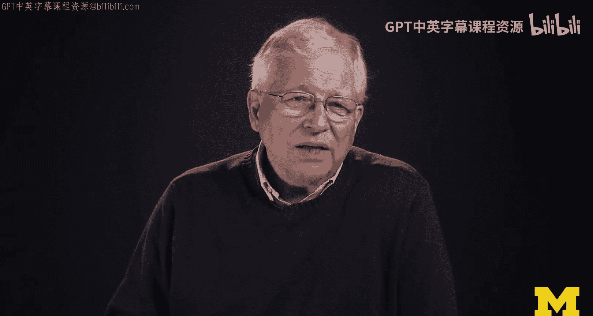

These threeRs then have been replicated in other areas， for example， in studies of environment。

 there are the three hours of reduce， recycle and reuse as a ways of dealing with our environment and ecology here in research then we have the three Rs pardon me again。

 the first being that the study design needs to be embedded in a realistic setting。

Realism is what we're concerned with。 Now， experiments， this is a problem。

 They can be very unrealistic。 gathering together those children from voluntary schools that volunteered。

 they could have been a very peculiar group。

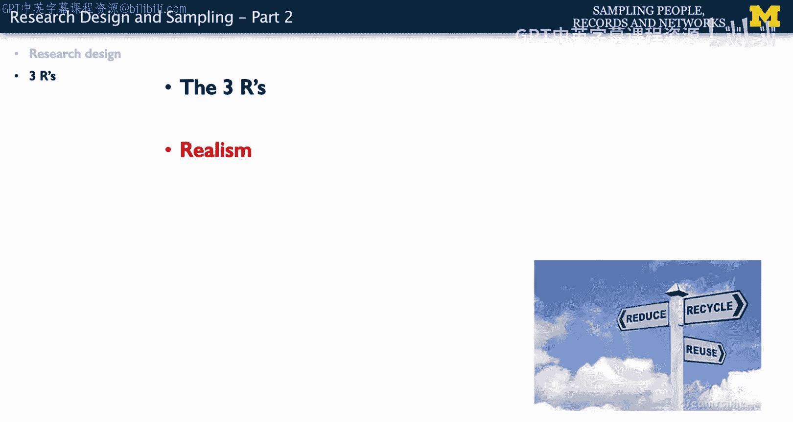

But one didn't worry about that in that particular case because the size of the sample was so large。

 but you can imagine artificial laboratory or clinical settings where it's not very realistic when they're administering a new drug and they're calling people every day。

 Did you take your medication today。I know。 I don't have anybody calling me every day to ask me if I had taken my medications that were tested in such studies decades ago。

 So it wasn't realistic yet it still has valuable information and insight。

 A quasi experiment and sample surveys are embedded in reality because they observe what is happening to the sample subjects directly。

 There's no interfering laboratory or clinic to distort or cloud judgment about what actually happened in the study。

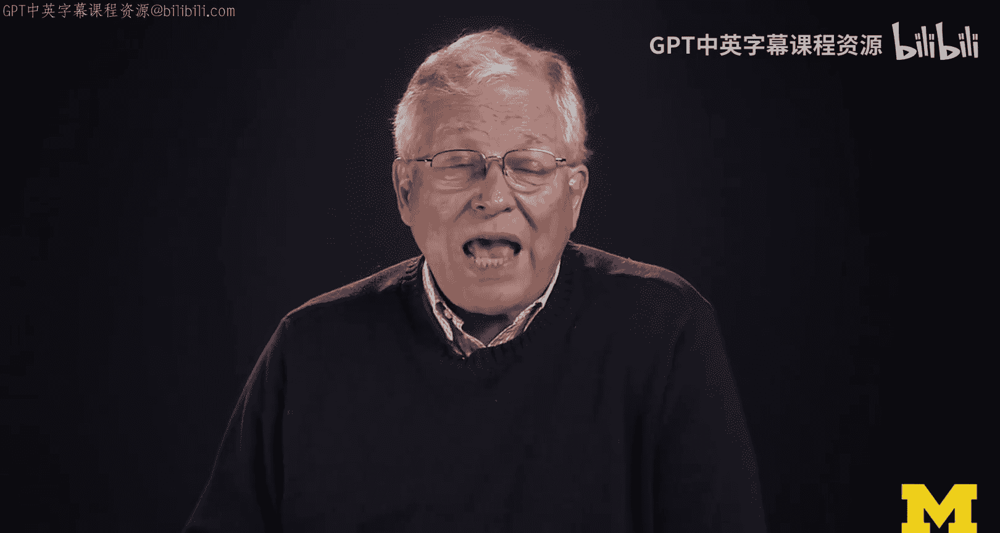

A second principle we've been talking about is the use of randomization。

 Expiments use randomization to assure equality across groups to make sure then that the comparisons yield conclusions only about important differences between the groups。

 the ones that matter， the difference being experimental condition。

 no experimental condition experienced。

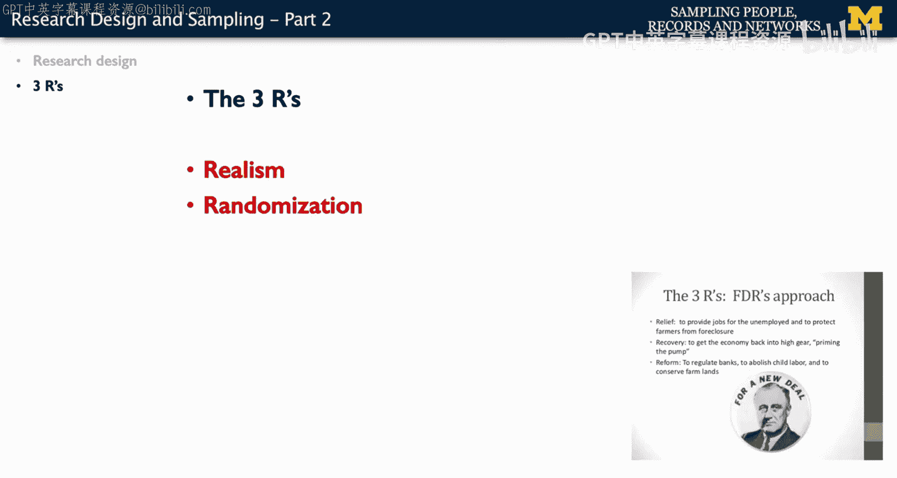

Quasi experiments lack that randomization， and so as a result， they're more tentative。

 it's not that we can't use quasi experiments in science， but we need more evidence。

 we need to do more testing and firm immediate conclusions are not as readily available to us。

Sample surveys are kind of in a split here with randomization。

 they're like quasi experiments for examining subgroup differences， they use the observed values。

 but they do use randomization in order to assure no differences between population and sample。

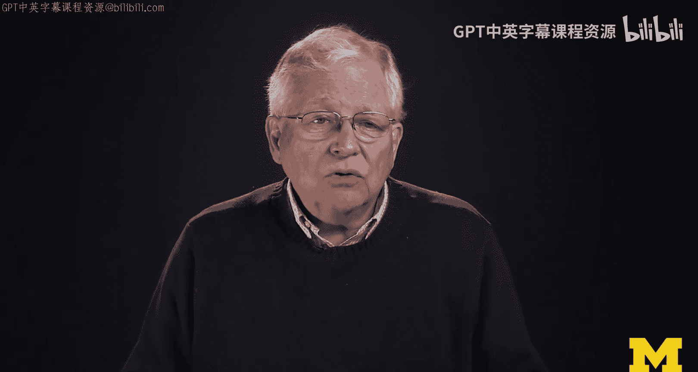

And so we get other kinds of things here， by the way。

 here's another example of the three R's adapted， it's a very popular and powerful idea in American culture。

 for example， Franklin Delano Roosevelt， he created something called the New Deal in the 1930s to address the Great Depression。

 the great economic Depression in the US and he had three R's of the New Deal， relief。

 Re and reformform。

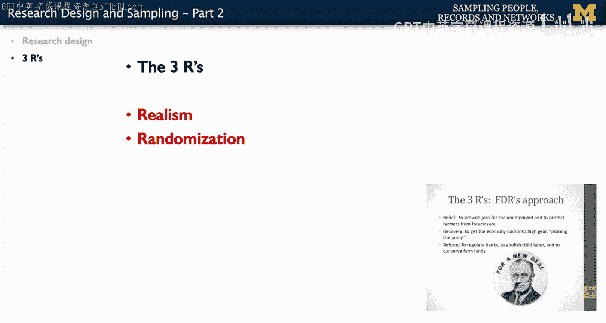

So this idea is just what Professor Kisish used in his idea realism， randomization， O。

 and our third representation。

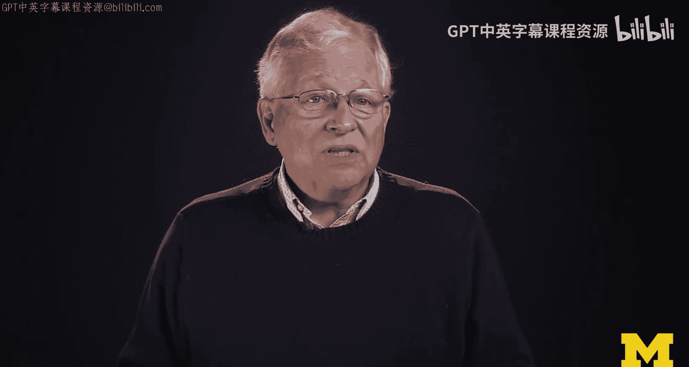

Randomization actually doesn't guarantee representation。 We'll see this。

 And so one needs to go further。 Expments seldom make any attempt sometimes。

 but but very rarely make any attempt to have representative groups that they examine。

 they're going to take individuals who are convenient， available。

 perhaps haphazardly assembled for their studies， quasi experiments probably some of the same。

 although quasi experiments more often would use a more carefully selected sample。

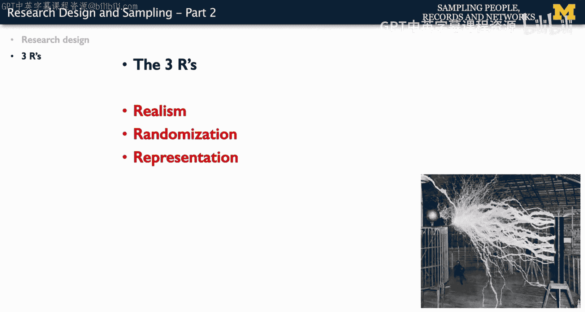

But surveys base their foundation， their claim to a place at the table among research designs on the basis of randomization to obtain a sample that is going to resemble the population。

 even though more is needed than just randomization to achieve that。

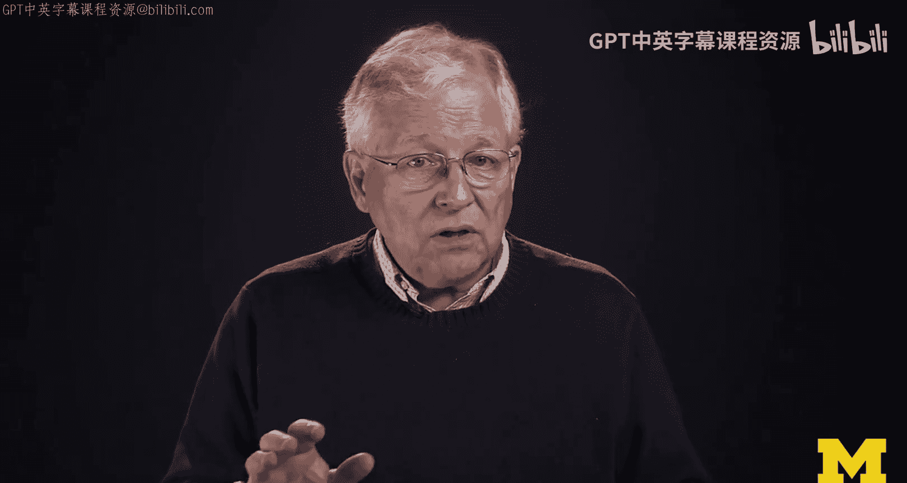

So there we have it， the three R's of research design。With these threeR's in mind now。

 we should say more about just what we mean by sample surveys and in our next lesson。

 lesson two that's highlighted here， we're going to talk about surveys and sampling and how they interrelate and why the two words sample and survey are put together like the way we've been doing in this course and in this program that we're assembling the set of courses。

And so we want to look at what it means for the kinds of surveys we're going to talk about in the rest of the course。

 so join me in lecture two in this unit on sampling as a research tool where we're going to look at how samples are used in surveys。

 thank you。

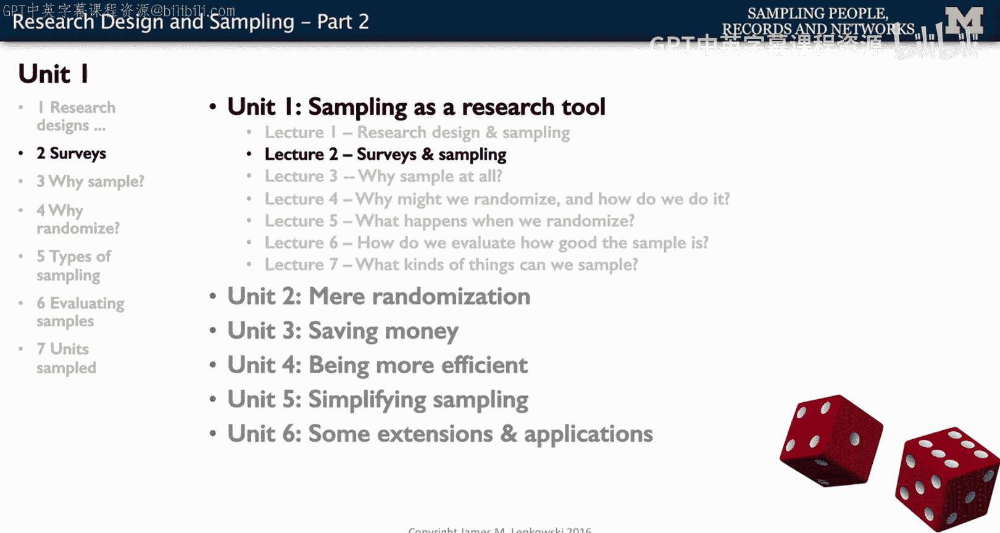

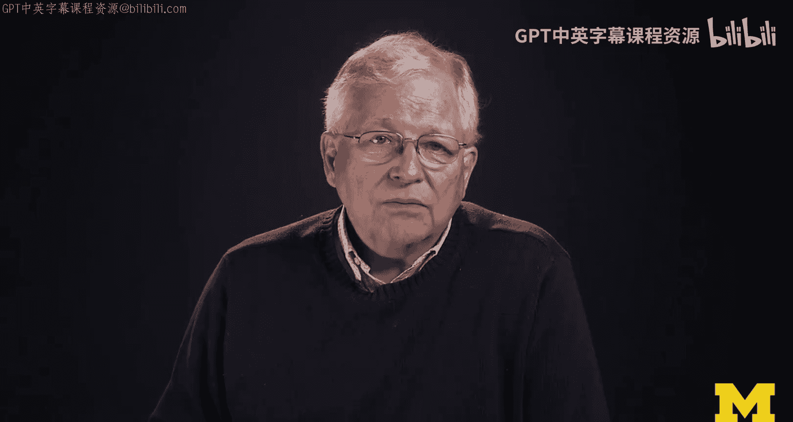