# 调查数据收集和分析：2-1：研究设计与抽样（下）📊

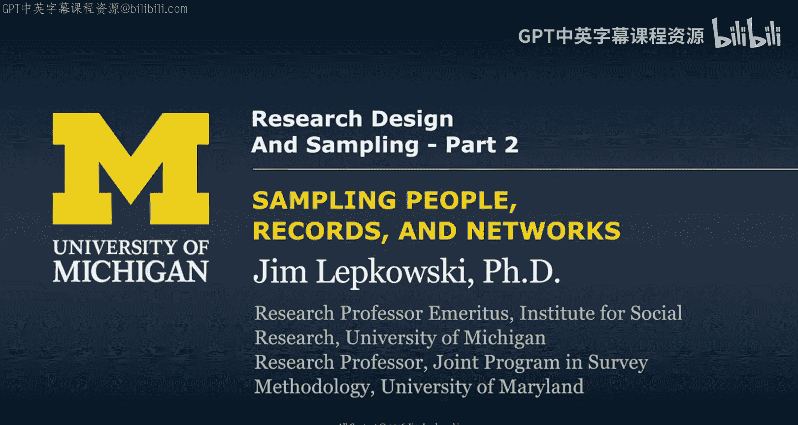

## 概述

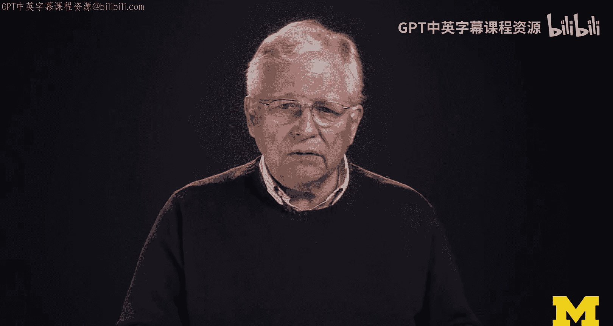

在本节课中，我们将继续探讨研究设计与抽样，重点介绍第三种研究设计——**抽样调查**。我们将了解抽样调查的起源、特点，以及它与实验、准实验设计的核心区别。同时，我们将引入研究设计的“三R原则”，并解释随机化在抽样调查中的独特作用。

---

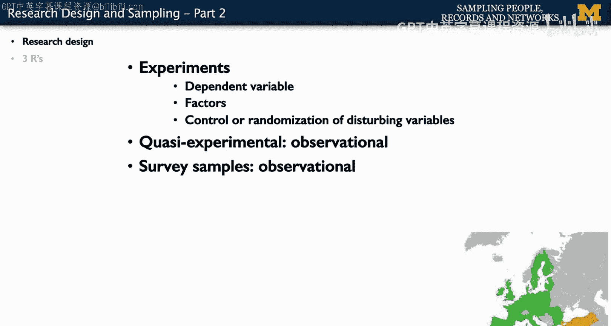

## 抽样调查：第三种研究设计

上一节我们讨论了实验和准实验设计。本节中，我们来看看第三种常见的研究设计：**抽样调查**。

实验设计被认为是**非观测性**的，因为虽然研究者也在观察，但研究对象是否接受某种处理（如治疗）是由随机化等客观系统决定的。准实验设计中，分组则完全基于历史或对个体自然状态的观测（例如吸烟者与非吸烟者）。

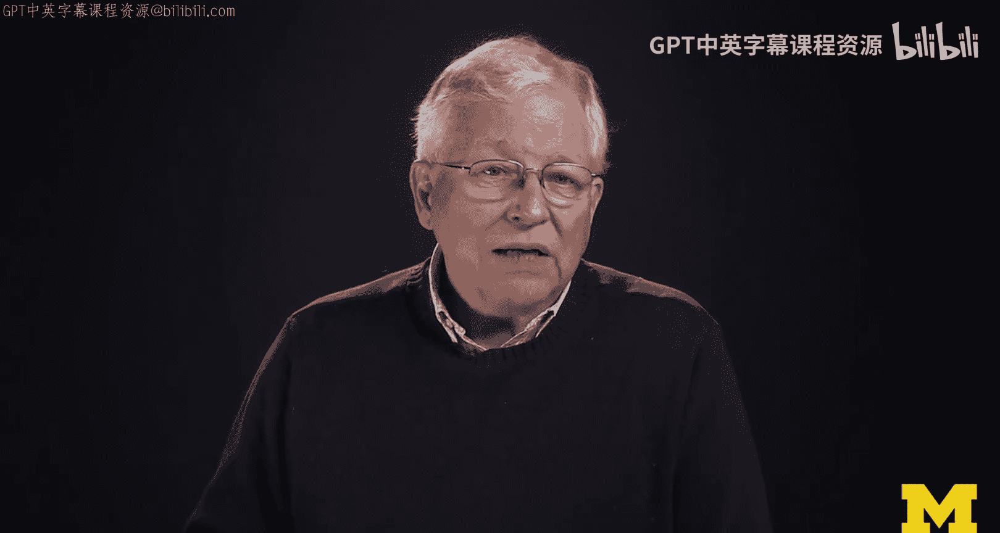

在抽样调查中，人们如何被分配到不同的比较组同样是**观测性**的。然而，随机化在这里出现在一个不同的环节，我们需要理解这一点，以把握研究设计的全貌。

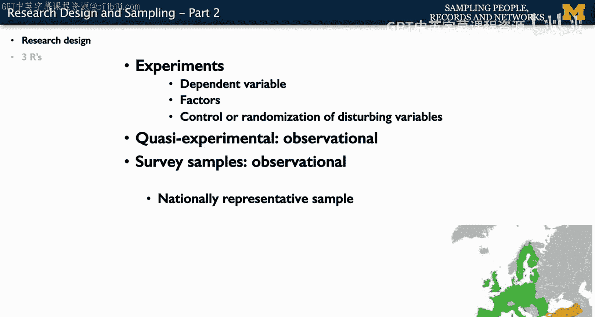

---

## 抽样调查的起源与目的

抽样调查起源于19世纪的西欧、北欧和西北欧地区。其最初的设计目的是**描述总体**。事实上，一些统计学家喜欢将调查分为两类：

*   **描述性调查**：旨在描述一个总体的情况，获取特定时间点的总体“快照”。
*   **分析性调查**：旨在进行比较、检验假设。

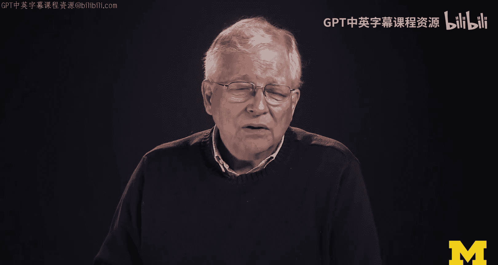

这种区分在实践中几乎无关紧要，因为很少有调查是纯粹描述性而不做任何分析的，反之亦然。调查的关键特征不在于此，而在于其**观测性**——我们并非将事物置于人为环境，而是在人们的日常生活中观察其自然发生的情况。

---

## 案例：土耳其人口健康调查

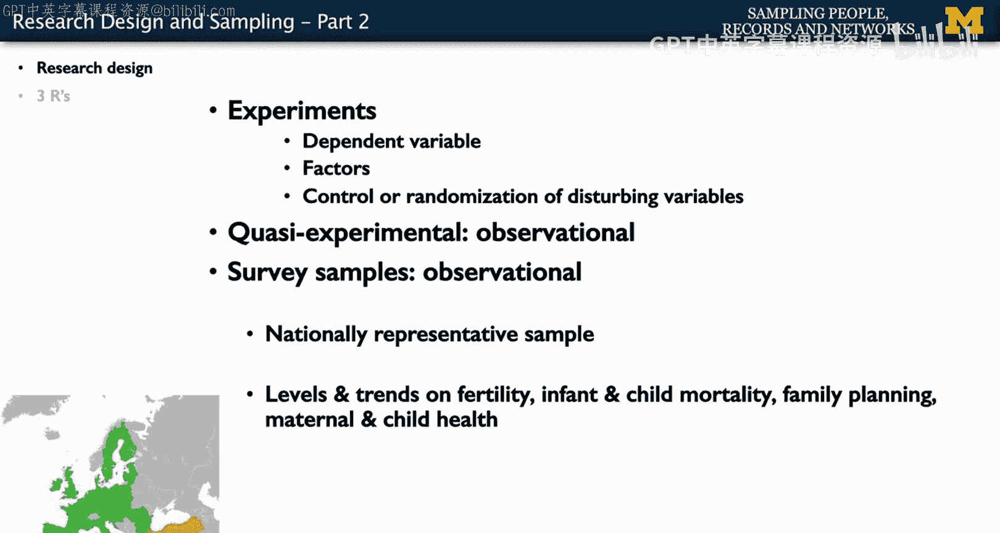

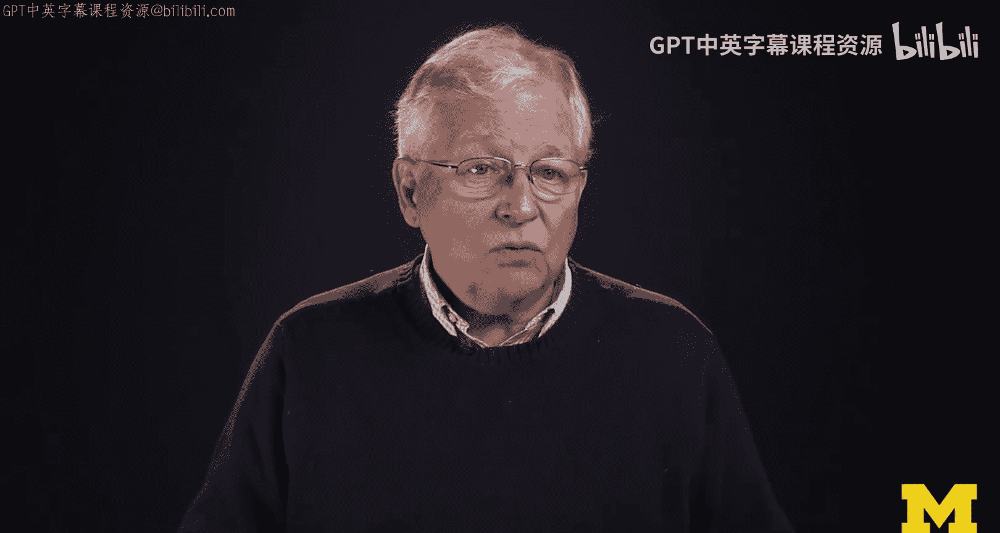

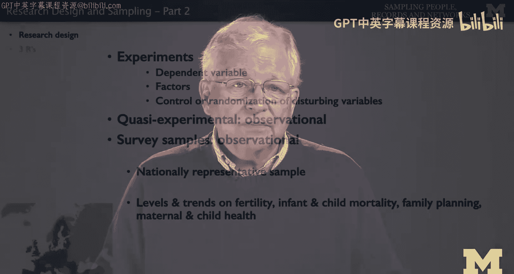

观测性研究可以针对全国样本进行。这里以土耳其的一项调查为例。

土耳其进行了一项全国代表性调查，以收集代表其人口结构和特征的数据，考察出生、死亡、生育率、家庭变迁和健康状况等。这就是**土耳其人口与健康调查**。

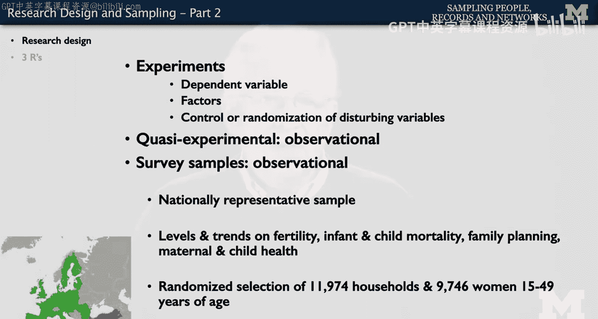

从科学角度看，使用此类调查数据进行研究，我们能做的最好解释是描述土耳其人口的健康和生育状况，并分析变量间的**相关性**。但我们**无法建立因果机制**。

例如，我们可以发现营养状况与某些健康结果之间存在强关联，这种关联可能强到让我们确信需要关注并制定新政策。但调查中并没有将人们随机分配到“营养良好”或“营养不良”的组别，这些是自然发生的复杂过程，我们只是观测了已有的分组及其结果。

然而，**随机化在这些调查中依然存在**，它体现在抽样环节。

---

## 代表性抽样与趋势比较

土耳其的人口与健康调查每五年进行一次，旨在衡量这些特征的趋势变化。只有每次收集的数据都能代表总体，趋势比较才有意义。

如果样本是随意或偶然组装的，当我们比较1995、2000、2005等年份的数据时，就无法确定观察到的差异是源于总体真实变化，还是源于抽样方式的不同。因此，我们需要一个能在每个时间点提供总体“快照”的样本。

土耳其2014年的最新调查覆盖了约7700万人口，涉及12,000户家庭和近10,000名15-49岁的女性。这是一个大规模的调查。

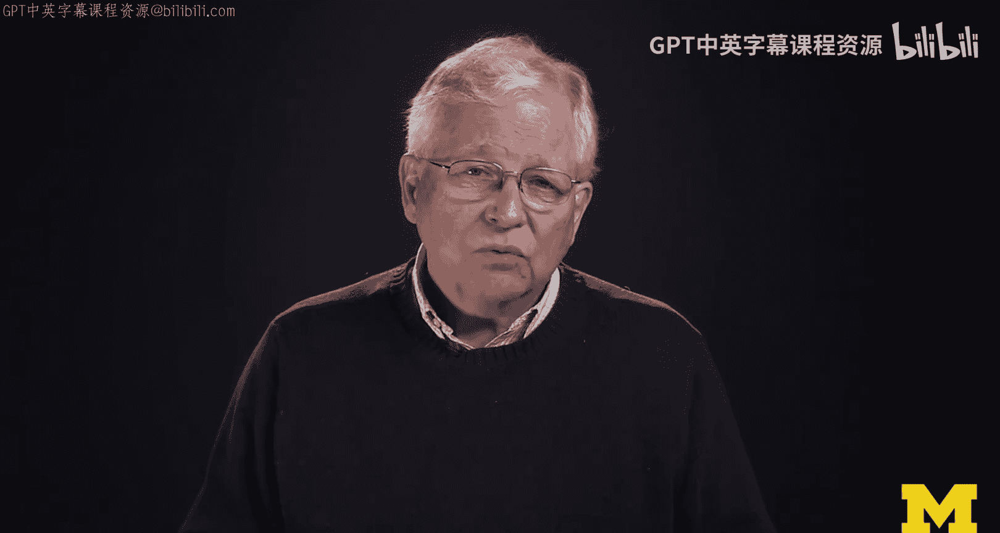

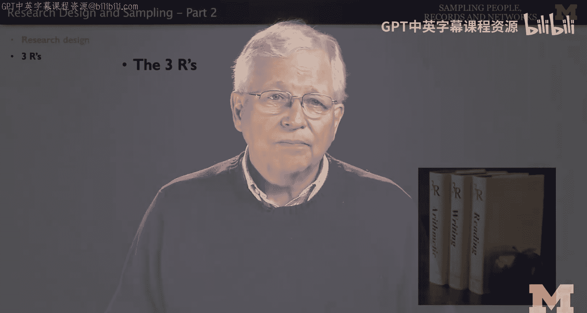

---

## 调查中的随机化：抽样机制

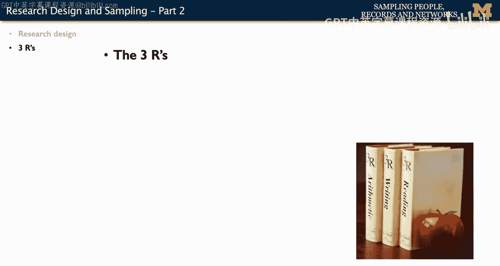

那么他们如何选择样本呢？以下是核心步骤：

1.  **随机选择**：样本选择的关键是**随机性**。没有主观选择，也不是基于方便或偶然。这是一个精心设计的随机过程。
2.  **控制变量**：在选择过程中，仔细控制了地理分布和年龄分布等因素。
3.  **概率可知**：我们可以追踪每个个体被选入样本的**概率**，就像在随机化实验中我们知道谁被分配了疫苗一样。我们也知道哪些个体没有被选入样本（非样本个案）。
4.  **观测数据**：然后对选中的家庭和个人进行观测。这里**没有**对处理组进行随机化（例如，随机分配女性使用某种避孕措施）。这只是观测她们实际做了什么。
5.  **现实环境**：数据是在人们生活的真实家庭环境中，于特定时间点收集的。
6.  **代表总体**：由于抽样程序，样本能够代表土耳其的总体，不仅是所有家庭，也包括15-49岁女性这个子群体。

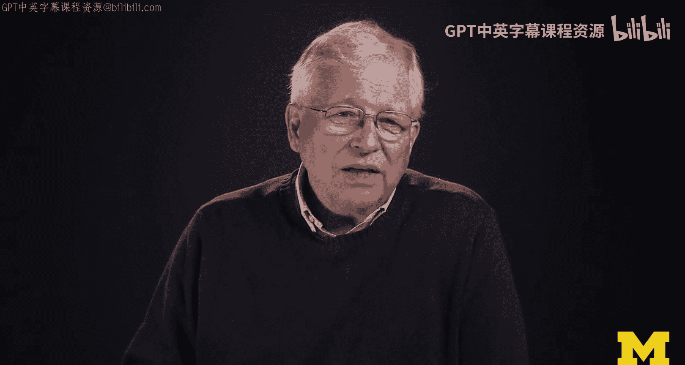

**总结来说**：调查中没有实验操纵。随机化被应用于**抽样机制**，用于将总体分为两组：**入选样本的组**和**未入选样本的组**。入选样本的组相对于未入选的组非常小，这与实验设计（通常两组人数相近）不同。但调查仍然使用了随机化，目的不同：**旨在建立一个能代表总体的组**，使其平均特征与总体相同。

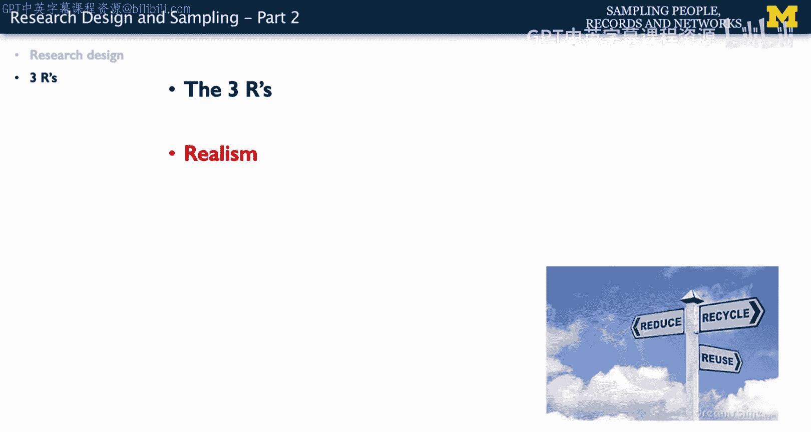

这种方法避免了因主观选择特定地点或特定特征个体而导致的样本偏差，通过概率选择实现了客观性。

---

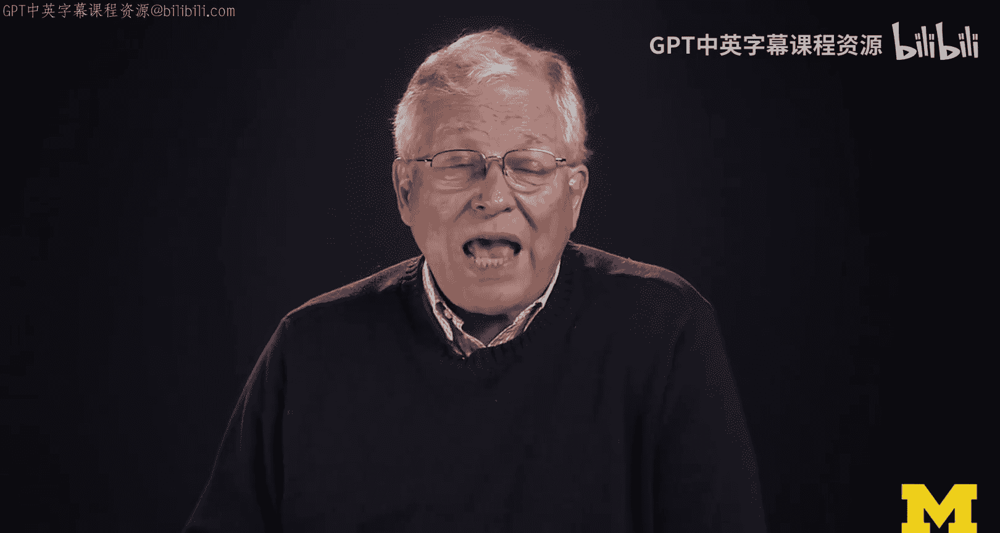

## 研究设计的“三R原则”

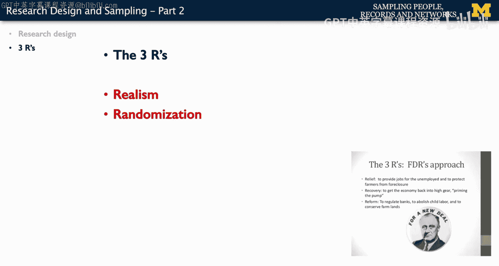

回顾我们讨论过的脊髓灰质炎疫苗实验（实验设计）、吸烟与肺癌研究（准实验设计）以及土耳其生育健康调查（抽样调查），我们可以总结出一些共同原则。社会学家莱斯利·基什将其提炼为研究设计的 **“三R原则”**。

**第一个R：现实性**
研究设计需要植根于**现实环境**。实验设计可能面临不现实的问题（如人工实验室环境）。准实验和抽样调查则直接观察样本对象的真实情况，没有实验室或诊所的干扰，更能反映实际发生的情况。

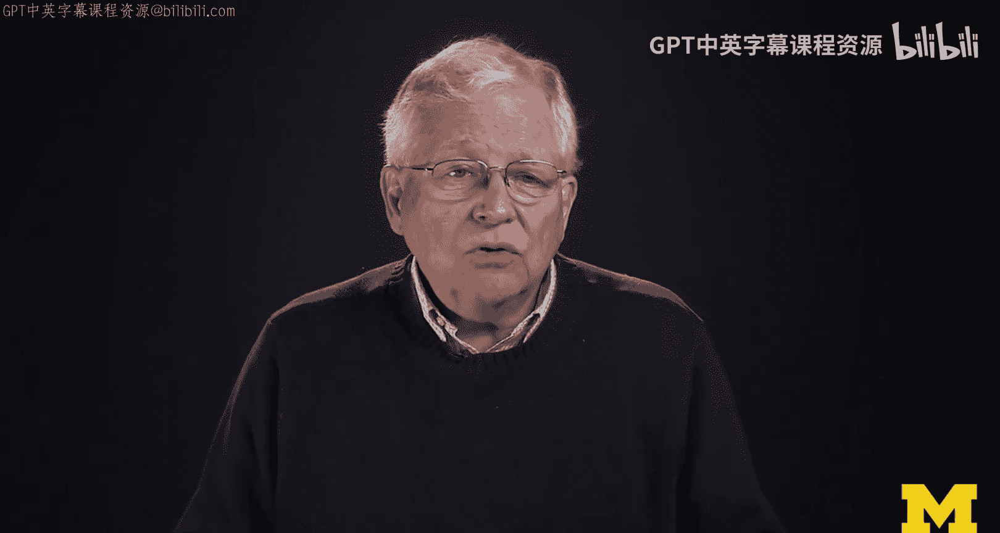

**第二个R：随机化**
我们一直在讨论使用**随机化**。实验使用随机化来确保组间均衡，使比较结果只反映实验条件带来的差异。准实验缺乏随机化，因此结论更具试探性。抽样调查在这一点上有所区分：在考察子群差异时，它像准实验一样使用观测值；但在保证样本与总体无差异方面，它使用了随机化。

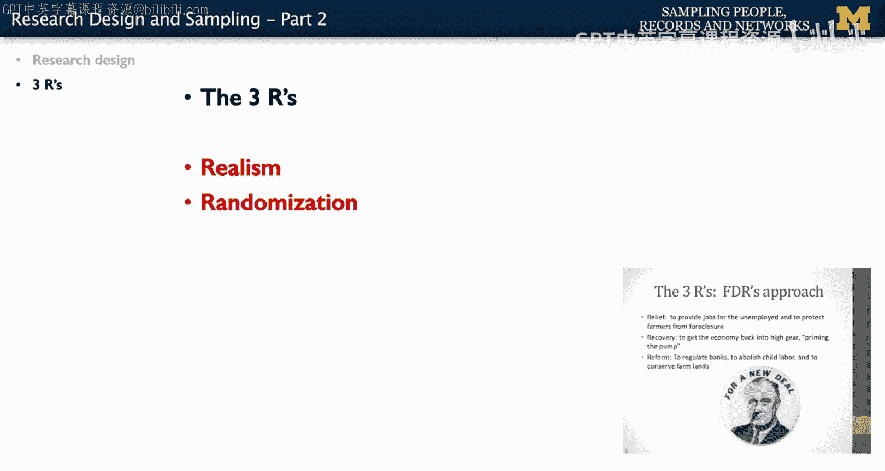

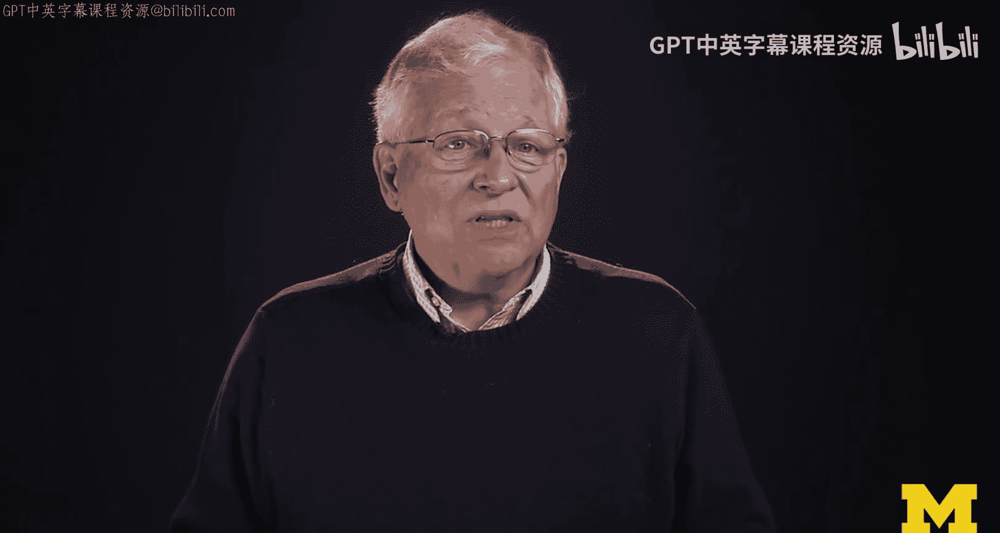

**第三个R：代表性**
随机化本身并不能保证**代表性**。实验很少尝试使其研究的群体具有代表性，他们通常使用方便、可用的个体。准实验可能稍好一些。而**抽样调查**将其在研究设计中的地位，建立在通过随机化获得一个能**代表总体**的样本这一基础之上，尽管实现代表性仅靠随机化还不够。

---

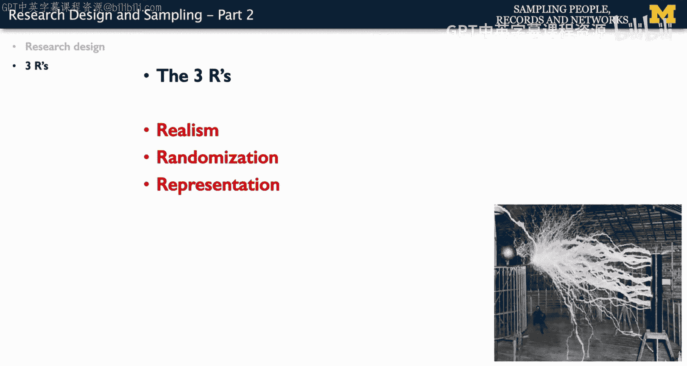

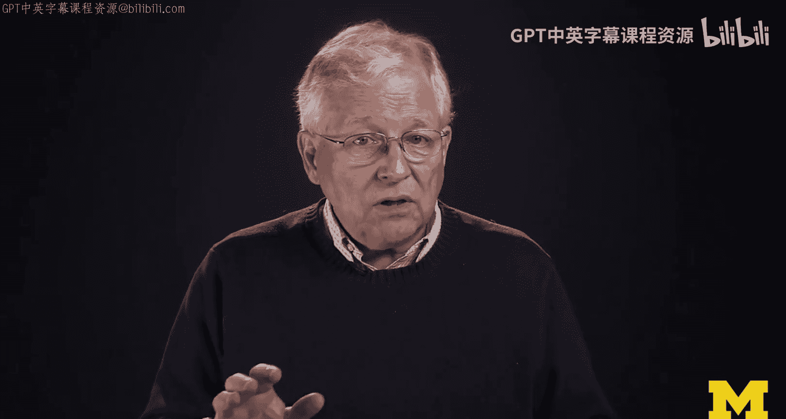

## 总结

本节课中，我们一起学习了：
1.  **抽样调查**作为一种观测性研究设计，其核心是描述总体和分析变量关联，而非建立因果关系。
2.  通过**土耳其人口健康调查**的案例，了解了全国代表性调查的目的和实施过程。
3.  明确了随机化在调查中应用于**抽样环节**，旨在获得一个能代表总体的样本，这与实验设计中随机化用于分配处理有本质区别。
4.  掌握了研究设计的 **“三R原则”**：**现实性**、**随机化**和**代表性**，并理解了不同研究设计在这三个原则上的侧重点。

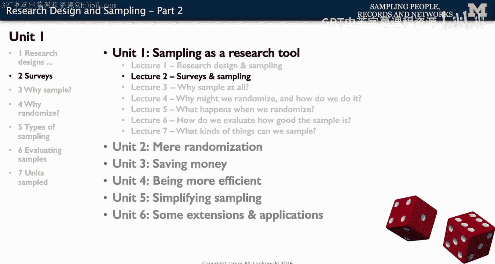

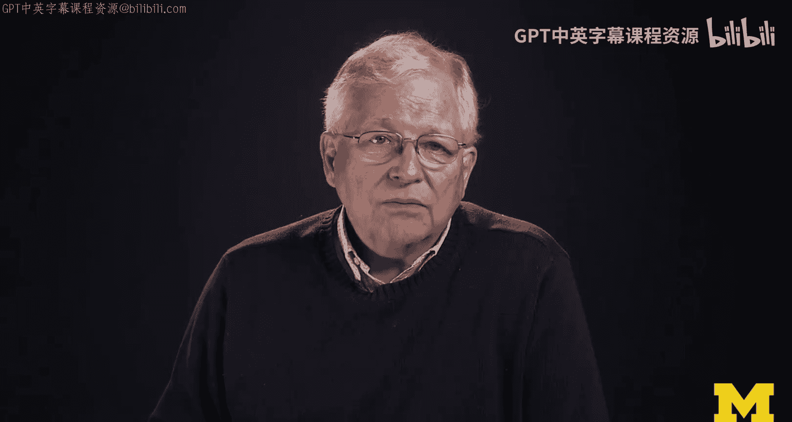

理解了这些基础后，在下一课（第2课）中，我们将深入探讨“调查”与“抽样”如何相互关联，以及我们将要学习的各类调查的具体含义。