# 密歇根大学《调查数据收集和分析（2-6：方法、社调问卷设计、抽样、缺失数据、分析）｜Survey Data Collection and Analytics》 p82 3_1.2 调查与抽样.zh_en -BV1fw4m1e7Zh_p82-

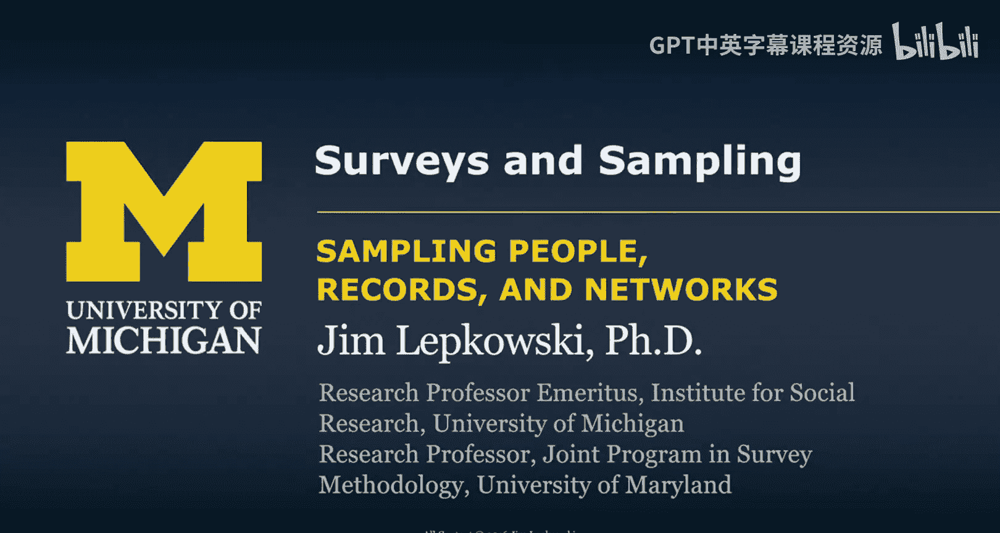

You know， this course that we're talking about that we've been doing now through just an overview lecture and one lecture is going to present one way of considering an important part of research。

 as weve mentioned already， the part about where we get the things that we're going to measure。

And as we've discussed in the overview。This kind of operation is done in many realms of science。

 many different scientific fields。It's often done quite informally， as we noted before。

 a physicist may draw a sample by just using materials that are readily available to them。

 the phenomena that's seen on Earth and' and they'll project it to the phenomena going on throughout the solar system or the galaxy or the universe。

 we're always doing this kind of thing， taking a sample in a particular way and then projecting it to other kinds of things。

We're often doing it by studying relationships and associations in a particular location and generalizing that to others。

 thinking about causal mechanisms and so on。What we're going to be doing here is doing things that are a bit more formal with respect to the sampling process。

 we're going to be thinking about this in the context of survey as a way of helping us formalize these things。

 a particular kind of research investigation rather than all kinds of research investigations。

And in this particular context， we're going to look at large scale data collection。

 the so called survey that collects observational data about a particular set of topics on a sample of individuals。

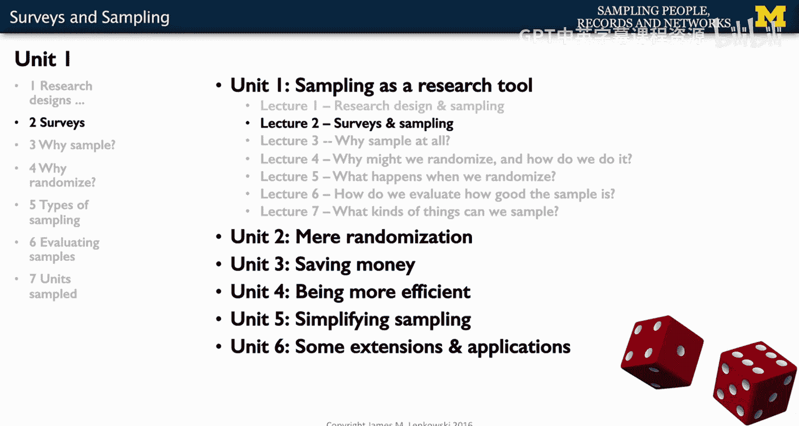

Now surveys are used in all kinds of scientific and non scientific investigation in MeFch。

 they're so pervasive that in some countries people complain about being unable to escape them。

 they seem to be everywhere。They are very useful and powerful tools for finding out about how people think about people think and act。

 what happens， what kinds of things happen as they behave in different ways。

 it may be collecting data about how they think about political candidates。

 it may be about national government， national and local government issues about education about transportation and related issues。

 it could be about crime and fear crime and so on and so on。

 so the topics are incrediblyibly diverse， which makes us a very powerful tool if you can apply it to many different kinds of problems like that。

啊。And then we get the results back and sometimes we get results that are surprising to us。

Mystified how did they get that result it just doesn't fit with my understanding the way the world works。

 so how do they do it， how do they ask the questions what process do they use I want to talk about that process and that may generate some questions for you as you're thinking about critically these kinds of things that we're getting all the time in our world about how to evaluate them。

 but we're going to talk about surveys and their general framework。

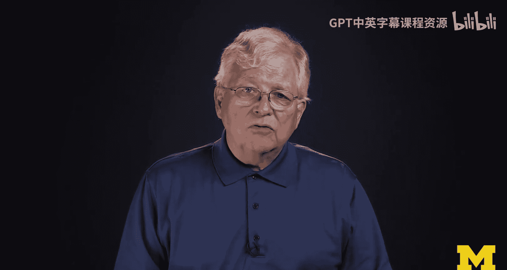

We're going to do that in four steps in the upper left there we're going to talk about problem specification first and then talk about measurement and then talk about outcomes and results。

 so there's a problem specification， we're going to make some measurements and then we're going to draw some conclusion and some results except that we're going to add one more thing to that a formal consideration of sampling sampling is seldom a very large share of a research investigation even a survey sample in terms of budget in terms of activity but it can be a critical one because it helps establish the population and the relationship of the results to that population。

We're going to use this framework that's got four boxes to it to describe the survey process。

 a simple representation of the survey process， whether it's formal or informal。

 we need to think about all of these boxes as we think about it。

 and even if people tend to deemphasize the sample， there is implicit。

 an assumption about what a population is， what the full set of molecules are。

 what the full set of chemical values are， what the full set of people happen to be that we're interested in。

But this process starts with a specification then of a population and a problem。

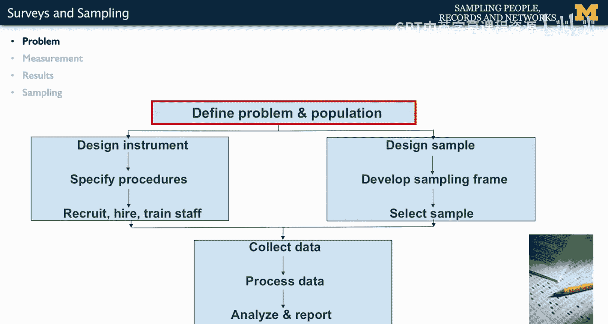

Generally， the problem comes first， people are interested in the problem。

 they can be focused on any number of things here。But that's where people put most of their thought。

 what is the issue that we're dealing with， the people who run them， the people who pay for them。

 the people who design them， they have a pretty good idea by the time they're ready to go what the topic is or the topics are going to be。

And they also know how they're going to make their observations in this kind of thing。

 they'll do them in such a way that they can establish fairly immediately whether one thing causes another well。

 they'd loved that to be the case， but as we saw when we talked about science。

It's hard to do unless you've got a carefully designed experimental study。

 so we're doing observational research methods。But one thing that sometimes doesn't get addressed as much as it should is the population What are you examining what's the collection of subjects that you're interested in and there are many surveys that don't even think about this very well it's just kind of as I said before implicit tacit It's not specified it doesn't specify the place where that population resides doesn't specify what the units are。

 are they people are they events that we're looking at and at least some confusion then as you're trying to develop the research investigation there may be some limits that we need to place on the population We're not interested in all the persons in the United States we're interested in only those who are eligible to vote they have to be 18 years of age and older we're interested in only talking to females because this is a set of issues that only concerns females those kinds of things need to be thought through as well just as important as the problem specification。

But sometimes not as carefully attended to。Well， let's talk a little bit about measurement the problem of the question of interest。

 the most compelling thing about a survey is what it is we're going to measure。

But that often starts with a very general notion of a construct。

 a general thing that we want to measure， we want to measure stress in a population。

 we want to measure how stressed out this group is。But we don't have a stress meter。

 we have indirect measures of stress， we can measure it in terms of blood pressure。

 we can measure it in terms of eye twitching， we can measure it in terms of coffee consumption。

 a number of hours slept， sleeplessness， all sorts of things that can be done。

Those kinds of measures are what we're going to be using。

 but we have to have the underlying construct for a specify we might be interested in what people think about a new product。

 well we have to have that product available and then what aspects of it do we want them to think about these are all measurement kinds of issues。

What you decide to measure， sometimes it's fairly easy， it's a direct observation。

 other times it's much more complex because we can't make direct observations。

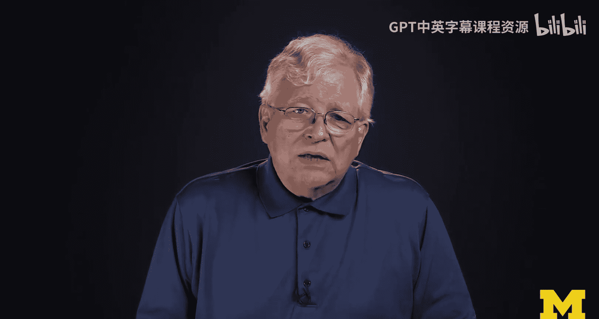

But nonetheless in that process， we're going to design some kind of an instrument or use some kind of an instrument。

 maybe our survey involves height and weight and overweight。

 and so we have a scale and a measuring device to measure height and we can apply those fairly easily borrowing an instrument from somewhere other cases we have to design an instrument like a questionnaire that allows us to obtain this data。

 this observational data through an interview process。

But even when we've designed that instrument we have to specify procedures。

 are we going to make sure that that scale is placed on a level surface that is uncarpeted that has a certain rigidrgity to it。

 we measured only at certain times a day in certain temperatures because it could be a little bit longer a little bit shorter depending on those circumstances。

 we have to think about the process that we're going to use to apply the instrumentation as well。

And then finally， if we're going to do some measurement， we may need to hire staff to do this。

 it may not be possible for us to have self-measurement， selfreport。

 the kind of thing that people fill out an instrument online in an internet survey。

 we may need staff to implement this， and I'm going to have to train them to do that implementation。

Through all that process， then when we've got that measurement all worked out and what the instrumentation is and how we're going to implement the data collection and what staff are going to do it and they're all trained and ready to go。

Then we collect data and that's the last box that we collect， we process， we analyze。

 and most people think about this as the heart of the survey and I suppose in many ways it is。

 but the prior step the measurement is extremely important in order to obtain reliable valid data for us to be able to draw。

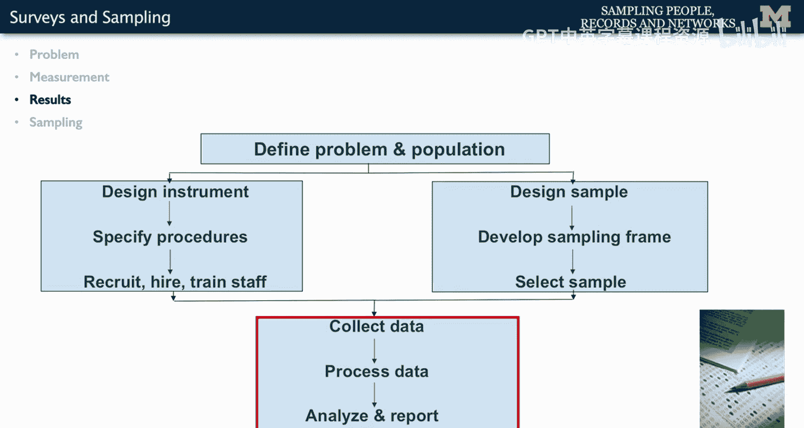

Firm conclusions about a population。Okay， that's the whole process， but I skipped something。

 didn't I didn't talk about representation， but that's the focus of our course and that representation side is the one that we're dealing with。

 the sample。

And in that process there we have to think about how we're going to go about doing the sample selection。

 this is a bit like specifying procedures， how are we going to figure out what sampling technique we're going to use and how to apply it。

In some ways， that depends on knowing the frame matter of fact。

 many of the sampling techniques that we look at were derived to deal with particular frame problems。

 that is the set of materials that we use oh let me define that then I use the term without defining a frame is that it's the set of materials we use to select the sample It could be a simple list。

 it could be a list of people who are in the population。

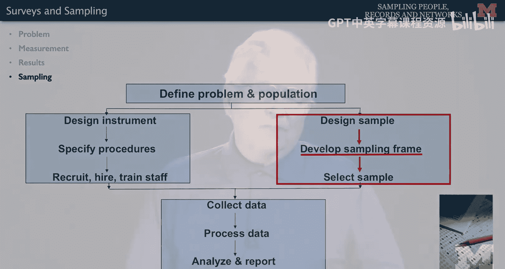

It may be that that list is a little bit out of date。

 so maybe we've got a list of people who are employees of an organization and it was obtained from the personnel department but they've not kept it up to date fully they didn't get the latest hires。

 the new hirings and there were a couple of people who。Died。

 big organizations and people died and they're no longer eligible。

 there could be a discrepancy between that list and full the actual population of the time we doing it。

That's very important to doing this， it assumes that we have a way of taking a list and then drawing a sample from it。

That's in a。Opposition to a scheme in which we just say all I need here to do is to recruit subjects。

 I don't care where we get them， I don't care where we get the individuals we're going to interview I don't care where we get the chemical product that we're going to going to use I don't care where we get the sample of water that we're going to examine I don't care where we get the sample of air that we're going to compare for us it's randomly mixed but in the human context that's hard to make that kind of thing recruiting a sample that way is sometimes dangerous we can end up with groups that are quite peculiar that we've drawn our sample from we're talking about a sampling operation where there's a list we sample from it and we follow that sample that's what we pursue and we think about a list and a scheme for sping from it at random that is suitable for that list。

And then we select our sample， then we go through and choose the particular individuals that are going to feed into that data collection。

 we're not just leaving it up to a field staff to a trained staff to do。

 we're telling them precise steps that they need to follow through on and specific kinds of things that they need to do in order to execute the data collection on the representation site。

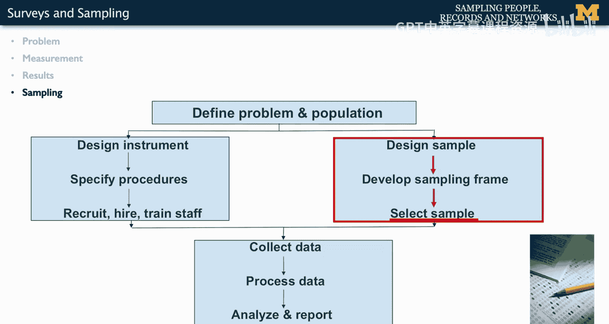

All right， that's the kind of thing that we're examining here。

 we're talking about that sampling process and how it ought to be done。

 we're going to stick to the more formal mechanisms for doing this。

 it's not to say that we shouldn't do the others， I do them。

 I design them but I want to do the more formal mechanisms because when we understand those。

 then it makes it easier for us to evaluate what's done when we don't follow them。

And that is an extremely valuable perspective so I think about this more as a strategy。

 let's get it down， get it down to the point where we really understand how to do sampling in a formal way and then we can depart from that。

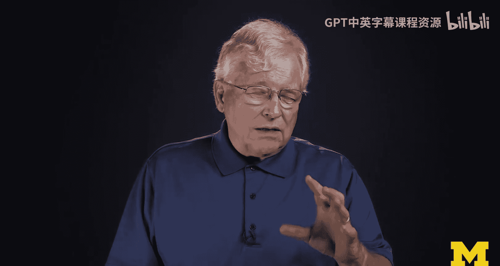

On the basis of convenience， on the basis of cost， on the basis of other phenomena。

That's the way the survey process fits in how sampling fits into it we've already talked about surveys and survey sampling and how they fit into research investigations now how sampling fits into surveys let's turn now to why sample it all what is the need for this and we're going to talk there about censuseism and contrast those with samples but that'll be our third lecture in our series here on sampling as a research tool thank you。

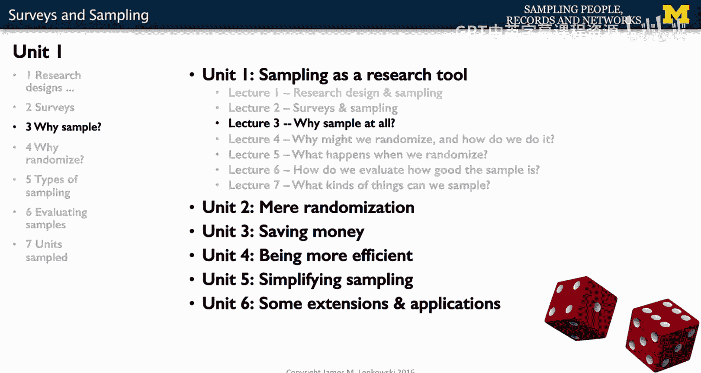

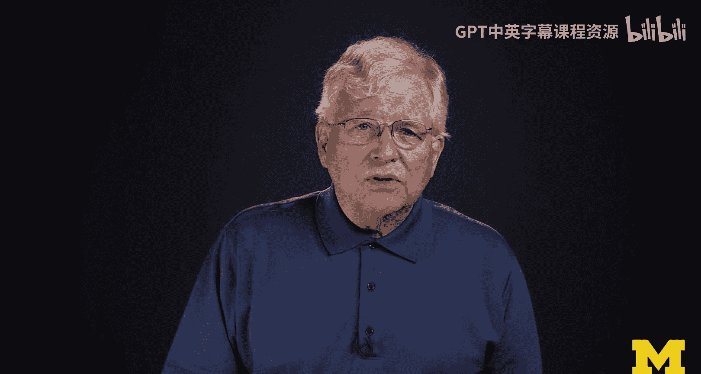