# 调查数据收集和分析：3_1.2：调查与抽样 📊

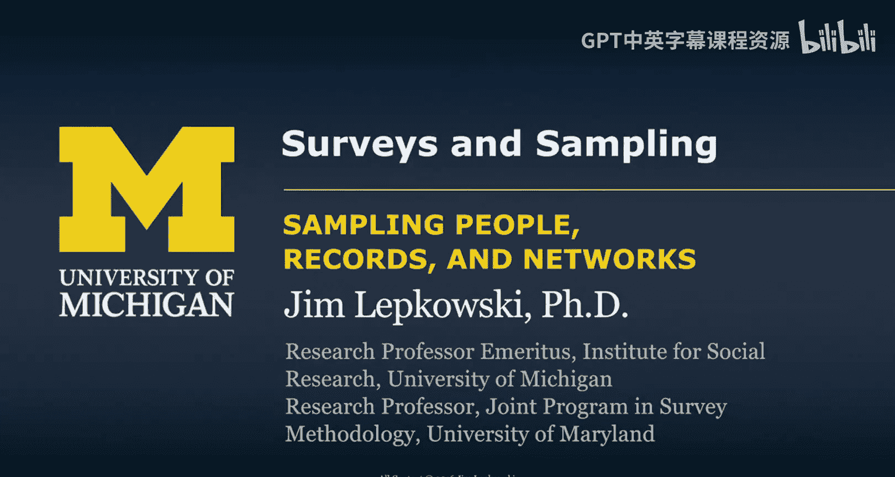

在本节课中，我们将要学习调查研究的整体框架，并重点理解抽样在这一过程中的核心作用。我们将看到，一个严谨的调查设计如何从问题定义开始，经过测量、抽样，最终到数据收集与分析。

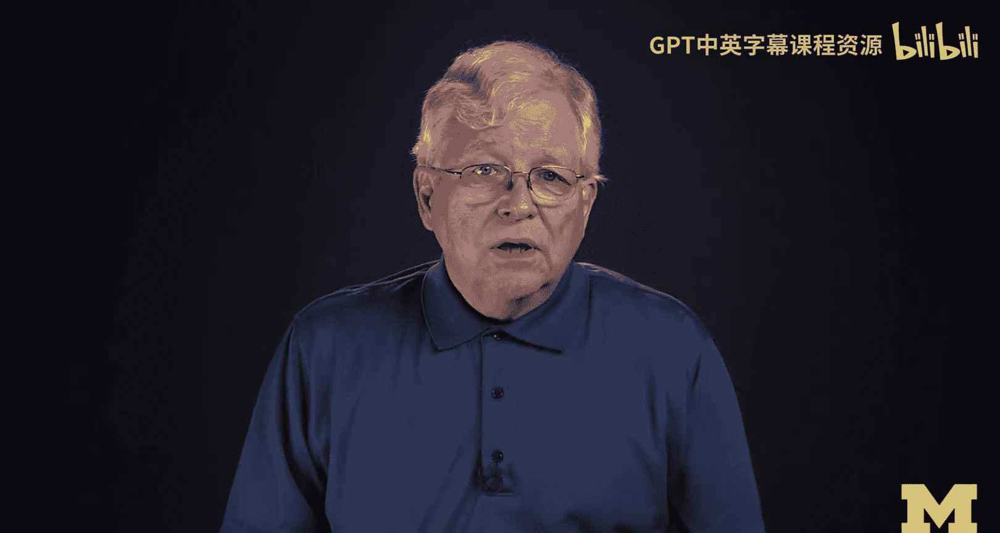

## 概述：调查研究的四步框架

上一节我们介绍了科学研究中获取测量对象的基本概念。本节中，我们来看看在调查研究的特定背景下，如何更正式地组织这一过程。

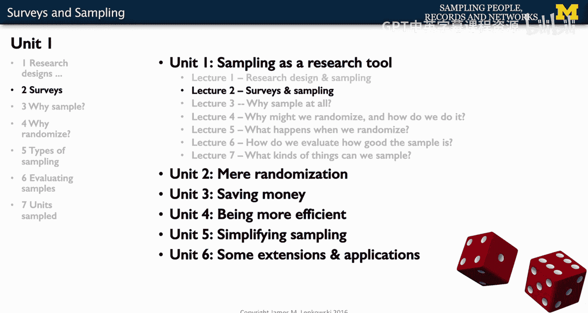

我们使用一个包含四个步骤的框架来描述调查过程。这个框架是调查过程的简化表示，无论是正式还是非正式的研究，我们在思考时都需要考虑所有这些步骤。

## 第一步：明确问题与总体 🎯

这个过程始于对**总体**和**问题**的明确界定。

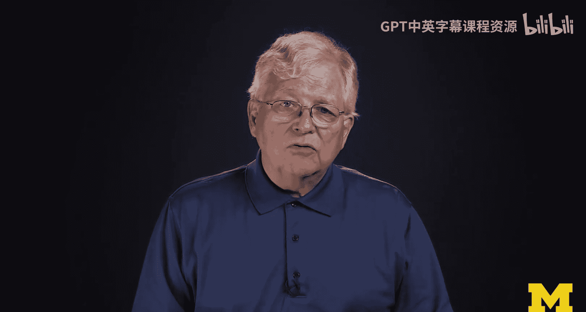

通常，问题先行。进行研究、资助研究或设计研究的人，在准备开始时，通常对主题有清晰的想法。然而，有时没有得到充分重视的是对**总体**的界定。总体是指你感兴趣的全部研究对象集合。

许多调查甚至没有很好地思考这一点，它常常是隐含的、默认的，没有被明确说明。它没有指定总体所在的范围，也没有说明单位是什么（是人还是事件）。在制定研究计划时，可能需要对总体施加一些限制。

以下是界定总体时需要考虑的关键点：
*   我们并非对美国的所有人都感兴趣，只对那些有资格投票（年满18岁及以上）的人感兴趣。
*   我们可能只对女性感兴趣，因为这是一组只与女性相关的问题。

这些方面需要像明确问题一样仔细思考，但有时没有得到同样细致的关注。

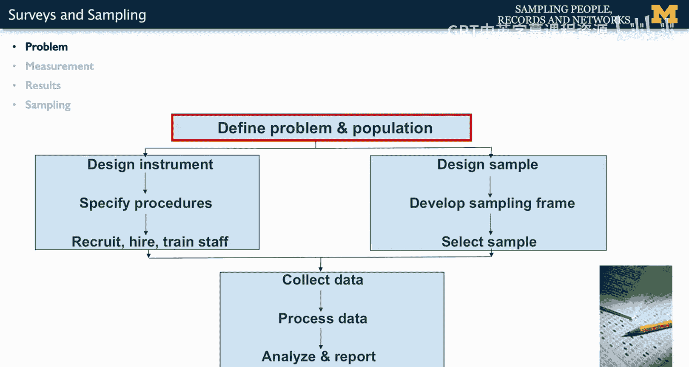

## 第二步：设计与实施测量 📏

调查最引人注目的部分在于我们要测量什么。但这通常始于一个非常一般的**构念**——我们想要测量的一个总体概念。

例如，我们想测量一个群体的压力水平。但我们没有“压力计”，我们只能通过间接指标来测量，比如血压、眼跳频率、咖啡消耗量、睡眠小时数等。这些测量指标就是我们实际要使用的。

在测量过程中，我们需要设计或使用某种**工具**。有时这很简单，是直接观察（如用尺子和秤测量身高体重）。其他时候则复杂得多，因为我们无法进行直接观察（如态度、观点），这时我们需要设计像问卷这样的工具，通过访谈过程来获取观测数据。

即使设计好了工具，我们还需要规定**程序**。例如，确保秤放在坚硬、无地毯的水平表面上；规定在一天中的特定时间、特定温度下测量。我们必须考虑应用测量工具的过程。

最后，如果我们要进行测量，可能需要雇佣工作人员来实施。这可能不是简单的在线自填式问卷。我们需要培训工作人员来执行这一过程。

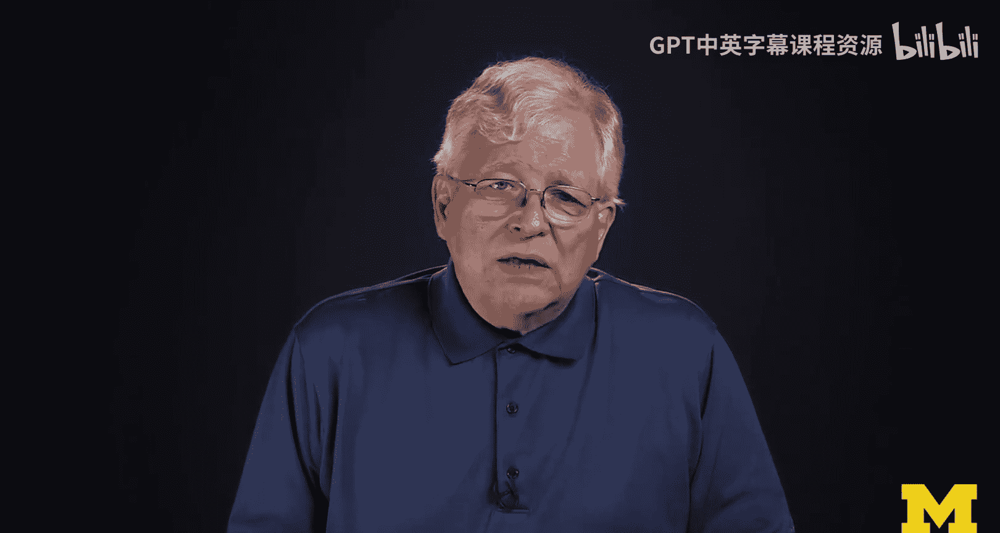

## 第三步：进行抽样以获取代表性样本 🎲

以上是整个过程的描述，但我们跳过了关键的一环——**代表性**，而这正是本课程的重点。代表性这一侧就是我们正在处理的**样本**。

在抽样过程中，我们必须考虑如何进行样本选择。这有点像规定程序：我们将使用什么抽样技术以及如何应用它。这在某种程度上取决于了解**抽样框**。

事实上，我们研究的许多抽样技术都是为了处理特定的抽样框问题而推导出来的。让我来定义这个术语：**抽样框**是我们用来选择样本的材料集合。它可以是一个简单的列表，比如总体中所有人的名单。

这个列表可能有点过时。例如，我们从人事部门获得了一个组织的员工名单，但它没有完全更新，没有包括最新的招聘人员，也可能有几个人已经去世，不再符合条件。在我们进行研究时，这个名单与实际总体之间可能存在差异。

这一点非常重要。它假设我们有一种方法，可以获取一个列表，然后从中抽取样本。这与另一种方案形成对比，即我们只是说“我只需要招募受试者，不在乎从哪里获得他们”。在人类研究的背景下，以那种方式招募样本有时是危险的，我们最终可能得到一个相当特殊的群体。我们讨论的抽样操作是：有一个列表，我们从列表中抽样，然后追踪这个样本。

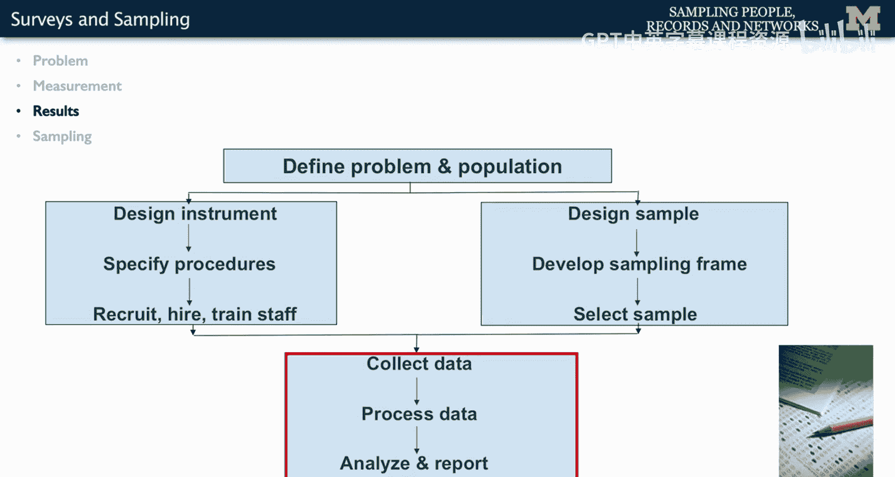

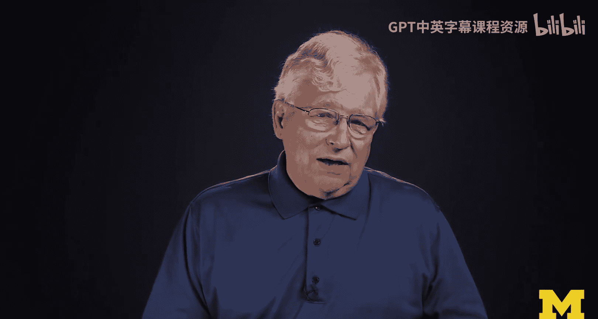

然后我们选择样本，接着去挑选将要参与数据收集的特定个体。我们不只是让现场工作人员去做，而是告诉他们需要遵循的精确步骤和需要做的具体事情，以便在代表性方面执行数据收集。

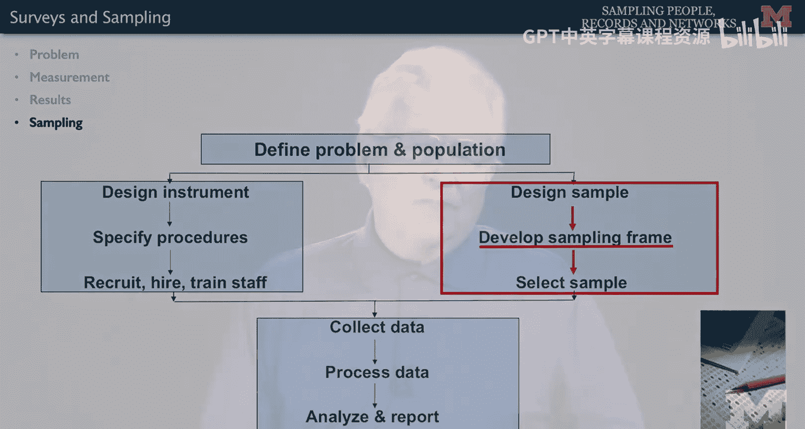

## 第四步：收集、处理与分析数据 📊

当我们把测量、工具、数据收集实施方式、工作人员及其培训都安排妥当后，我们就进入最后一个环节：收集数据、处理数据、分析数据。

许多人认为这是调查的核心，从许多方面看也确实如此。但为了获得可靠、有效的数据，以便对总体得出确切的结论，前一步——测量——是极其重要的。

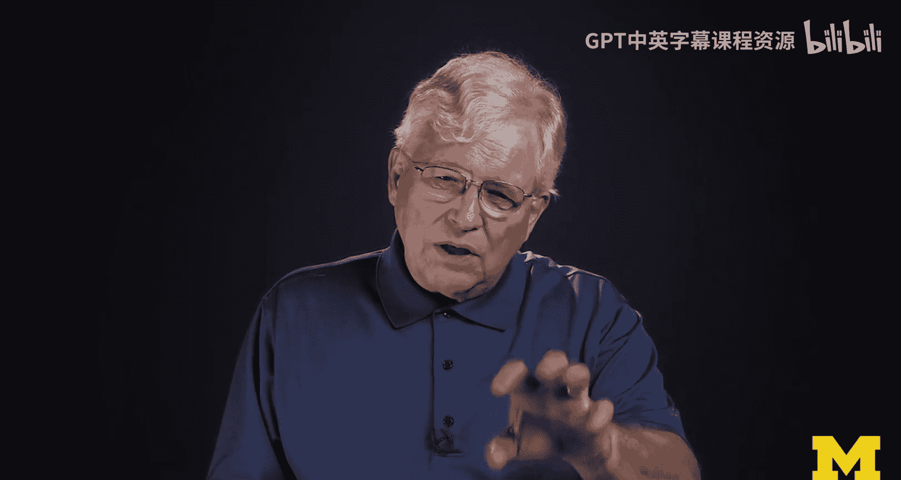

## 总结与展望

以上就是我们在这里要研究的内容。我们讨论了抽样过程以及应该如何进行。我们将坚持使用更正式的机制来做这件事。这并不是说我们不应该做其他类型的抽样，我也会设计那些，但我想先介绍更正式的机制，因为当我们理解了这些，就能更容易地评估在不遵循它们时所做的工作。这是一个非常有价值的视角。

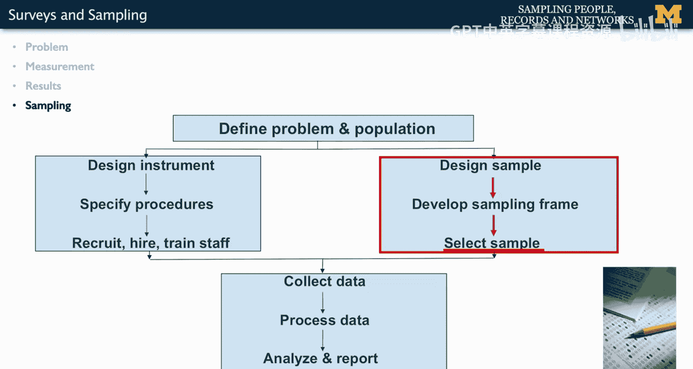

我把这更多地看作一种策略：让我们把它弄清楚，真正理解如何以正式的方式进行抽样，然后我们可以基于便利性、成本或其他现象，从这个基础上进行变通。

这就是调查过程的构成以及抽样如何融入其中。我们已经讨论了调查、调查抽样以及它们如何融入研究。现在，我们看到了抽样如何融入调查。接下来，让我们转向为什么要抽样，我们将讨论普查并与样本进行对比，这将是我们关于“抽样作为一种研究工具”系列讲座的第三讲。

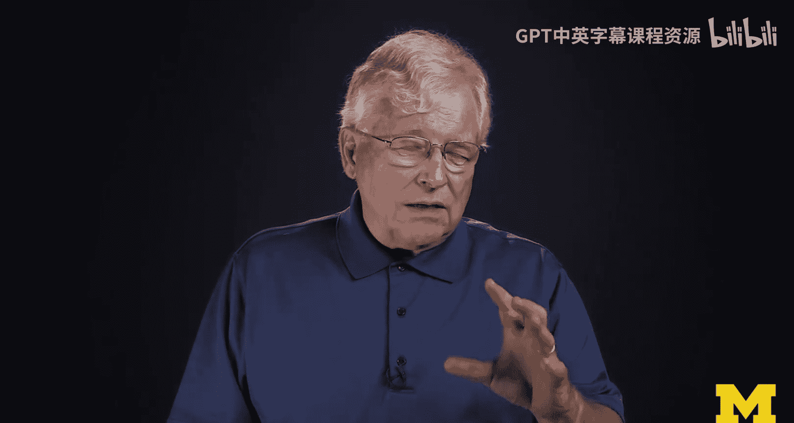

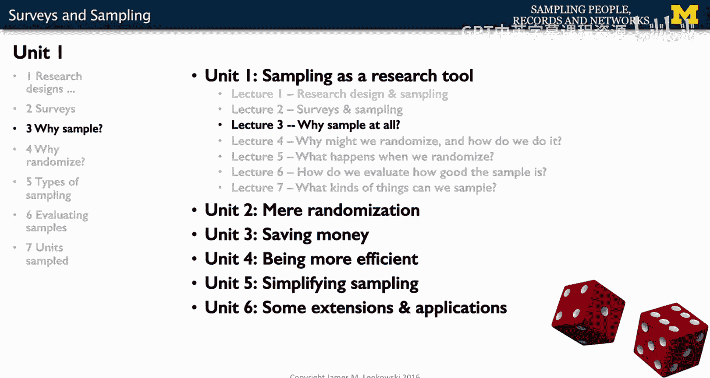

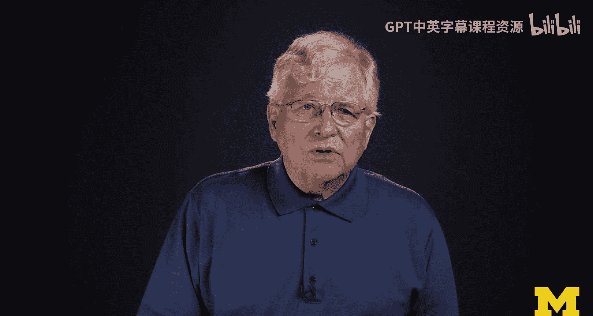

**本节课中我们一起学习了**调查研究的四步框架：1) 明确问题与总体，2) 设计与实施测量，3) 进行科学抽样以获取代表性样本，4) 收集与分析数据。我们特别强调了明确界定总体和抽样框的重要性，以及遵循正式抽样机制的价值，这为我们理解和评估各种研究设计奠定了基础。