# 密歇根大学《调查数据收集和分析（2-6：方法、社调问卷设计、抽样、缺失数据、分析）｜Survey Data Collection and Analytics》 p83 4_1.3 为何抽样(上).zh_en -BV1fw4m1e7Zh_p83-

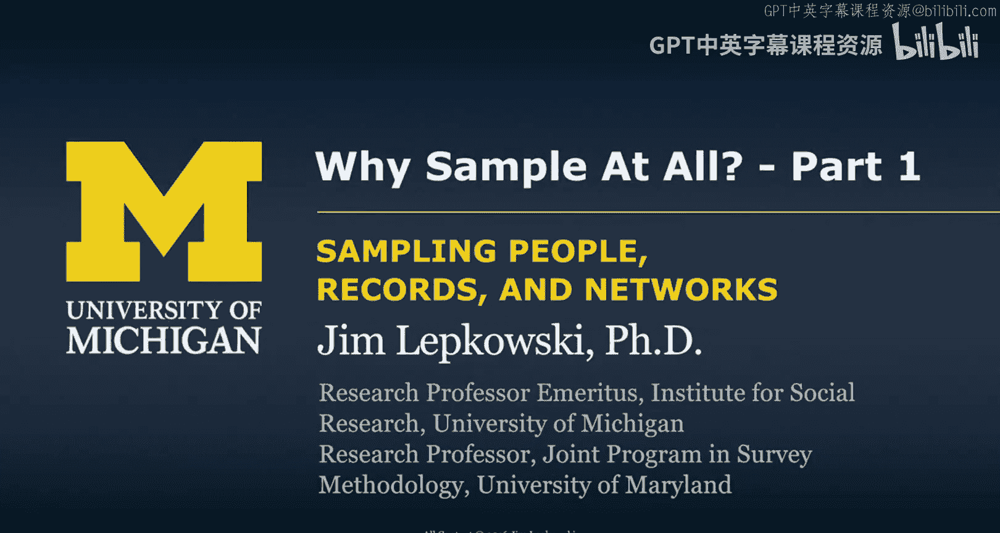

All this stuff about sampling would be a whole lot easier if we could just collect our observations in our survey without having to worry about much besides getting enough subjects to have a large enough sample to be able to say reliable things about the population。

 If we're only so easy。 Wecome back。 I'm continuing on our discussion about sampling people。

 records and networks and doing a sort of a reflection on what would be nice about samples。

 if if we could just， you know， take anybody。 But and just get enough observations to draw our conclusions。

 Yet what we're going to do is a bit more formal than than just that。

 it's going to have the same object， but it's more formal in this process。

 and they're just aspects of the process that lead us into more and more complexity as we do it。

And that's unfortunate， and yet I think it's a consequence of thinking carefully about these kinds of things。

In this lecture， we're going to cover a couple of diverse topics that can again and provide context for what we'll say later about specific sampling methods。

So we're going to talk about surveys and sampling in this lecture。

 but I just want to highlight something if you look ahead to the lectures3，4，5，6，7。

 those next lectures， there are five questions that we're going to address once we have this background We're going to talk about why sample at all I mean maybe it's not necessary to do a sample maybe we can just do something completely different in terms of drawing our conclusions。

Secondly， if we're going to drill a sample， why do we need to randomize and how do we do it if we're going to be forced into doing it。

 or if we think it's necessary to do it。Thirdly， what happens when we randomize。

 what happens to our ability to draw conclusions about the population。

And so we're going to look into what the consequences of randomization are。Fourthly。

 how do we evaluate the result， how good it is and what role can randomization play in that？

And then our fifth and final question in lecture seven。

 what kinds of things can we sample and that will be fairly brief it's going to be people。

 records and networks。So here though we're going to concentrate on why sample and all。

 and in order to do that， let's look in this lecture at a set of topics here that I've got outlined in the back。

 we're going to talk a little bit about a census source sample， a little bit about accuracy。

 what we mean by accuracy here。

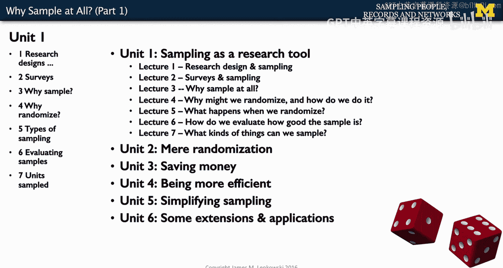

We're going to talk a little bit about probabilities and something called frames。

We're going to address techniques， the processes that we're going to use。

 and then a little bit about some deficiencies that happen when we attempt to apply those techniques。

 and then we'll mention briefly things about complex design。

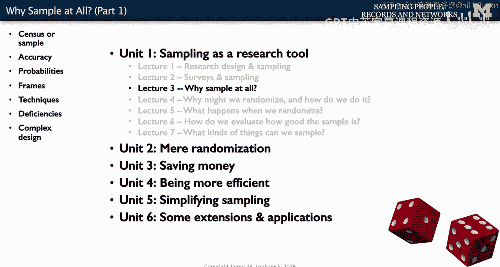

So that's what we're going to be addressing here， these are kind of scattered but related topics that are foundational background understanding。

What we're going to be doing is we go ahead with this。Okay。

 so let's look at this first one about a census or a sample。 So many times in a textbook。

 you'll see this kind of thing where as the drawing in the lower right shows。

 there's a population of a large， diverse group of people， many colors。And from that population。

 the sample is drawn， we want that sample to be a miniature of the population。

That's kind of one perspective on it。 That's kind of a classical perspective that comes about from 19th century studies of the human condition in Northwest Europe。

 I want to make sure that my approach leads to good， accurate conclusions about the population。

 I want to be able to tell people what is the condition of the people living in in London。

 in this neighborhood in London at this time with respect to sanitation or with respect to crime。

 with respect to working environments and so on。

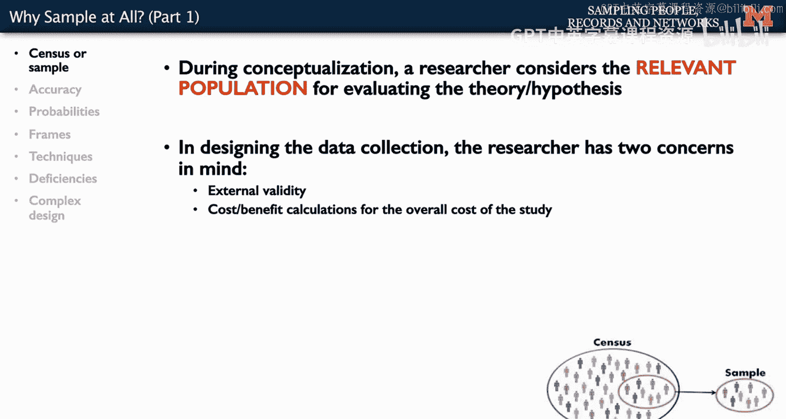

I just want to make sure that I've got good accurate conclusions that I can draw and one way I can do that is to just。

Do the whole thing， draw a sample and take all。

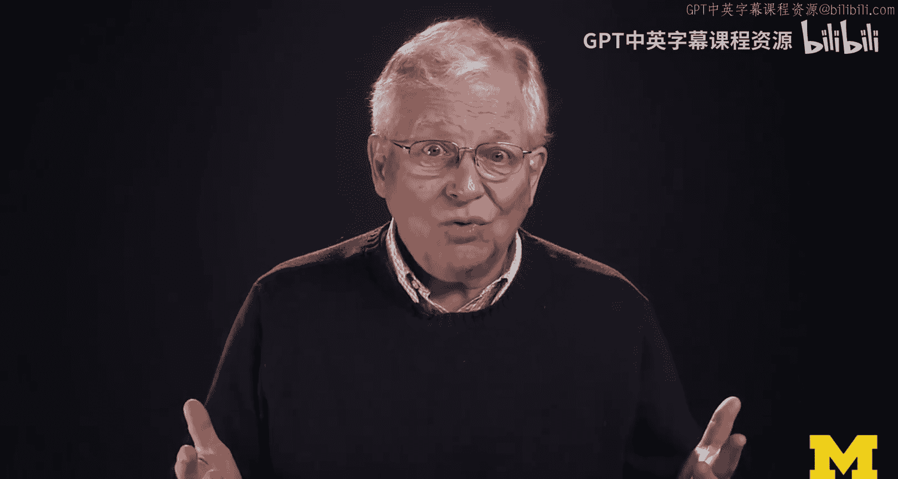

So there's a relevant population that we're interested in。

 and then we're going to be drawing a sample from these and thinking about how good are the outcomes that I've got based on this sample。

Okay， census involves a complete enumeration of population when the population is large。

 That's a very costly thing to do and very time consuming。

 Censuses are not done routinely for most of these， the subject matter， for example。

 the in the almost every country in the world。 I think every country in the world today， at least。

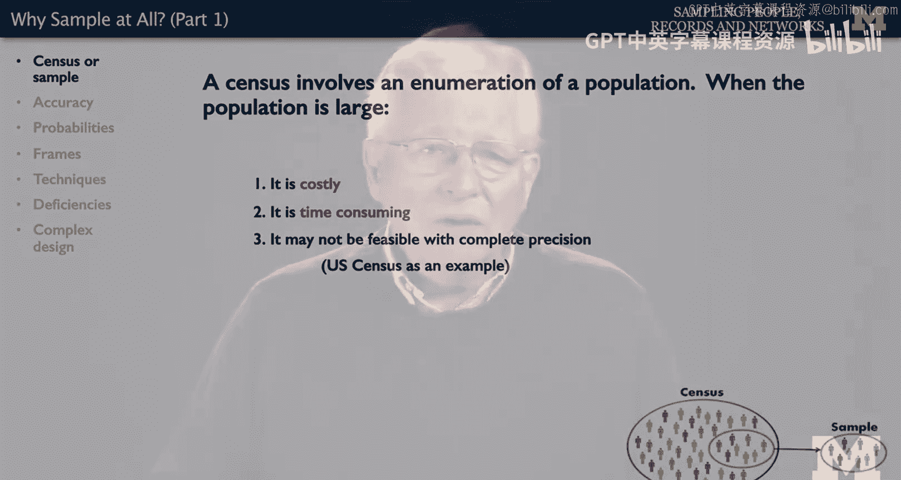

Aspires to doing a census of the population。 But those censuses are done only every five years or only every 10 years because of such an expensive undertaking and a limited number of variables。

 Remember in the most recent census of population for the US。

 There were just a limited set of questions。 than they advertise it that way。

 You only have to answer 10 questions。 There's nothing more that you have to do to try and reduce burden and encourage participation and response。

，Problems that are run into is then with respect to the census are the timing audit is a problem。

 they're only done every 10 years， the census in the US is done in years ending in zero。

 every 10 years going back to 1790 the first census of the population and that means the data get rapidly out of date。

 there are some problems with nonresponse that occur the US。

 census is at first a process of self-administered forms being mailed out to people through the postal service。

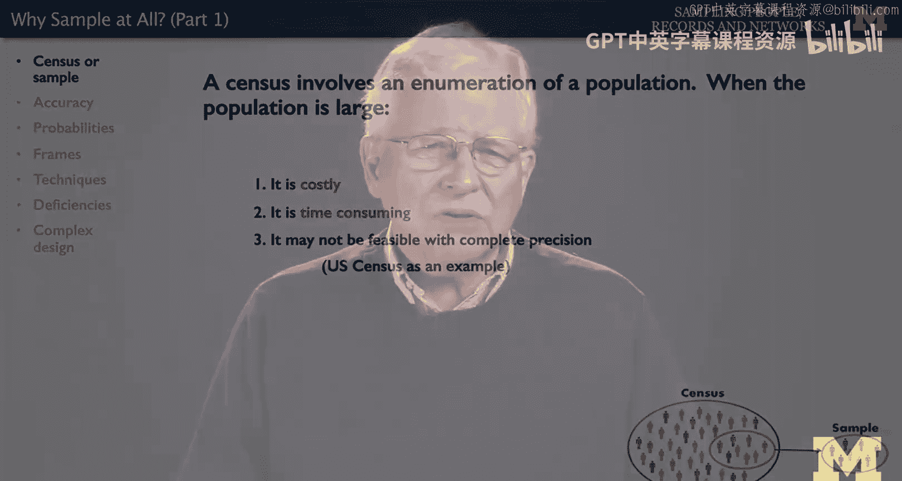

And then people are supposed to fill out those forms and return them， but。

About 25% of the US population a little more than that doesn't return those forms。

 And then there's a sequential process in which individuals go door by door to those households that have not returned the forms in order to collect the data。

 So it's a， it's a。Complex undertaking because it's so large and vast in its its operation。

The cost for a completed unit and the total cost are a little misleading。

 It may not cost very much per person to do a census。

But when you've got a large population of hundreds of millions of people。

 the total cost can be something that only could be attempted periodically by a government system。

And so it's not feasible to do censuses all the time。 In between censuses， people can do samples。

 They're going to get snapshot and try and get as good a representation of that population as possible。

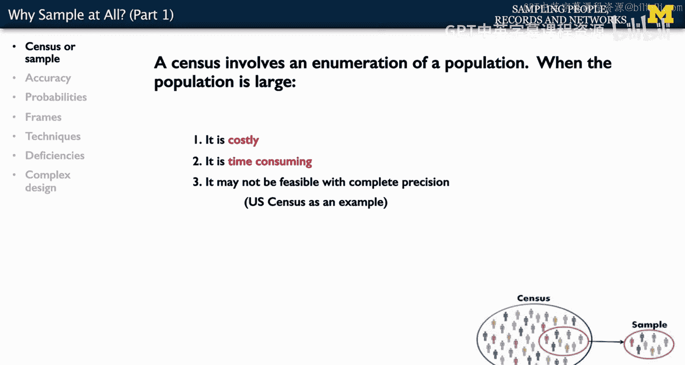

So the census and the sample working together， generally。

 the census represents what the sample aspires to be， measuring everybody and getting a good。

 accurate picture of that。 But the sample is more cost effective and timely and can be done more often and fill in the gaps in terms of time。

 fill in the gaps in terms of population， fill in the gaps in terms of variables that are being measured。

 The census can only do a limited number at a given at a time。

So the sample is far less costly and far less time consuming to conduct。

It's only dealing with a subset of the population， but we want to make sure that that's sampled。

Somehow represents the population， a miniature of it， as I've said before。

And if we can't do the whole and thereby get perfection， we're going to have some error。

We'd love to have it so that there's no error， but there's going to be some error because we only have a subset of the individuals。

 How large is that error。 And just what can we do with it。 Now， actually。

 we think that in the case of samples samples， we can get more accurate results than with the census。

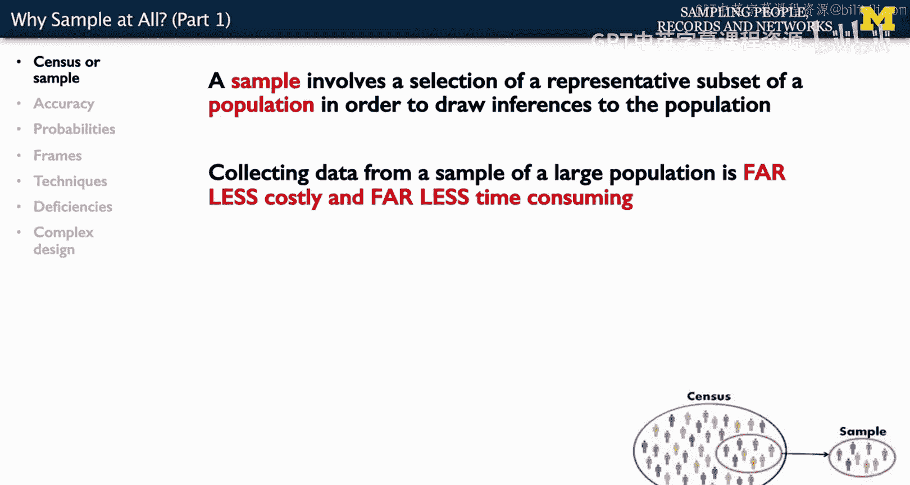

Because we can concentrate on a more limited set of subjects and getting higher quality information for each of those subjects。

 those in the sample than we can with a census where we've got to spread our resources across vast numbers So we can actually get more accurate results with the sample than we can with a census。

 but but maybe we ought to talk a little bit about what that means。

 and we'll do that when we talk about accuracy in a second。 before we get there， though。

 let's talk about how samples get selected。

Now， we can do recruitment directly。 By that， I mean。

 we're just going to go out and assemble a set of volunteers to participate in our studies。

 It's more of a recruitment activity than a sampling。

 The idea is that we're going to find people willing to participate。

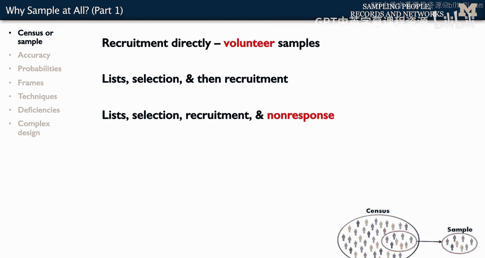

There's no issue about。A list and a sample selection。

 that's the kind of selection technique that's used more in more formal government and academic surveys。

But we can just recruit a group of people and assemble them and collect data from them。

 So the idea of using volunteers for the sample， people who are self-motated。

 they're the ones who initiate the decision to participate。 It's not that we approach them。

 In contrast to the mechanisms that we have， that we'll talk about the middle one here in which we actually have a list of the elements in the population。

 We select the ones that we want from that list。 Now we're going to do that using randomization in what we're talking about。

 but that selection is something that's instituted by the scientists the statisticians。

 the researchers。

And then we go to recruitment， We only recruit among the sample， the selected group。

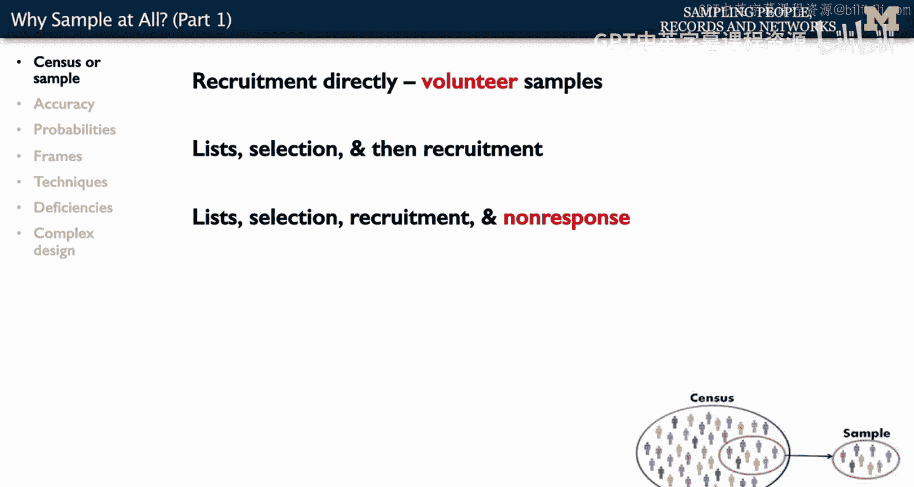

And so there's a interjection of another aspect of this。

 a list and a selection rather than just going to recruiting。But there's a consequence of that。

 And we'll talk a little bit about this in this course。 And that is， we may have that list。

 We may have the selection， and then we may do our recruitment。

 but there are some who are not going to participate。 We're going to have nonre。

And that is a deficiency that creates the necessity of a set of assumptions about what we're doing that isn't there when we just consider the pure list selection and recruitment kind of an approach。

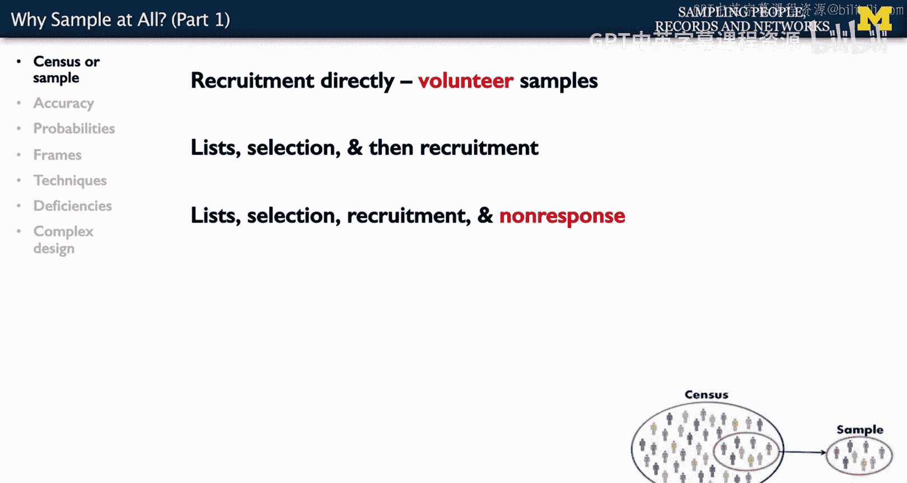

So for our purposes， I'll talk a little bit about recruitment recruiting these things directly。

 volunteer samples。But mostly we're going to talk about having lists or some way of assembling lists。

 even in artificially assembling a list and making selections and then doing the recruitment。

 and we'll add on a few things about nonre as we go along。

But because we do samples。They may cost us less because it's smaller numbers that we're going to be doing。

 but they also can lead to better data because we may have more resources to devote to better measurement and even better coverage and response。

There's always the ever present concern for the fact that we have a sample and not a census。

 and so we can be wrong in our sample result because。

There are four possible outcomes that might arise。 And the bull'seye image that you see here。

 This is sometimes referred to in the survey realm as a total survey error perspective。

 And you've probably seen this in earlier courses in our specialization。

 Help us to understand this more fully。

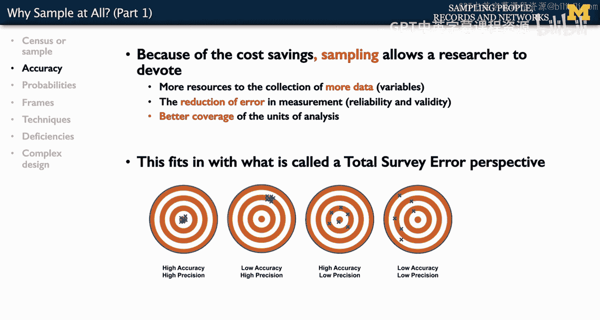

Now， I'll come back and talk about accuracy a little bit more in the context of what we're doing。

 But I just wanted you to understand that when we do samples。

 we're not claiming that we got perfectly accurate results。

 mainly because we know that we got a sample and not the full population involved。

We've mentioned that the samples can involve probability selection or no probability sampling。

We mentioned the kind of volunteer recruitment to get a sample。

 sometimes for more convenient sources than we might use otherwise。

But there are lots of ways that sample can be and drawn the don't In chance selection。

 a matter of fact， even in the social sciences and the studies that are done。

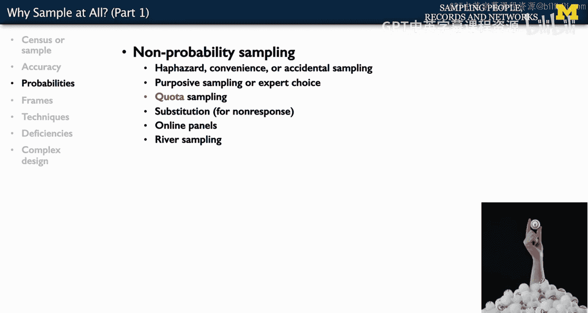

Randomization is is not the norm。 The norm is non randomized studies， Noranized selection。

 For example， the sample may be selected through expert choice or judgment。

 We rely on the expert to determine who falls into the sample。

 We have systems in which we can fill quotas based on interviewer judgment。

 We get the down to a point where an interviewer is told that， look。

 you need to get 10 interviews from this neighborhood from this voting precinct from this voting district and we want half of the interviews that you do to be female。

 We want two of those interviews to be done with people under the age of 30。

 and we want four interviews to be done with people of this particular background。

That kind of thing， though， is in contrast to the nonresponse and substitution that is sometimes done。

 so we may actually get a list and make a careful sample selection。

 and then when we go out into the field， we allow for the possibility that there be nonresse and we allow the interviewer to substitute another unit or someone else to substitute for a carefully chosen unit。

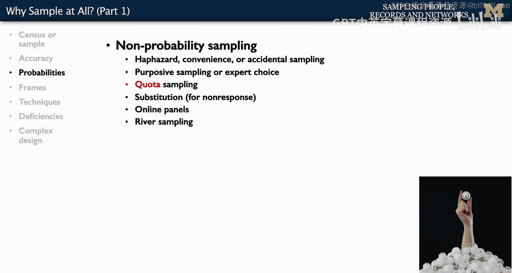

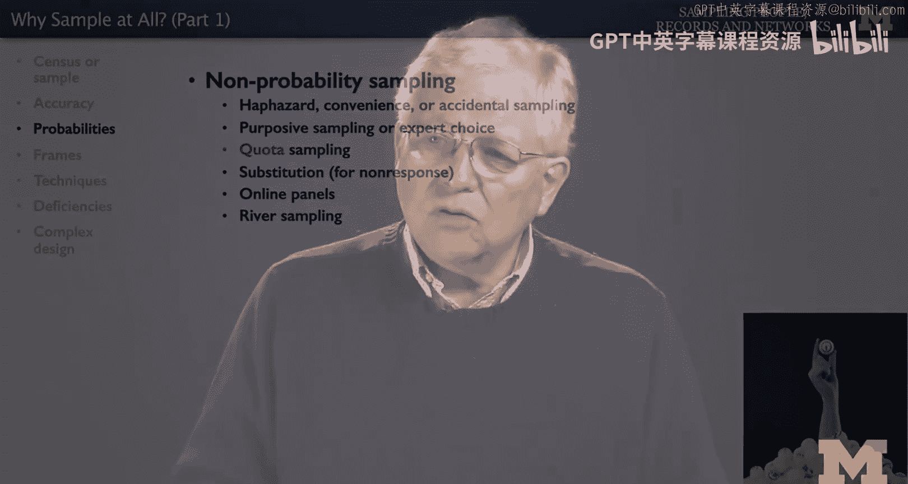

So there are three forms of non probability sampling that I mentioned there。

 there are expert choice or judgment， filling quotas by interviewers or others。

 and then substitution。

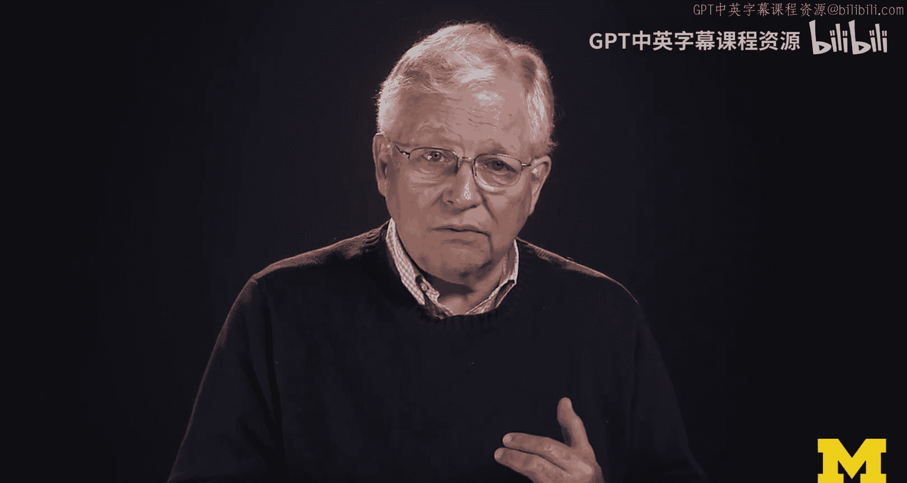

There are also such things as online panels。 these are very widely used。

 increasingly widely used today in studies of political opinion and attitudes。

 and they're basically recruit the sample in advance。

 recruit a panel of individuals that you can draw a sample for a particular problem from Now they're going to participate on the basis of their voluntary decision to be a member of the panel。

 In contrast to river samples that draw the sample continuously as needed。

 rather than having a panel already assembled and then draw a sample from it for a particular client or from particular application。

 we're going to do this through some kind of a flow process that's drawing people through mechanisms on the web or through other kinds of recruiting mechanisms There all sorts of things there。

 non-pro sampling very inventive kinds of things。 but they're beyond the scope of this course for us to deal with。

 What we're going to deal with is in the lower righthand corner there。

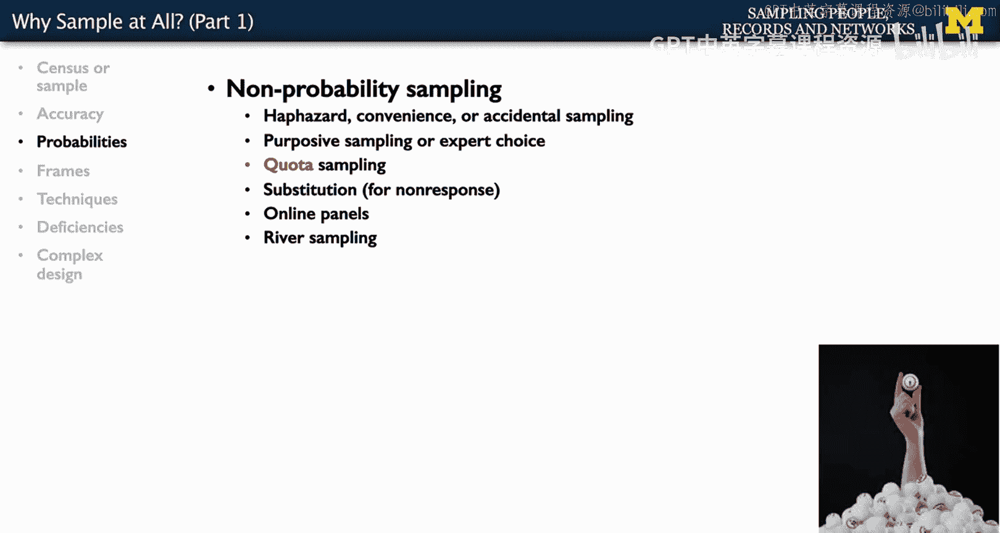

The image of the lottery， choosing something at random， something that comes up as in a lottery。

 a set of numbers that have some payoff for us， but here we're going to use that。

Randomized selection and probability sampling。 And here。

 there are a range of techniques on the probability side that we're going to be dealing with。

And these involve， as I mentioned， randomization only design。

 simple random selection that we'll do in our next unit。Sttraatified selection。

 the idea of grouping and then getting greater efficiency in our operation by drawing selections from each of the groups。

Grouping and choosing the groups themselves， a so called cluster samples。

 which are designed to improve the efficiency by reducing our costs。

 and they can reduce costs substantially。There are also accounting methods like systematic selection that make the selection process much easier to do and could be done by clerically trained individuals rather than highly trained professionals。

 and then more complex techniques that involve probabilities that deal with particular real world problems in drawing these samples but using again。

 probabilities in the selection process。So different realms of operation， one mainly recruiting。

 focusing on recruiting a sample and nonpro techniques that fall under that。

 and the other that have techniques that involve probability methods such and techniques such as outlined here。

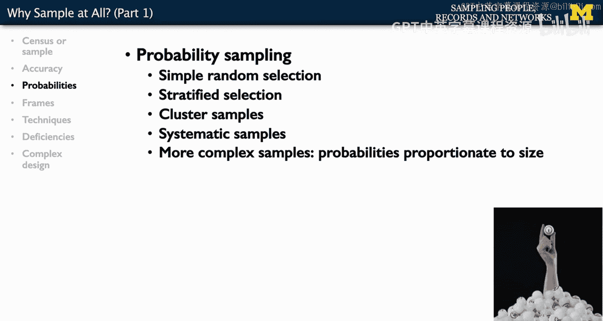

Well， let's take a little break here and then come back to lesson three about why we sample it all to wrap up this particular lecture。

Thank you。

