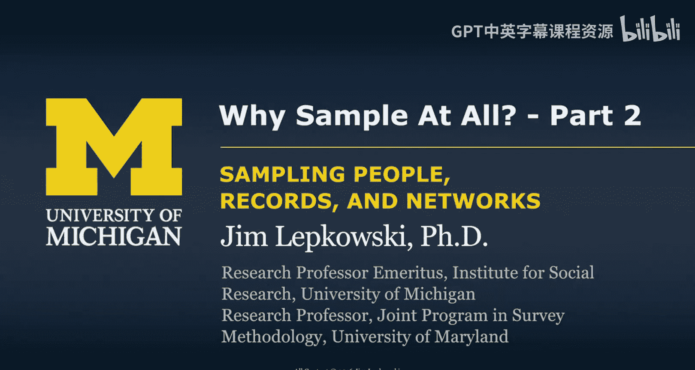
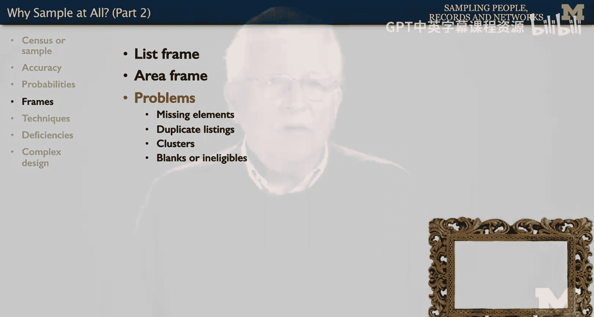
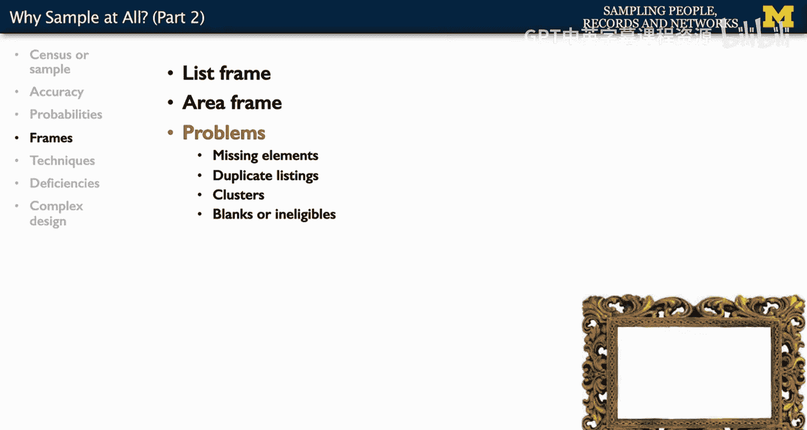
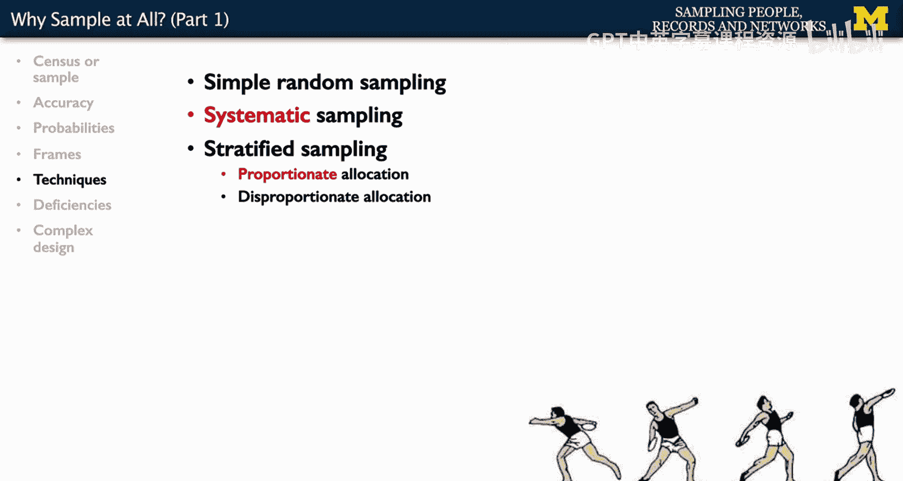
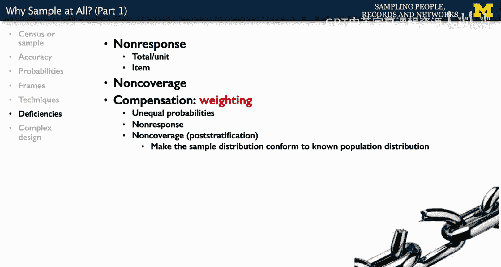
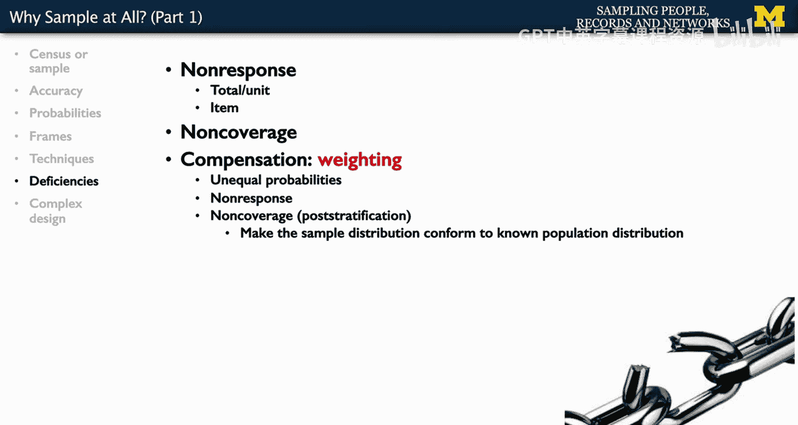
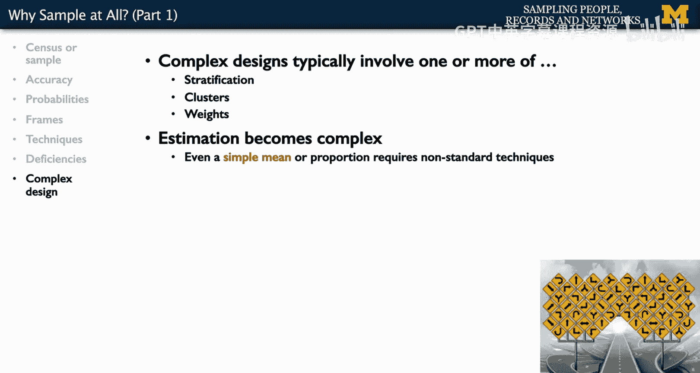
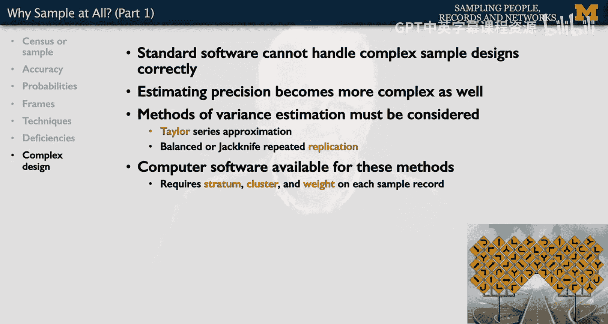
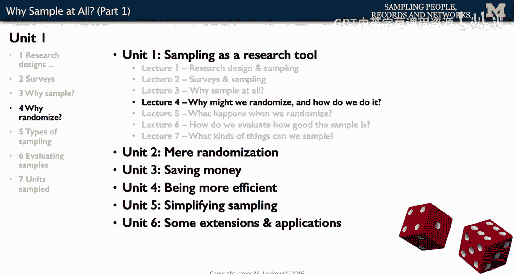

# 密歇根大学《调查数据收集和分析（2-6：方法、社调问卷设计、抽样、缺失数据、分析）｜Survey Data Collection and Analytics》 p84 5_1.3 为何抽样(下).zh_en -BV1fw4m1e7Zh_p84-

We're resuming our lecture 3 on sampling people records and networks in unit1 on just sampling as a research tool。

 and we're going to be in this particular case， picking up or we left off in our first part of the lecture。

 You recall that we were talking there about censuses versus samples and how samples can be valuable。

 and then whether or not we use randomization probabilities or not。

 what techniques go with those different kinds of probability and probability samples。

And then we wanted to continue on with a couple of additional topics。 and that's where we are now。

 We're now going to turn to looking at frames。

Framees are a one of those transcending generic terms that refers to the set of materials we use for selecting the sample Now usually we think about that in terms of a set of materials that are assembled all in one place。

 a simple single list。And so our techniques that we've been talking about。

 many of them can be applied directly to those kinds of lists。

 simple random sampling and stratified sampling and systematic sampling。

But there are also situations in which we have not a simple list frame， but more complex frames。

 frames that we have to assemble because we don't have that list。

 and we need to assemble our sample by doing it in stages step by step so that we can reduce the costs of a hugely expensive operation。

 building a list。 We want to be able to use existing materials and not invent new materials for what we're doing。

So area frames are an example where we may draw a sample of persons in a country by first。

 not sampling attempting to create a list of all the persons which we don't currently have。

 but by first assembling a list of the geographic areas where they live。

 all the geographic in a country， so maybe it's all the districts in a country。

 maybe it's all the enumeration areas in a country， enumeration areas being a census type unit。

And we attempt to draw a sample， not attempt to， we draw a sample of those areas first because we're going to link people to them。

But then when we go there to to those areas， we discover that there's still a lot of people there be a lot of time and money to create a list of the people。

 and then we're only going to use a subset of them。So we might subdivide it further。

 We might take the district and divide it into blocks or enumeration areas or some smaller subunit and then draw a sample of those and so we start with a list first of districts and then。

Within the selected districts， a list of subdis within them， and we sample those， those subdis。

 And now we're down to a list of sample subdis。And we go to those。

 And then we recognize that we can go and obtain a list of households。

 We still don't want to list all the people because too many we're only going to take a small share。

 We don't want to list more than we have to。 So we list the housing units and draw a sample of those。

Now we go to the sample housing units in our fourth stage and now we list the people。That area， area。

 area or unit， housing unit person that kind of an area frame。

 lot of different lists being assembled there。 some of them being assembled for the first time。

 our own listing operation。

These kinds of things can create problems in our ability to match up our frame to our population。

 even in the simple list case， we may have cases where there are elements in the population that are not in the list and things that are on the list that are not in the population and so on。

 those kinds of problems can be dealt with as we think about the particular frame that we have。

And so there are remedies that people have for addressing these kinds of problems and making sure that we get the best possible match between population and frame。

 between population and the list or set of materials that we have to select our sample。

To those frames we apply the techniques that we've already been mentioning。

 So we mentioned simple random sampling and systematic sampling。 But here in these techniques。

 there's a particular recommended set of ways of carrying out the selection。

 There are several ways to do to do the same thing。

 There are several ways to do simple random sampling。 We'll look at some of that as we go along。

 But these are particular techniques， particular forms that are followed in the selection。

 sort of like when I was in high school and on the track team and throwing the discus。

 There was a form。 I was terrible at it。 I was not a good discus thrower。 But nonetheless。

 there was a technique， a particular approach steps that were involved。

 And that's what we'll look at as we look at the sampling techniques that were're going to be examining。

There are techniques that are used that are applied to lists to list frames。

 and then there are techniques that are applied to cluster situations to area samples and those kinds of things。

 to multistage samples， and so the techniques are somewhat different in each case。

Regardless of the techniques and the frames that they're applied to。

 there are going to be deficiencies in our samples。 For example。

 I've already mentioned some of these， like nonresponse。

 We've drawn a sample very carefully from a list。 We've assembled that sample and we're out recruiting individuals in that sample to participate in the study。

 and some of them don't provide data because they don't want to provide the data。

 or we can't locate them。 or there is a language issue or all sorts of of things that can happen。

 Sometimes it's that they don't provide us with information at all。 In other cases。

 they provide us with some information， but for some items， they don't provide the information。

 they don't want to tell us their income。 They don't know the answer to a particular question。

 So there's missingness in the data， nonresponse。's that's's a sort of breaking the link here。

 We've got such a nice， carefully selected sample。 And yet now we're we're losing some of the individuals that we've so carefully assembled。

There's also some problems with respect to coverage。

 One of the frame problems that I didn't really highlight is the fact that there is this discrepancy sometimes between the frame and the population。

 The frame doesn't cover all the elements in the population。

 Now that may be because of of a deficiency in the frame may also be because of a deliberate choice we've made。

 We decide not to cover population in a remote。

Portion of a country。Because it's very expensive to get there and the size of the population is fairly small。

 It's not that we're not interested in them， but。Excluding them saves us bundles of money。

 and it makes very little difference in the final conclusions。That we're doing overall。

Both nonre and non coverage， there's compensation to try and。Bring that。

Break in our link back together a little bit。 And there's something called waiting that's used in these kinds of things。

 Now waiting is used to compensate for unequal probabilities of selection。

 but sometimes it's also used to adjust for non responses and non coverage。

 a technique called post stratification in which we attempt to make the sample look like some outside control information for our population。

But nonetheless， we're attempting to address these deficiencies， post ho。

But then we also have to consider one more factor here。 And that is complex designs。 Boy。

 there's a lot of things that we can put together now， as you can see。

 whether there's randomization and clustering and stratification。

 There are various kinds of estimation procedures。There are weights that can be considered involved in this process。

All of these are departures from the simple， simple randomization。

 Sim random sampling is a base as a starting point。

 But there are all these departures that we introduced to save money。

 to make our designs more efficient， to correct various kinds of def。

And when we introduce these features that are not just randomization in into the process。

 the estimates that we have to compute become more and more complex。

 A simple mean or a simple proportion becomes much more difficult to compute because of the complexity that goes on。

That complexity is reflected as well， in the kind of。

Measures that we're going to talk about that are used to assess the quality of our results。

 It'll be something that we call standard errors or confidence intervals that we'll talk about。

 And in those kinds of estimates for our results。Being able to compute those for more and more complex designs that involve clusters and stratification and weights and other factors。

 It becomes a complex task。 We need software beyond the standard software that can handle these complex design features correctly。

And so it's necessary for us to talk a little bit about variance estimation we'll do that in the last unit very briefly。

 we'll talk about some of the different ways that quality of our data can be assessed。

 taking into account this complexity and some of the software that's available to do this kind of thing that makes it opaque you don't even have to worry about this kind of thing because the software provided you give it the right kind of information handles all of these things。

And what we'll see is that as we change the technique。We change how we compute our estimates。

That as we move from a simple random sample to a cluster sample。

 we're going to change how we compute our estimates。And as we do that。

 we need to keep the design married to connected to the estimation procedures。

 and the software will help us do that。 Okay， it turns out that this complexity follows the randomization。

 and there are many ways that we can randomly select samples if we've been talking about it。

 And so we're going to need to keep track of how we selected the sample in order to make our estimates as sound as possible。

In our next lecture， what we're going to do is turn to the second of our five questions。

 we're going to ask the question about why might we randomize and how should we do it？

And so we're going to look at random numbers， what they're like and how they are used in selection。

 We won't worry about technique as much as about the implication of using random selection and getting our sample。

 and we'll look at the consequences of randomization in lecture 4。 Hope to see you there。 Thank you。

