# 密歇根大学《调查数据收集和分析（2-6：方法、社调问卷设计、抽样、缺失数据、分析）｜Survey Data Collection and Analytics》 p85 6_1.4 随机化原理与方法.zh_en -BV1fw4m1e7Zh_p85-

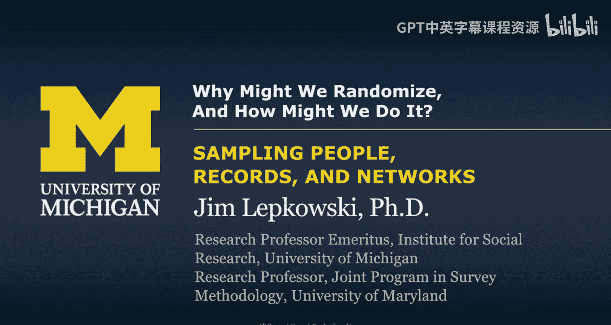

Hello and welcome again to our lectures on sampling people， records and networks。

 this is our fourth lecture in the first unit that we're dealing with， the first of six units。

And in this particular case， we're going to be dealing with the topic of randomization。

We talked about sampling and why one would sample it all in the last lecture。

 but here we're going to deal with how we draw the sample and in particular the use of chance selections and why we should even do it at all。

It sounds scientific， I know， to use chance selections， it sounds like it's fair。

 it sounds like it's the right kind of thing， it's not a bad reason to do。

Probability sampling as the label will give to this。But it's a more complex procedure then。

Informal methods of sampling where we're just recruiting subjects。

And so we're going to occur at an expense to do this， what do we get with it？

What do we get with probability sampling and how valuable is it。

 that's what we're going to look at in this lecture and the next couple of lectures。

And then we're going to continue our discussion by actually doing some applications。

 although we'll do one here in this lecture as well。

We're going to discuss this issue in four parts here and you'll see our display in the upper left now。

 we're going to first look at what random numbers look like and then we're going to talk about how they're used in a selection。

 how they might be used in a selection。And then kind of a peculiar question， should I put it back。

 and I'll tell you more about what I mean by that， and then an example of sampling people from a list。

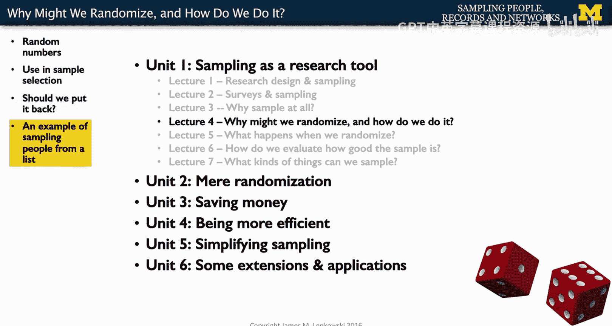

The idea of random numbers。They come in many different forms， here's 10 random numbers。

These random numbers are all between zero and1， you can see with the decimal。

 they've got five digits， they could have more。These were generated by a system that gave us the random numbers or the numbers between zero and one。

And any number between zero and1 was equally likely now if you wanted to specify it in terms of these five digits or one or three。

 that's fine， but the idea is that any number within that range has the same chance of being generated as any other。

Those 10 random numbers then are from what's called the uniform distribution。

 uniform equal uniform probability of selection for all those numbers。

 there's 10 of them now you can't distinguish them from non-random numbers， frankly。

 you know it would have been possible for us to generate the same number very unlikely but the same number。

 that first number of 4。0。49018 could have generated 10 consecutive times and then what would we have。

Random numbers。So there's no limitation on these， there's no restriction on the random numbers。

 all we know is that every number from zero to one has an equal chance of being selected and we've done a five digit representation here。

Here's another set of random numbers， these are single digit numbers， the digits zero，1，2，3。

 through nine。There are 10 possibilities in every one of the 50 locations that we see。

 it's just a string。 a string of 50 numbers and those 50 numbers zero through  nine are all represented in them。

 but in any given location there could be a number from zero to nine。

They're also from the uniform distribution， but a different way of thinking about it。

 they are the numbers from zero to nine， all equally likely in any given location。

 50 different random numbers each。Equal chance of any one of those digits。

And so now we have a sequence of random digits as well well we had a sequence before but here's one that's a little more concrete 5050 digits in sequence sort of like we could have had a sequence of digits that choose between one and two where one represents in cointossing ahead and two represents a tail all of these kinds of things are possible ways of representing these things Now they can be grouped in many different ways。

 these 10 digits these 50 digits can also be that same 50 digits grouped in sets of five they don't have to be strung out like that they've been grouped in a way that's more convenient。

 a little more convenient to read this in blocks of five and oftentimes the random digits are generated in just such a way。

 long， long strings of them and then they are written out in blocks like this just to make it more convenient to see what the numbers are。

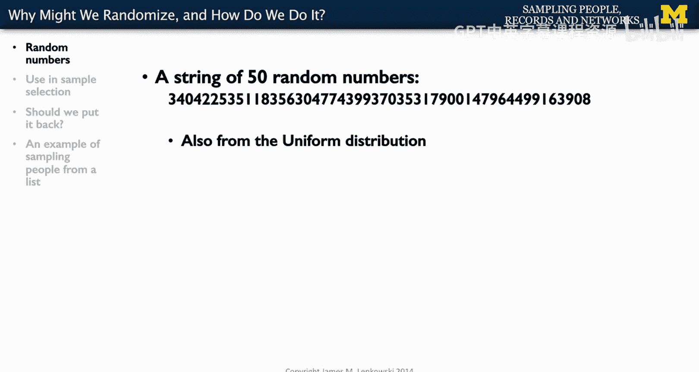

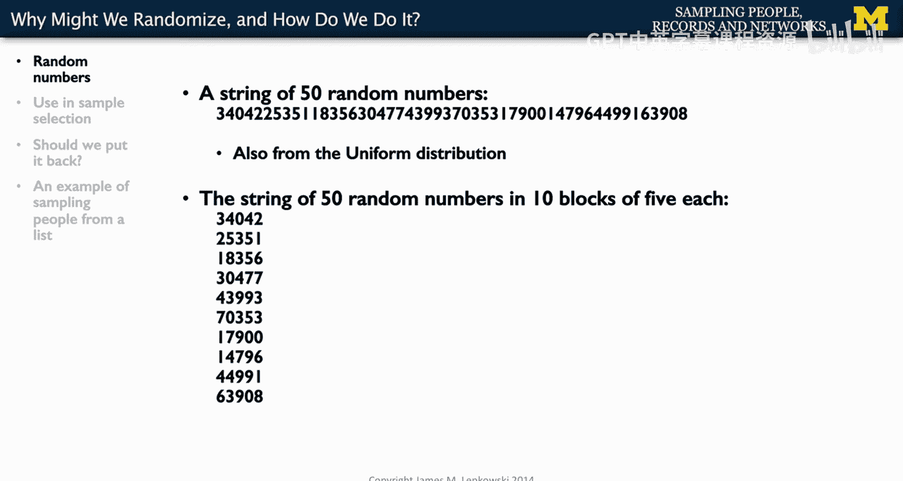

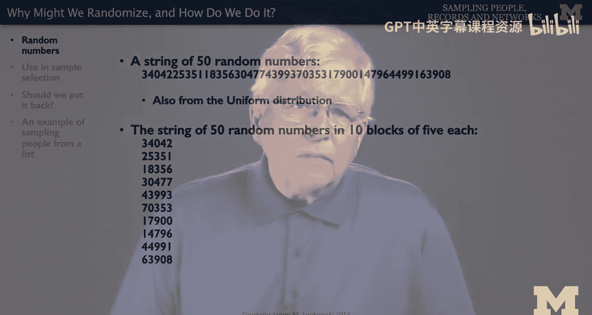

We can also use random digits that aren't uniformly distributed， for example。

 these digits here come from a generation system where they tend to generate numbers that are closer to the middle。

Closer to the middle to numbers from zero to1， and they tend to be more frequent towards the middle。

Well， that sounds biased I mean why would anybody do that Well it's because this comes from a distribution that occurs in naturally we see this kind of distribution arising in practice and so we want to mimic what's going on in the real world by using digits that are coming from a distribution that follows that normal distribution by the way。

 the word normal here that I've used with the capital letter think of it not as normal in terms of that's what everything is。

 that's what everything should be but more as a standard。

 a standard distribution because it does occur so often and it is one that is widely used in statistical practice so it comes more from the French normal than it does from the English normal meaning kind of middle。

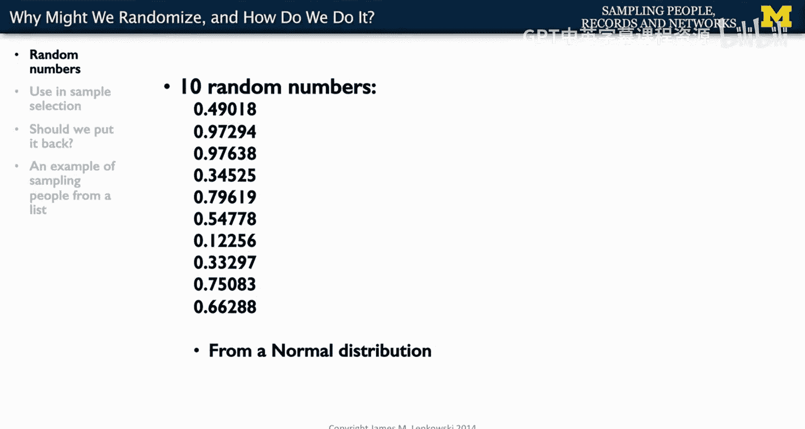

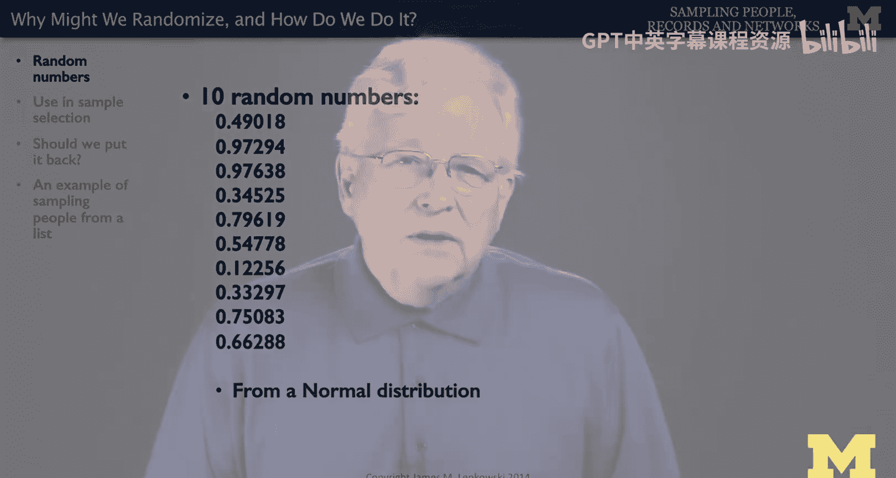

Here's 4500 random digits， they're grouped into blocks of five。

 I know it's really hard to see right but nonetheless you get the idea there those chunks of five。

 there's 50 rows and 90 columns， 18 blocks of five going across those columns， 4500 digits。

Why would someone display it this way Well it may be that sometimes we need five digit numbers or two digit or one digit depending on the problem。

 the application and having them group this way makes it easier for us to see them to read them。

 use some sets of numbers for two digits and some for three these random number tables appear in textbooks and my mentor。

 a man named Leslie Kiish had a table of these in his textbook。

 and he made a trip to the People's Republic of China a long time ago to talk with them about doing chance selections in some demographic studies studies of population。

And while he was there to honor him as a sociologist and statistician。

 one of the students went out and took the random numbers in his table in his textbook。

 and they printed them on a Thirt。

And he brought these back， he was so thrilled with this。

 he brought them back and handed them out to his students and colleagues and my wife has one quite。

A fashion statement， just digits， grouped in sets of five。

 actually some people think they look like zip codes， but that's neither here nor there。

 it's not necessarily good fashion， but it does represent a way of looking at these。

Here's another representation of these， this is from one of my favorites。

 a book published by the Rand Corporation， the Rand Corporation。

 a think tank during the war years and even today they do a lot of work on defense contracts。

AndFollowing World War II， they published a book called a million randomand digits。

 So now we're talking about a sequence of a million digits from  zero to9， repeated going on and on。

 and they grouped them into blocks of five they grouped them into blocks of 500 pages with 2500 digits on a page with 50 rows and 50 columns on a page and then they printed them Now why would anybody do something like this it had a serious purpose it also generated some fun things but the serious purpose was they were demonstrating that they had a random number generator that would generate numbers that looked random now they weren't actually convinced that their generator was truly random so they called it a pseudoran number generator it the English pronunciation of the Greek meaning false and that random number generator。

 they wanted to demonstrate that it was coming very close to a random process so they did it a million times and they counted how many zeros。

 how many ones。As a matter of fact， the only text in the book is the first page that this is a short table showing how many ones。

 how many twos and so on were there， and the rest of it are the digits。

Now some people have had some fun with this， there actually is a book review of this million random digits out there on Amazon。

And from the Fconometrics blog， they quoted some of these and I just want to share them with you。

 for example， someone reading this wrote to whom would I write to report typographical errors。

 I noticed that the first seven on the third page third line on page 48 should be a three the seven that's printed there now isn't random other than that this is really an excellent book how they knew that I'm not quite sure I think they were just giving us a little poke at such an odd collection。

There was another one that came in and said such a terrific reference work with so many terrific random digits。

 it's a shame they didn't sort them to make it easier to find the one you're looking for。

Of course if they sorted them they wouldn't be in random order anymore so we have 100。

000 zeros and 100000 ones in order okay well they're just poking fun at it my favorite was this one I took a class in statistics in college I use this book to help me select a random sample of phone numbers for a poll I was conducting for my class project the most popular household cleanser in the greater Siouxland area is Bami by the way one of those phone calls was answered by the woman who is now my wife we've been happily married for 10 years Thank you Rand well that's kind of an unusual use of random digits to find a spouse but nonetheless perfect some chance element in that process。

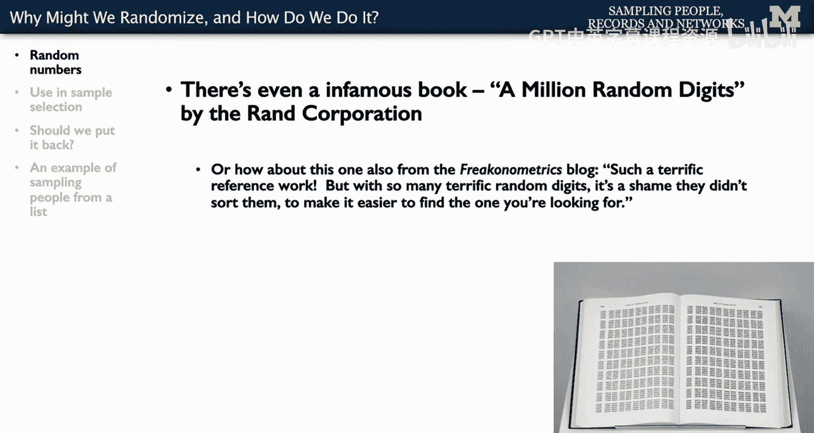

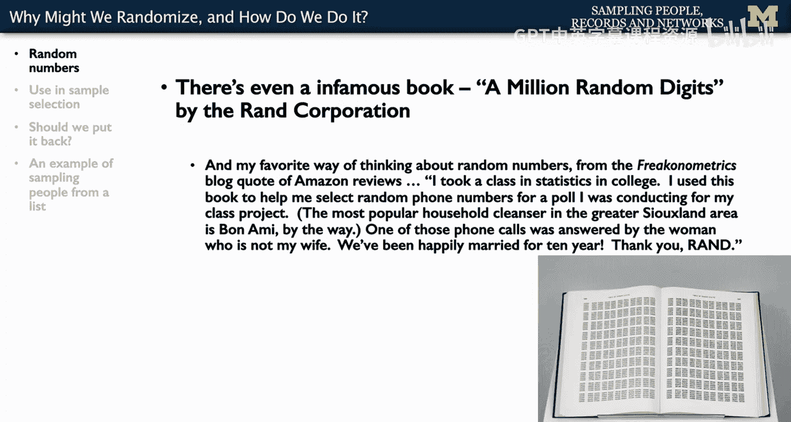

But back to our random digits， we can use these to make our selections now this kind of thing could be used to select a sample by taking a frame remember when we said about frames a few lectures ago。

 here's a frame， this is just a list this is a list of faculty we don't have the names for the faculty we have a sequence number we have an ID number an8- digit ID number。

 we know what college what division they're in， we know their sex and their rank and salary information and we're going to draw a sample from these these actually came from the faculty at the University of Michigan the whole list has 370 this is just the first 25。

And the idea would be that we're going to grab some random numbers from the table and match them with the identity numbers of the faculty for example we could try and do it with the8 digit ID number well that'd be a little bit complicatedate we need eight digit numbers and then you know eight digits。

 370 man we're going to generate a lot of eight digit numbers that don't match up at all so that probably a very inefficient way to do this but we would be better off using the sequence number and so the sequence number will allow us to generate three digit numbers from 001 up to 370 any random digit three digit sequence that we might choose from one of those tables matched up to these would be a selection。

So here's another table of random numbers I told you that there's lots of them out there。

 but here's one that actually comes from another source than the one that I've shown you so far。

 and they're grouped in sets of five and rows， and we need to start choosing from these numbers that we match up to that list。

 where do we start？It doesn't matter where we start I suppose you could close your eyes and drop a pencil on the page。

 I know that's actually written about in some textbooks it's not necessary， start in the upper left。

 whatever you'd like to do， but do something that's systematic so that you use these numbers and use them in a way that you can keep track of what you've been doing let me illustrate so for example let's look at this first number here。

 a three digit number what we need now I know that's hard to see but the first three digits are the first three digits from the first five digit block579 we're going to match that up to our list except that we don't have a 579 in the list it only goes by sequence number to 370。

We'll cross it off。 The next number is 3，4，1， I'm just going to go down the columns of those first three columns。

 I ignoring the last two digits in the block of five， that's fine。

341 is in the list and that becomes our first selection， so I've circled it。And continuing down。

 that means that there's my first sample selection。

Continuing down019 is the next one that's also on the list notice the leading zero so that we need to get19s in there or ones or twos and we use sequences that involve zeros as well as leading digits so 19 becomes one of our selections we go to the next one25。

3253 is in our list in one of our selections and 2。

38 and 694 I just did them all at one time I did a bunch of them here now you notice that I've gone down the column below the bottom of the page this actually goes on and on to get our sample and when I got to the bottom of the page。

 the bottom of the columns that were 50 rows I still didn't have enough for my sample so I went back to the next set of three well in this case the next block of five and three that was just the way I went through the list you could have chosen to use the last two of the first five and the first of the next six but next five it doesn't matter just long as you keep track of it and identify what you've done。

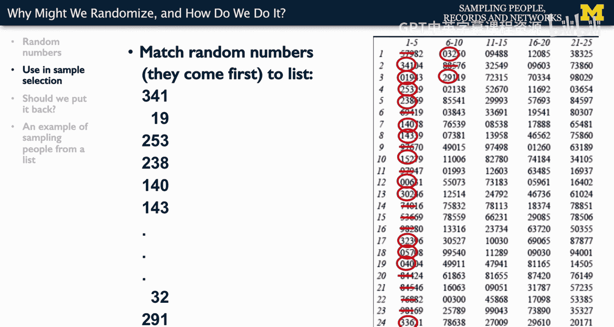

There's our sample， 341919，253， all the way through 291。

 that's the random sample that we've selected for our。

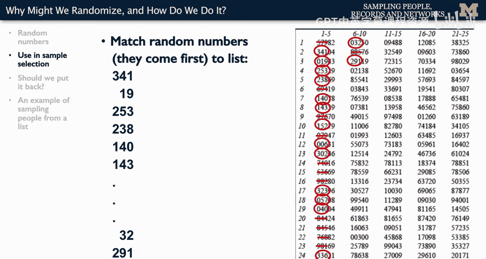

Our purposes。One question that comes up。 It would have been possible to have gotten the same number more than once。

 As a matter of fact， in the actual sequence that I used， one number did come up。

 I think it was number 23，8 came up twice。 Well， what do we do with that Should we select it twice or not Now this raises a question about putting it back and there's two alternatives here。

 obviously， we keep it or we discard it， we drop it。 if we keep it when it's drawn a second time。

 that's what's known as with replacement sampling and we're going go over this again several times。

 if we drop it， it's known as without replacement with replacement means that when once we've chosen it。

 we put it back in the list and make it eligible for selection Without replacement means we take it out of the list and make it ineligible for subsequent selection。

 and this has an impact on some of the things that we're going to be looking at。

The preference is to drop it， it leads to better samples。

 but better samples not because of the appearance of the sample。

 which is what some people might think， but because of the properties with respect to the quality of the data that we get。

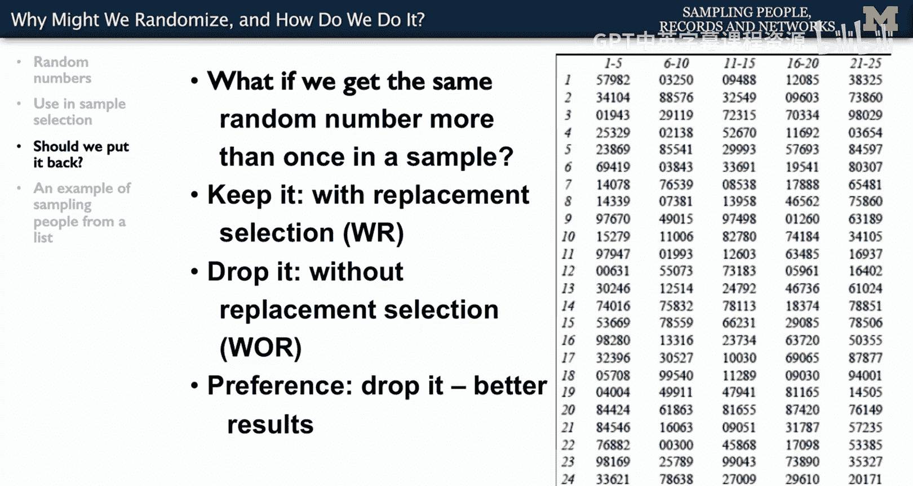

Okay， back to the sample， here's the whole sample， here's the 20 the now numbered from  one to 20 in terms of the order that they were selected that you can see the randomness。

 I suppose of the list it's a random sequence， we went through and we also put in there the incomes just illustrated and calculated then the incomes these are in thousands of dollars and we can see that the mean income of this this sample was $78。

600。I mean， that's the result， that's what we wanted。

 so we have an example of sampling people from a list and then calculating a result from that list。

What we're going to do next is look at what happens when we randomize it you think we've just seen it。

 no， there's some consequences here that we need to understand statistically and that's what we're going to look at in lesson five。

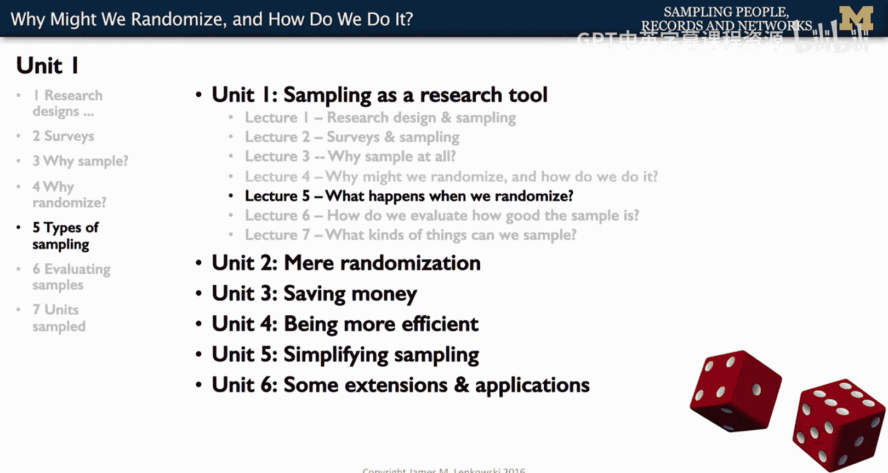

About what happens to the quality of our data when we randomize and how we assess that quality。

