# 密歇根大学《调查数据收集和分析（2-6：方法、社调问卷设计、抽样、缺失数据、分析）｜Survey Data Collection and Analytics》 p86 7_1.5 随机化实施效果.zh_en -BV1fw4m1e7Zh_p86-

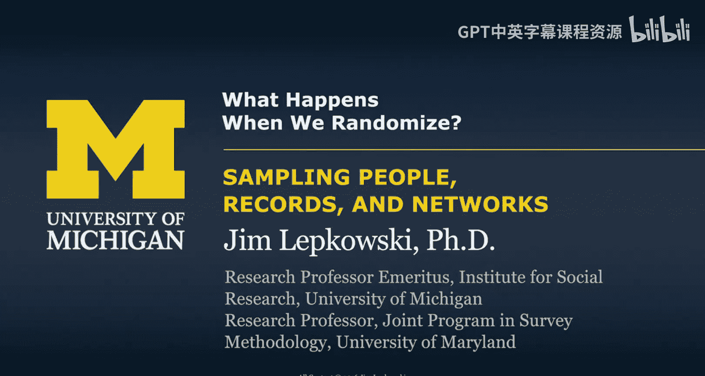

Hello， welcome back to our lectures on sampling People， recordss and networks。

 my name is Jim Lepowski。And in this。Lecture what we're going to do is continue what we've been doing before where we saw what it was like to。

Sample at all and do so randomly and in this lecture what we're going to be doing is looking at the issues of what happens when we sample in terms of the consequence。

 what do we get， especially what do we get when we sample randomly。

And so we're going to focus on these consequences here and in our probability sampling realm。

 we're going to need to use our imaginations as we do this。

 and I'll tell you where we need to use our imagination， but it's not that hard for us to do。

 but we're going to have to imagine certain kinds of things that we're never going to see。

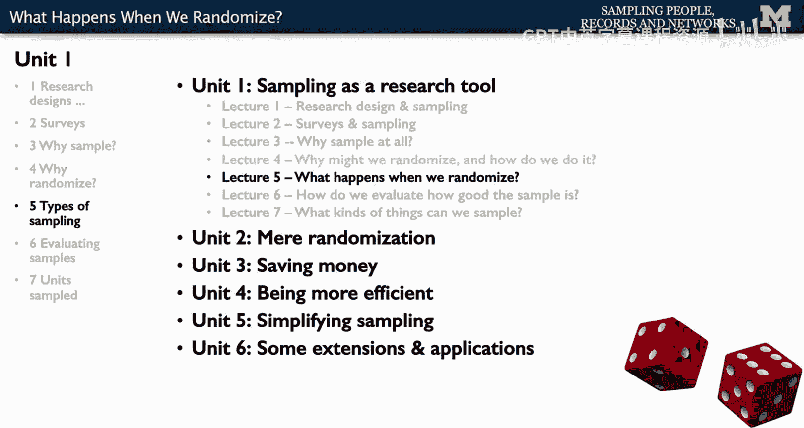

sortrt of the counterfactual the thing that we wonder about。

 you know we made that decision and went in one direction what would have gone the other well we're going to imagine that here except that here when we imagine it we can make it quite concrete what those other kinds of outcomes are and even come up with ways of。

Understanding what those outcomes would have been like。But in any case。

 what we're going to do is talk about our selection process by talking about a seven step process。

 where we're going to start out talking about a population to frame to sample kind of an operation when we're interested in the elements。

 and then go on and talk about what happens when we have one possible sample as opposed to many possible samples。

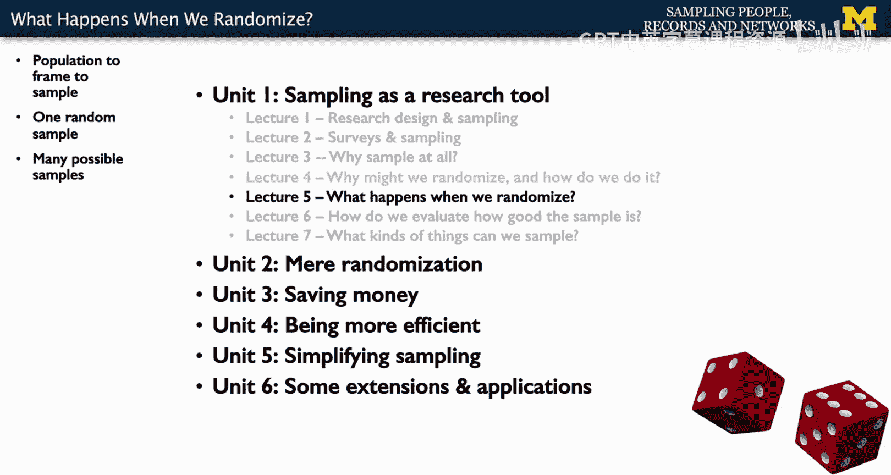

So our material is going to deal with a process of sampling。

 but in more conceptual terms for the time being。

。So let's start with the following。Step one from our process。

 our survey sampling process that we looked at before involves a population definition。

 a population of specification， let's suppose this is the population。

 this is the collection of all the faculty members in our list。

 all the transactions that we're going to be dealing with and it's just a diagram to represent those and that's really the first step in defining that population and this is even a tiny little blue E up there in that hand with one finger pointed up we're dealing with the elements in the population。

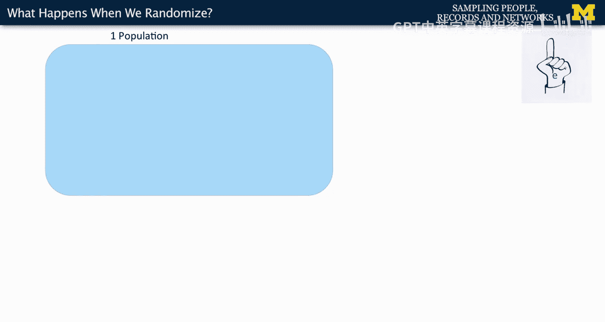

Well we know right away that we cannot get all of those elements in a list， we can get a frame。

 a possible list， and that frame quite possibly could be very close to being identical to the population。

 but in a lot of practice it's not。

And so this frame that's shown here now is step two getting the list that we're going to use。

 the materials we're going to use for the sample， this frame is not offset like temporal or you know physically that one is behind the other。

 this is the overlap。And the frame doesn't contain all the population elements。

 that's a little bit of light blue along the upper edge there for the population。

 whereas the frame also contains some things that are not in the population that you can see the shadow there to the right and the bottom so the frame is not a perfect representation but that's what we work with so population to frame。

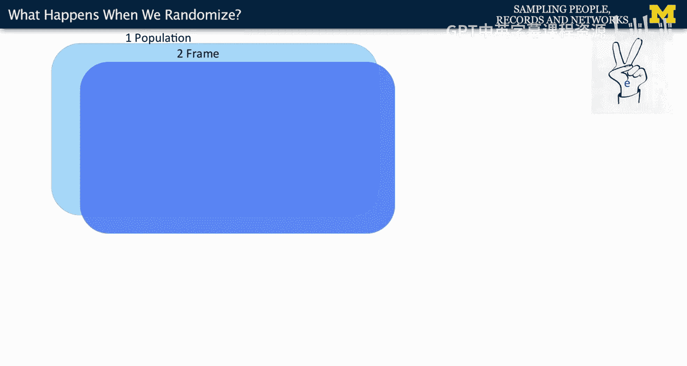

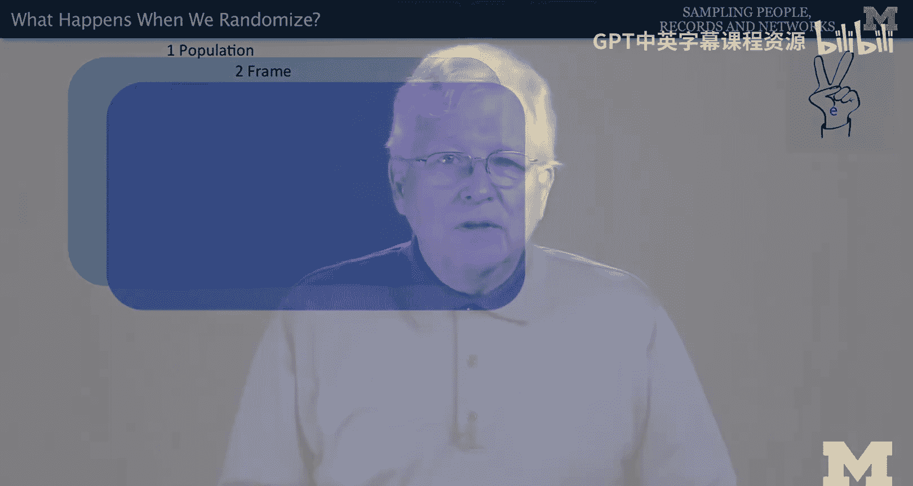

And then we have our list and from our list that this is a representation we've looked at this before。

 this is a more complete list of the faculty， this is 150 of the 370 faculty from our example from the last lecture and in this particular case that's the list that we're using and we don't know for sure whether we've missed some faculty who are newly enrolled in the some others who have been removed from the list they've moved out the universities。

 they've passed on whatever it might be， there might be a mismatch between this list and the actual set of faculty at the moment we're doing the sampling。

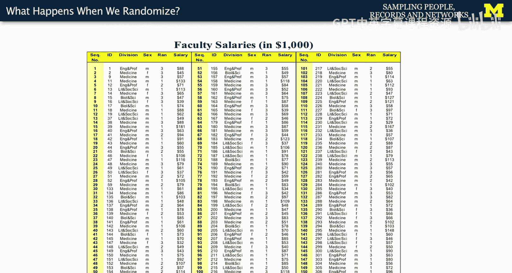

From that list， we draw a sample， that's the third step， okay population。Frame。

Sample that sample is a microcosm of the frame and we're going to do chance selections right。

 so we're going to use something like a table of random numbers to draw that sample from the frame。

And there's our random numbers that this is a full representation of a list that I gave you just a little corner of when we were doing our example sample and it led to a possible sample that had 20 cases and there's the sequence numbers of those that were chosen that we did last time and I've added the incomes because now we've gone out and we've interviewed these faculty and we've obtained their incomes and we've calculated the mean way down at the bottom we can see the mean income okay that's the process we went through before our process involved population specification。

 a frame identification， a random selection of a sample and then computation of an estimate。

 those four steps and here we're on solid ground， these are all things that we can physically represent。

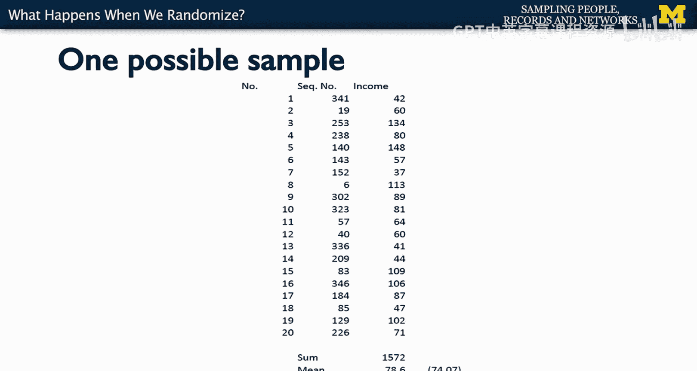

But we also recognize that this sample and the one mean that we've got。

Probably isn't the true population value， matter of fact。

 there's almost zero chance that that's the actual mean of the population because we've got a sample of only 20 from 370。

 there's some error， there's some discrepancy between what we have in our sample and the population if we had done a census。

 we had done every one， then we would have the exact mean under this scheme。

So we can imagine then that maybe we had gone back to our list and started in a different place and drawn a different sample。

 we instead of going down columns 1，2 and  three， we started over in columns 10， 11 and 12。

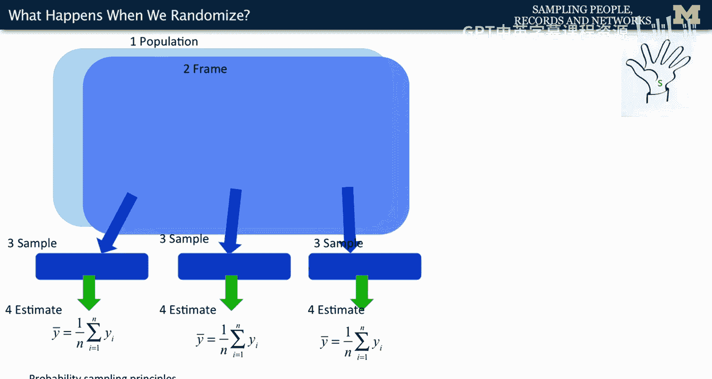

We went row wise， we used the random number table in a different way and we got a different sample and computed I mean。

 drew a different sample from the 370 now we' put them back， there's another possible sample。

 there's at least three possible samples， there' as a matter of fact。

 given the scheme that we used for sample selection in our illustration。

 there are billions of possible samples of size 20 from the 370。And for every one of them。

 we can compute a mean。And now we're getting to the fifth step in the process because as we think about this there's。

Billions and billions of them， possible different samples drawn， and for everyone there's a mean。

And for every one of those means， we're using the same sample size， the 20 different elements。

 there's just a whole lot of them there。

And we can actually count how many there are， we will do this for simple random samples。

 we're going to count how many possible simple random samples of size 20 we could get from 370。

And so we've got the first sample， the second sample， the third sample going across the bottom。

 and then dot dot dot going on up to the。Last sample and you see I've actually got a little index there with a funny notation that I'll explain later。

 but that's the last sample， there's a countable number。

 there's a finite number of these possible samples。

 but what's interesting is now we have a set of means。

 billions of them and there's a distribution to them。There there's a range of values。

 there's a smallest mean and the largest mean， there's a group of means that's in the middle 95%。

 there's a group of means that's in the middle two thirds。

 there's a group of means that up in the upper 5% and so on。

 there's a distributional property interestingly， we come back to this later under probability sampling。

 these means will give us a distribution across all possible means that is normal。

 that normal distribution I didn't mention this before， but it's bellshaped。

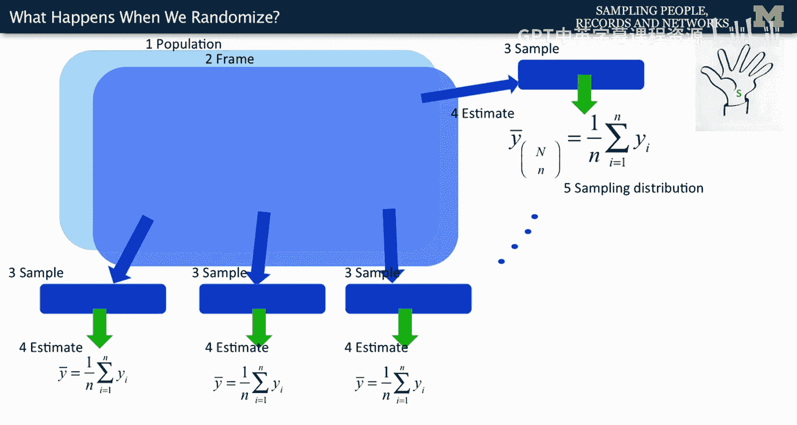

It's quite remarkable， really， if you think about it， that we would get that kind of a distribution。

That distribution has variance， it has spread。So now we're up to fifth step。

 we're thinking about this consequence of doing this。

 this is the consequence of doing random sampling， weve got lots and lots of possible samples。

 we're never going to look at all of them so in concept this is kind of a waste of time unless we can do something where we would say can I estimate the spread of all those possible samples？

By not doing more than one sample， but taking one。And it turns out that there's a piece of algebra that we won't do。

 that would be more in our sampling theory class， a piece of algebra that gives us our sixth step。

 We start out with a population。

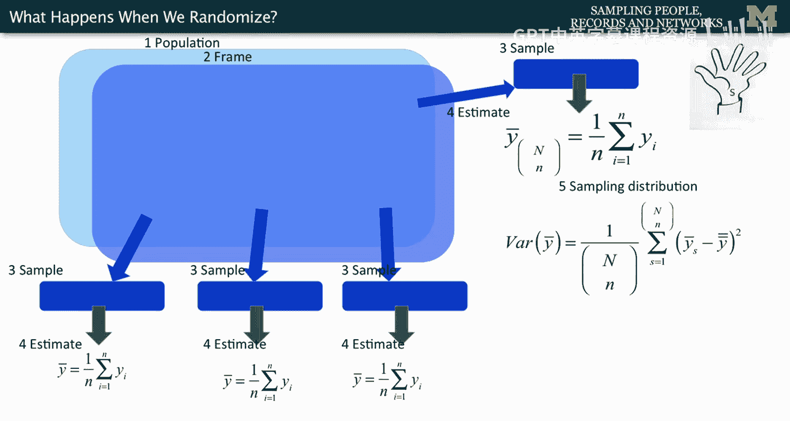

为。Specified a frame， we drew a sample from it。Then we realized and we computed an estimate from it。

 and then we realized that we could repeat that sampling estimation process again and again large number of times and we had then。

Means from every one of those samples and the spread of those means， we can define it。

 we could calculate it if we were to do all those possible samples。But instead。

 it turns out that that variance across all possible samples has a simplified expression。

 algebraic simplification that is such that we can calculate that from just one sample。

One sample and we get something called a standard error and that standard error is a measure of the spread of those means across all possible samples now this is quite remarkable。

 we can imagine that but we don't have to go through it。

 somebody's already done the algebra for us and given us that formula。We can calculate it as I said。

 we can get these standard errors and calculate them in this sixth step that give us a number number in this case the number from our sample size 20 is 6。

026 that's our standard error now there's a meaning to it。

That will help us understand the uncertainty of what we've just done because we've got one sample from billions。

 we know it's not the right one， we know we're uncertain。

 but the standard error is going to allow us to specify not only it's not just a number。

 it allows us to specify the uncertainty。And that uncertainty can be reflected in also how we design the sample。

 it turns out that as we change the sample size now this isn't for our own illustration。

 but as we change sample size， those standard errors go down and that helps us understand that I can get better and better results。

 this is what we'll talk about in the next lecture by changing the sample size increasing it I can get worse results by decreasing it。

Okay， but back to our seven step process， we've got six outlined through standard error。

 here's the last one。That standard error can be used to give us an uncertainty statement。

 that uncertainty statement is typically called a confidence interval。

There we're getting a statement that involves an upper and a lower range on possible values for the means in the population。

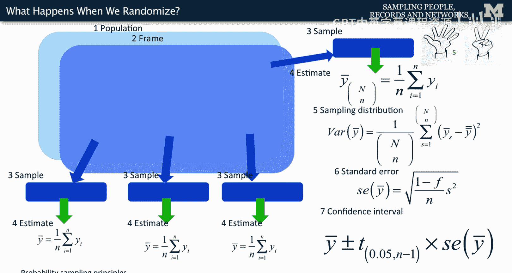

If that。Interval is wide， we have a lot of uncertainty， if that interval is narrow。

 we don't have as much uncertainty， it's a very valuable way of capturing in one statement。

 not only what it is we've estimated the middle of that interval， but also how wide。

 how far apart it is our uncertainty about the result。

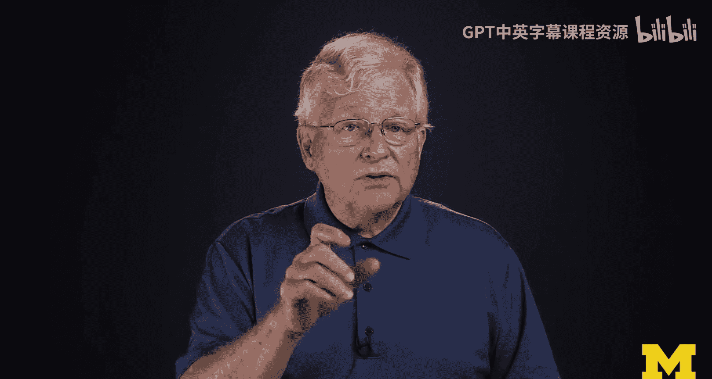

And so there's a calculation of a cough interval calculation of a coughs interval that is one that is something we'll look at and in this particular case for that sample size 20 way down at the bottom we won't go through the calculations we'll explain some of the technical detail as we go along there's an interval there from 66 to 98 so our mean is in the middle 78 78。

6 is in the middle of that range and this is saying that our uncertainty is such that it could be from 66 to 98。

 95% of the time。

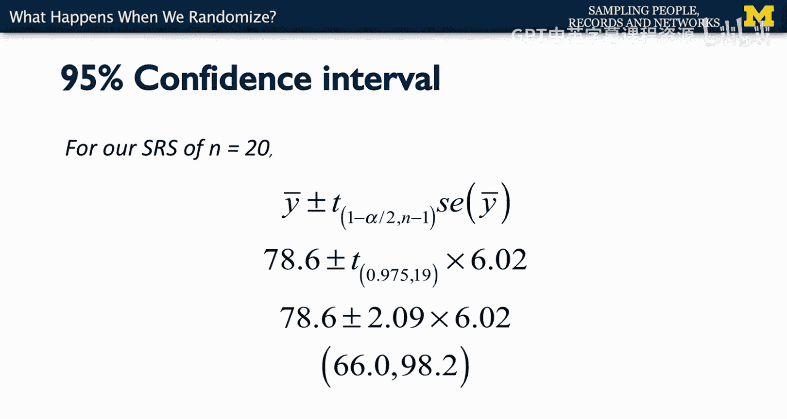

That interval is going to cover what the true population value is。

If that were narrower we'd have more we'd feel less uncertainty about this。

 this is a pretty wide range， now may be sufficient for our purpose。

 not saying that it's not useful if it's still uncertain， but narrower would be better。

So there we have it， six steps to get to where we need to be， one is a population， two is a frame。

 three is a sample， four is an estimate。Five is to imagine all possible estimates。

Six is to calculate the variability of those and seven is to write it in an uncertainty statement。

That's the statistical process that we're going to be doing。Okay， so just a bit of a summary。

 we're very close to talking about two important measures of results here on average is this process giving us the right thing。

 we're going to talk about that in terms of bias and then secondly， how variable is it。

 that's the uncertainty statement， the variance。

Our random process， we're using random digits applied to a frame to generate our sample and in theory。

 a large possible set of samples， and we can measure the variance across all of those。

 and only random samples allow us to do this。We can make assumptions to get to this conclusion。

 I'm not saying that we shouldn't make assumptions to get to it。

 but this is the kind of the frequency， the counting way of thinking about the world is not necessarily the best。

 it' not the most coherent， but it is one that you can get a clear idea about than some of the others。

 and it involves a population。And a sampling mechanism。It does not involve a population distribution。

 we've made no assumptions about the population itself。

We've only got the sampling mechanism and our outcome that is。

Then manipulated because of the sampling mechanism to give us an uncertainty statement。All right。

 we need to explore this just a little bit more， we can use these ideas now to make statements about how good the sample actually is。

 we can evaluate the quality of our samples that is very important everybody wants to know we started out talking about this。

How did you get that number you know how did you ask the questions and so on。

 we want to know about the quality， how good the result is。

 and we're going to deal with the quality of the representation side of our survey sample by looking at this kind of framework in a little more detail in our next lecture。

Look forward to seeing you at that lecture， thank you。

