# 密歇根大学《调查数据收集和分析（2-6：方法、社调问卷设计、抽样、缺失数据、分析）｜Survey Data Collection and Analytics》 p87 8_1.6 样本质量评估.zh_en -BV1fw4m1e7Zh_p87-

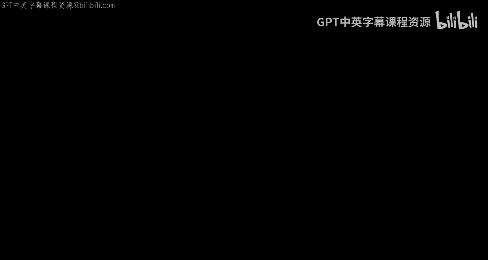

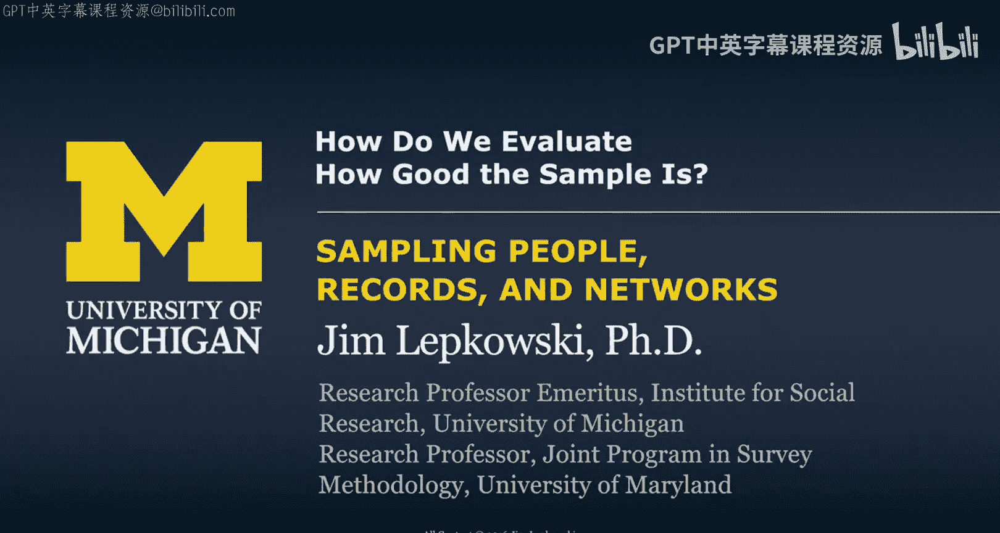

Hello。You know in our last lecture we were talking about imagining what would happen in a realm in which we did random sampling and we took all possible samples we were combining some ideas from previous lectures where we talked about sampling as an important a feature of research。

 sampling is an important feature of survey，Surveys and survey data collection and survey sampling。

And randomization and how those random numbers can be used to draw samples。

So here we want to take what we learned before about the consequences of sampling in terms of what happens to our ability to understand the quality of our results by looking at what happens to all possible samples and how we can actually do that from just one sample。

 and we want to think about that in terms of defining some measures of data quality。And again。

 talking about some of the same results， butre looking at it a little different terms now。

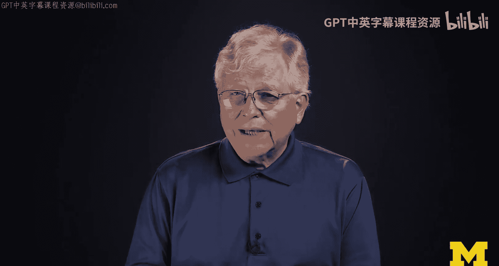

So here what we're going to be doing is continuing our unit one in lecture six。

 where we're going to talk about how do we evaluate， how good a sample is。

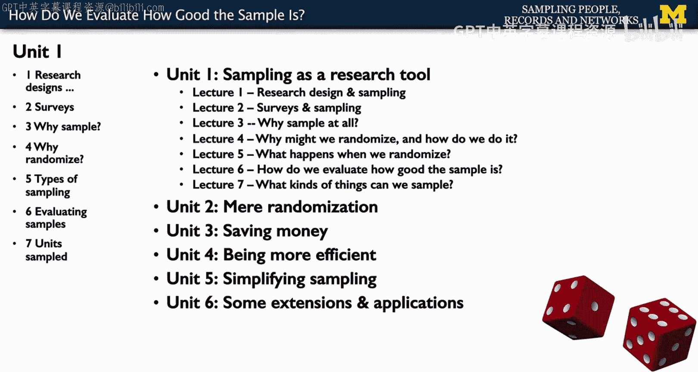

And in doing that， we want to talk about not only the evaluation。

 but we're going to do this in several steps， we're going to go back to our sampling distribution。

 go back to our seven step process， if you recall that， our seven step process for the sampling。

Inference， statistical inference， drawing conclusions from the sample process。

 and then we're going to talk a little bit about the standard error which we did before and the COPS interval before we turn to looking at two measures of data quality。

So here's I'm going to break into this process， I'm skipping over。

 youll recall that there were seven steps， the first was that we had a population that was specified。

The second was that we had a frame。That matched up as best we could in that population。

 but was a list that we could use or set of materials for drawing the sample。Third， we drew samples。

 one sample。And we computed an estimate and then fifth as what's shown here we imagined repeating that process again and again。

 and so up in that hand in the upper right there's an S in there。

 a green S now for sampling distribution we're now thinking about all these possible samples and what happens across all those possible samples that we can use to assess what's going on so we said that there was a spread and I gave a messy formula we'll talk about that in more detail later when we talk about simple random sampling but we basically said what's the spread of the means across all those possible samples。

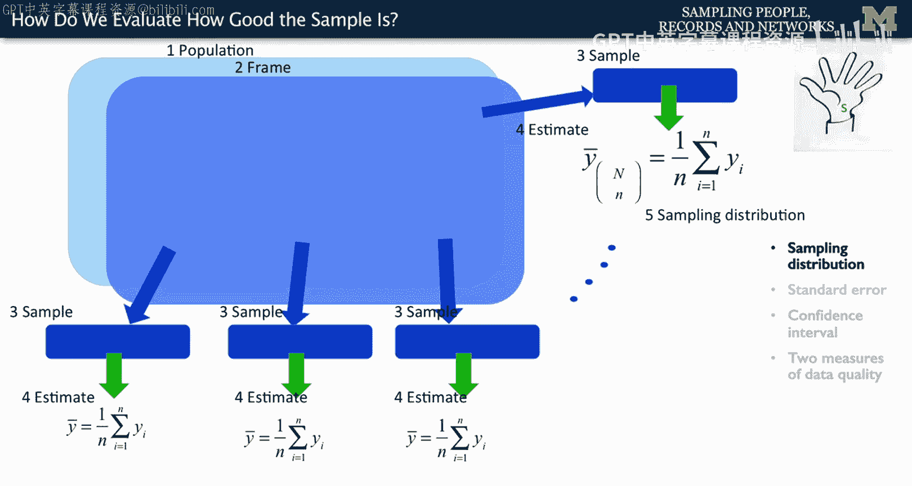

And we came up with that sampling distribution， the standard error， the sixth step。

 a way to calculate from one sample the variability across all possible samples。

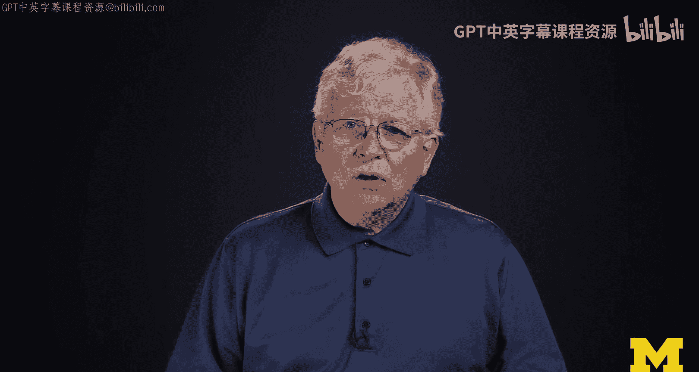

So from the sampling distribution， which is built on that frame and population and sampling and estimation to the estimation of the spread across all possible samples。

 that standard air。And again， by way of review， we noted that we could calculate that and again。

 we'll come back to that calculation， but we want to keep reminding ourselves that there's a numeric way that we can determine what the spread is across all possible samples。

And then we talked about a cop interval， that was the last step。

 this is now where we take that standard error and we convert it into a uncertainty statement。

A cofs interval， an interval that tells us what's going on across all possible samples and we had a result from our sample of size 20 that we did in one of our previous lectures where we had an interval from 66 to 98 so that's kind of wide we're not very certain about it it's not our best we prefer it be narrower。

 how might we improve that well we could do that by increasing the sample size because we know now something about that standard error and we haven't looked at it but it turns out that it's inversely related to sample size。

And rum that's the result of algebra， some of you just didn't think about it and make up that formula。

 there was an algebraic derivation from that conceptual framework that we were dealing with。

How can we think about this now， this process in terms of evaluating quality？

And here is a display where we're going to look at two measures of sample quality and this is a fairly。

Classic representation of what happens with quality in research investigations。

 and you'll see this in other kinds of descriptions of research investigations。

And we have five targets that could be used for some kind of sport。

 and we have in each one of them representations of multiple shots at it。

Think of our samples now as those multiple tries， so we're going to get six shots at it。

 we're going to draw six of those possible samples， there could be a lot more。

 but what kinds of things could happen when we do that？In the one on the far left。

 we have our six shots and they are all very close to the middle， very tightly grouped， very close。

 not only are they tightly grouped， but they're right at the middle。In the second representation。

 the next one to the right， they're still grouped very close together in affect the same pattern。

 no not quite the same pattern， but very similar pattern group tightlyling together。

 but they're away from the middle， I dont if you ever watch people playing darts and they're really good ones they're very precise they can group their shots their darts in the same location very consistently。

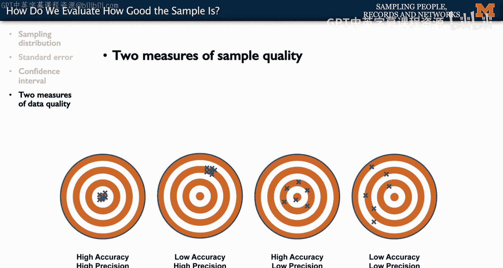

And they can move around what they're aiming at， they can aim from the middle。

 or they can aim at a target off to the side their point totals for doing this， of course。

Now that kind of thing is similar to what we're seeing here， they're grouped tightlyd together。

 they're very precise， but they can be thought of as being accurate or inaccurate。

 low accuracy in the second one。As opposed to the other two representations here。

 the third one is where we have a spread， a wider spread of the of the results this would be equivalent to our samples getting us means that are。

More widespread， there are more differences among those means than in the tightly group kind。

 less precise， but in this case on average we've got it right。

 they're targeting the middle of that pretty closely。And then finally on the far right。

 they're spread out and their average is away from the targeted middle。

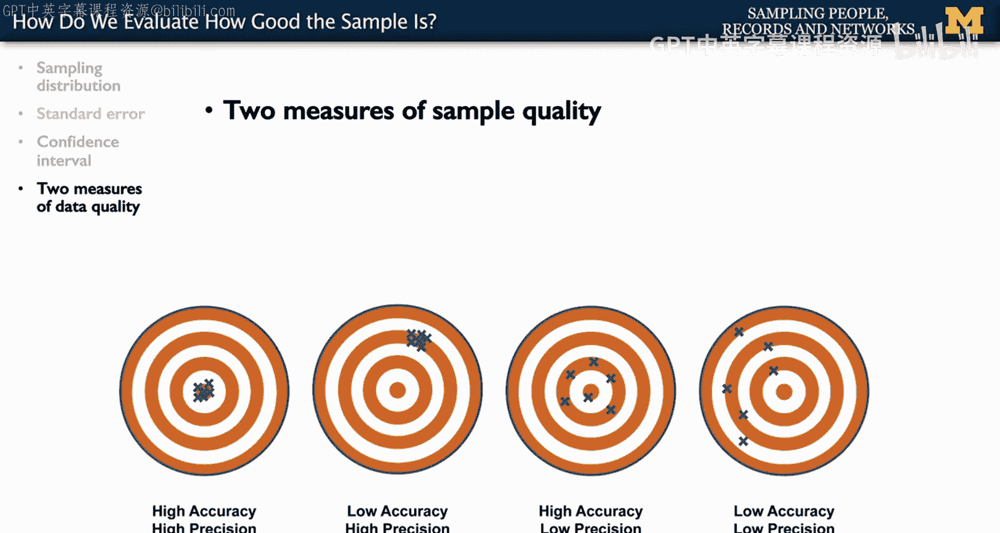

They are low precision and low accuracy。That allows us to think about two kinds of measures here that are typically used to summarize this kind of result。

 and now we're thinking about this now in terms of our samples producing estimates and how close they come to the true population value。

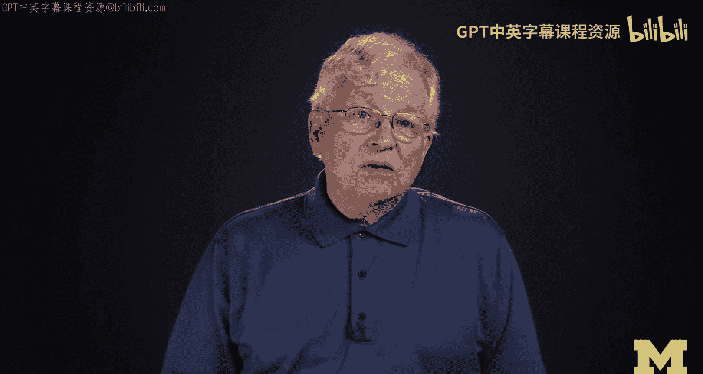

So we have one measure。That is the distance from what we're getting on average to the thing that we're aiming for。

And so in the second display we put in a doublehead arrow。

 a nice black doubleheaded arrow there to represent the difference between what we're getting on average and the true value now in our sampling realm we're not aiming to be away from the metal。

 not like playing darts here we really want to get towards the metal and there's a discrepancy we're going to call that bias that's the term that's typically used the difference between what it is we're trying to estimate and what we're getting on average。

But then we also can talk about the spread and we've highlighted here that the spread is larger。

 particularly larger than the other displays， and so now we can talk about variances， variant。

 that standard error that we're talking about is a measure of the size that if you will。

 the diameter of that circle。And that。Larger standard error means that circle is wider in diameter and we're less precise in our results。

 our survey there's something about our sampling process that's producing results that are more widespread。

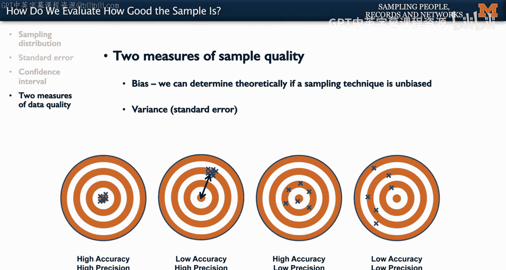

Okay， so we have bias， well， how do we determine that in practice this is very difficult theoretically with the sampling processes that we're dealing with。

 it turns out that if we go back to that conceptual framework， that sampling distribution。

 we can determine whether or not there is a bias in our process。

 on average if we're going to get the right thing。And so we can measure the size of that bias or actually determine that there is no bias。

 so simple random sampling that we're going to talk about next turns out to be unbiased。

On average， we're getting them grouped together now it may be that they're spread out because we have small sample size or narrowly concentrated because they have a large sample size。

 but either way they're centered on the true population value。

The variance there we've got to measure a standard error that we can compute from the data。

 we do not need to rely on some theoretical derivation that says what's going to happen overall。

 we can take a particular sample and calculate the spread， the diameter of that circle。

 and so in the second diagram where they're fairly narrowly concentrated together， small diameter。

 small standard error precise。Wer。Larger diameter circle less precise and that means that we can compute and compare those diameters and compare the quality of what we're getting a that's the quality measure。

 something that we can use to compare different ways of doing the sampling operation。

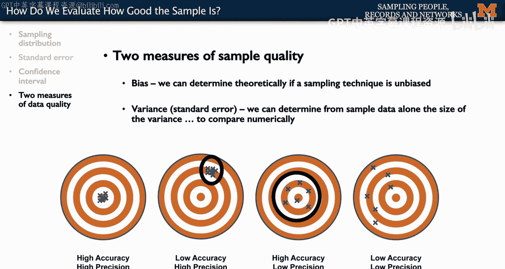

So。It all depends on the random process used to select the sample as to what these outcomes are。

If we have a process that is。Based but precise， we can also have a process that is unbiased but not very precise and so on across these。

 these are all possible ways of evaluating the sample， we're going to use those two dimensions。

 bias and variance in order to assess what's going on with the quality of our results。

And we're going to calculate one of those from a given sample if we've drawn a probability sample。

 we can use the standard error calculation to get that diameter calculated for all possible samples from just one I was trained as a statistician you always needed at least two things to measure variance。

 well that's natural right we can't talk about variances unless we have two experiences with something at least two。

Here's a case where we can have an experience with one of them， but if we've selected it。

 our process has been done in a certain way， I can tell you what's going on across all of them from just one。

So this is really pushing our thinking here， that it is not just a simple process。

 but one that has some properties that can be extremely valuable。

So to return to something that we said at the end of the last lecture， there are two measures here。

 now we've explained them the bias and the variance。

 they both depend on understanding this process in which we've taken random digits and applied them to a frame。

And gotten a sample， one sample of many possible ones in theory。

 and we can measure the variability across all of them by。Looking at just one possible sample。

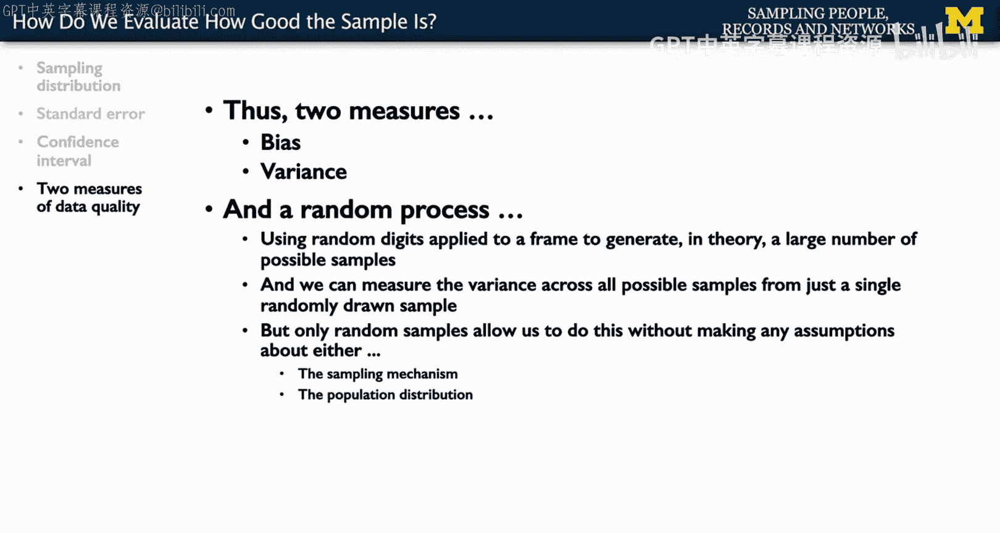

Now。This is possible with random sampling with probability sampling。

 which is why I'm emphasizing it here， I do samples that don't have any randomization in them。

I generally start with this as a strategy， thinking about probability sampling because it has these valuable properties because once I know that sampling mechanism。

I can。And apply it through this seven step process。

 I can make statements uncertainties certain statements about my my results。

 I don't have to make any assumptions about the sampling distribution。

So let's go back to wrap up here to a kind of sample design that we talked about the less formal designs that don't use randomization。

 so we're interested in understanding how consumers。

 shoppers think about a new product that we're about to put on the market and we decide to do something that's convenient。

 we go to the mall， we get them as they're coming in the entrance to the mall and invite them to participate in a study。

That kind of sampling there does not involve randomization。Well， then can weuse these results。

 we can if we're willing to make one of two assumptions， maybe two assumptions together。

 one assumption would be that that process that we've used。

 getting them as they come in the door and inviting them is like a random sample of all possible shoppers。

That's a strong assumption， but it may be valid， but notice we're assuming that it's like random sampling。

We're relying on these results there。The other way to do it would be to take a set of observations that we've made。

And then make an assumption back to the population。

 What was the original distribution of the income values， Was it normal。

 were they bell shaped or did they have some skew， you know。

 there are faculty out there who earn in a lot more money and faculty who earn in a lot less money。

But we impose a distributional assumption now that's very common in statistics and from that basis with again an assumption of random sampling。

 we can use the same kinds of inferential tools we're talking about here。

 a standard error as a way to assess variability， and we still need tools to assess bias。

So in our next and final lecture， let's just talk a little bit about， again come back to people。

 records and networks just to see some illustrations of them to give us context and framing for what we're going to do as we apply these kinds of random methods to different kinds of populations and frames。

 thank you。

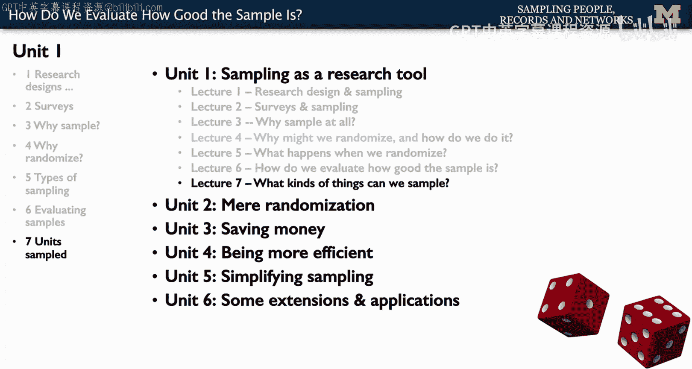