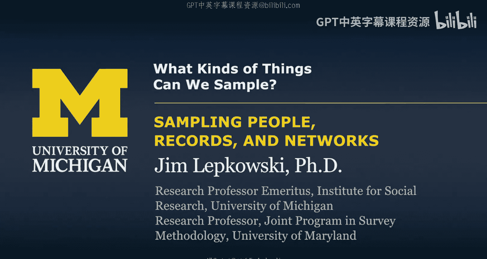
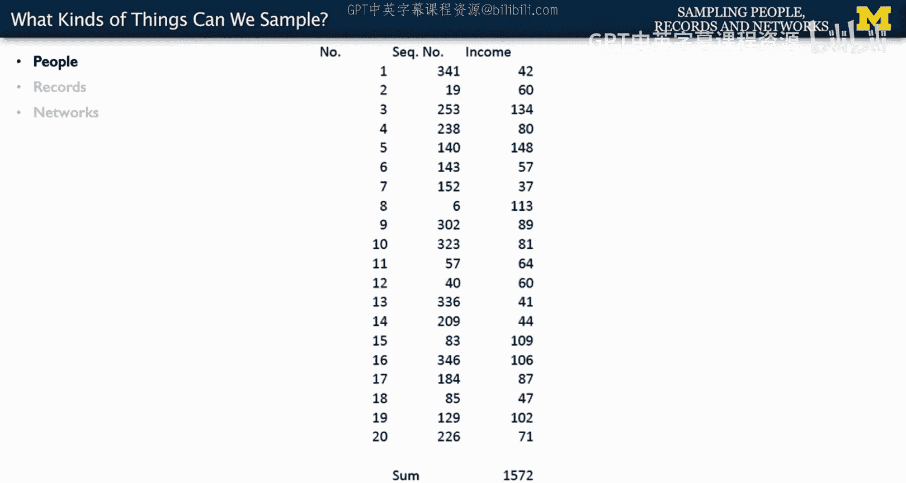
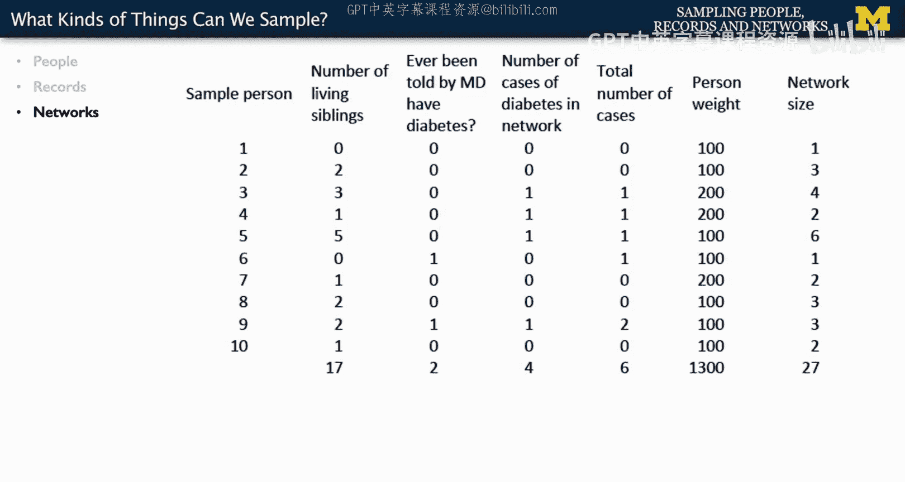
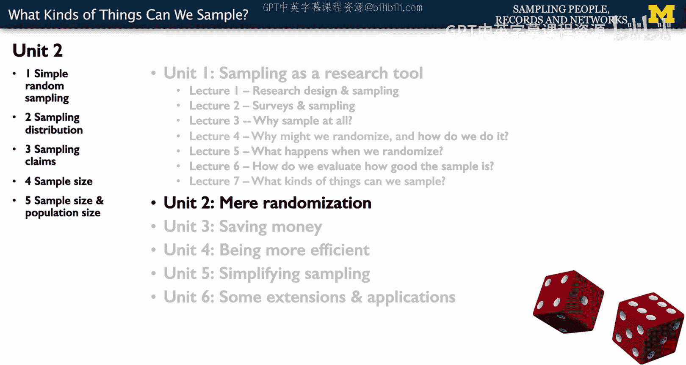

# 密歇根大学《调查数据收集和分析（2-6：方法、社调问卷设计、抽样、缺失数据、分析）｜Survey Data Collection and Analytics》 p88 9_1.7 抽样对象类型.zh_en -BV1fw4m1e7Zh_p88-

Hello and welcome to the last of our lectures in unit one of our course on sampling people。

 records and networks。We want to make this a little more concrete to just talk about how the kinds of ideas we've been talking about can be applied to those three areas。

 people， records and networks。And we've examined a variety of background about how sampling fits into research investigations。

 how it fits into surveys and how it operates， but let's just talk a little bit about application now to well almost anything。

What we want to explore in this lecture， the last in unit one is。

Some ways that we can do or some frames， I guess， some populations and frames。

And the I'm going to maybe confuse this a little bit by using the term units or elements because when we talk about people。

 it's pretty clear what the unit is people， talk about records， it could be a transaction。

 it could be a billing record， it could be a variety of things and we talk about networks it could be a number of things too。

 and we might sample different things at different times and the generic term that's used and sampling is unit。

I'm sorry we're mixing that up with the units here， but the idea of a sampling unit。

 we want to distinguish that just a little bit as we move ahead here。

We're going to do this in three sets， just people， records and networks we' got an example of each。

 and one of them we've already seen， so let's just talk about these things to make sure we understand how these samples could be applied in each case。

So we started out talking about sampling people and here's that list again that we did where it involved the faculty members at the University of Michigan and their salaries and the list that we had。

 the frame that we had had 370 elements on it， we're only seeing the first 25 here。

In terms of the data that the data organized in terms of just a subset of the many things that we might know or want to know about them。

We have a sequence number for each from 1 to 370， just a numbering we've done to the list to the frame。

 and an ID， an eight digit ID that was assigned by their employer。

 their division that is college or school or major area of study， sex and rank and salary。

And what we did was we applied a table of random numbers to those we got random digits and remember we had the 579 didn't fit the list of the 341 that did and the 019 that did and so on。

 and that led to a sample， a random sample。From our population list。

 along with a set of values on incomes that we measured for each one， I know it was on the list。

 but we' just sort of pretend it wasn't there that we collected it and we got a mean and then we talked about how that mean。

Came from one of many possible samples that could have been drawn of size 20 from the 370。

The sampling distribution and then how we could use from that sampling distribution notions of variability to calculate a measure of the variability across all possible samples。

 just from this one sample。And then make an uncertainty statement。

Okay， that's kind of what we've been doing in this unit。

 just getting used to these ideas and working our way through them and trying to understand them。

But we can apply the same logic to other kinds of populations and here's records。

These are hypothetical， this isn't actually it's taken from my records。

 but I've mixed things up here， credit card transactions， where there's a date given。

There is a sequence number in the first column a date given， a time of the transaction。

 a reference number that's like the ID except there that's got a lot of digits in it the category we would know some background information about this in a subcategory so there might have been a purchase that involved business services advertising services that appeared on the credit card it wasn't a business it was a personal credit card so there's no particular indicator there。

 some additional information about the transaction in the amount。

That's our background record now why would we want to sample these why would't we just work with all of them because we may want to go in and do more detailed work on the transaction to collect data that would be very difficult to link to these particular records and only do it on a sample or we might use some expert opinion to assign categories and codes to this depending on the information and that takes more time and expense we're going only do it on a sample。

 but again random sampling， we would use the same kinds of random numbers to make selections of these transactions we would think about the data collection and obtaining values and computing a mean or a proportion or maybe a regression coefficient but just different kinds of sampling but now the object is not necessarily a person but a transaction an event so we can apply our methods to things other than people such as records。

These methods can also be applied to things that are even more a little more hypothetical networks this is the kind of network sampling that is illustrated here that has been used sometimes in the social sciences suppose what we've done is draw a sample of people and then when we go to talk to them we've drawn them at random and we go to talk to them and we say we want to ask you two kinds of questions the first kind of question is who are your siblings now we're thinking of those siblings as a network a network of individuals related by blood or legal legal adoption for example。

 so how many siblings do you have and you can see the first sample person here if you can see these records clearly there are 10 and that first sample person has no living siblings they might have passed on it may be that they were an only child but they have none。

Okay， and then the second person has two living siblings now the first person is a network of size1。

 the second person now in our conception is a network of size3。

 the next person has three living siblings， that's a network of size4。

All right， that's one set of data we're collecting about the network and its characteristics。

 it's important to understand this because it's going to have an effect on estimation。

 something we'll talk about in our last unit。The third column of data there。

 I know these are off centered， but it says ever been told by a doctor， an MD medical doctor。

 if you have diabetes。Do you， have you ever been told that and of the10 people too have been told this？

And then the next question over says， okay， about your siblings。

 have any of your siblings ever been told by a medical doctor that they have diabetes？

And this is the number of those siblings that have。

Now there's a big assumption here right about the measurement process。

 can someone report accurately about their siblings on something like this？

Let's just assume we'll set the measurement issue aside from this course。

 that's one that's being dealt with in other courses， but nonetheless。

 we're collecting data about not only the individual but elements in the network from that individual We could go to the other elements in the network and collect the data as well and expand our operation so that our sampling starts with one。

Noode in a network and then expands it to the other elements in the network。

This particular kind of result here is referred to in the sampling literature as a multiplicity sampling。

 there are multiple chances of an element being selected， that person who has three living siblings。

 they have four ways of being chosen， they could have been chosen。

 they were or any one of their three siblings could have been chosen。

 and we need to take that into account before we can do proper estimation back to the population。

The basis for that is still the probabilities that we've been dealing with。

 but we're going to have to think about the probabilities in more challenging ways because this kind of sampling is more complex。

Well， that's where we're going。 The kinds of applications that we're going to do。

 What we're going to do next is turn to what I'm labeling near randomization。 Now。

 now the word mirror isn't Houston in this context very often。

 the actual term for what we're going to talk about technically is called simple random sampling。

 but it's a kind of sampling that only uses randomization in the selection。

Now I say only why， why would you use anything else， Well。

 it turns out that we will use other information in unit 3 dealing with。

 as we mentioned before in the overview， things that have to do with cost。

 and we're going to try and reduce our cost by using other pieces of information。

We may be able to make our results more precise， narrower diameters on our spread。

By considering auxiliary information， But here we're only going to consider randomization as the only feature of the selection。

 not anything having to do with cost or with auxiliary data。

 What can we do with that and what are the consequences of it。 And so me randomization。

 Only randomization is the issue here。The type that we're going to deal with is simple random sampling is not the only kind of mere randomized study that can be done。

 but the one that we're going to talk about。 And that's what we'll turn to in unit 2。

 as we move ahead with our lectures。 Thank you。

