# 密歇根大学《调查数据收集和分析（2-6：方法、社调问卷设计、抽样、缺失数据、分析）｜Survey Data Collection and Analytics》 p89 10_2.1 简单随机抽样(SRS).zh_en -BV1fw4m1e7Zh_p89-

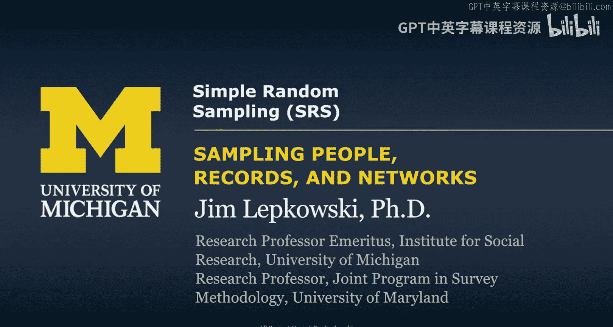

Welcome once again to our Coursera courseur on sampling methods in the context of data collection and analysis。

In this unit， we're starting a new unit， we're going to talk about randomization as a sampling technique。

 what I'm calling me randomization， only randomization。

 we're just going to look at this as the primary selection device in our process。

And there is only one way an element in the frame， call our frames can get into the sample。

 and that's by individual random selection。It is typical to call this kind of thing simple rather than mere random sampling。

 simple referring to just randomization。

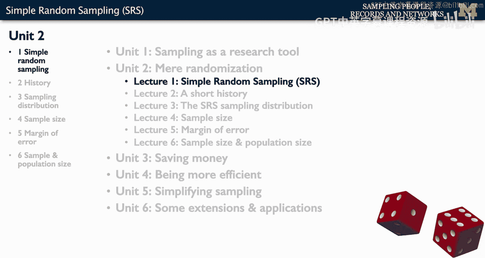

But I hesitate to use the term， even though it's more commonly used。

 because this is less simple than it might first appear。

There's a part of simple random sampling that depends on a choice of duplicating elements in the sample that bother statisticians because of the finite basis of the population。

 and it's that application of mere randomization to finite population that will cause us some problems。

 but that goes beyond where we are for right now。

So let's introduce SRS as it's sometimes called simple random sampling。

 and we're going to talk a little bit about frames and random variables。

 we're going to talk a little bit about selecting the sample and some definitions and then the practical use of simple random samples as we go along。

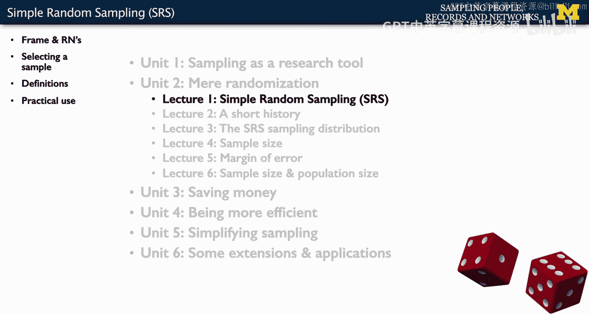

You recall that we've already done a simple random sample。

 We had a rather large table of random numbers when we were talking about randomization and what random numbers look like。

 well here's that table of random numbers， I know it's impossible to read， but you can。

Maybe pull this out and zoom it in and look at the properties， all of these numbers， in this case。

 4500 numbers that could be used to draw our sample。

 and then we apply this set of random numbers to our frame。

A frame that consists of persons who happen to be faculty， so we're sampling persons who are faculty。

 professors， associate professors， assistant professors at university。

 and we see that there's a little different layout than before because we can see their sequence number and an ID that is somewhat sequential but with gaps。

And a little bit of other information， auxiliary data。Auxili data about their rank。

 about their division， where they happen to be appointed， their sex。

 but we're going to ignore that information。 We're just going to treat this as a list of。Individuals。

And apply， our random selection techniques to that list of individuals。

The frame has more elements than can fit on one sheet。 So here's another sheet。

 There's at least 300 of them in this particular frame。 As a matter of fact。

 there's a total of 370 elements。 That's our capital N， our population size。

 as far as we're concerned。

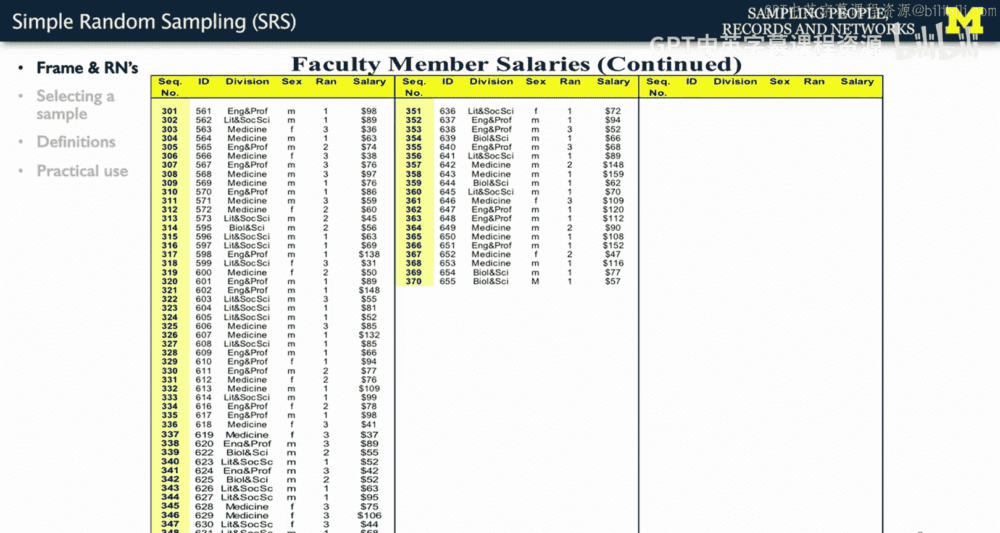

There could be more faculty， but we're just limiting it to these 30 to 70。

And here was a simple random sample that we did in our last unit。 We didn't call it that。

 but but here's what we did。 And so to sort of review the steps。

 we identified random numbers from the list that we could then link up to the I D numbers or the sequence numbers for the subjects。

 So we were looking for random numbers that went from 0，0，1 to 3，7，0， and we were looking for。

 in our case， from that finite population of 370 elements，20 such numbers that were distinct。

 different。

We're using random numbers from a table and matching them up to unique numbers assigned to each frame element。

 And for each selection after the first， we went back and check to be sure， well。

 maybe we didn't do this formally。 We probably did it informally and very fast。

 we checked to make sure that when we had selected the next unit。

 It wasn't one that had already been chosen。Because if it was。

 we went back and rejected the that most recent selection。

 which was a duplicate of one that was already there and then generated another random number and made another selection。

 That is， we made sure that we had 20 distinct 20 different elements from the population in our sample。

 And we just continued that process。Again and again。

 doing the draws until we got to our sample size of lowercase N 20 distinct frame elements selected。

So this we labeled without replacement selection， a unique sample of elements。

With that kind of an approach。Where we don't allow duplication， you see a little key there that says。

 don't duplicate。Every element of the population has the same probability of selection Now we're going to use a term here throughout the course to refer to that process and call it Epsom E P。

EM。 you see that highlighted in red。 It's an abbreviation， an abbreviation for equal， E for equal。

Probability， P for probability。S E for selection。Method， M for method， equal probability。

 selection method。 Every element in the population has the same chance of getting into the sample as any other。

And further， every combination of size lowercase N20 in our particular case has the same probability of selection。

 the groups themselves， all those unique sets of 20 different elements and there are lots of them have the same chance of selection。

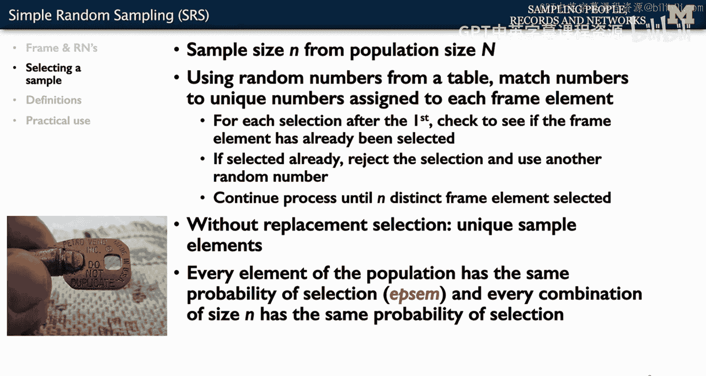

That's what we did before， that was our simple random sampling process。

There's other ways to do this and get a simple randomum sample in the end the same way。 So again。

 we're interested in a sample of size lowercase N from capital N 20 from 370。

And here's what we're going to do， we're going to change the process。

We're going to get our random numbers now and we're going to take random numbers and they could be three digit。

 four digit， five digit numbers， and we're going to go through and we're going to get those random numbers and we're going to assign them one by one to every one of the 370 elements in the list。

That is we're going to assign a different random number to every element。

And then what we're going to do is take that list now that now has not only the sequence number and the I D number。

 but now has this random number assigned to every case。

 and we're going to sort the list by the random number。

We're going to take it and go from the smallest random number sign to the largest random number sign。

 And then our sample operation is to take the first lowercase N elements in that sortred list。

Because they are randomly ordered， I could take the first 20。 I could take the second set of 20。

 I could take the last 20。 I could take every 10th1 until I get to my 20。

 It doesn't matter because they're in random order。

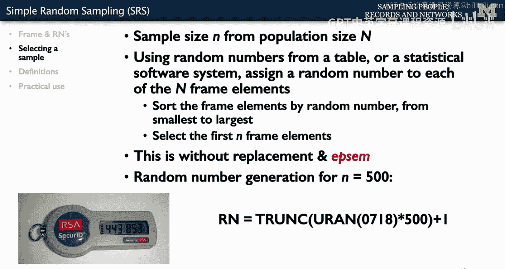

This process， if repeated again and again。Will yield a simple random sample in the same way。

It's without replacement， no elements going to get selected more than once because we're just taking the 20 elements from the beginning of the list。

It also turns out to be equal probability selection method that's E， P， S， E，M， Epom。Now。

 it would be a little hard to do this for 370 cases to go through and grab random numbers off that table。

 So instead what we might do is do it through a process of using the numbers a generating numbers through a machine process some kind of a black box mechanism that does that some kind of a key that's generating numbers。

 I don't know if youve ever had one of these for for secure login where you can you can it's always showing a new number there and when it comes time to enter in in order to log in a certain certain six digit sequence。

 you've got to look at that key and then then enter those six digits in exactly as they appear and then you enter in randomly generate it in that way。

 Well， we can do that through our selection mechanisms and I show a formula here。

 a piece of machine code and I'm going expand this just to say that we could generate those random numbers for each case by machine much more quickly than we could do。

By hand， if we had a way to tell the software system， here's how you generate these things。

 And so so here's a way to generate these random numbers。

 We could use a function inside of each of our pieces of software。

 our statistical software called a random number generator。

There are a number of different ones that we've mentioned before。

 we would use the uniform random number generator。And we would tell it， look。

 we want uniform random numbers。 we want random numbers that are between 0 and 1。

 We want a sequence of them。And we want you to give us the next number in the sequence when you see this for this case。

 Oh， and we want to make sure that you start on a certain page and column in a row。

 and we put in a seed。 So you see the U ran and then open pars 0，7，1，8。 The 0，7，1，8 is a seed。

 It's the starting point。 start on page 7 and column 18。

 and just start generating the numbers from that point。

 And then as you're generating those random numbers between 0 and 1。Muliply it by 500。

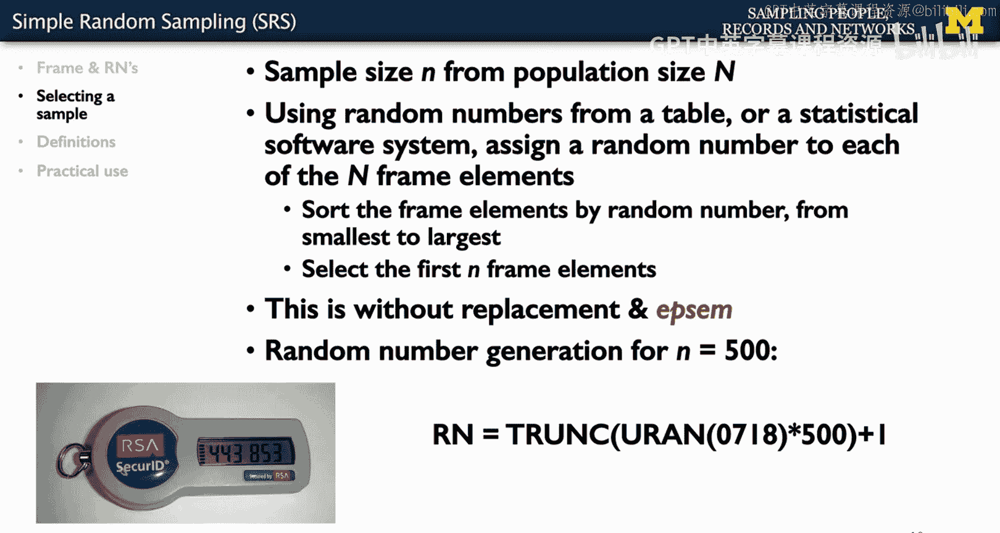

Now what that's going to do is take the numbers between 0 and1 and expand them to a set of numbers from zero to up to 500。

But but they're going to have decimals in them because those random numbers from0 to 1 have got a lot of decimals in them anyway。

 And so。It's going to expand the numbers from 0。00000 to 4999499。9999。And we don't need the decimals。

 so we're going to apply a function， trunccate the decimals， chop them off。

And then we've now got a random number that is between 0 and 499。

 not 500 because 500 wouldn't actually get generated in this process， but 0 to 499。

 We don't want 0 to 499。 We want 1 to 500。 So we're going to add one to it。

 And that's our random number。 That's a random number generating mechanism but it's built around the idea of the uniform random number generator。

 That's the key that you ran function is what we're going to use to assign a random number to every case。

 and it'll be just a random number from 0 to 1。 We don't care whether it's from 0 to1 to 500。

 We just care that it's from 0 to 1 and that's what we use in the sorting。Okay。

 so that's another way to do simple random sampling。

呃。There's another way。Now， these are all different。Processes， procedures。

 but they yield the same result。 They yield a set of samples that we would label simple random。Here。

 we're going to do a sample of size lowercase N from capital N again for 20 from our 370。

 We're going to use random numbers from a table， and we're going to match them to the unique numbers assigned to each case。

And we're going to continue the process until we have n frame elements selected。

 20 frame elements selected。We're going to check for duplicates in the sample。

 So we' got a sample of 20。 We've got them all generated， and we look to see， and lo and behold。

Of the 20 cases， two of them are the same。Well， reject the whole list。 reject that sample。

And draw another of p size 20。 We keep doing that until we get a set of 20 that our。Unique。Distinct。

This is a very expensive process。 We didn't do this by hand。 We let a machine do it。

 We're going to generate samples that allow duplication。

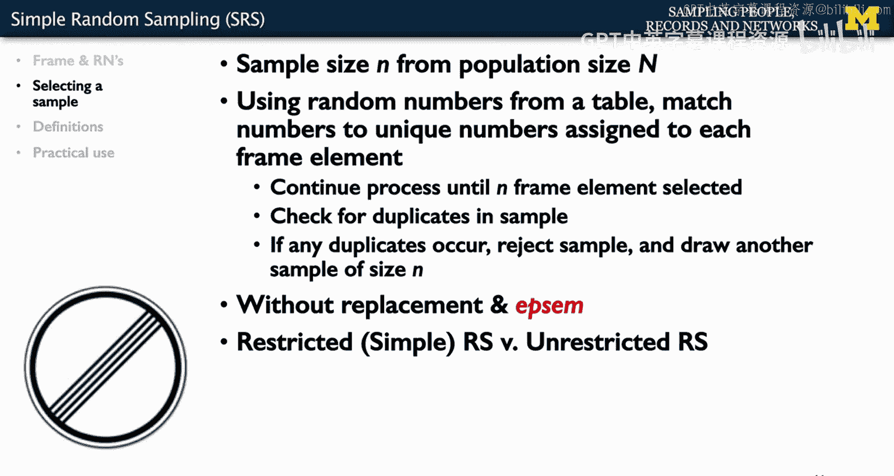

But when we get duplication， we reject the sample。 We only keep the sample if it doesn't have duplicates in it。

This gives us， in the end， a without replacement sample that is Epsom and a simple random。

 As a matter of fact， what we're doing is using a broader class of samples。

 The unrestricted random samples， the ones that include the duplicate in it。

And then filtering out the ones that have duplicates。

Fing those out of the system and only retaining the ones that don't We comparing a restricted or simple random sample versus an unrestricted。

 And hence the symbol in the lower left， actually， this is the symbol Sometimes you see on the highway with with the multiple stripes through it。

 which says all restrictions are removed。

Unrestricted random samples and we find those that have the restrictions we're interested in。

 this is not an uncommon sampling technique， but again， what happens that gee。

 we've seen three different ways to draw these samples， the direct approach we did first。

 where we deliberately search for duplicates， the approach where we sorted the list。

 this approach where we sort the samples we select out the samples that have the right properties。

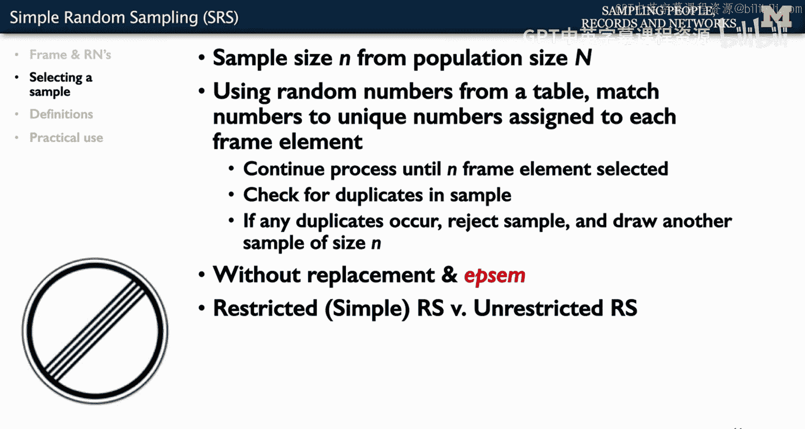

There are lots of possible techniques， but all of them lead to the same set of possible samples that we could have。

And it turns out that any procedure。It yields a fixed sample size N and for which every element of the population has the same probability of selection and every combination of size lowercase N has the same probability of selection。

 That's a simple random sample。 And that's the formal definition。 that's impossible to work with。

 But we just have three different ways to implement it。

It turns out that that process has a huge number of possible samples。

 and this is going to turn out to be very important for us。

This definition is unmanageable practically， but it opens the ground to explore the possibility。

 the range of possible samples that we can have。 There's a huge number of them。

 Here you see under our second bullet。 All sets of size and distinct elements from capital N。

 Pick one。 That's what we're doing。How many possible distinct samples are there。 Well。

 there's a formulation for doing this， something called combinatorics。

 and some of you may be familiar with this from your work in other areas in which we want to choose lowercase n from capital。

 We want to choose 20 from 370， and that can be expanded。 That kind of an expression。

 You can do that counting by taking the kind of expression shown there you'll see a fraction。

 a ratio with a 370 exclamation mark。That 370 exclamation mark means 370 times 369 times 368 times 367 times 366。

 all the way down to one。Divided by 370 minus-20 exclamation mark。 That is 350。

350 times 349 times 348 and so on。 Oh， by the way， which cancels the stuff in the numerator， right。

And also divided by 20 factorial。Well， if you do this number， it's huge。

 You can see what I've got there。 You've got a huge number of possible samples that could be selected。

 One large set of outcomes from this process。And what we're doing is choosing one of them by these techniques。

 we have three different techniques and we've chosen one sample from any one of those techniques to be our simple random of sample。

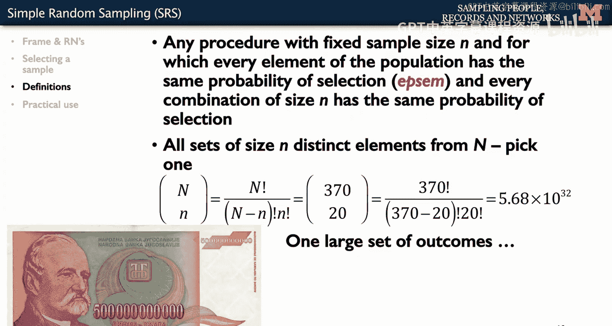

This idea of there being many possible sample is going to be important。

 but it's a large set of outcomes out there。 It's virtually infinite when you start looking at numbers like this。

 It's like the currency in the lower half whenever I think about this。

 I think about these situations in world history in which there was hyperinflation and people began manufacturing notes that had lots and lots of zeros。

 This was the Dar in Yugoslavia and this note had to be manufactured because the prices had escalated for various kinds of reasons so。

 so quickly and so dramatically that we needed really big numbers to keep track of things to even buy a loaf of bread。

 Well， here we have really big numbers because this process has a vast number of possible outcomes。

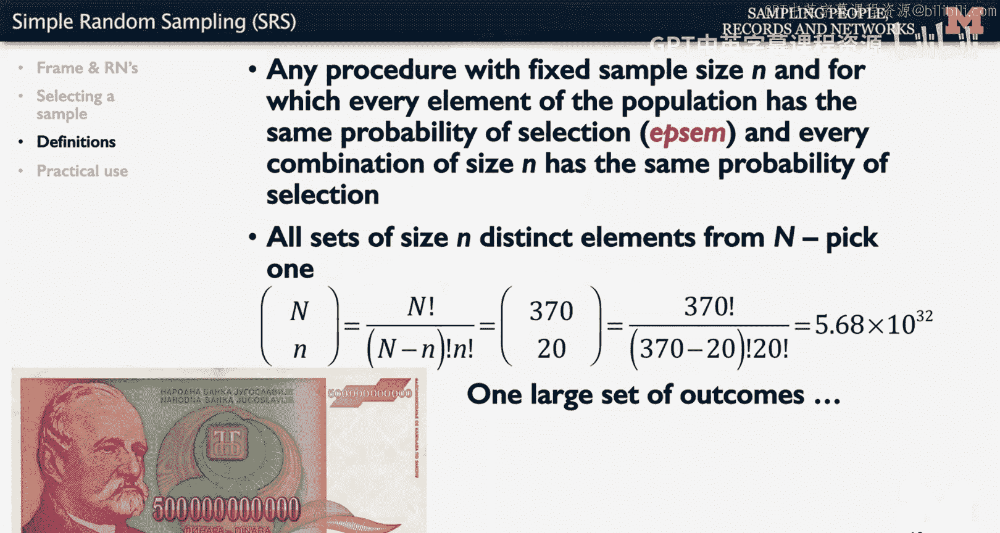

Okay， so what practical use is it well， if we can use those practical techniques that we talked about in the beginning for simple random sampling。

 it can be a widely used approach process for simple problems。

But it's rarely used by practitioners now， of people who do this kind of thing all the time in isolation to just do a simple random sample is a little bit complicated for lay administration。

 I wouldn't recommend it to a lot of people whove not done it before。 It's too easy to make mistakes。

 and then you worry about whether you've got the right mistake and whether the mistake made any difference。

 Oftentimes， it doesn't。

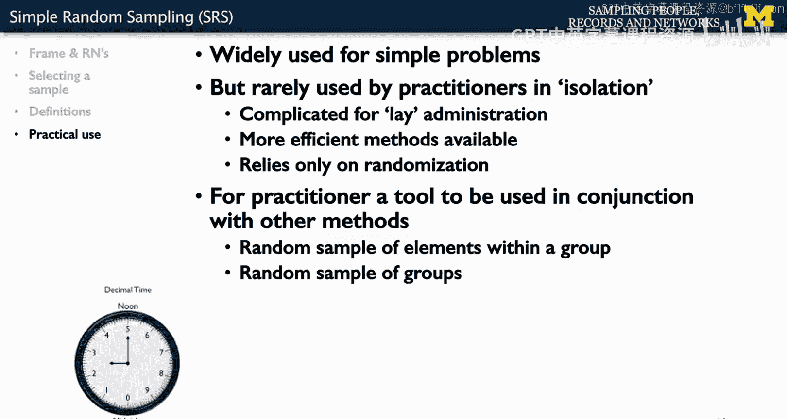

But there are more efficient methods of selection available， easier to apply methods。

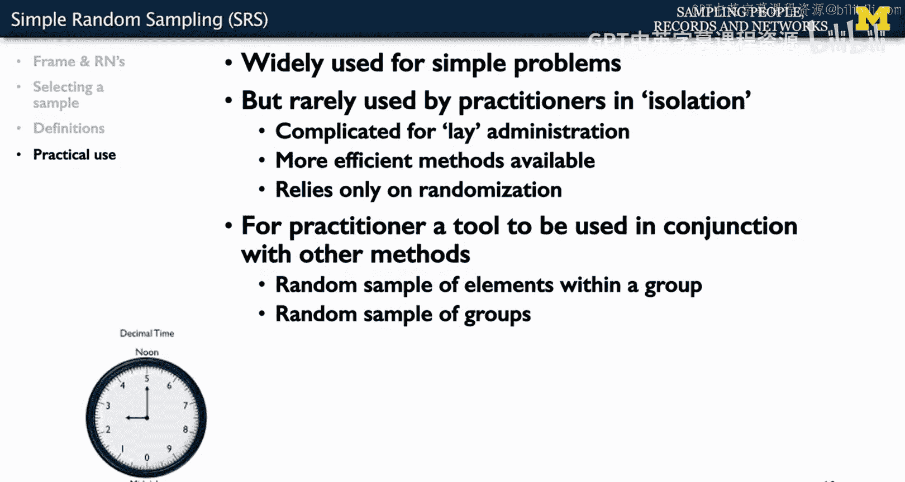

Its appeal is that it relies only on randomization。

 And so people who don't usually do a lot of sampling might do simple random sampling as a first resort。

 People who do a lot of it don't do this as a first resort。

 They use other techniques that give them better properties in their results。

So simple random sampling for the practitioners is a tool that's to be used in conjunction with other methods。

 a random sample of elements within a group， that idea of stratification we talked about that we're going to talk about more in upcoming units or a random sample of the groups we're doing simple random sampling What we're attempting to do is do things in a form with simple random sampling that we don't ordinarily do my illustration on the lower left is a somebody came up with a decimal time instead of our 24 hour clock or our 12 hour clock twice a day dividing the day into 10 hours and just having that clock there no that seems straightforward。

 but nobody does that and that's what's true here for simple random sampling people it's a nice idea。

 but there are better ways， better ways because of the need to subdivide our time into intervals。

 12 is a better number than 10 for that purpose so。

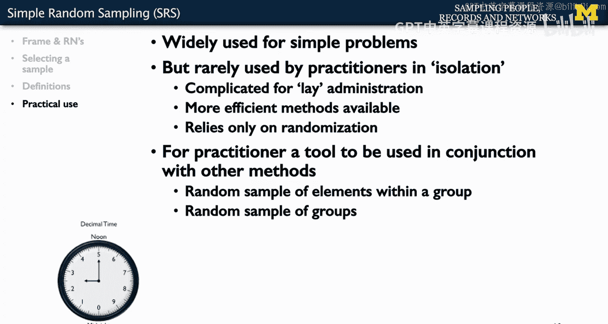

It's just that simple random samples are not quite the best way to do it。

 there's certainly an acceptable way to do it， but I'm going to encourage us as we move along into other techniques to think about other ways to draw samples that will be better than simple random sampling。

Okay， so that's it for simple random sampling the simple random sampling gives us our bottom line here is that it gives us a large set of possible samples。

 there are a large number of them out there and what we have to start thinking about is well gee we only got one of them so does this say anything about our quality and that's something that we're going to look at is that distribution of our estimates from our sample across all of those possible samples we're going to have to imagine this。

We're going to imagine what that distribution looks like and then see how good our sample is on the basis of what that distribution looks like。

 It's going to take some time to think that thing through， but we'll do that in the upcoming lecture。

 where we're going to look at those kinds of questions next。 Thank you。

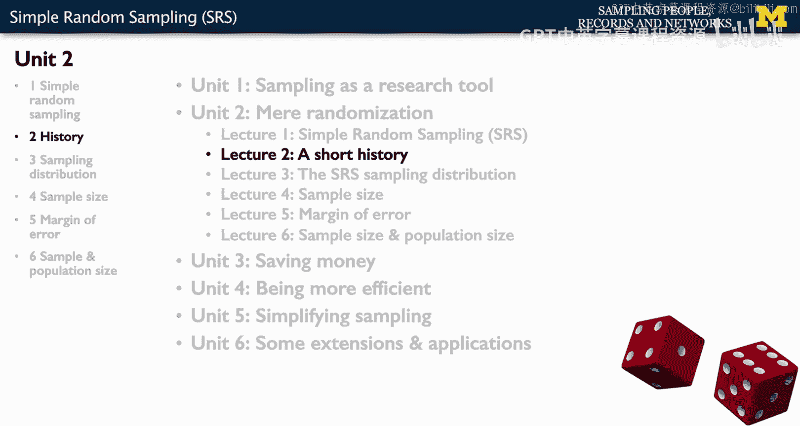

