# 调查数据收集和分析：2-6：简单随机抽样(SRS) 📊

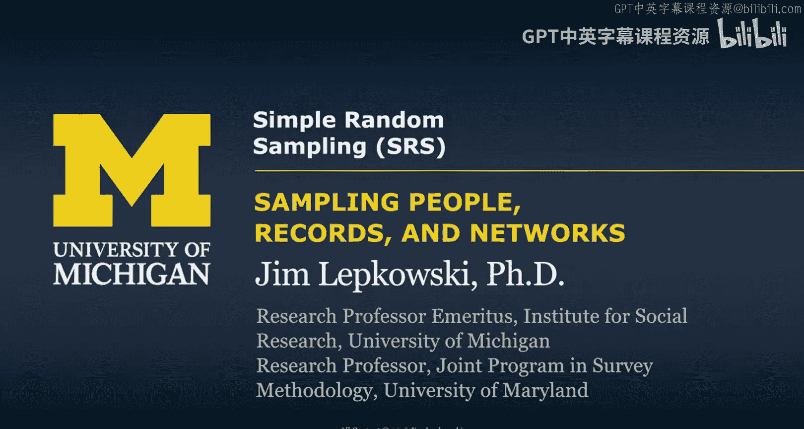

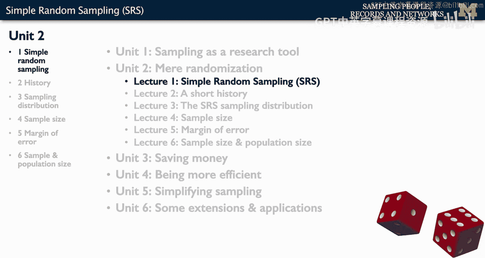

在本节课中，我们将要学习抽样方法中的基础技术——简单随机抽样。我们将了解其核心定义、多种实现方式以及在实际应用中的优缺点。

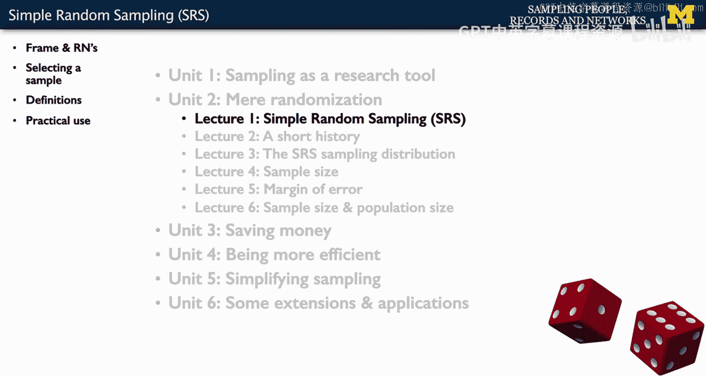

## 概述

简单随机抽样是一种基础的抽样技术，其核心在于仅通过随机化过程从总体中选取样本。我们将探讨其定义、三种不同的实施步骤，并分析其在实际调查中的应用场景。

## 简单随机抽样的定义与核心概念

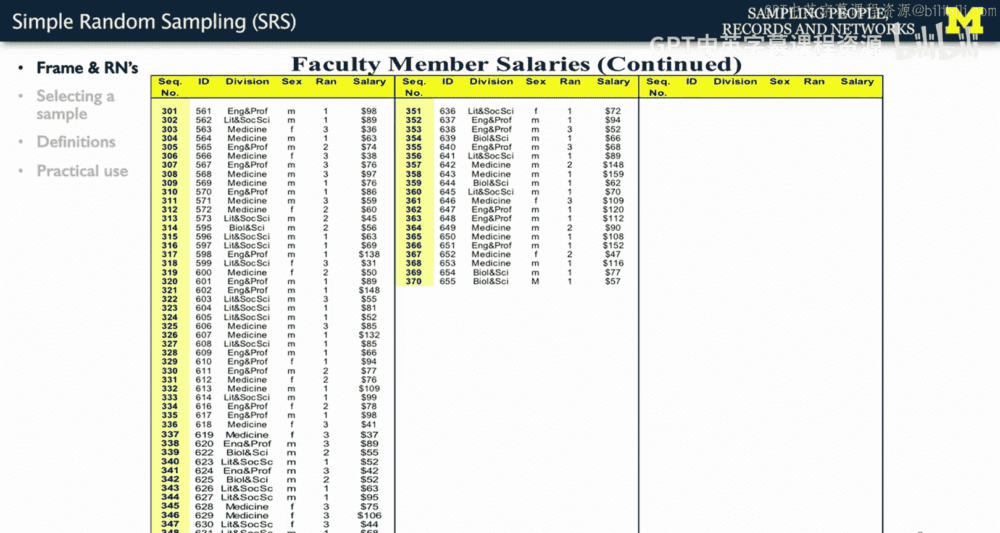

上一节我们介绍了抽样方法的整体框架，本节中我们来看看最基础的随机抽样技术。

简单随机抽样是指：从包含 **N** 个元素的总体中，抽取一个大小为 **n** 的样本。它必须满足以下两个核心条件：
1.  **等概率选择方法**：总体中的每一个元素被选入样本的概率都相同。
2.  **组合等概率性**：所有可能的、由 **n** 个**不同**元素组成的样本组合，被抽中的概率也相同。

这可以用数学公式表达为：每个元素被选中的概率为 **π_i = n / N**。

虽然“简单随机抽样”这个名称很常用，但其背后的统计原理（尤其是在有限总体中处理元素不重复的问题）并不像听起来那么简单。

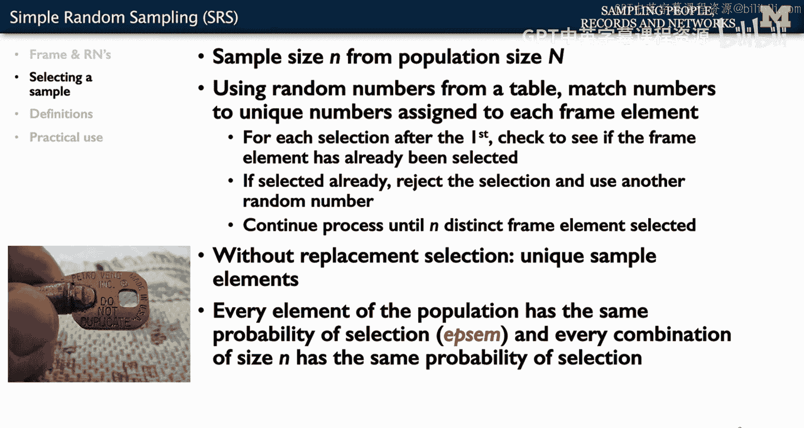

## 实施简单随机抽样的三种方法

尽管定义严谨，但在实际操作中，我们可以通过多种流程来获得一个简单随机样本。以下是三种常见的方法。

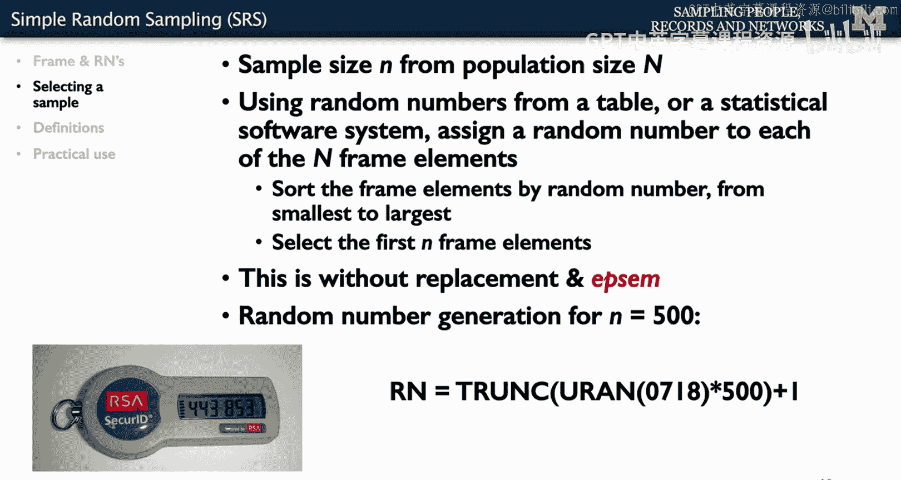

### 方法一：直接抽取法（拒绝重复）

这是我们之前单元演示过的方法。以下是具体步骤：

1.  准备一个包含所有 **N** 个总体元素的抽样框，并为每个元素分配一个唯一的序号（如001到370）。
2.  使用随机数表或生成器，产生一个在序号范围内的随机数。
3.  将随机数对应到抽样框中的元素，将其选入样本。
4.  抽取下一个随机数，并检查其对应的元素是否已被选中。
    *   如果**是**（即重复），则拒绝该次选择，重新生成随机数。
    *   如果**否**，则将该元素加入样本。
5.  重复步骤2-4，直到抽满 **n** 个**不同**的元素。

此方法确保了样本无重复，且每个元素及每个样本组合被选中的概率相等。

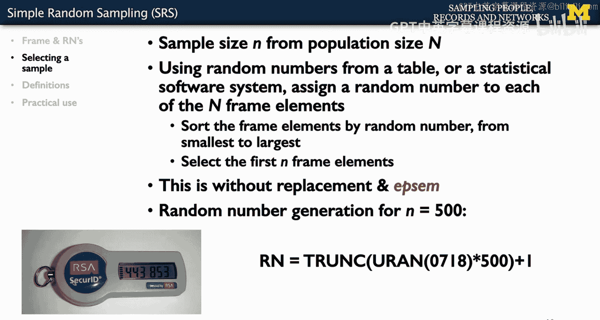

### 方法二：随机排序法

这种方法通过为每个元素赋予随机“标签”来简化选择过程。

1.  为抽样框中的**每一个**元素（共 **N** 个）都生成一个独立的随机数（例如，使用0到1之间的均匀分布随机数）。
2.  根据这个随机数，将整个抽样框的列表重新排序。
3.  排序后，直接选取列表中的前 **n** 个元素作为样本。

由于列表顺序是完全随机的，选取前n个、后n个或每隔固定间隔选取，在概率上都是等价的。这种方法也自然地避免了重复，并满足简单随机抽样的所有条件。

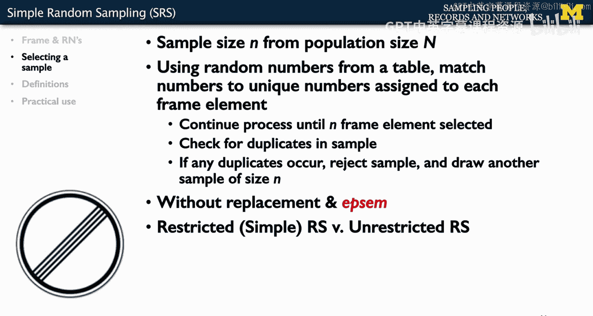

在软件中，可以使用类似 `runif(1, seed=0718)` 的函数为每个观测生成随机数，然后进行排序操作。

### 方法三：筛选法（从有放回抽样中筛选）

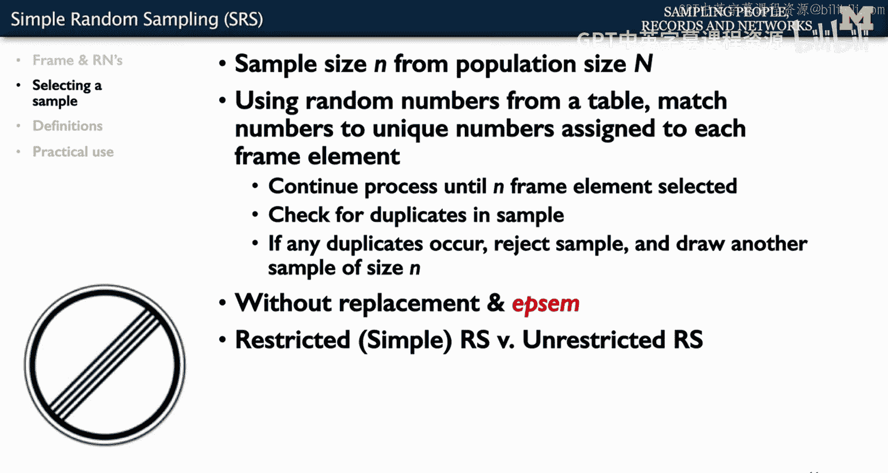

这种方法首先生成允许重复的样本，然后进行过滤。

1.  进行**有放回**的随机抽样：从 **N** 个元素中随机抽取 **n** 次，每次抽取后都将元素“放回”总体，因此同一元素可能被多次抽中。
2.  检查得到的样本中是否存在重复元素。
3.  如果样本中包含重复元素，则**丢弃整个样本**。
4.  重复步骤1-3，直到获得一个由 **n** 个**不同**元素组成的样本为止。

此方法从更广泛的“无限制随机样本”中，筛选出符合“无重复”限制的样本，其结果同样是简单随机样本。但该方法效率较低，因为可能需要多次尝试才能获得一个无重复样本。

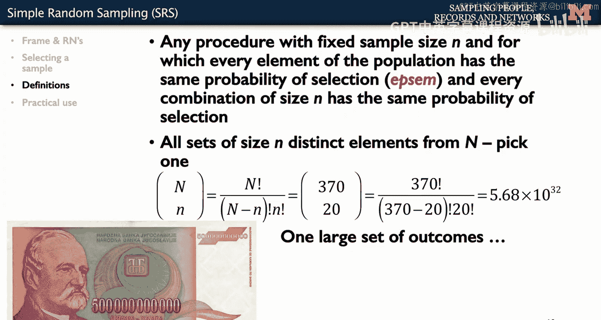

## 简单随机抽样的性质与实用性

无论采用上述哪种实施方法，最终得到的样本都符合简单随机抽样的定义，并且具有一个关键性质：**可能的样本数量极其庞大**。

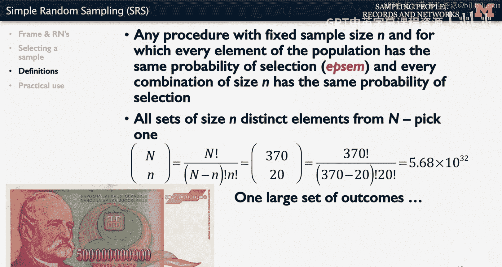

从总体 **N** 中抽取 **n** 个不同元素，所有可能的样本组合数是一个组合数，计算公式为：
**C(N, n) = N! / (n! * (N-n)!)**
例如，从370人中抽取20人，可能的样本组合是一个天文数字。我们的抽样过程，就是从这海量的可能性中随机实现其中一个。

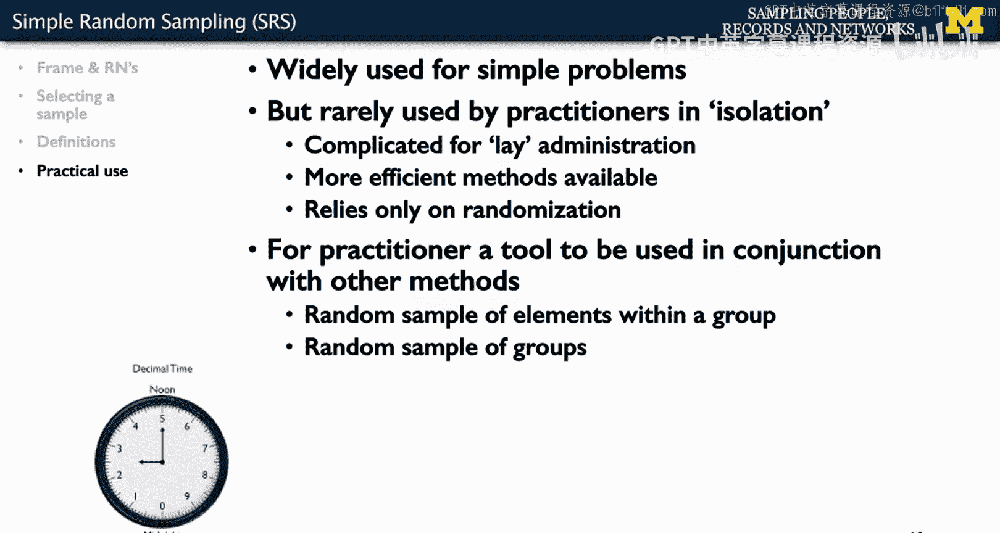

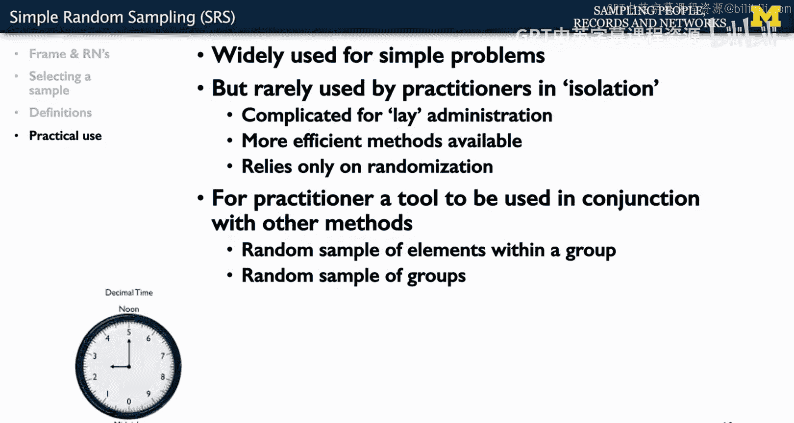

在实践应用中，简单随机抽样有其地位，但也存在局限：
*   **优点**：原理简单，完全依赖随机化，无需其他辅助信息。对于抽样新手或简单问题，它常被作为首选方法。
*   **缺点**：对于大型或复杂的调查，它通常**不是最高效或最实用的方法**。专业调查人员更常使用分层抽样、整群抽样等技术，这些方法能在相同成本下提供精度更高的估计，或更便于实施。

因此，简单随机抽样更像是一个基础构件。在实践中，它更常作为**其他复杂抽样设计的一部分**被使用，例如在分层后的层内进行简单随机抽样，或对初级抽样单元进行简单随机抽样。

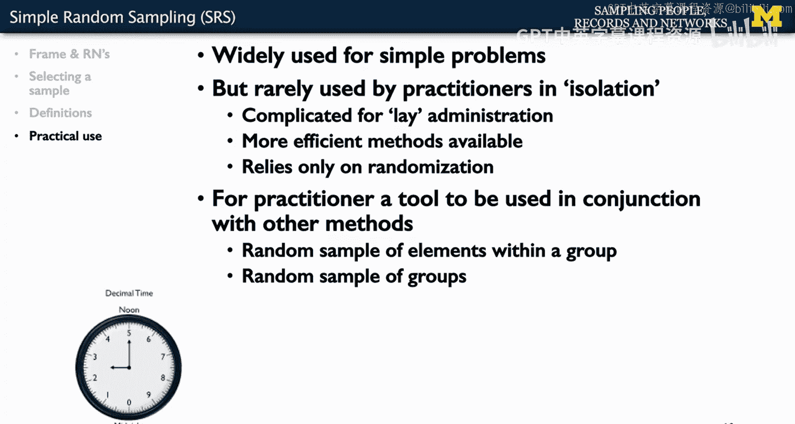

## 总结

本节课中我们一起学习了简单随机抽样。
我们首先明确了其核心定义：等概率且所有等容量样本组合等概率。
接着，我们探讨了实现它的三种具体方法：直接抽取拒绝重复、随机排序后选取以及从有放回样本中筛选。
我们了解到，尽管其原理直观，但可能产生的样本组合数量是巨大的。
最后，我们讨论了它的实用性，认识到它虽然是重要的统计基础，但在专业调查中常与其他更高效的方法结合使用。

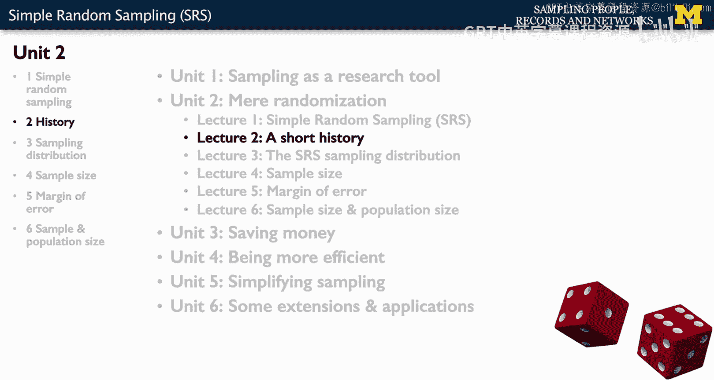

理解简单随机抽样为我们评估样本质量奠定了基础。接下来，我们将要思考：在如此多的可能样本中，我们手中的这一个样本的估计值究竟有多可靠？这引出了对抽样分布和估计精度的探讨，我们将在下一讲中深入分析。