# 密歇根大学《调查数据收集和分析（2-6：方法、社调问卷设计、抽样、缺失数据、分析）｜Survey Data Collection and Analytics》 p90 11_2.2 随机化简史.zh_en -BV1fw4m1e7Zh_p90-

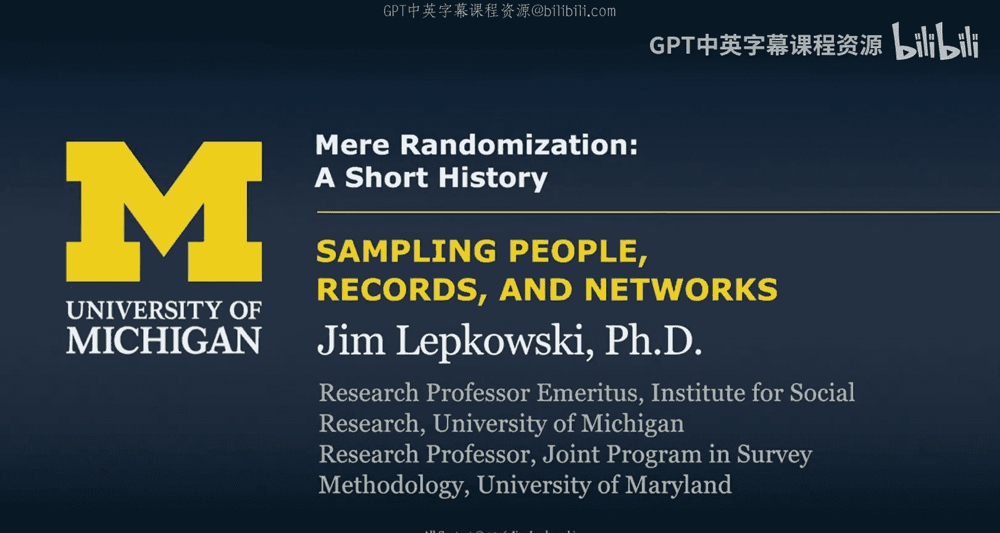

Our purpose in this lecture is to return to some ideas that we've looked at already。

 but from a different perspective。Where we've already considered the issues of having a population of a given size and drawing a sample from it and having the possibility of many possible samples。

And we want to consider some of the implications of this kind of thing。

 But what we're going to do is do this in the context of simple random samples。

 but look at a short history of these ideas just to have some framing from our proceeding forward。

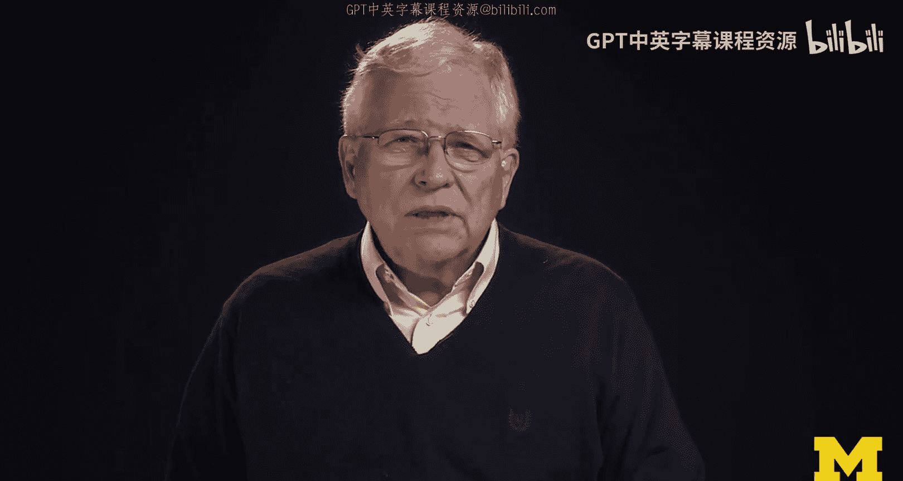

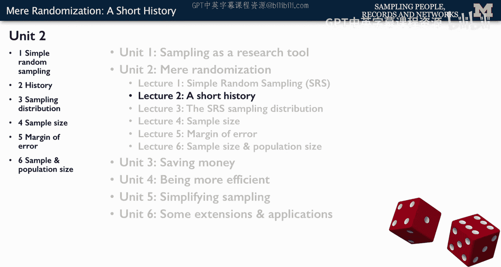

In the future， we will recall some of this as we look at。

More on subor randomum sampling and other kinds of sample designs。

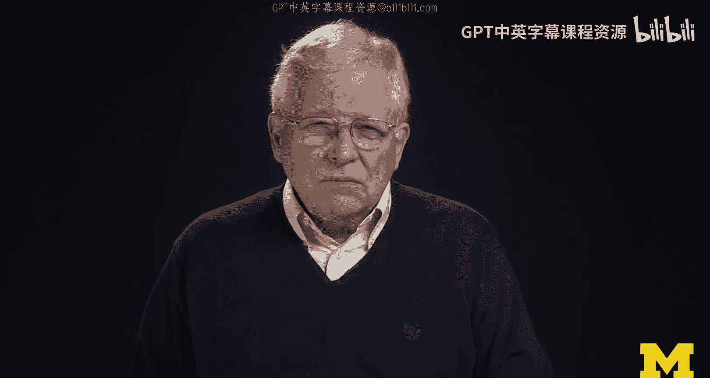

Our history then is going to involve a discussion about the difference between practice and theory。

A little bit about what's called the representative method， a term that we've already used。

More about randomization and then a comparison between what's。

What used to be known as the representative method and the randomized method。

 And then some principles that were extracted。

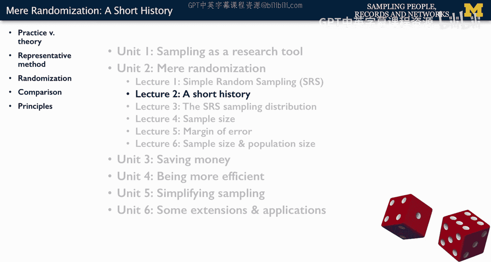

And these can provide a framework for us as we move ahead in deciding how we should draw our samples。

The kinds of things that we're talking about here with respect to probability samples。A roseose。

Really， the way they're constructed to day out of practice。

 There wasn't a theoretical development first。 And then these kinds of things were extracted from them。

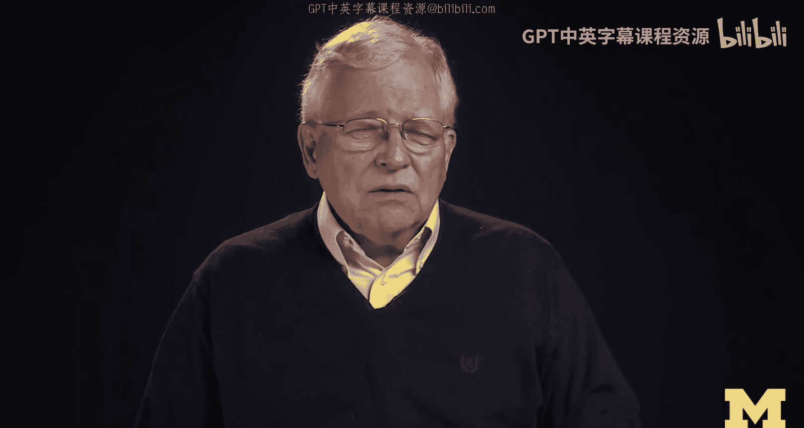

What we're looking at are techniques that were responses to practical problems。

The result of attempting to solve practical problems with respect to understanding what's going on in a population。

Theory， in this particular case， statistical theory， is what I'm thinking about here。

Came in later and formalized some of the implicit assumptions that those practitioners who were solving these problems were making。

And then confirm。Sometimes corrected。In other cases， extended what was going on in practice。

 So the the。

Progression here， typically， not uniformly， is to move from practice to theory。

 And that explains some of the perspectives that you've seen already and some that we're going to see as we move ahead with these kinds of designs。

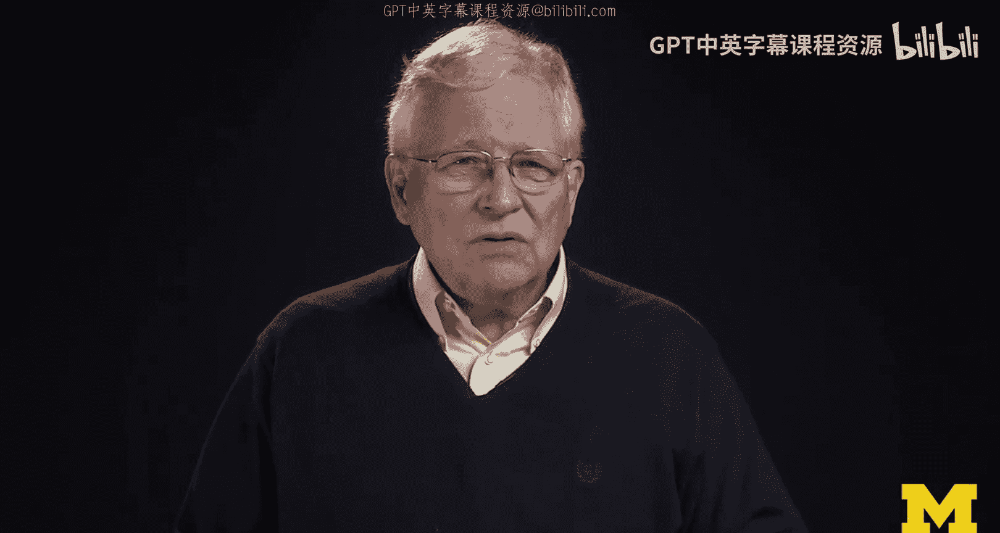

Now that sampling practice， the origins were really in the framework of data gathering surveys that we've been talking about。

The early data gathering that we traced this history back to。

 We don't go back a great deal of time as you'll see。 And it was a time when。

Science was on the ascendance。 Science， the idea of generating new knowledge through systematic study and using the kinds of research designs that we've been talking about。

 experimentation， as well as observation。Was widely admired for its contributions to our understanding of the physical world。

 whether it was in physics or chemistry or astronomy。At the same time。

 there was great interest in health and social problems and those who were interested in those kinds of things。

 many of the early social scientists were philanthropists who had money。

 especially in Northwest Europe， from the industrial revolution。

And they wanted to understand what the industrial revolution and the movement of large populations into urban centers。

 what kinds of effects it was having， But they wanted to do the study in a scientific way much the way physics or chemistry was doing their research。

 So they called themselves They called the science or some of them did anyway。 Social physics。

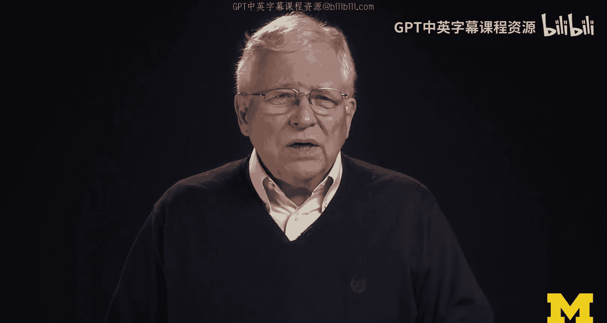

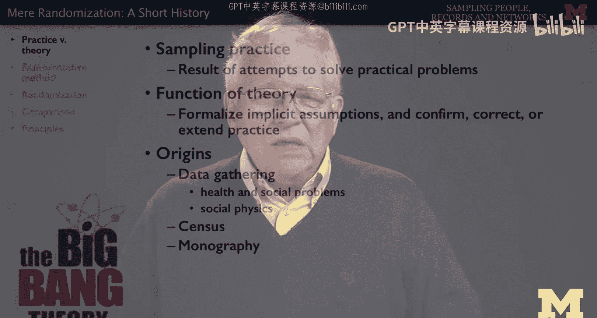

So it was data gathering in an attempt to have a scientific approach to studying social problems。

In the same way that you were seeing scientists studying physical phenomena， physics。There were。

 at the time， two basic approaches in their minds to how they should go about doing their studies。

 One that we've already talked about was a census， a census。

In which there is a population， that's what they're interested in now。

 They're not interested in this in some undefined， vague， In population。

 according to some distribution。 They have a population in mind。

 though the residence of a sman in London or a village in France。

That was what they they thought of as their， their population。

 and they would do a census of it to study it。 That is。

 they enumerate all of the units and they make measurements on all of them。

 That gave them the assurance then that they were able to make inferences from their study back to that population。

There were others， though， who recognized that they couldn't do a census for many of the populations they were interested in an entire country。

 especially among those who were engaged in the rise of the public bureaucracy。

The public government systems that came about really in the 19th century in Europe。

 where there were large scale government institutions。That thrived on data。

 and they knew that they had to provide data to those systems to for those systems to develop effective policy。

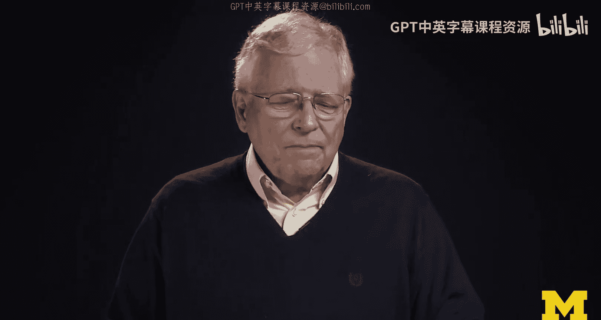

And so they couldn't do a census for every problem that they had to deal with on one day in health and the next month on crime and crime victimization。

 So they began to do studies that were called monographic studies。

 The study of one study a typical unit。

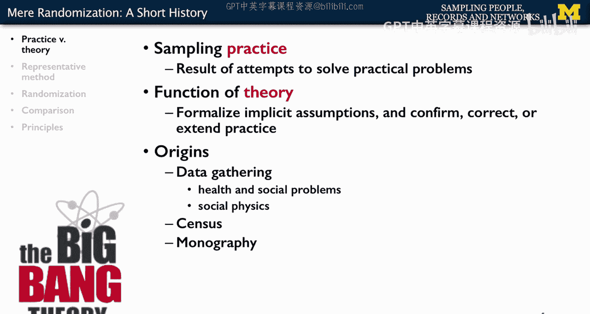

And in contrast to the census where you study everyone here， we would study a unit， a village。

 a town， a neighborhood， and then generalize to the entire population。

 This kind of thing still goes on today in the United States， there's a study called Middletown， USA。

 It's been done periodically over the decades since the end of the 19th century。

 beginning of the 20th century。 And it studies one town in the US that at the time it was initiated was very close to being near the demographic center of the US。

 That is， if you took all the population of the US and and waited it across the population It sort of balanced it out。

 Where's the middle And the middle was somewhere at that time in northeast Indiana。

 one of the Midwest states。 And so that the town， Middletown USA is a study of a town right near that that center。

 Muncie， Indiana。And the idea was， let's study that intensively。 And what we learned from that town。

 we're going to generalize the entire country。 So that's the idea。

 Do them all or take one and generalize。Now。

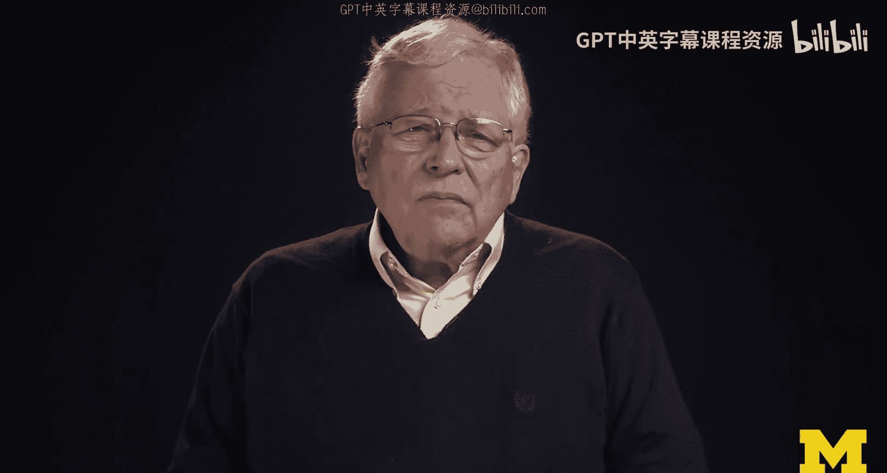

This was not a satisfactory solution for people in government statistics at the time。And in Norway。

 the chief statistician was a man named Shire， who couldn't afford to do a census。

 He was doing a census periodically， but he couldn't afford to do that for every problem that came up。

 couldn't afford to collect enough data in each census to be able to represent the entire country on all the different variables。

 all the different dimensions that were of interest。

 So he began constructing what he thought of as miniatures of the country。

 he would draw a sample now， not of one typical unit。

 but a set of units that when put together in composite。Gave him miniature of Norway。 So the towns。

 the villages， the central cities， collecting data across all of those。

 but identifying units that he have available through the census operations in Norway。

Assemble a large number of units and use prior information in the selection of those units。

Now there's no chanceant selection here， there's no probability selection。

 just the idea of let's represent the population。

And he would do this in a quite elaborate fashion and then。Collect data。Within that sample。

 within that sample of locations， and then make inferences to the entire country。

He took this idea to other statisticians at a group called the International Statistical Institute。

 And there he encountered some resistance。 There was a statistician named Von Meyer and others who said。

 well， this doesn't make any sense。 You really need to do a census。

 You're making calculations where there are no observations。

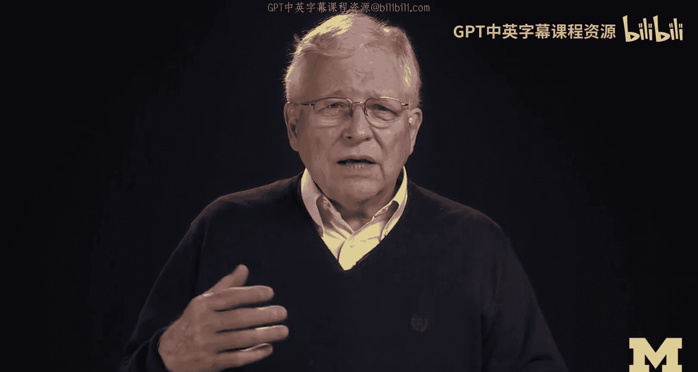

And observation is necessary in order for us to be able to make inference。Others， French school。

 Chasson and others， they advocated monoography， detailed examination of a typical case。

 You're not getting enough detail about these。 And we can generalize from that。 Well。

 this kind of controversy。 Now， there's three different ways of going about it。

 This kind of controversy LED them to put together a commission。

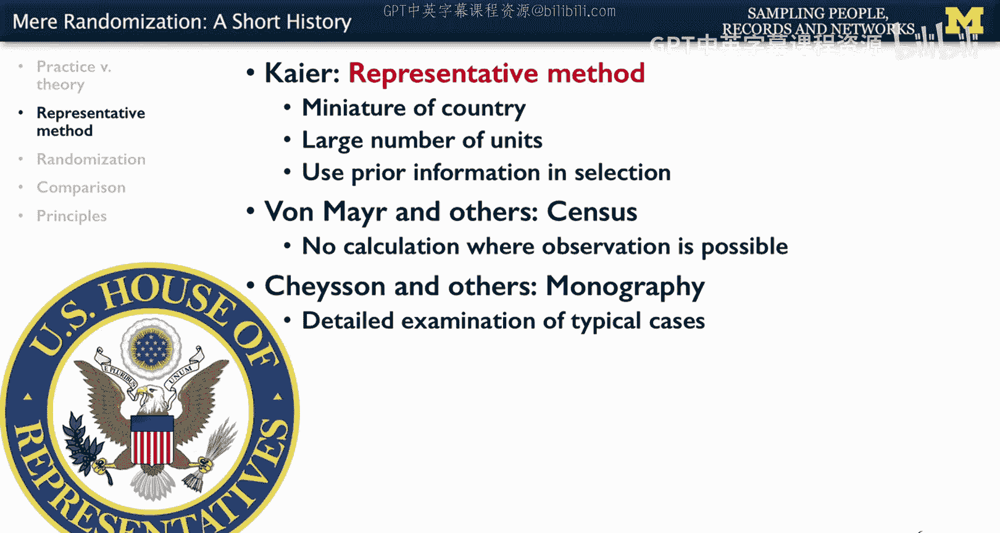

And that commission took a number of years to come back with a report。

 but the idea was representation。 that's the seal that you see there。

 the idea of representation that was being exhibited in government units， so in the United States。

 the House of Representatives is in a way， an attempt to assemble for political purposes a miniature of the country。

 based on population distribution across states in order to represent the country and thereby affect political processes the people thought fair。

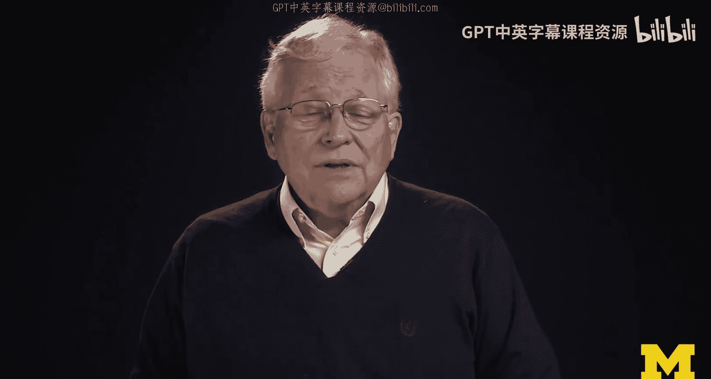

They're going to try and do the same thing in the research realm。

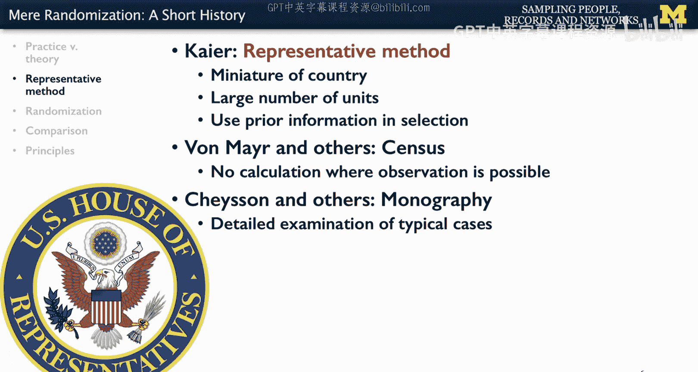

Now， that study。LED to really no conclusion at all。 The study came back。 And after eight years of。

 this is people doing it in their professional association part time。

 they came back with a conclusion that said， look， you should do whatever you think is appropriate。

 All of these methods， the representative method advocated by Shire。

 The census advocated by von Meyer and others。 The monoographic method。

 these are all suitable methods for doing research about populations。But。

We're going to just give labels to these and some some basic principles。 But the basic idea。

 one of the principles that they came out with was whatever you do。

 make sure that it somehow is representative of the population。 And that's not a well defined term。

 It may be in common usage today， but it's not well defined statistically。

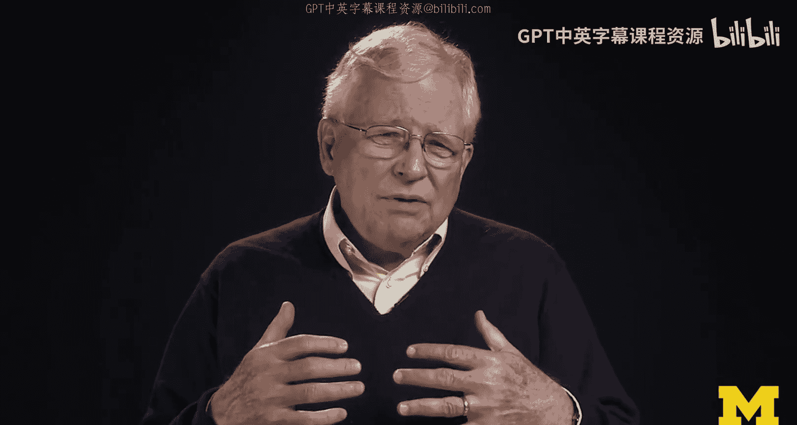

And out of this idea of representative sampling grew some of the non probability sampling methods we talked about recently。

 Prosive sampling or judgment sampling， expert choice， even balanced sampling。

 making sure that your sample looks like the population on certain dimensions。

 And then we're going to collect data on other dimensions and other variables that we've never observed before。

 and we should get a good sample。 So that representative method became the foundation for a lot of sampling that didn't involve chance selection。

 But there was no chance selection involved in it。But shortly after that report came out。

 a statistician named Bowlley in 1906 said， you know。

 we ought to couple this with randomized selection。

 He was at the time working with a statistician named R A。 Fisher。

 who was doing randomization in experiments。

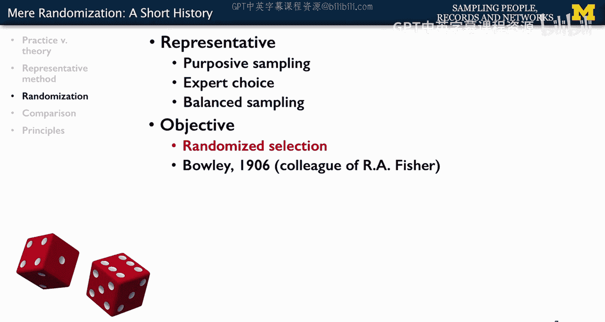

And remember in experimentation， how randomization is used to create groups that are as alike as possible so that we can compare them by manipulating a characteristics such as a treatment administered to each。

 and then seeing what the difference was in the outcomes。 He said， well。

 we ought to apply this in much the same way we talked about it before to determine who's in the sample and who's not in the sample。

Well， through the 1910s teens，1920s， this was kind of accepted。 There's representative sampling。

 There's， there's。Censuses， there's other kinds of data collection such as monoography that's there。

Reranomization didn't really catch on。 It seemed to be kind of an added thing that didn't have any particular purpose。

 And that was until 1934 when a statistician named Naman proposed examining。

 comparing the representative method， if you will， to a chance selection method。

 the kinds of techniques that we're talking about now。 And he wrote a paper about this。

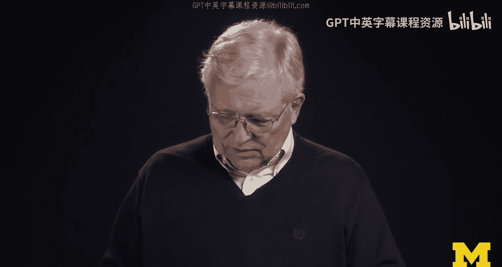

And in this paper， he studied the properties of repeated sampling。 Now。

 nobody does repeated sampling。 It's too expensive。 You get enough money to do one。

 You can't afford to do many。But he said， imagine all possible samples。

 And you recall that we've talked about this， imagining all the possible samples that could be selected。

 That idea wouldn' have been around， But he proposed applying it to this specific problem。

 And then looking across all those possible samples and seeing what happens to the distribution of our values are characteristic across those possible samples。

 And so he talked about the sampling distribution of an estimator。

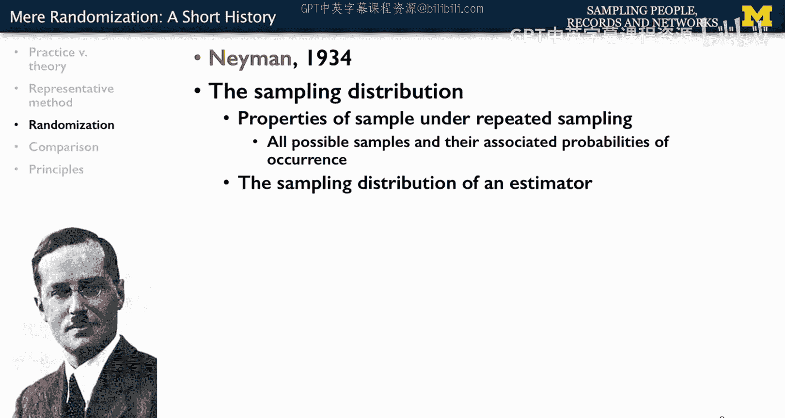

By the way， in that particular paper that he discussed all this。

 he introduced the idea of a confidence interval。So comps intervals are very commonly taught and used today。

 but they originated in 1934 a Naman's paper。By the way， a second aside on this。

 Naaman was also the inventor， along with another statistician named Pearson。

Who proposed the idea of hypothesis testing？He did that in 1932。 So 1934， he went on with with。

Compfiference intervals to extend the ideas into the kind of inference we use in surveys today。

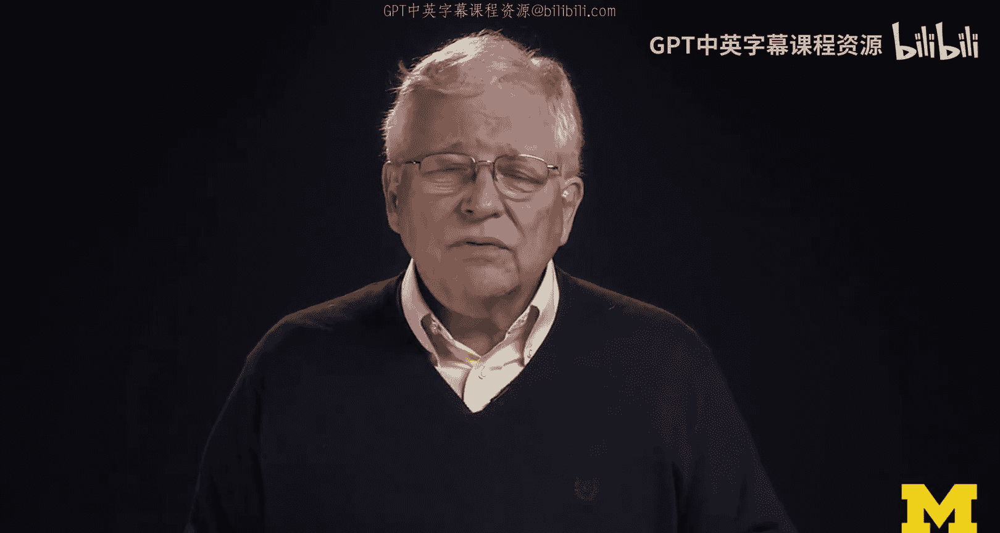

What he was most concerned with was what are the conditions under which different procedures。

 Re procedures or chance selection procedures would produce valid estimates。

 And he defined two kinds。 Then probability sampling。 That's where we got the term we're using here。

 And he talked about unbiased as something we'll come to in the in the next lesson。

Irrespective of the population structure。 He was noting that he could do this with probability sampling without needing to make any assumptions about the distribution of the characteristics in the population at all。

Versus a propsive or balanced judgment sample， a balance sampling， even a quota sampling。

 balance sampling is a bit like quota sampling， not quite the same thing。

 but they have some similar foundations。Where one has to make tough， I think。

 be the term we use today， assumptionssumptions about population structure。

And sometimes those assumptions would be so strong that we'd think these may actually not be very likely to be achieved in practice。

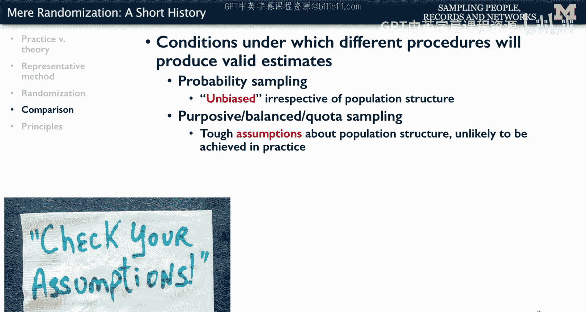

So he's contrasting these two methods and out of this， there was more debate。

 but basically what came out of all of this was the following look。

 you ought to be doing probability sampling because it's objective。

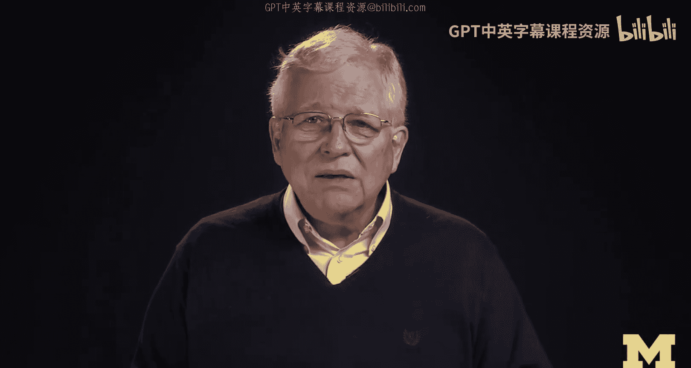

Now remember， this is 1934 thinking things are different today。

 but still probability sampling is an important feature of how these sample surveys are conducted。

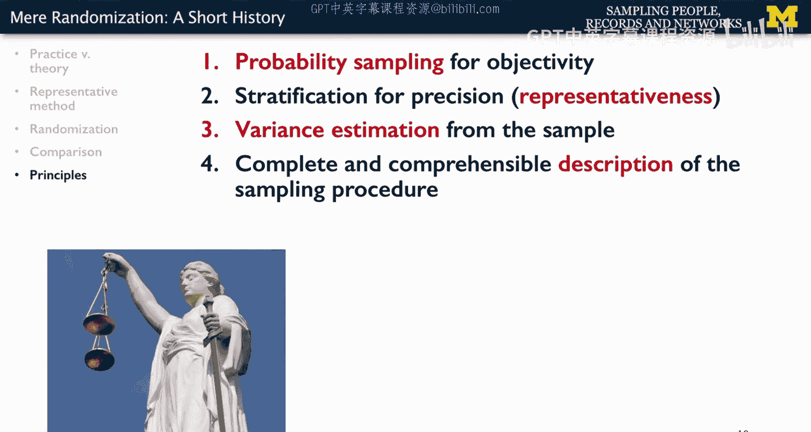

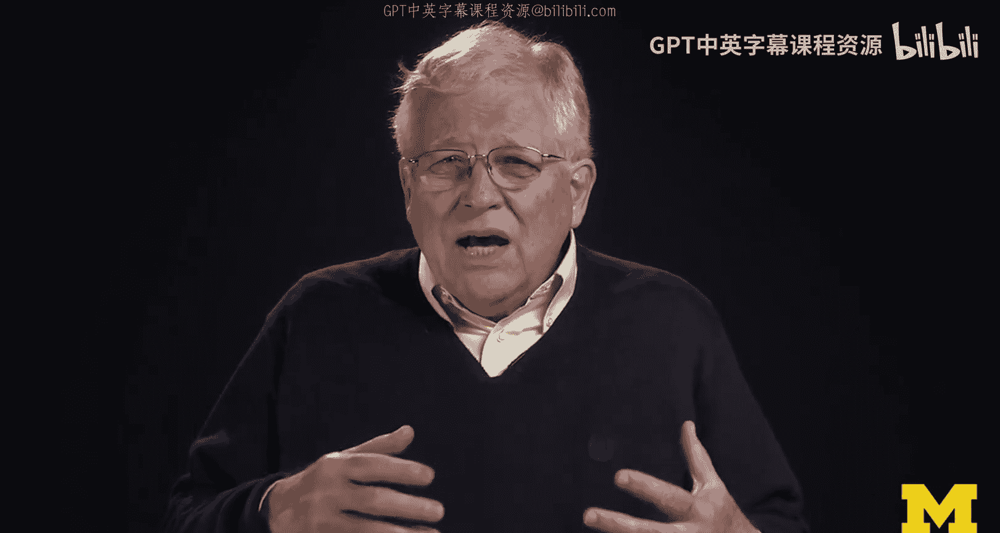

You ought to be doing representativeness， but let's make it more formal。 Let's do some grouping。

 The kind of thing that we're going to talk about muable stratification to improve the quality of what you're doing。

Let's make very sure that when we're all done， We also examine the quality of our estimates。

 and that would involve estimating variances， of those standard errors that we're talking about confidence intervals。

 Let's make sure that we give our user， our the consumer of our data。

 Both our projection as to what's going on in the population， the mean the proportion。

 But also our uncertainty about it in the form of cof interval or standard air。

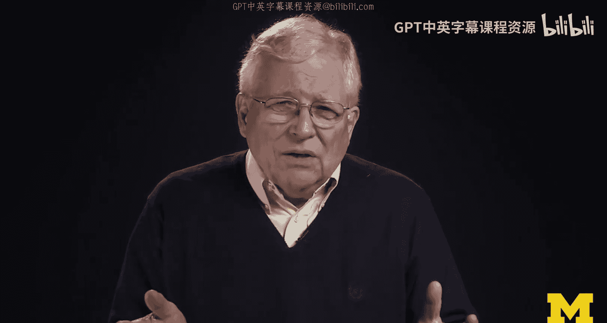

And then make sure that we give a complete and comprehensive description of the sampling procedure。

 Don't， don't just say that a sample was drawn。 How was it drawn and make sure that the reader has that so that they can assess for themselves。

 What's going on。 These are kind of principles， back my principles that emerged out of this debate from the late 19th century to the。

 oh， the first half of the of the 20th century。 And that's been a foundation and a basis for the kind of thing that we're talking about here。

 But it's been going on for 70 some years now， And that is the framing for what we're doing now。

Now， given that， you' got to understand a lot of other things were being done at the same time are being done today at the same time。

 We're giving you a fairly specific set of principles and guidelines here。

 There are other ways to do it。 But if you understand what we're talking about here。

 you'll be able to evaluate other ways of doing sampling。

 And that's why we've just gone through this little bit of history here in in this lecture。

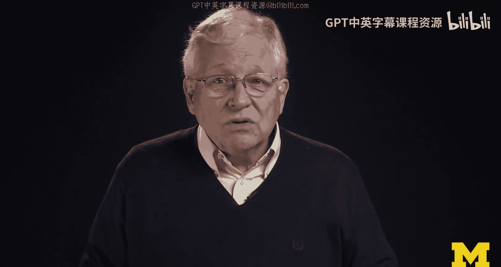

In our next lecture， what we're going to do is look at something of an example and study the sampling claims that go there in our next lecture before moving on to talking about sample size。

 Thank you。

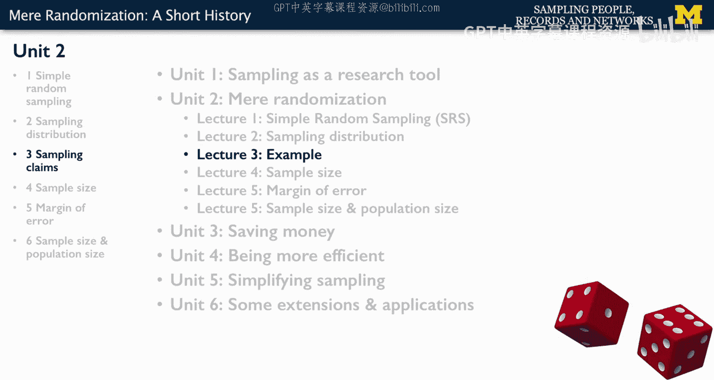

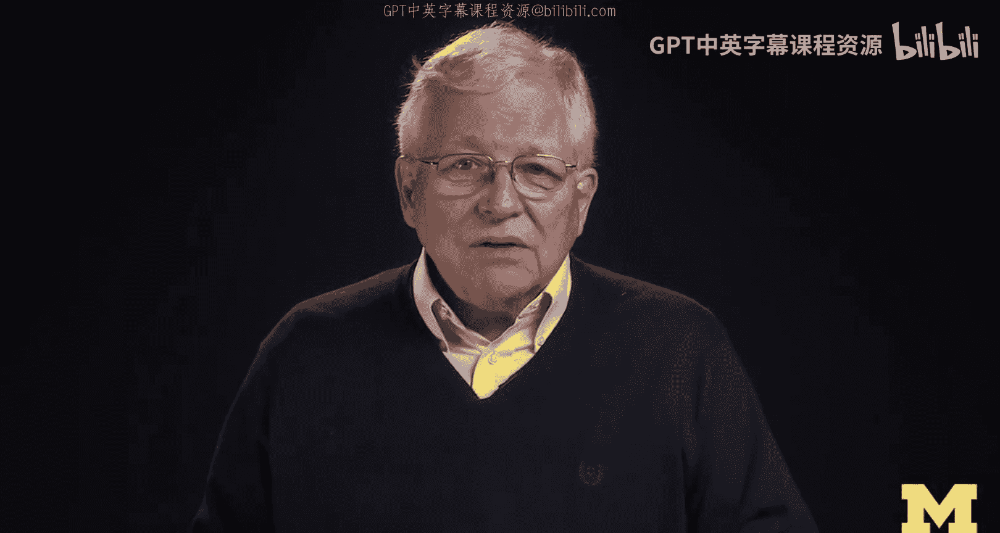