# 密歇根大学《调查数据收集和分析（2-6：方法、社调问卷设计、抽样、缺失数据、分析）｜Survey Data Collection and Analytics》 p91 12_2.3 SRS抽样分布(上).zh_en -BV1fw4m1e7Zh_p91-

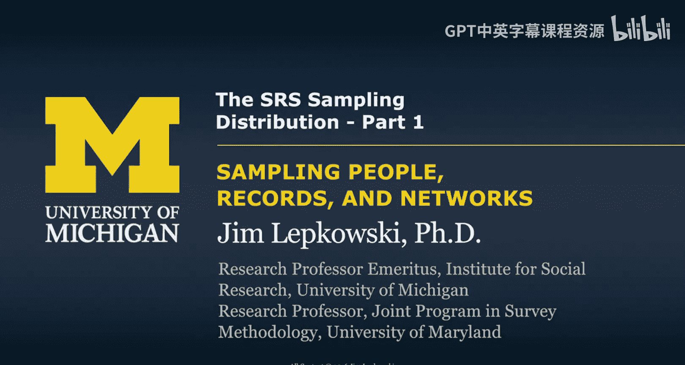

Welcome again to our continuing series of lectures on sampling people， records and networks。

We are continuing a unit2 on simple random sampling or mere randomization as the device in the sample selection。

 and this lecture is about the sampling distribution。

We're going to be looking at the nature of that sampling distribution as defined by Naaman in our last lecture。

 we talked briefly about Naaman's contribution。And looking at some of the properties of the sampling distribution。

 repeating some things that we did before under sampling as a research tool。

But here we're going to be doing it with respect to simple random sampling。

 So we're going to look at the simple random sampling sampling distribution and its properties and talk about some of those as way of preparation to design work。

 understandingstanding this will help us understand how we're going to design new simple random samples。

 basically calculate sample sizes。

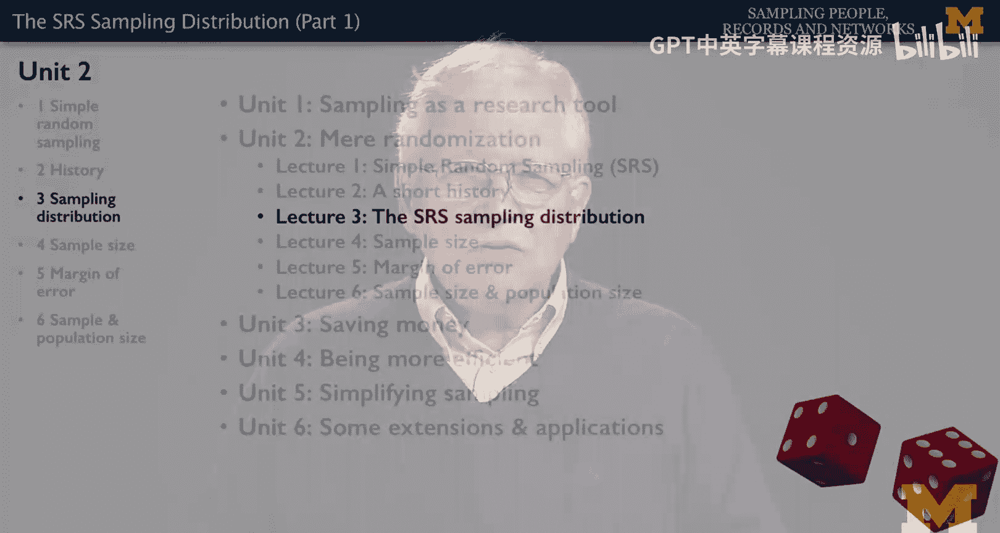

We're going to talk about a basic framework for understanding sampling distributions and then the properties of the sampling distribution before finishing up with some discussion about C intervals。

So as I said， we were initially talking about a sample design。

In which there is a unit of selection that is the population element， simple random samples。

 and the basic framework for this was given by name and in 1934。

 And he talked about this basic framework being applicable to all kinds of populations and that it shouldn't depend on assumptions about the population structure。

 a matter of fact， it's appropriate for large populations of elements and can be done without making assumptions。

 now。

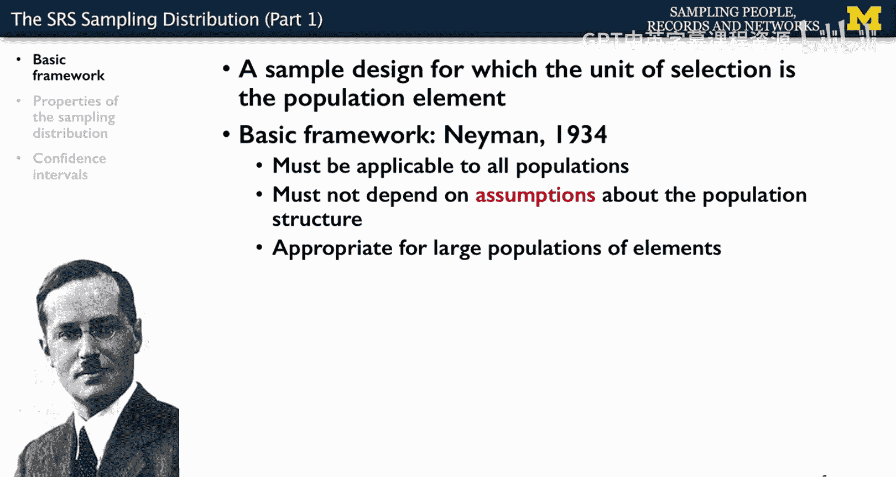

This is a bit disingenuous of me to put this forward at this point。

 because we end up making assumptions when this kind of thing fails and the failure I have in mind is nonrespon。

 But for our purposes here， we're not going to worry about nonresse。

 We're just going to deal with what happens in in the process when it's applied in principle and we'll deal with some of the practical realities later in in in the course。

A key idea here， is the idea of， as we've said， repeated sampling。

 We want a process that is objective。 Simple random sampling is that。

 because the selection is determined by the random numbers， not by any input on our part。

It's mechanical and objective。And we want one in which we can consider all possible outcomes。

 as Naman did， of the sampling process so that we can define a sampling distribution and be able to think about ways of calculating standard errors and cop intervals。

As a way of evaluating the whole set of possible outcomes to go with this。

That idea is important as an imaginary device as we've talked about before， for a given sample。

 we can obtain a particular value of the statistic of interest， such as a mean why bar。

But what we like to know is how good is that white bar。

And the way we're going to define that y bar is in terms of how close do we think it's going to be to the true population value。

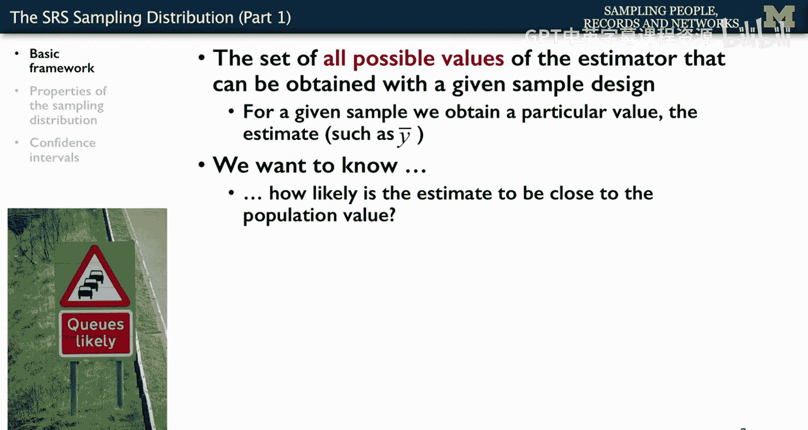

And that will be where we end up in this process。 Now。

 I'm not being very formal here in terms of definitions。 This is a little bit loose。

 And so it's a little bit dangerous for us to be talking in these terms。 But that's the basic idea。

 How close does that mean to the true population value when we don't know the true population value。

So if what we can do is come up with a process that。On average。

 is going to get the true population value。And then we can define how much variation there is around that true population value。

That will be about as good of a way of expressing this as possible。 Now。

 we aren't going to be able to make this statement in terms of probabilities。

 This is important to statisticians， but we have a statement。

 a confidence interval statement that's widely accepted as useful in interpreting the uncertainty that we have in our results。

 And that's what that interval is about that uncertainty。

So we get one sample。 We only get one shot at it。 Typically， Sometimes we can draw multiple samples。

 The estimate may be correct， not very likely。 It's likely to be incorrect in error。

 And so what we would like to do is somehow establish the probability of a satisfactory estimate。

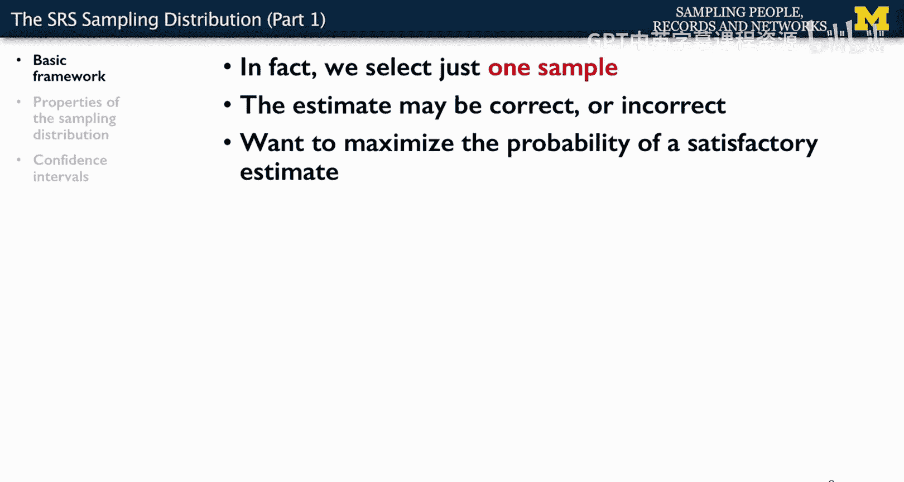

And so what we're going to do is define two characteristics of the sampling distribution that will help us to。

Make these statements that tell us something about whether estimate is satisfactory or not。

The first of these is unbiasedness。 We've mentioned this before。

 but we're going to be a little more formal， and there's a little more notation here。

 And so you'll see already that we're going to talk about unbiasedness in terms of something called an expected value and average value。

 A over what Aver over all possible samples。So the notation here the statisticians use involves expectation。

 We don't usually talk this way。 We usually talk about average or mean today day。

 But the original ideas that were expressed here about these things talked about， well。

 what's expected would be the mean of the sample。 That's what we would expect the next value to be if we were to draw another element from the population。

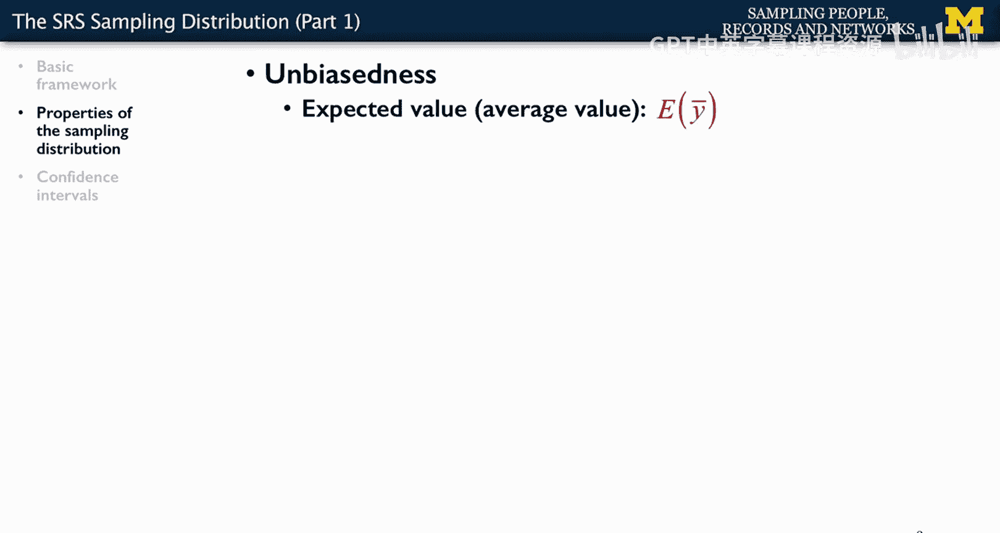

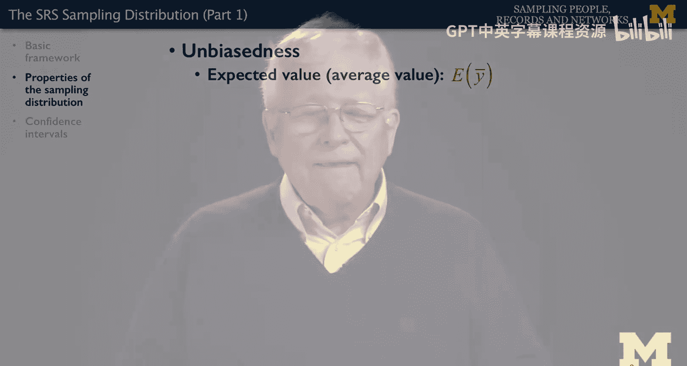

So E is a convenient notation to represent that。And the question is。

 what is the expected value of our mean。But we've only got one。What would it be， though。

 if we looked at it across all possible samples？

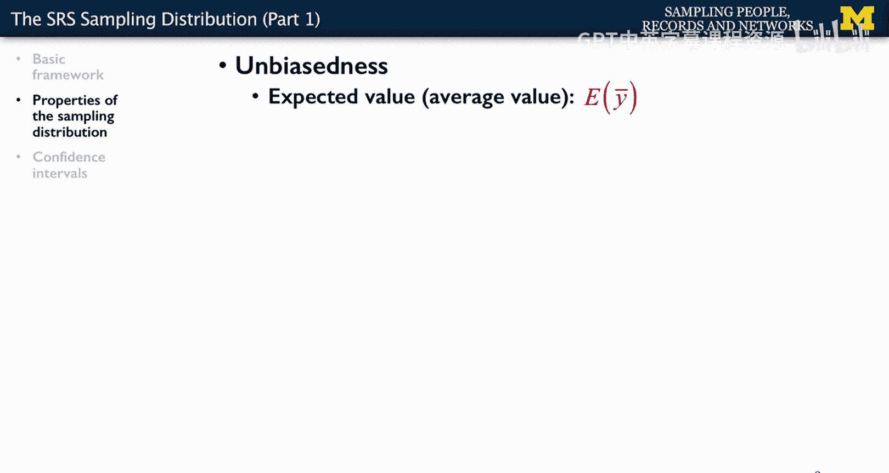

Now， you remember for simple random sampling that we had an expression for a way to calculate all possible simple random samples。

 It was a really big number for even the small problem we had。

 We had a population of 370 with 20 elements selected from it。 And there were just。

Lots and lots of possible samples that were there。 This is talking about getting the mean from all those possible samples and averaging them。

呃。Unless you got a really small population and small sample size。

 you couldn't calculate this directly， but you can express this in terms of algebraically an outcome。

 And so that expectation means something like the following。 So here's that expectation again。

 that E and then inheses Y bar。 We're worried about the mean and what its average value is across all those possible samples。

 So what we're going to do is get the mean of each of the samples。 And let's call those y bar sub。

 You see that on the far right hand side。

And so that Y bar sub S is a。A value from one particular sample。And。That particular quantity。

 Y bar sub S is going to be looked at across all possible samples and summed up。 Well。

 all possible samples。 That's our expression。Capital N choose lowercase N。 that combinatorics。

 That's the count。 That's the number of possible samples in simple random sampling。

 This won't be true in other kinds of sampling， but in simple random samples。

 And we're going to do is add them up。 That's that Greek letter sigma。

 that capital sigma from the Greek alphabet。 And then we're going to go a little bit further and actually divide that sum by the total number of possible samples。

So we're getting an average across all possible samples。 Now。

 nobody's going to be able to do this in practice。But we can show in theory。What this thing is。

 And it turns out that for simple random sampling， we get。

A very interesting result where this statistic that we're interested in。

This Y bar subs that we average across all possible samples。

Summing up across all possible samples and dividing by the total number of all possible samples。Is。

The population mean。Capital Y bar。That is， on average， we're getting the right answer。

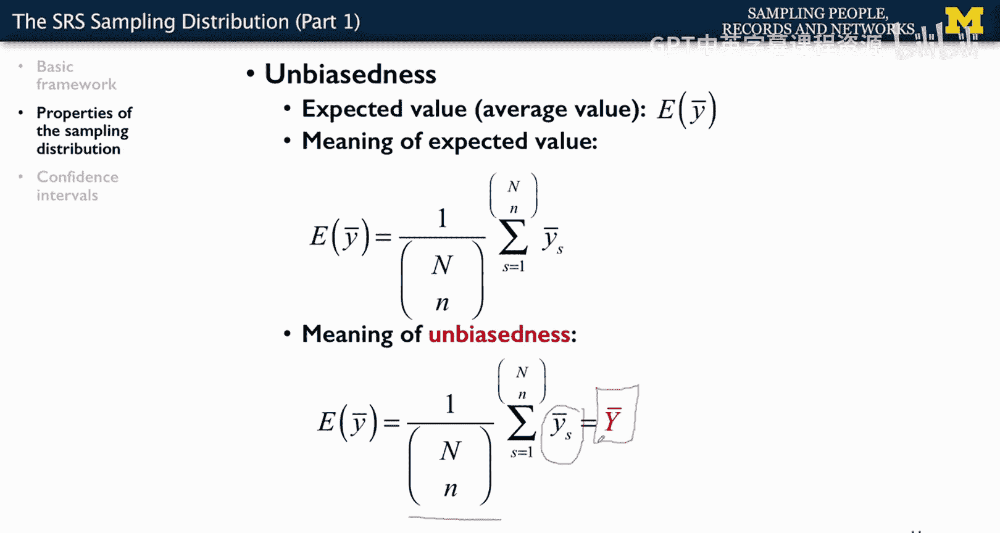

That's what we mean by unbiasedness。 We use the term un biasasedness in everyday language。

 But we think about it differently。 There we're talking about a particular phenomenon being unbiased behavior。

 a way of thinking here， we're talking about what's happening on average。

 So we wouldn't use this kind of language in in， in our conversations with one another。

 But in the statistical framing， this is what it means。

Simple random samples are unbiased for the mean。 They're unbiased for proportions。

 They're unbiased for a whole whole host of statistics， and that is a valuable property。 Now。

 we know that at least this process is centering on what we're trying to estimate。

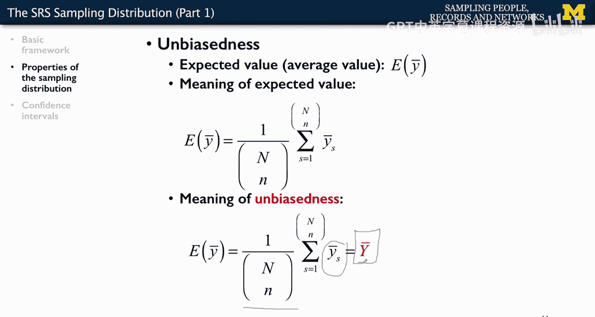

Well， that's only half the battle。 that tells us where we are in the middle。 But， you know。

 how far away are we。 What's the spread of those values。

So let's take a little break here because this is getting a little bit long and what we're going to do is continue on in our next lecture with the sampling distribution again。

 the simple round sampling sampling distribution， where we're going to look at that spread and then applying it to the idea of a coughs interval and interval。

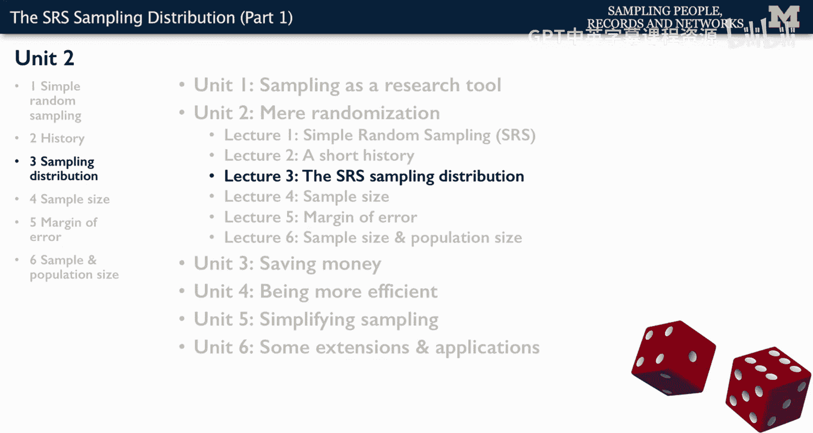

Let's turn to that next， thank you。

