# 密歇根大学《调查数据收集和分析（2-6：方法、社调问卷设计、抽样、缺失数据、分析）｜Survey Data Collection and Analytics》 p92 13_2.3 SRS抽样分布(下).zh_en -BV1fw4m1e7Zh_p92-

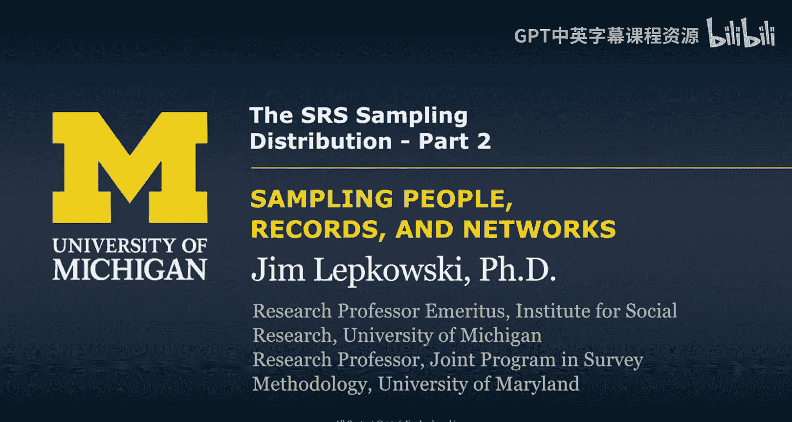

Welcome back。 I've taking a little break here in the middle of our lecture 3 of unit 2 in our overall course on sampling people。

 records and networks to continue our discussion then about。S R S sampling distributions。

 lecture 3 here under simple random sampling。 And you recall that what we were just talking about had to do with a property of simple random sampling with respect to means。

 whether or not， on average， those means are the true population value。

 And we had to find something called an expectation。

 which was an averaging across all possible samples that we could imagine， Oh， well。

 that exist in in theory， at least， And now what were going to do is talk about now that we know that on average。

 we're going to be centered right at the truth population mean that we want to estimate what spread and values do we have。

 So we're going to talk about standard errors and cough intervals。

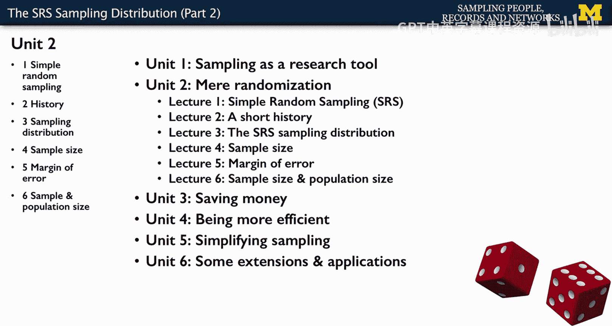

And here we'll go back and recall something that we did when we looked at simple random samples。

 and we looked at our own particular simple random sample and talked about a standard error。

 a standard error where we calculated a sampling variance from our one sample。

And we used a formula there。 and I'm just showing the formula here。

 It doesn't really matter that we don't have to memorize this or learn in particular。

 I just want to go back to it。 There is a way to take the information in the sample and compute what the variability is across all possible samples for these centered。

 centered on the population value， sampling distributions under simple random sampling。

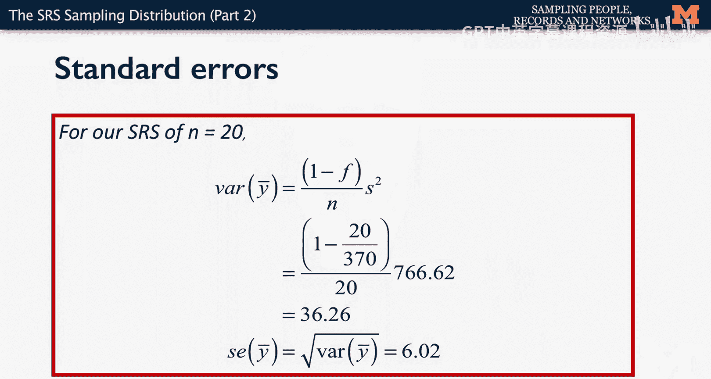

Now， how do we know that， Where does that come from， I mean， that's just a formula。

 Did somebody just invent this， and then they tested it out and got the right answer。

 Did they simulate this。No， they did the same thing we were just doing with respect to unbiasedness。

 They raised the question。 and They said， well， what's the variability from one sample to another。

 First of all， let's call that something。 We're going to call that the variance of the estimator。

 The sampling variance of the estimator would be a better term。

Now， rather than call it E for expected value， we're going to call that var。

 This is a notation that is not widespread in statistics。

 but I thought in a course like this this a little bit better。

 var capital V A R capital V to say this is the true spread of all those those means。

 We're going to calculate that variance。 And how would we calculate。 Well， by definition。

 here's what we're going to do。 We're going to take this mean that we've gotten from each one of our samples。

 There it is， again， There's our Y bar sub S。

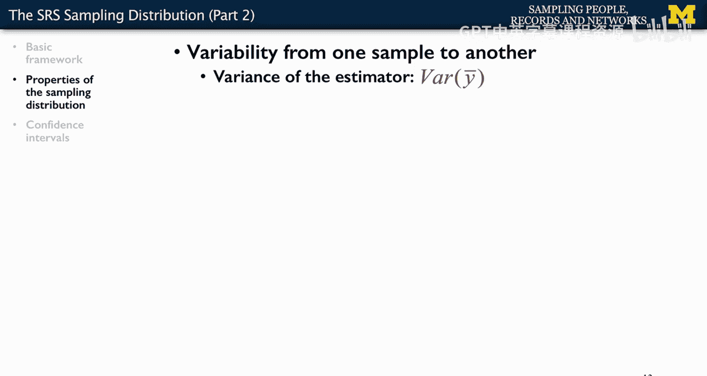

And what we're going to do is compare it to the expected values。

 So the expected value is the population mean。 But this is in theory。 now。

 we don't know what that value is。 That's what we're trying to estimate。 That's our parameter。

 when we're going to compare each of our sample means from all those billions and billions of samples that we've got。

 possible samples。We're going to take the deviation and we're going to square it。

 and we're going to add it up again， across all possible samples。And then average it。

 divideide by the total number of all possible samples。

 It looks a lot like that expression we just had， except now here。

 we're not just averaging the Y bar sub S。 We're averaging its deviations from the middle of the distribution。

 the expected value of the distribution。

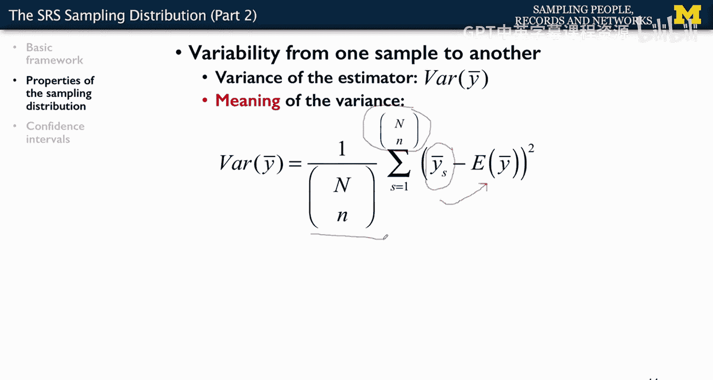

That's the definition of this thing。Inoperable that that helps us not only to understand the principle。

 It doesn't tell us how we're ever going to get a value for that， how we're going to estimate that。

 unless we do all possible samples or a large number of samples。 Maybe we sample from the samples。

 we do instead of doing one sample， we do 10 samples or 20 samples。 And we。

 we calculate an empirical estimate。 that would be one way to do this。

 But it turns out there's a shortcut。 that's algebraically equivalent。

And the algebraic equivalent is that formula that we just gave you。

 that formula that we were just looking at in which we。

Said the sampling variance。I'm highlighting that。 That's on the left hand side。

 that capital V A R Y bar， the thing that we just defined above is algebraically equivalent to。

If I take that expression for the mean， it's algebraically equivalent to。

1 minus lowercase n over capital n S squared over n。

 That thing on the right hand side that we just sort of gave you from before。

 That's the algebraic equivalentence of that messy formula in the middle。 Now， how do we know that？

 Somebody did the algebra。 Oh， we do that in proofs， We do that in the proofs or demonstrations。

 if you will， in， in the theory version of a course like this。

And show how that thing arises in practice。

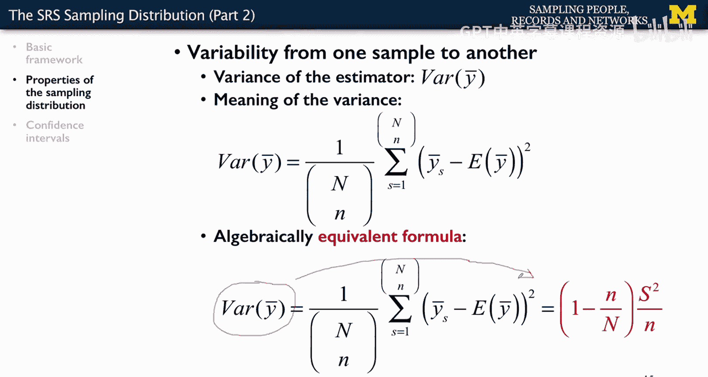

Now， that kind of thing we didn't discuss very much。 but now I I want you to understand。

 It comes from a definition。 It comes from that definition of sampling variance。

 It comes from our imagining all possible samples， and then calculating these deviations of the results of our sampling processes。

 or imagined ones。 And we get an expression that doesn't require us to know all possible samples。

 It requires us to know three things。 It requires us to know the variability of the elements in the population。

 Now that's not an easy thing to get at。 We don't have the population values。 We can't get at it。

 but we could mimic it from the sample。

But that's one of the components。The second component is that odd multiplayier out in front。

1 minus lowercase end over capital N。This is often called the finite population correction。

The finite population correction， some people abbreviate that and you may see it。

 it's just useful to know， they'll abbreviate this as the F for finite。P for population。

C for correction。Now， they'll also write it as 1 minus F。

 F is the fraction of the population that's in the sample。 So 1 minus that fraction。

 That's what that FBC is。 It pops out in that formula。 It comes out of the algebra。

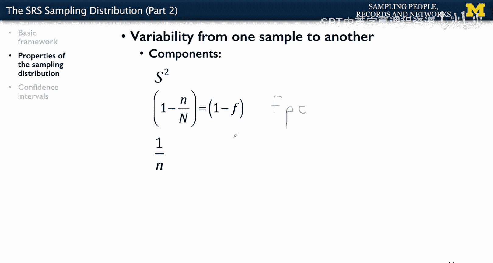

It turns out its origin has to do with the fact that when sampling from a finite population。

 you get some unexpected effects。 If you sample from an infinite population， Oh， without replacement。

 Remember， we're doing without replacement sampling。

 We're not allowing the same element to be duplicated in our sample。

 The same element is selected more than once。 We set it aside。

 we keep going till we have lowercase and distinct elements。Okay。

 so that's a multiplier that one minus F， that1 minus lowercase n over capital n is a multiplier of the S squared。

 And as the sample size is large relative to the population size。

 then that fraction is large and one minus that fraction is smaller。

 And so it sort of reduces the impact of the S squared。

There's one more piece to it， though。 And that is， the whole thing is divided by。N the sample size。

 And this is the key。This is the key to understanding what's going on in practice。

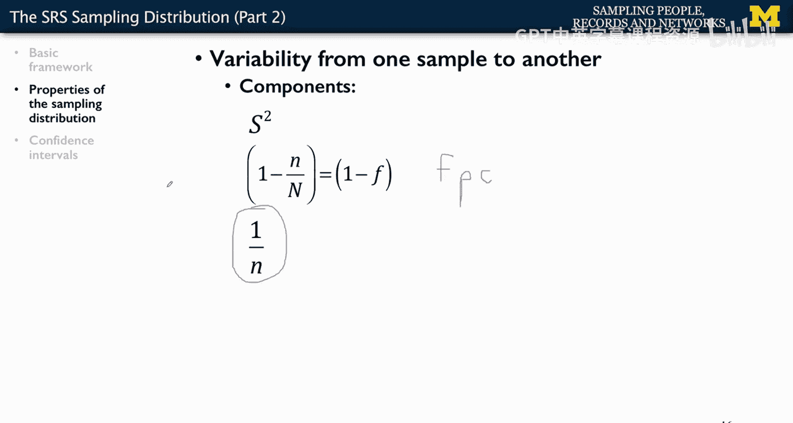

So that。As the sample size could be different values。The sampling variance can be different。

If we have a sample size 20 and a sample of size 40 to consider。

 we know that the sample of size 40 will have smaller sampling risks， be smaller variability。

 That is the range of the spread of values that we're going to be dealing with will be smaller。

Because we're dividing by lowercase N。That 1 minus F is a relatively minor correction。

 we'll deal with that in an upcoming lecture， But that one over n is the key。

 It's going to take that S squared， which is the same。

 no matter what sample I draw and divide by N and the sample could have different sample sizes。

 and as the sample sizes increase or decrease around various values。

 that variance is going to increase or decrease。 Well。

 decrease or increase in the opposite direction。 What I mean by that is。

 if you can see this little drawing here。

OfThe horizontal dimension to sample size going from small sample to large sample as you move from left to right。

And the vertical dimension is the sampling variance。 And so as we move increasing in sample size。

We see that we are decreasing in sampling variance。 Well， that's the role of that one over n。

 It's tempered somewhat by that finite population correction， But S squared is S squared。

 no matter what sample size we draw。

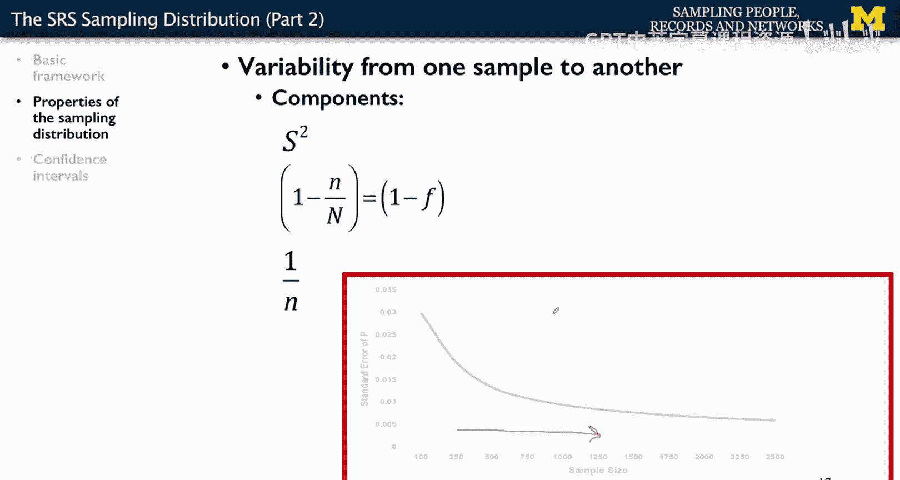

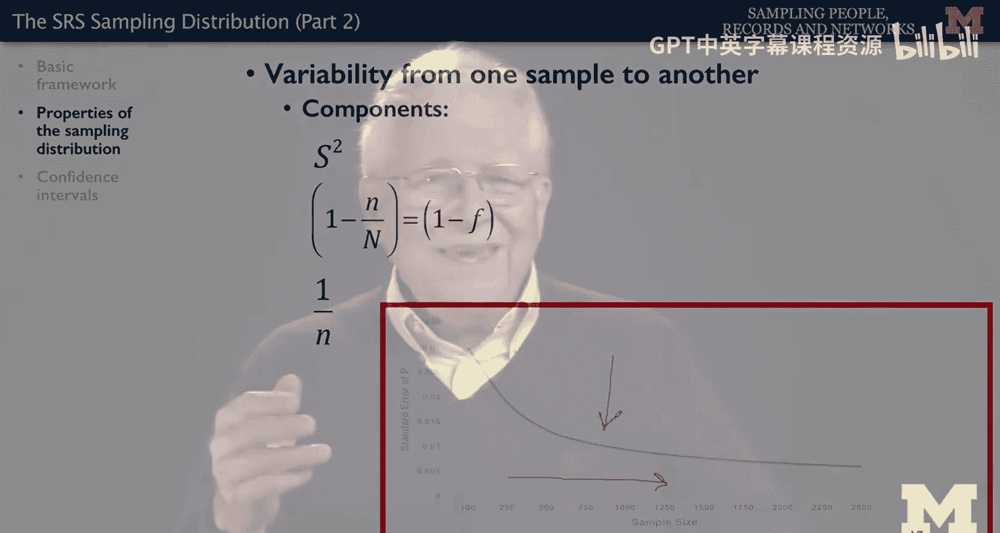

And so the variance decreases， now actually what I've got here is the standard error。

The measure of precision that we've got to use when we want to think about our estimates。

 But it's the same kind of relationship for the variance in that way。

Why do we have to deal with that standard error because we're on the wrong scale？

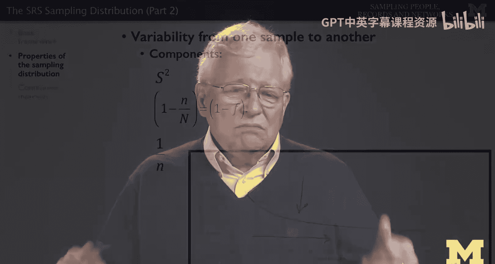

If our y variable happened to be income， it's， it's in dollars。 It's in euros。 It's， it's in yuan。

 it's in some currency。The， the mean is the mean of that currency。 So a mean income of $50000 or。

45000 or whatever it happens to be。 But the sampling variance would be in dollars squared。

It's all on the square dimension。 I I personally would rather be paid in dollars square than in dollars。

 but it， it's not a reasonable measure。 So we convert back in a way。

 we take the square root of the variance in order to get to a standard error。

 And that's what we're showing here。 It's just the square root of that expression。

And this is the quantity that was shown in that plot on the previous slide。

 decreasing standard errors as the sample size goes up。And gradually decreasing。

 more and more gradually decreasing as you get to larger and larger sample sizes because they're having less and less of an overall impact。

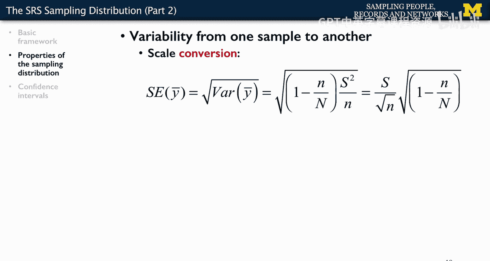

Okay， now。This is a lot of notation， a lot of formulas。 And we warned you it was coming。

 but it's not so important。 The formulas is to understand what they represent。

 They're very compressed ways of expressing some important ideas for us to understand。

 And what we've observed here is that for our particular phenomena where we're dealing with a certain variable that has variability in the population。

We'll call that S squared or S in the standard error domain。As the sample size。

 actually as the sample square root of the sample size。Increases。

That standard error goes down because the S doesn't change。 It just to the sample size。 it changes。

 and it's tempered to a certain extent by that finite population correction， the square root of it。

That's the thing to remember about what's going on here。

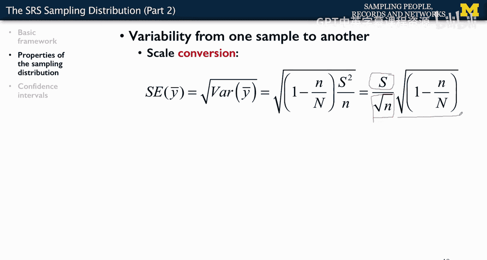

And that will help us in our design decisions。But theres one key part of this that remains to be resolved。

 And that is， this is fine in theory。 But what do I do in practice。 I don't have S。

 Where am I going to get it， Am I going to get it from a census。 If I going to do a census。

 then why bother with the sample。 Is there any way to get that S from the sample。

 Because when I have the sample， I will know the sample size。 And for simple random sampling。

 I know the size of the list。 Now， we'll deal with some situations where I don't know the size of the list later。

 But here， I know the size of the list capital N。 And so I have all the elements to compute except S。

 And so what happens then in practice is that we estimate the variability from one sample to another。

 There's an element variance that we need to have or or it square root。

 what's called a standard deviation。

And what we're going to do is compute an estimate of that element variance from the sample and substitute it。

 Now， when we do that， this substitution， this is meant to be a lowercase S squared。

 And in contrast to the capital S squared， it's estimating the population element variance。

And it's calculated from the data the same way the one in the population is。

 but restricted the sample data。 We only need the sample data to calculate it。

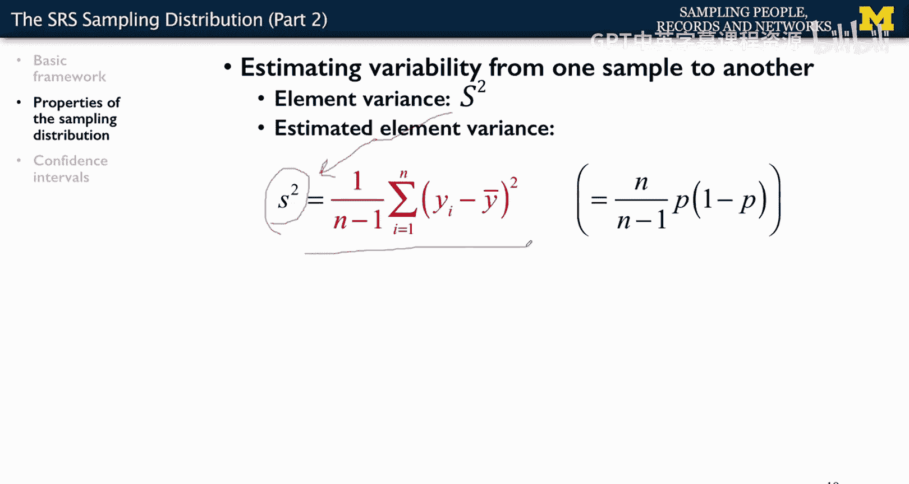

That means that if it's a good estimate， which it turns out to be actually， this lowercase S squared。

 I won't do the notation， but you remember that expectation。 On average。

 the little S squares that we're computing， and there could be one for every possible sample we select。

 If I average those， they turn out to be capital S squared， lowercase S squared。

 The sample element variance is unbiased for the population element variance。

Okay， now I've got a little notation off to the side in the survey realm。

 proportions tend to be widely used in terms of some of the data collection where they're collecting data in questionnaires and they ask for responses across a scale。

 certain categories。 And so a lot of people will convert this and start writing these expressions in terms of the proportions。

 when it's a proportion， that is the variable is one， if you have the characteristic 0， otherwise。

 One， if you hold an attitude 0， if you don't。That kind of thing then allows you to take the proportion。

 and。Calculate the S square directly from the proportion and the sample size。

 So that's just an annotation to remind me to say that to you that in the literature。

 in the actual application， when dealing with a lot of proportions in a survey。

 people will tend to write this in that particular form。

But what happens then is that we get estimated sampling variance。 We worry about now。

 not so much the。

Capital V AR， but the lower case， V A R， the A Rs is is lower case still。

 but that first letter is shrunk from capital to lower case。

 And that's because it's now derived purely from sample information。 It's a sample quantity。

And that sample quantity looks exactly like the one we saw before。

 There's our finite population correction，1 minus lowercase n over capital n， that 1 minus F。

 There's our division by n。 But now what we're doing instead of using capital S squared。

 we're substituting lowercase S squared。In order to get a calculation and we'll do the same thing in the sample。

 we will multiply all this stuff out if we have a proportion and get a different expression that allows us to work with just the proportions。

This， if we go back to what we talked about in unit 1 is key。

 Being able to make that kind of an estimate。 Now， let's go back to the progression。

 We had a definition for the sampling variance。

We took that definition and did some algebraic manipulation and got this funny expression。

1 minus lower K n over capital n S squared over n， capital S squared over lowercase n。

And now we've estimated the capital S squared to get an estimate of that sampling variance。

 Now from one sample。

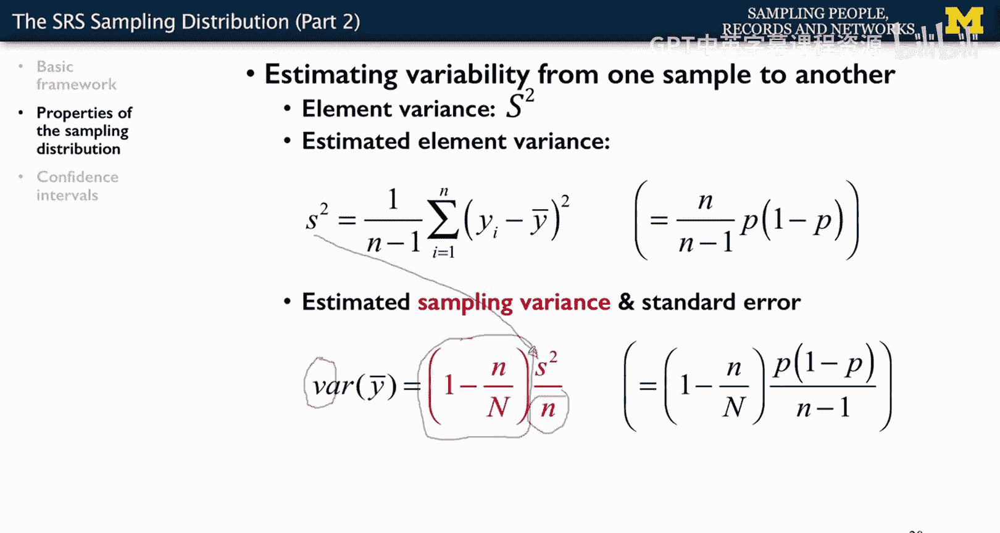

We know that because of simple random of sampling， that sample mean is on average。Correct， unbiased。

 And we have a way to estimate the spread across all possible samples。

 the variability of all of those those estimates。So we've got a very powerful set of tools。 And oh。

 there's one more step。 Of course， we'll go to the standard error。 Actually。

 there's two more steps because we're going to calculate a standard error here。

 and we're just going to replace capital S with lowercase S。

 Take the square root of that element variance。 And this is what many people will refer to when they talk about precision。

The precision of the sample， they're really thinking about not so much the variance。

 but that standard error， How large is it and how precise is my estimate。

 Small standard errors are better。

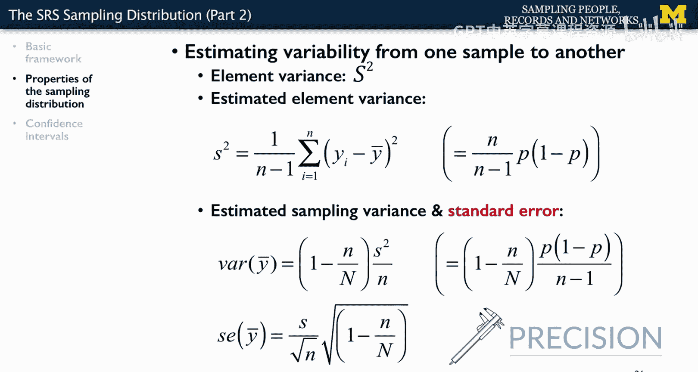

But they go a little bit further than that。 And we， we've seen this already。嗯。

It turns out that that y bar that that sample mean that we've got has another property。

And that is， because it's based on a sum of the sample observations for large enough samples。

That y bar is normally distributed。 The The shape of that sampling distribution of those values is that bell shaped curve that we looked at before。

That normal distribution。And allowed naamen under the law of large numbers to define a cop interval。

 He formed an interval with that precision measure。 He took that precision measure。

 I know it looks like leading reading this from left to right that this is all about the mean。

 This is all about the proportion。 This is all about the statistic。

That that it looks like we're centering about the y bar。

 But really what's key here in understanding is that we're taking the estimated precision in our sample。

And we are applying it to the mean。 We're saying， how uncertain are we about that mean。

 We've got a certain multiplier here。This has to do with the normality。

 The Z is a standard statistical way of expressing numeric statements。

 numeric values from the normal distribution。 And this is defined or derived in terms of our cos intervals to represent a particular set of values。

 but it's multiplying times that standard error。 And if the standard air is really big。

 we got wide intervals。 If The standard air is really smaller， we got narrow intervals。

 that gives us the the sense of uncertainty about the quality of our estimate。

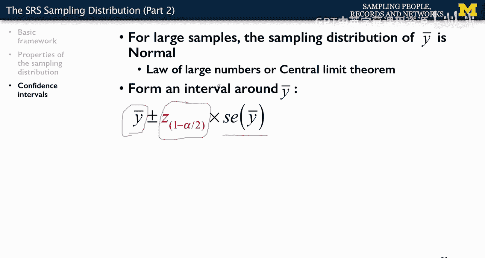

Now。For large samples。 Now， Y bar is normal。 we use the central limit theorem。

 There's actually several different labels for this。

 The law of large numbers to form an interval around y bar。 And you'll notice here。

 I've replaced the y bar or the Z statistic that we were looking at before with 1。96。

 their particular values for Z， depending on the compant level。 And in this case。

 we have a 95 per cent co level。 That is 19 times out of 20。

 We think that our true population mean will fall in this interval 19 times out of 2019 samples out of 20 that we would do from that sampling distribution。

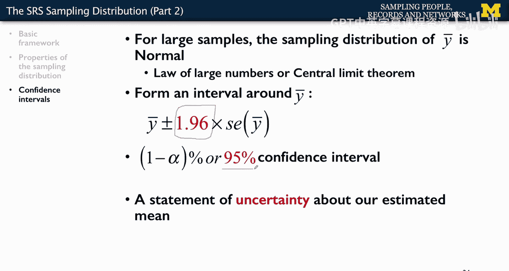

Well， at least on average， that's what we're going to get。

And so 1。962 round that up to2。 I know that a lot of people like to stick with that and say， oh。

 I don't know that I should round it because it's a precise value for the normal distribution。

 But for quick calculation， back of the envelope calculations，2 is sufficient。

And now what we've got is a statement of uncertainty。

 Our statement of uncertainty says what our uncertainty level is。 Oh，5 per cent uncertainty。

 It tells us what an upper and lower limit are around a central value。

 And this captures for us the essence of our sampling problem。 Now。

 this is a way of making a statement about our estimate that captures the quality of what we're doing。

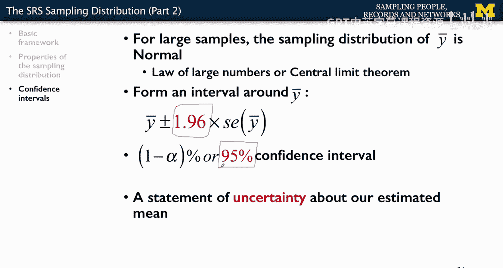

So we did this before， right you recall for our simple round sample of size 20， we saw this。

There we did something slightly different， but we did the coughoffs interval。

 and we did calculations for this。 And in doing those calculations for the cooffs interval。

 we did our Y bar。And our standard error of wide bar。But we had a Z value that was used。

And it turns out that the Z value has a problem when our sample sizes are not large and sometimes our sample sizes are not going to be very large。

 And so we need to take that into account that the sample size is not very large。

 And so a T statistic is used。

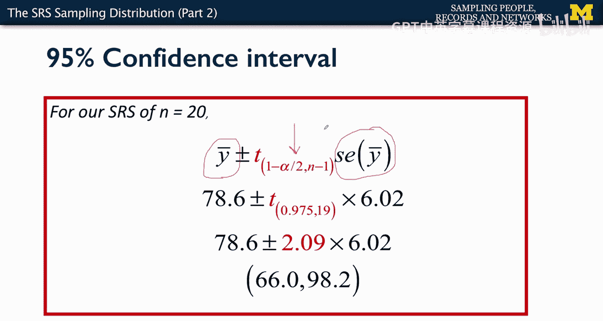

Now， we won't。We don't have time to go into what's the T distribution。

 It's very closely related to the normal As matter of fact， when we have really large samples。

 the T is the normal。Or the normal is the tea。 howeverever you want to say。

 The tea is just there when the sample sizes get smaller。 and。

 and usually you start seeing the tea different from the normal and the sample sizes start getting smaller than 100。

Then you start seeing more substantial differences。

So this is a quantity that's typically used in these coughs intervals when you're being careful to take into account small sample sizes。

But nonetheless the less， the bottom line down here is whether we use the Z or the T。

 a cough interval。That represents our uncertainty。 Now。

 there's a lot of uncertainty in this estimate。 This was our。

 our sample in which we were estimating incomes of faculty members。

The population of 370 faculty members and we go from 66 to 98 that's a pretty broad range。

 we're not real certain what that value is and 19 times out of 20 we think it these kinds of ranges are going to capture it。

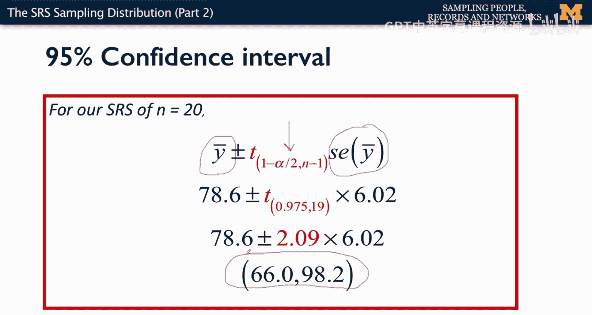

But。That range is pretty wide if we wanted to do a better job。Have less uncertainty。

 We can attack that problem by attacking the sample size。

We can specify a sample size that will narrow that to even a pre specified amount。

And that's what we're going to do in the next lecture。 We're now going to turn。

 given this understanding of sampling distributions， understanding of expectations。

 of sampling variances， of estimating sampling variance， of estimating standard errors。

Of calculating cough intervals， we're going to take that and apply it to the problem of calculating a sample size to get us a pre specified level of uncertainty。

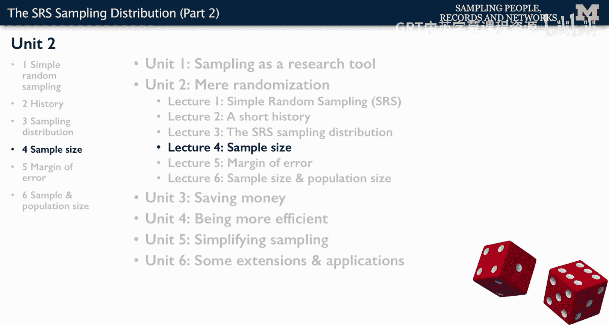

That's the interesting design problem。Yes， the calculation， the estimation is all important to do。

 but。Our purpose here is to think about how to design these data collection studies。

 and this is a key part of them。So join us in the next lecture in lecture 4 where we discuss sample size for simple random samples。

 Thank you。

