# 调查数据收集和分析：2-3：SRS抽样分布（下）📊

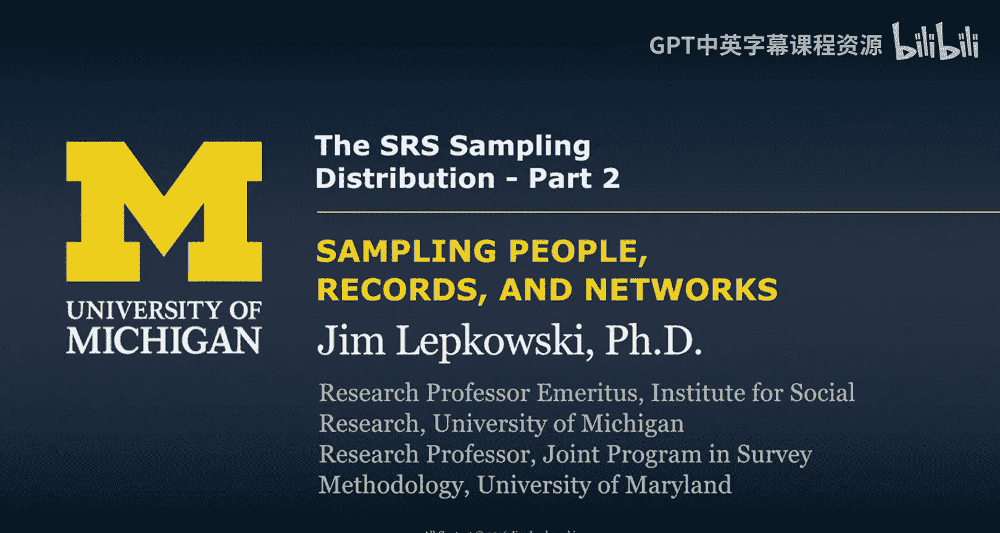

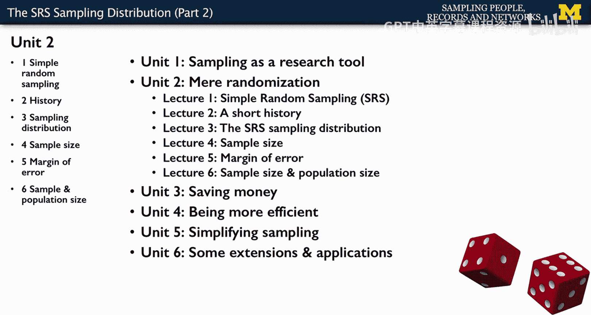

在本节课中，我们将继续学习简单随机抽样（SRS）的抽样分布。上一节我们讨论了样本均值的**无偏性**，即从长远来看，样本均值会围绕真实的总体均值波动。本节中，我们将深入探讨这种波动的**幅度**，即抽样分布的**离散程度**，并学习如何计算**标准误**和构建**置信区间**。

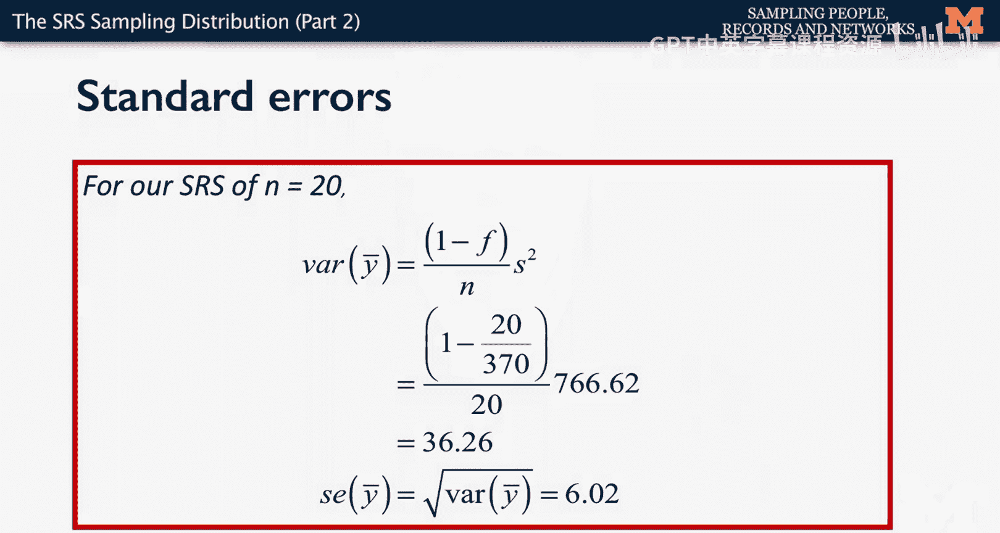

## 抽样方差与标准误

上一节我们介绍了**期望**的概念，它描述了估计量的中心位置。现在，我们关注其离散程度，即**抽样方差**。

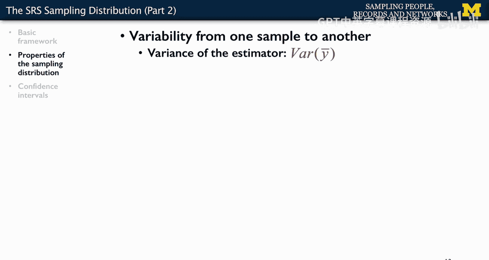

抽样方差衡量的是所有可能样本的估计值（如样本均值）围绕其期望值（总体均值）的波动大小。其定义公式如下：

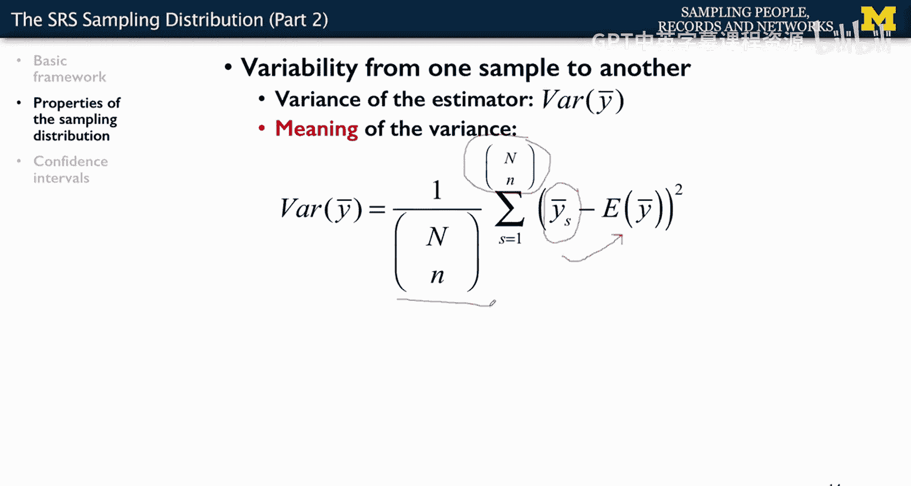

**Var(Ȳ) = Σ (Ȳ_s - μ)^2 / (所有可能样本的总数)**

这个公式计算了每个样本均值与总体均值之差的平方的平均值。然而，这个定义式在实际中无法计算，因为我们不可能获得所有可能的样本。

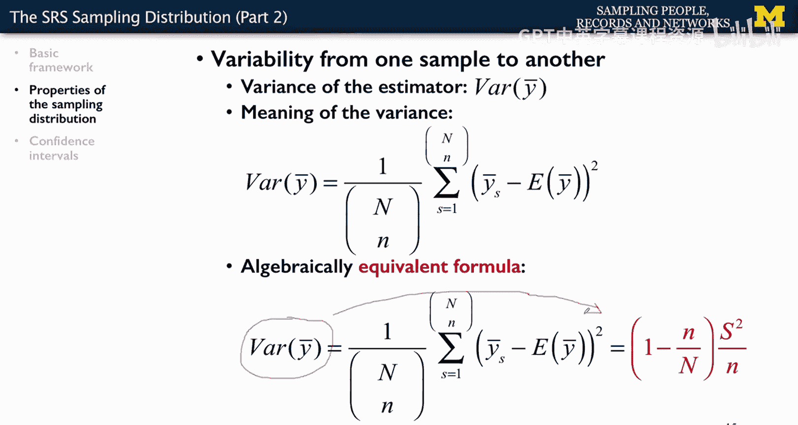

幸运的是，通过代数推导，我们可以得到一个仅使用总体信息（总体大小 N、总体方差 S² 和样本大小 n）的等价公式：

**Var(Ȳ) = (1 - n/N) * (S² / n)**

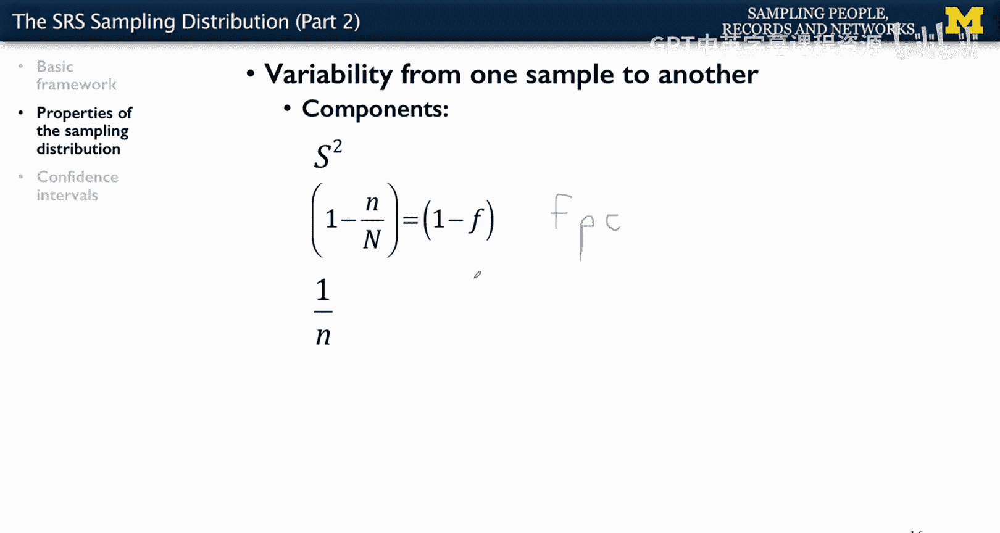

这个公式包含三个关键部分：
1.  **总体方差 S²**：反映了总体中个体的变异程度。
2.  **有限总体校正因子 (1 - n/N)**：当从有限总体中不放回抽样时，这个因子会减小方差。当样本量 n 相对于总体大小 N 很小时，它接近 1，影响不大；当 n 接近 N 时，它会显著降低方差。
3.  **样本大小 n**：这是影响抽样方差的最关键因素。**样本量越大，抽样方差越小**，估计越精确。

由于方差的单位是原始单位的平方（例如“美元²”），不便于解释，我们通常取其平方根得到**标准误**：

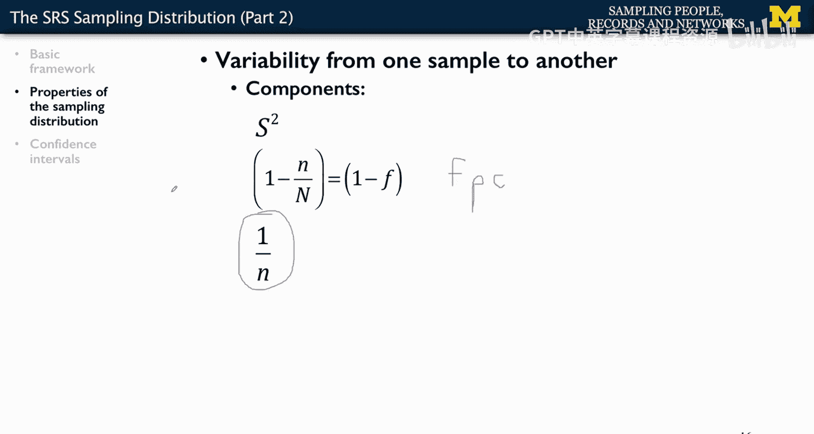

**SE(Ȳ) = √[(1 - n/N) * (S² / n)]**

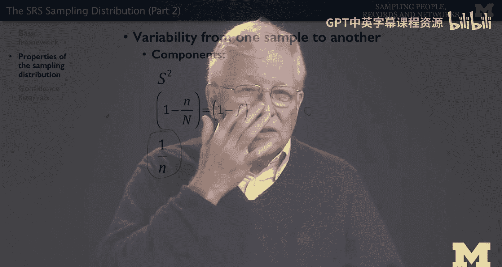

标准误与样本大小的平方根成反比，这解释了为什么增加样本量能提高估计精度，但收益会递减。

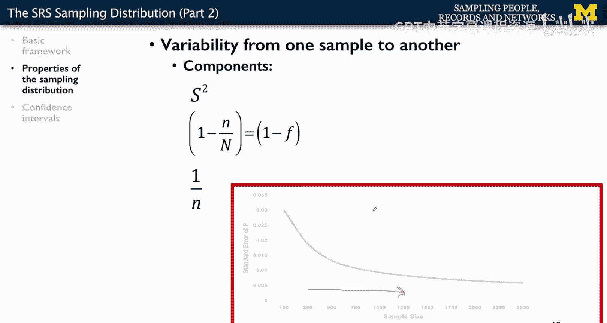

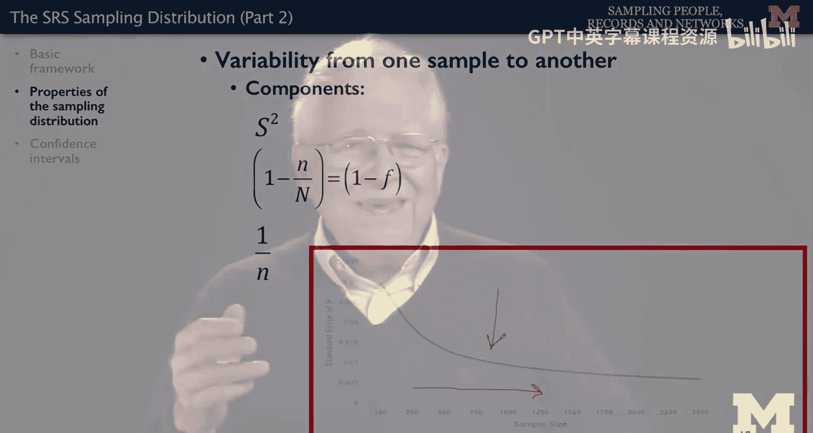

## 从样本估计标准误

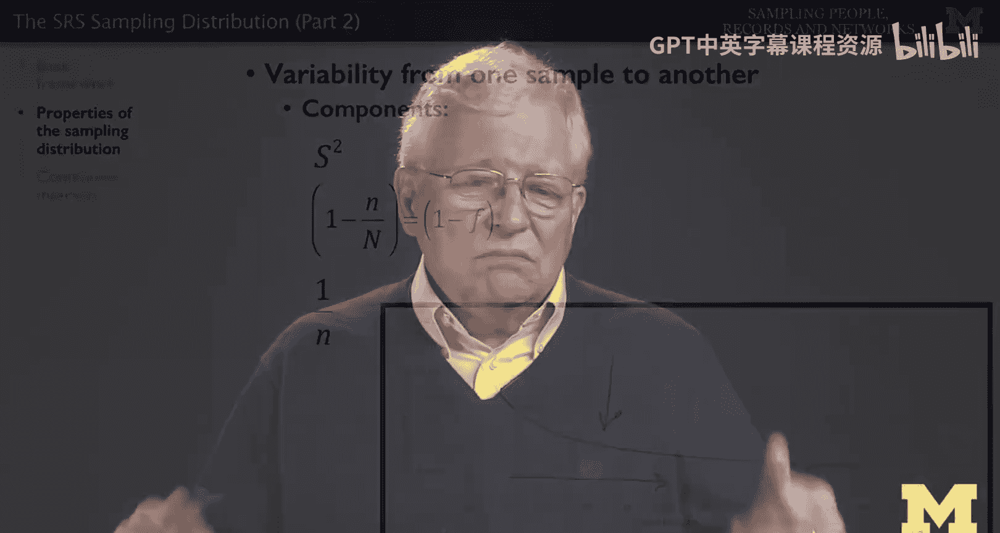

上述公式是理论上的，但在实践中，我们不知道总体方差 S²。解决方法是使用**样本方差 s²** 来估计它。

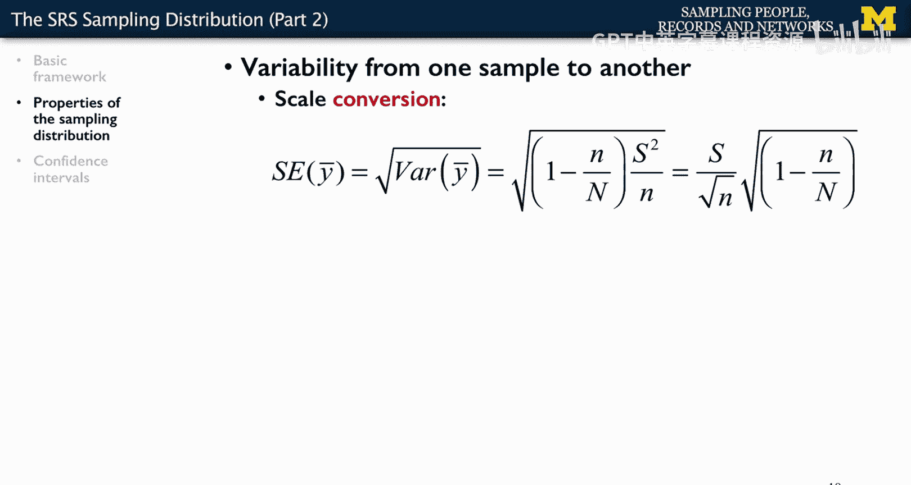

样本方差 s² 的计算公式与总体方差类似，但仅基于样本数据。一个重要的性质是：**样本方差 s² 是总体方差 S² 的无偏估计**。这意味着，平均而言，用 s² 来估计 S² 是正确的。

因此，我们可以计算**估计的标准误**：

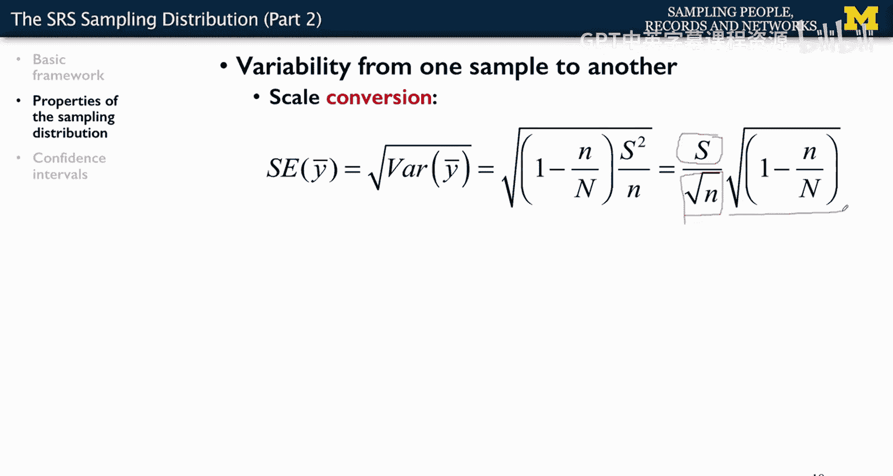

**est. SE(Ȳ) = √[(1 - n/N) * (s² / n)]**

这样，仅凭一个样本的数据，我们就能估计出所有可能样本均值的波动范围。

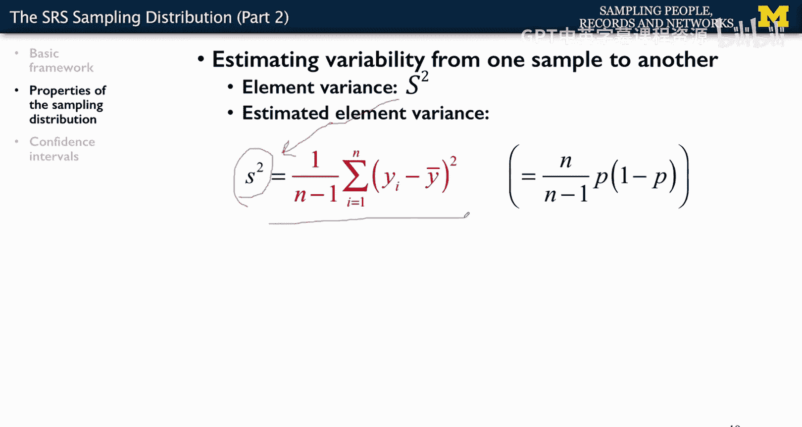

对于常见的**比例**估计（例如，支持某项政策的人口比例），方差公式有更简洁的形式。如果令 p̂ 为样本比例，则其方差估计为：

**est. Var(p̂) = (1 - n/N) * [p̂(1 - p̂) / (n - 1)]**

## 构建置信区间

知道了估计值（样本均值 Ȳ）和其精度（标准误 SE），我们就可以构建**置信区间**来表达估计的不确定性。

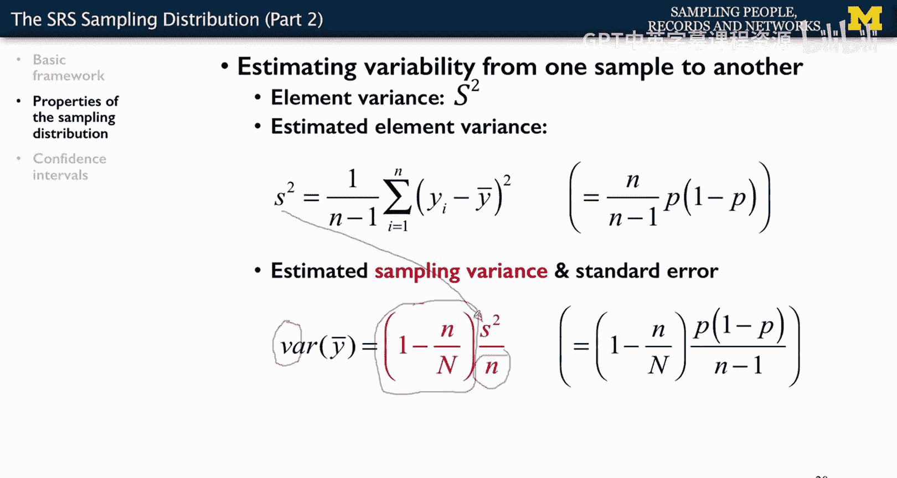

根据**中心极限定理**，当样本量足够大时，样本均值 Ȳ 的抽样分布近似服从正态分布。利用这一性质，我们可以构建一个以 Ȳ 为中心、以若干倍标准误为宽度的区间。最常用的是**95%置信区间**：

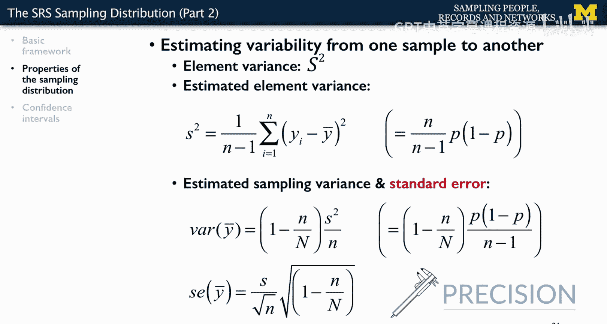

**95% CI = Ȳ ± Z * SE(Ȳ)**

其中，Z 是标准正态分布的分位数。对于95%的置信水平，Z ≈ **1.96**（为简便计算，常近似为2）。这个区间的含义是：如果我们重复抽样很多次，每次计算一个这样的区间，那么大约有95%的区间会包含真实的总体均值 μ。

当样本量较小时（例如 n < 100），正态近似可能不够好。此时，我们使用 **t 分布** 的分位数（记作 t）来代替 Z。t 值取决于**自由度**（通常是 n-1），并且比对应的 Z 值更大，从而产生更宽的区间，以反映小样本带来的额外不确定性。

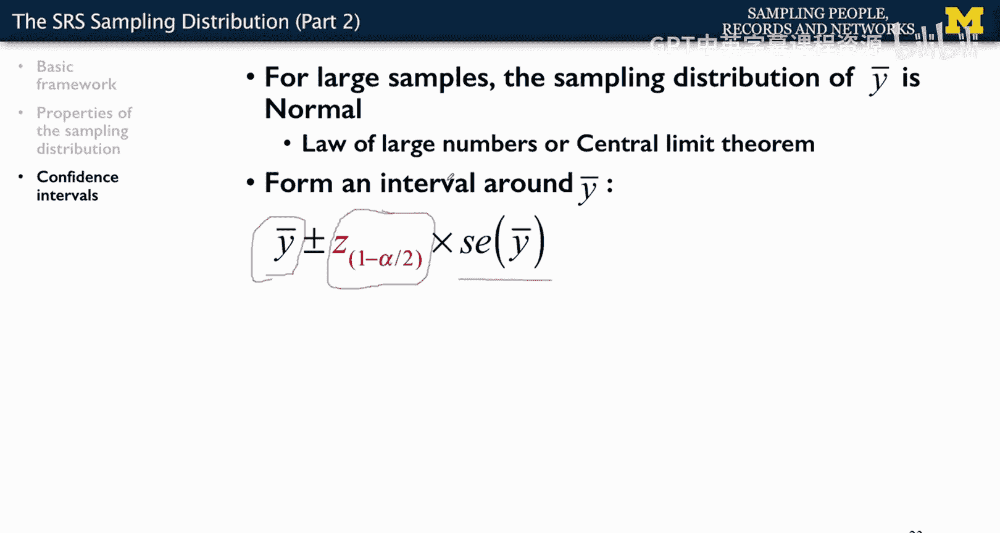

以下是构建置信区间的步骤总结：
1.  从样本计算估计值（如均值 Ȳ 或比例 p̂）。
2.  计算估计的标准误 SE。
3.  根据置信水平和样本大小，选择适当的乘数（Z 或 t）。
4.  计算置信区间的上下限：**估计值 ± 乘数 × 标准误**。

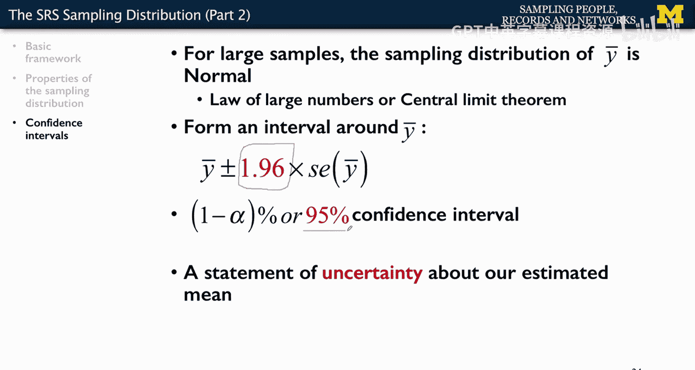

## 总结与应用

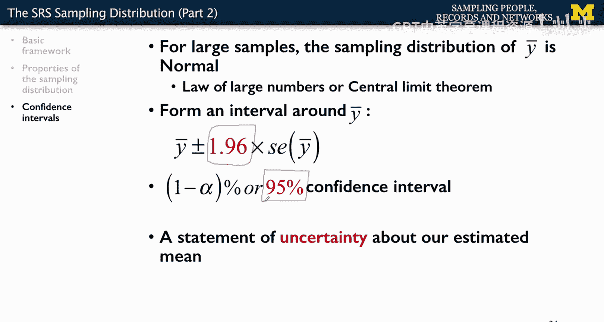

本节课中我们一起学习了简单随机抽样下估计量的离散性度量。

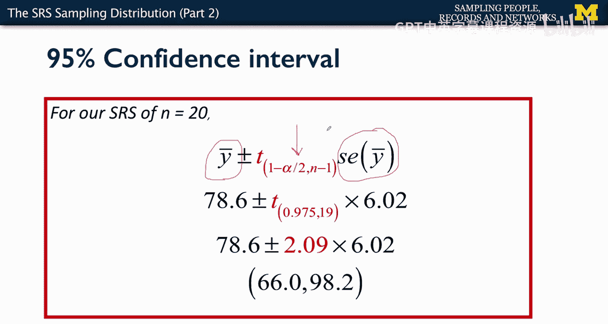

我们首先从定义出发理解了**抽样方差**，然后导出了其便于计算的公式，并引入了关键的**标准误**概念。我们了解到，标准误主要受**总体变异度**和**样本大小**影响，并通过**有限总体校正因子**进行微调。

在实践中，我们使用**样本方差 s²** 来估计未知的总体方差，从而计算**估计的标准误**。最后，我们利用抽样分布的正态（或 t）近似，构建了**置信区间**，这是一种量化估计不确定性并做出概率性陈述的强大工具。

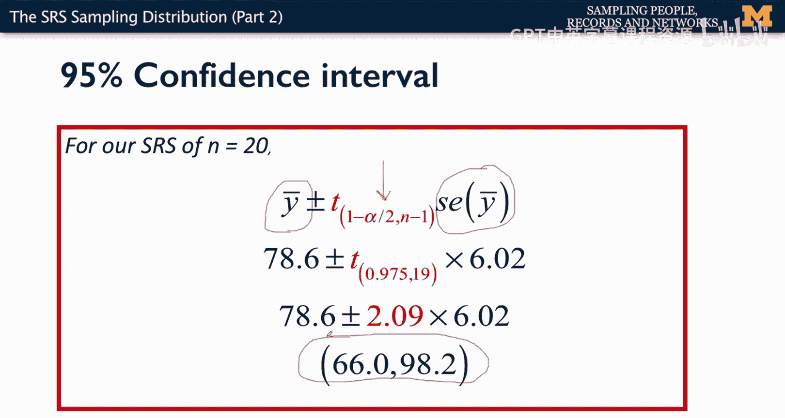

所有这些工具——无偏性、方差、标准误、置信区间——为我们解决调查设计中的核心问题奠定了基础：**如何确定样本量？** 在下一讲（第2单元第4讲）中，我们将利用本节课的知识，学习如何为简单随机样本计算所需的样本量，以达到预先指定的精度（如一定的置信区间宽度）。

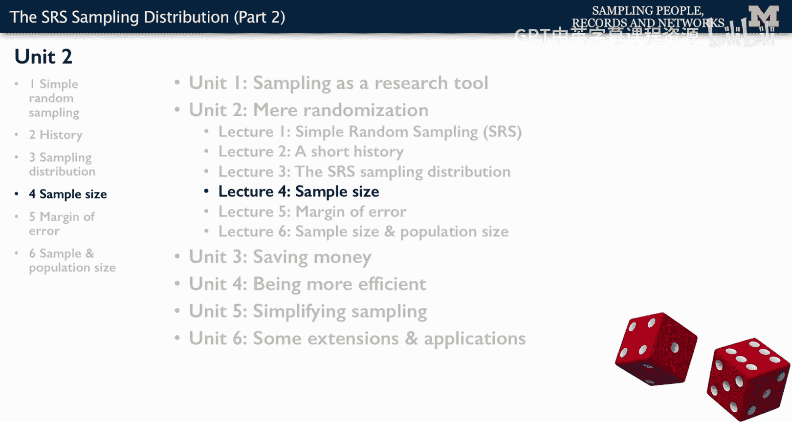

---
**版权说明**：本教程内容整理自密歇根大学课程《调查数据收集和分析》（Survey Data Collection and Analytics）第2单元第3讲（SRS抽样分布）的下半部分。课程视频编号 BV1fw4m1e7Zh，对应讲稿第92页。内容已进行翻译、梳理和教学化改编，旨在帮助初学者理解核心概念。所有图示版权归原课程所有。