# 密歇根大学《调查数据收集和分析（2-6：方法、社调问卷设计、抽样、缺失数据、分析）｜Survey Data Collection and Analytics》 p93 14_2.4 样本量确定.zh_en -BV1fw4m1e7Zh_p93-

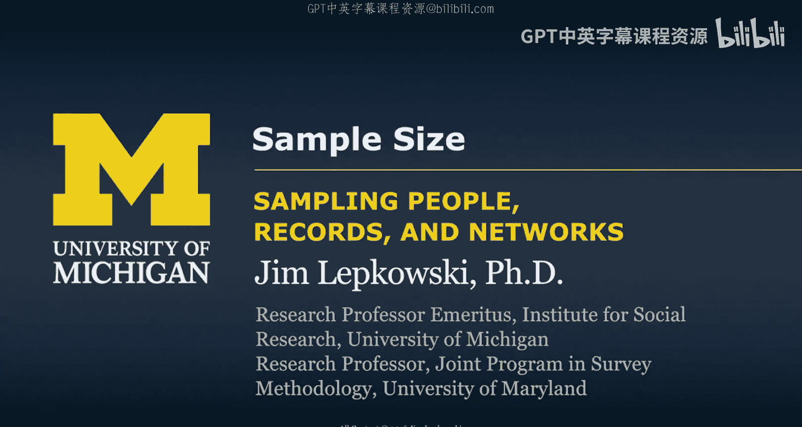

There's a problem that's difficult to grasp that arises once we understand how to do simple random sampling。

And that is how to plan the next one。And this requires working backwards。

 thinking backwards from what we've just been talking about。 So in this lecture。

 which is about sample size and simple random sampling in unit 2。

 This is our fourth lecture on sample size。 We're going to be going backwards now now that we understand something about the properties of the sampling distributions for simple random samples。

 Let's work through those kinds of formulas to say if I've got to figure out what I need to do to plan for the next area。

 I've got to estimate the cost。 I've got to figure out what is going to cost me， or maybe yeah。

 what it would cost me to do something to get a certain level of of quality in my data。

 a certain width of co interval， a certain standard error。

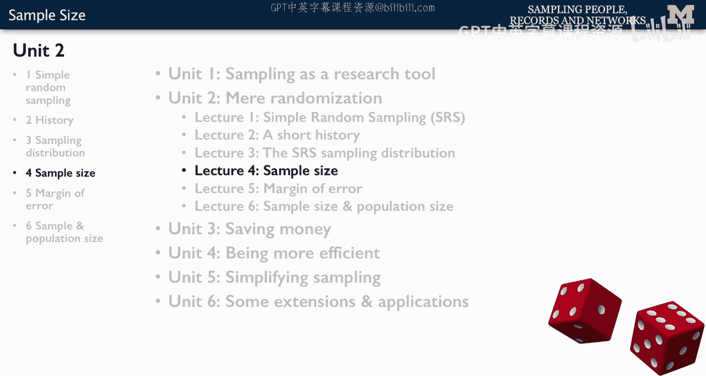

I've got to know the sample size， I've got to know how many elements they're going to be in the sample in order to do this。

And so what we're going to do is talk about three things here。

 we're going to talk about the background， some things we need to know in order to address this question of I'm getting ready now not to analyze a sample。

 but what's going to be needed to draw a sample。And we're going to be anticipating that this is leading to budget kinds of consideration。

 So in a way， in the background is cost， but we're not going to formally deal with cost。

 that's a different matter here。 We're just going to deal with that sample size。

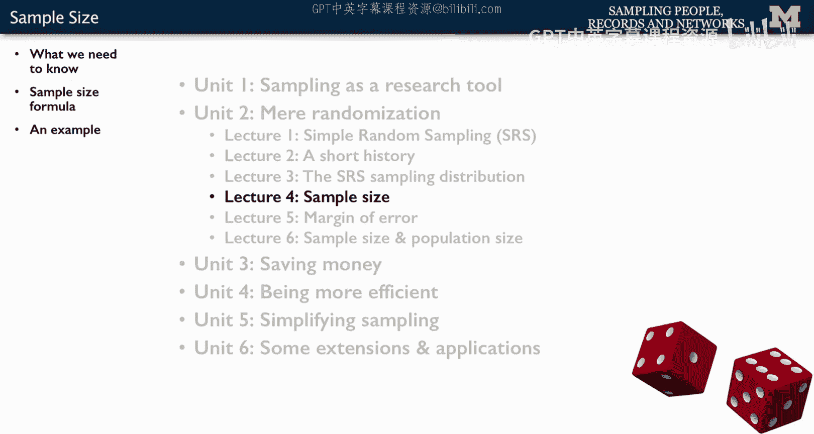

So what do we have to know what sample size are we going to calculate， is there a formula。

 how do I go about it， what's the process， and then go through an example。

So。The question we have is， what sample size do we need to use to obtain a given standard error of the estimator。

And turns out that there are two things that we need to know in this。

 One of these is the population variance。 Now， I just said we didn't know that in our previous lecture。

 We don't know what that S square is， but we estimate it from the data。

 We're going to have to get this from somewhere。 where we don't have a sample。

 but we're going to have to get data from a past census from a past sample survey。

 maybe even from administrative records。Using that data。

 we're going to calculate an estimate of that S squared。

 We're going to put it into Excel and calculate the variance of a bunch of values。

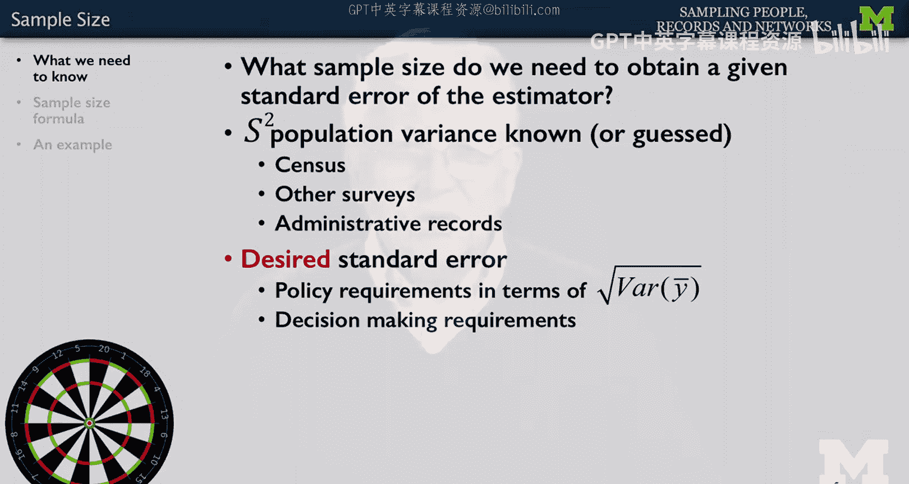

We're going to obtain a value for S squared， from our historic。Data collection， maybe not ours。

 We borrow it from others who published and reported those values。 That's why it's so important。

 These published findings。 I know there's all sorts of gamesmanship that goes on with publishing papers。

 but it really is to put in place data that others can use to plan new investigations。

And so here we're going to get a value of S squared from someplace like that。

 and I'll show you where it might come from in our example。

The second thing that we need is the target， What size， standard air。

 What precision do we want in order to have a satisfactory result。

This can be driven by considerations about the decision making that we're going to do with the data。

 So the size of that standard error， the quality of the estimates depends on what it is we have to make in decisions about do we need really precise estimates。

 Sometimes we we do。 In other cases， it's not so important to get really precise estimates。

 We're willing to live with things that are less precise because there are a phenomena that is large in scale and contrasted with another another phenomena that's quite different。

 So。

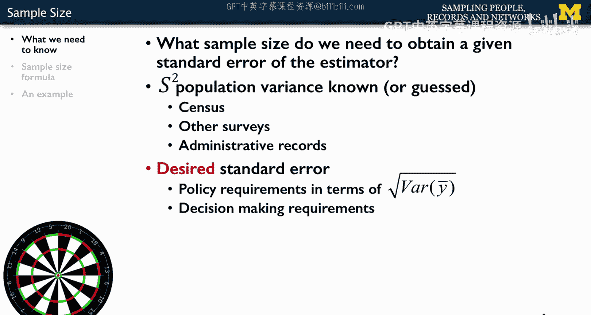

Decision making requirements are going to be a part of that as well。Now。

 I say these two parts that are needed because I'm coming back and thinking in my own minds about our formulas here that we just dealt with when we talked about simple random sampling。

 Remember our sampling variance。

Up in the upper right hand side involved a finite population correction。

1 minus lowercase and over capital N。An element variance， S squared。

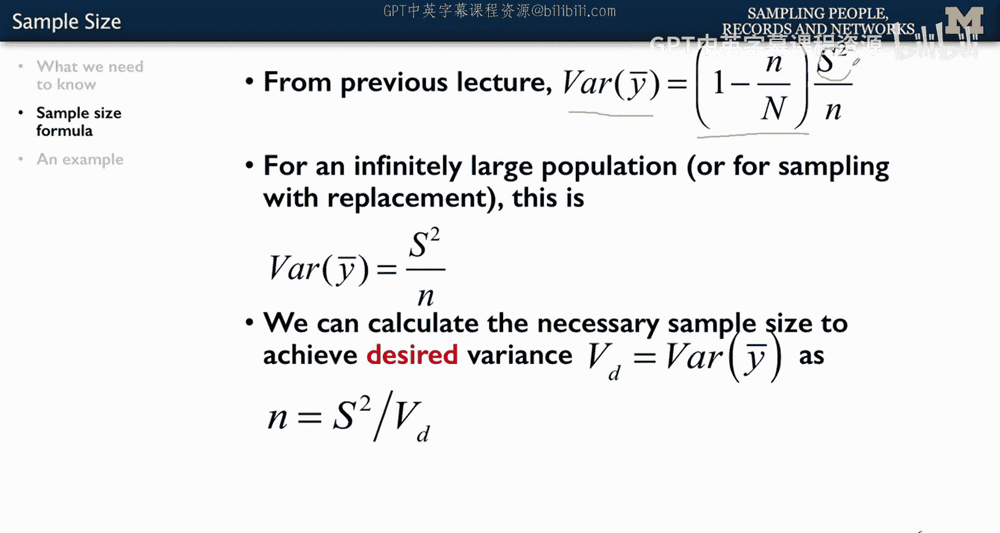

And dividing by a sample size。What I need to know is what's the sample size。

 I know the population size。 I know the sample size。

 What's unknown to me are the element variance and the target。

 What level of sampling variances do I need。

So。Just for the time being， let's get rid of that finite population correction。 Let's simplify this。

 because that thing's kind of a headache to worry about it。

 makes the algebra a little more complicated。 and just go with the sampling variance of the mean。

 that is without that finite population correction。

 because if if the sample size is a small fraction of the total population。

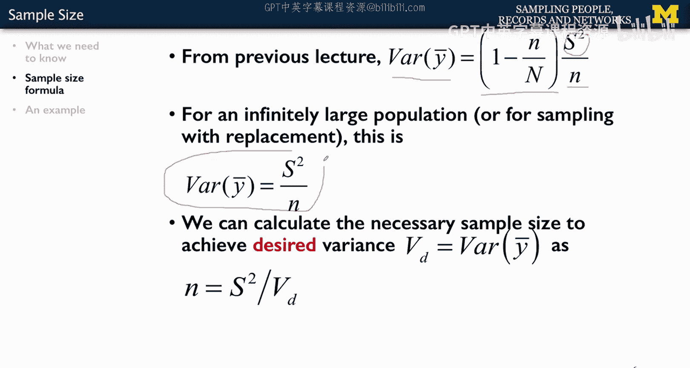

It's only 1% of the population or less。Then lowerrique center capital end 0。01 or less。

 That means 1 minus that is 0。99 or larger。 It essentially rounds to one anyway。嗯。

Let's just set a aside for the time being and figure out what we need here and when we look at the sampling variance expression involving escort over N。

 well， then it's very easy to do the algebra and say， well， look。

 the sample size just needs to be that element variance。

Divided by that variance。Oh， but I've replaced it with something。 I said， but wait a minute。

 it's not the variance。 It's not the actual sampling variance。 It is the desired sampling variance。

 So let me just call it a little notation just to remind us that what we're doing is。

a part of the process in which we have an object， a desired level of precision。

Let's call that V sub D。 Now， it may be that we started with the standard air。

 Well we squared to get that V sub D。 Maybe we've got the sampling variance。

 and we've got a cough interval。 we'll figure that out as we go along。

 But there is some level of sampling variance that we've decided is necessary。

 And so the sample size is just that element variance divided by that desired level of precision。

Now。We're not just going to ignore that finite population correction。

 It turns out that what we just did really was to take that sampling variance that we were just looking at and。

Essentially， absorb this finite population correction， The 1 minus lowercase N over capital N。

 In that expression， we just sort of moved it into the denominator of the denominator。

 We literally divided lowercase N by that value。And so what we really have down there is kind of a provisional。

Sample size that has already got embedded in it， that adjustment。

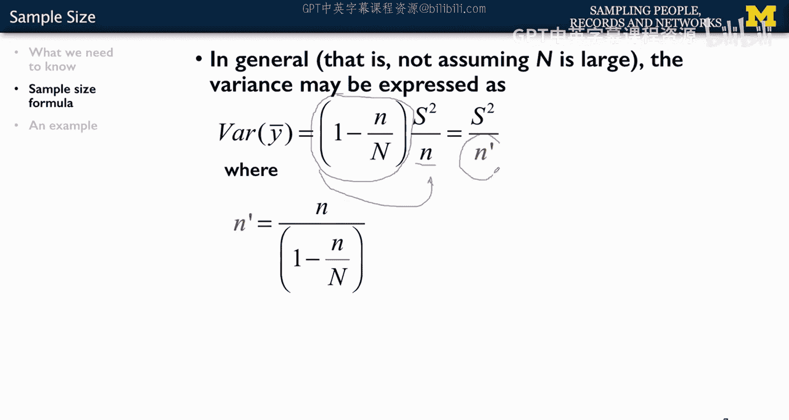

And that allows us then to work backwards。 It'll say， look。

 if we get a provisional sample size and prime in this case。

Then what we can do， we know what N prime is， but we want N。

 And so what we're going to do then is get the the provisional sample size。

 Let's call it the necessary sample size on this slide， the necessary sample size。

That's that end prime。And。We'll do our simple calculation S squared over that V sub D。

 that desired level of precision。 And then what we're going to do is calculate lowercase n。

By taking the end prime and plugging it into this formula。

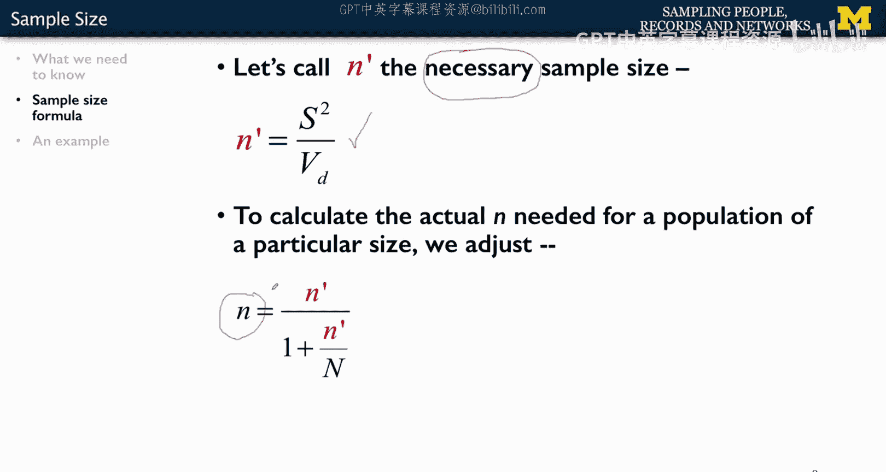

And if you， you， if you like just plugging into formulas。

 we used to call this plug and chug in my day。 then it's straightforward。

 We're going to get a provisional value and then adjust it。 and that adjustment involves capital end。

 and that's all we need to do。So that's the process。 But well， we need to go through it。 I mean。

 this is this is all notation， So we need to work through an example， but this is the basic idea。

 calculateulate a necessary sample size based on two pieces of information I'm going to have to have。

And I'm going to have to do some work here。 One of them is an element variance。

 The other is the desired level of precision， and both of them require work to obtain and assumptions。

And then when I've got that necessary sample size， I adjust it for the capital N。

 I adjust that for the capital end to get my sample size。 Well， let's look an example here。

Suppose of what we're interested in are attitudes， attitudes about political figure。

 And in this case， I've chosen attitudes about the current US president。

 the current president of the United States and how he is doing his job at the present time。

 it could be soon his or her job， how well they're doing and this is a question' has been going on for a long time。

 This goes back to the 1950s where Pauling began asking the public about their attitude their opinion about how well the president is fulfilling that role。

 So here's the way the question has been worded for the last for a number of years now。

 in many of these surveys， Do you approve or disapprove of the job Barack Obama is doing as president And if you approve or disapprove Do you approve。

 disapprove strongly or somewhat。

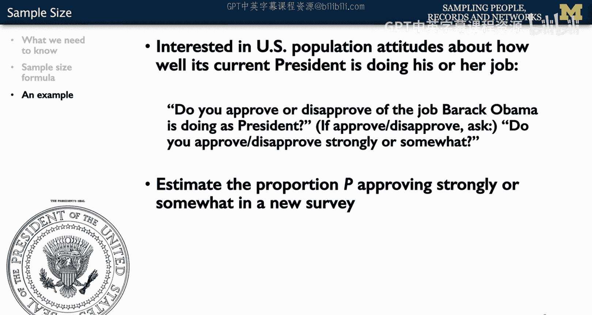

Now in those two questions you get four categories， you get， I strongly approve， somewhat approve。

 I somewhat disapprove， or I strongly disapprove a four category scale。

 and basically what we're going to do is convert that into an answer that is a proportion。

 the proportion approving strongly or somewhat in a new survey。Now， these surveys， as I say， that。

 that question sequence has been going on for a long time。 This is one example。

 there are other ways that this is asked， but is converted into a proportion。

 proportion strongly or somewhat approving of how the president is doing his or her John。Now。Suppose。

 as is in the case of President Barack Obama late in his term in office， his approval rating。

 that proportion， as is referred to as an approval rating， is about 60 per cent。

610s of the fraction of the people asked in the last survey said。

They think he's doing a good job， strongly or somewhat approve of the job。Now。

 it turns out that that allows us to calculate S squared from that past survey。

This is past survey data， roughly and approximately， if you recall what we were looking at。

 that is S squared is P times 1 minus p， the proportion times 1 minus the proportion 0。

6 times 1 minus0。6 or 0。24。There's R S squared from past data。

 That's what I was referring to going back and looking at that past data。 Now。

 maybe I didn't have exactly the same question wording I'm using now。

 Maybe it was slightly different。 Maybe there was a cent neutral category。

 I may have to do some work to manipulate to get to to this point。

 But that's beyond the scope of what we're doing。

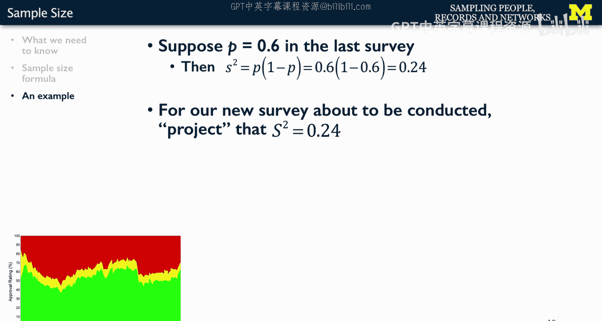

Here， we're just worrying about getting a value like that。

 And there are lots and lots of ways that we obtain these things。 So for our new survey， then。

 we're going to use S squared equal to 0。24 for this。

And again， that that drawing in the lower left。 that's the approval ratings over time。 right。

 the red or the disapproval， the green or the approval。

 And then this particular one is coming from a series of surveys in which there was a group of people who are undecided in the middle。

 Those are the yellows。 but it's that kind of thing。

 And you can see it's bouncing up and down month by month。 This is done。

 And we've got lots of past data。 it's not of true of all， I know you've probably got your mind。

 Well， what about the brand new measure。 No one's ever done before。

 All those things can be dealt with in the same way。

 We just want to do the basics here for a case that's well documented。

We also need to specify in advance what the new survey is going to do in terms of quality。

 What sampling variances do we want。 Now， here's where we need to work backwards。Here。

 we need to think about what we would like to end up with in the way of an uncertainty statement。

 So suppose that we said my uncertainty statement would really be best if what I could have is a 95 per cent comp interval。

That gives me a lower limit of 58% and an upper limit of 62%。 That's really what I want。

 Ive run a really good estimate。Now， you may say， well，59% to 61 is really good。

 but labels are labels here。 let's think of this is our target precision。

 This is specifying a standard error， believe it or not。 It's saying。

 look at the United States overall。 And this is the comps level I want to have for that to project back to the population。

So that upper cuff interval， the limit that 62%， is the proportion， if you recall，60%。

6 in fraction terms， plus a multiplier times of standard air。

ThatThat's coming from that normal distribution， call that is that 62% is 60% plus a Z times the standard error of the 60%。

So if that's what we want， that means that， oh， what's the Z， the Z， Oh that's that 1。96。

 let's use that 1。96。 That's that thing from the normal distribution。

 remembering that that 60% number is actually normally distributed across all possible samples。

 That's the drawing in the lower left。 that bell shaped curve。 and the 1。

96 gives us the limits on that that gives us the 95% comp level。

 So I'm just going to round it to two to simplify our calculations。

 we can be more precise if we need to， if we're doing this in a spreadsheet or。

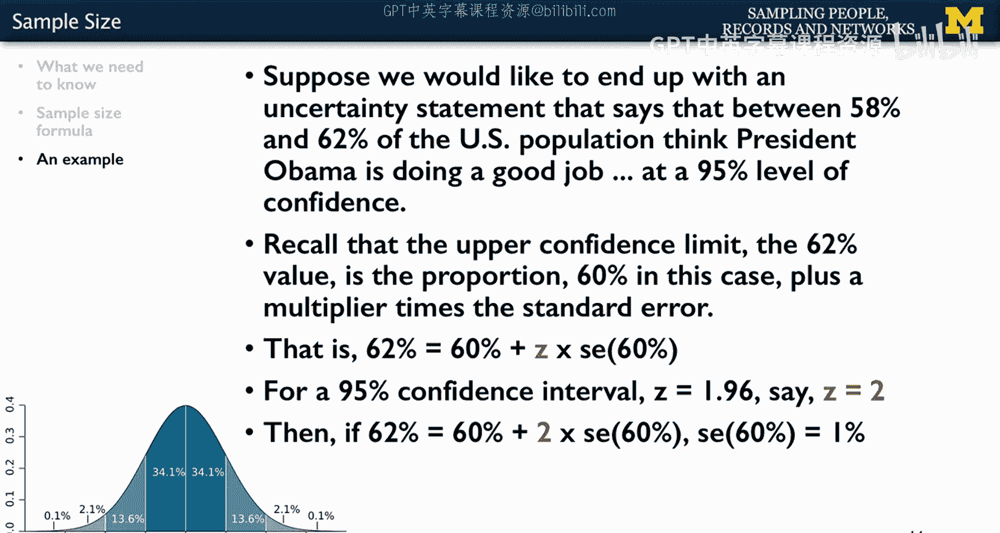

Writing a report about it， but for our purposes。

There we have it。 Now we know the upper limit， we know the middle， the 60%， the 62%。

 the 60% and the Z。 So now we can figure out what the standard error is。

 and it turns out that the standard error that we need to satisfy this requirement is 1%。

The standard error of that 60% that we need to get that interval from 58 to 62 is 1%， that is that 0。

02，0。62 minus 62% divided by 2 is 1%。Now it's better to work with the proportions here than it is the percentages。

 but so I'm going to move back and forth and this may be a little bit foreign for you。

 but that 1% translates into 0。01 is a fraction。

Okay， that's what we want our standard error to be。 So we don't。

 we're not going to say it in terms of percentage anymore。

 We're going to say it in terms of that proportion。 And now we've got。RV。Now we have our variance。

 well， no， no， not quite because what we've got is the standard error that we want。

That standard error is 0。01。The variance that we want then is the square of that standard air。

 We've got to work backwards。 What I remember what I said going forward。

 we calculated a variance and then got to a standard error。 Here。 we've determined a standard error。

 We're going to work backwards to a variance。 So we're going to square that thing so that what we realize is that we need a desired variance of 。

0001。 Now， that's a small number。

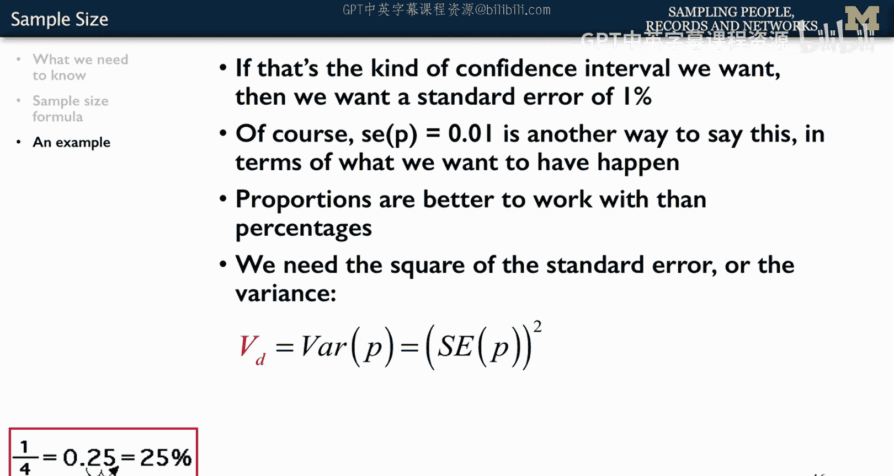

But that's what is determined or driven by that decision to make a 95% cough interval that went from 58% to 62%。

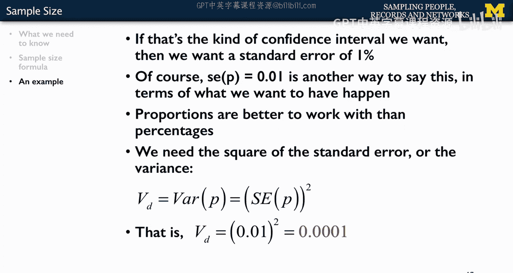

And so we've worked backwards through those steps。 You may have to go back through this a couple of times to to get the the feel for it。

 But where we are now is at the point where we have our S squared and our V。

Our S squared to 0。24 and our V of 0。0001。And what we're going to do is do our calculation。

And in doing our calculation now， we're going to calculate our provisional value。

As the insert in the left says a wise man once said。

 never begin data collection without calculating the necessary sample size first， well， there it is。

 that's the necessary sample size， 0。24 divided by 0。0001 is 2400。Now。

What difference does the finite population correction make。Now， remember that conversion formula。

 I'm going to take that N prime。 and now I'm going to do one more step。

 And in this N prime adjustment， what we're going to do is take that provisional N prime。

That necessary sample size and prime。And adjust it by capital N。 How do we do that in this formula。

 I'm going to take the 2400 and divided by 1 plus 2400 divided by capital N。

 Now I don't actually know capital N。 What do I mean by that。 Well， we。

 we probably are talking about here。

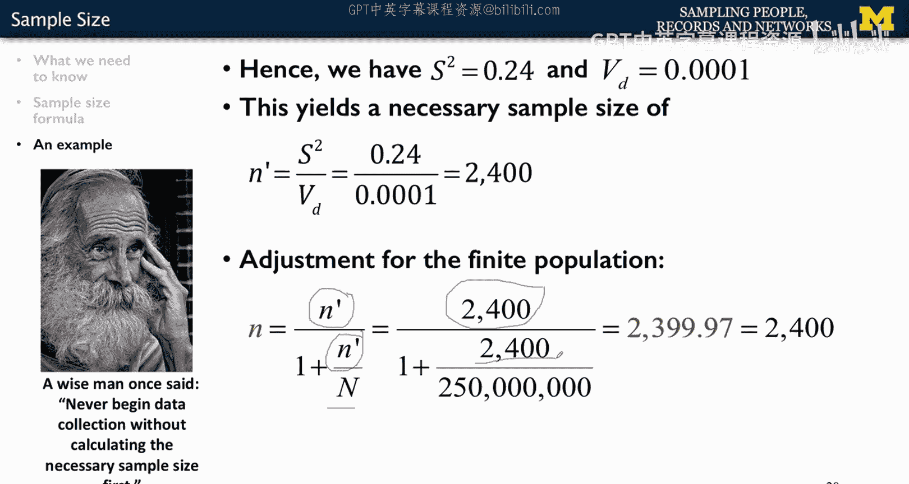

The number of voters， the the number of persons eligible to vote。

 Those are the people to whom this matters。 Yes， it matters to others who can't vote。

 but the people who are 18 years of age and older。 And that's about 250 million people。

I don't know it exactly， but， you know， it does't matter whether it's 250 or 251837000 and so on。

 It just doesn't matter that to that extent how close we get it， because when I do the adjustment。

 notice what happens。

In this adjustment scheme， my sample size comes out to be 23，99。97，2400。 In this case。

 that adjustment doesn't make any difference。 I'm still going to go with the necessary sample size。

So I've got。An estimated sample size now， having gone through the process of figured out what element variance is there in the population。

 what level of precision I need to meet something like a constructed coughs interval an anticipated cos interval。

And I've got my sample size， but you know there are two more questions that we want to address here and these would be the last two lectures that we do。

Is there a more direct way to figure this out from a projected comp mineral。

 But we'll actually go through the way to just take that that width of constant and put it into a formula and then。

That sample size， that it wasn't effective very much by population size。 I'm surprised。

 I would have thought that the population size really would magnify that sample size。

Let's look at that problem in our last lecture。 So in our next lecture。

 we're going to turn to talking about margin of error。

 margin of error is the expression for that half width of the cons interval。

 and we're going to talk a little bit about why it's call a margin of error and then how to work with it directly to figure out the sample size。

 and then our last lecture in the series will be about sample size and population size in their relationship。

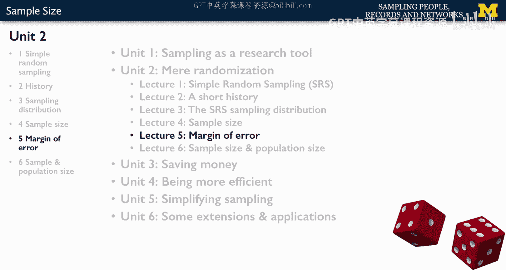

Thank you。

