# 调查数据收集和分析：2-6：样本量确定 📊

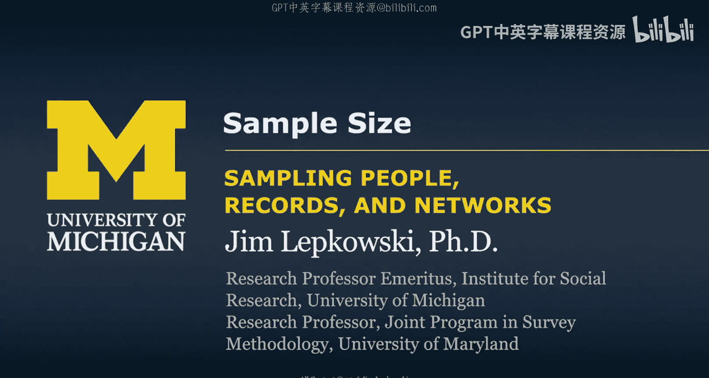

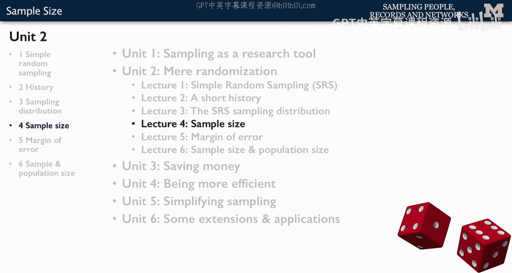

在本节课中，我们将要学习如何为简单随机抽样确定所需的样本量。理解抽样分布的特性后，我们需要反向思考，根据期望的数据质量（如置信区间的宽度或标准误）来规划调查，并计算相应的样本量。这直接关系到调查的预算和可行性。

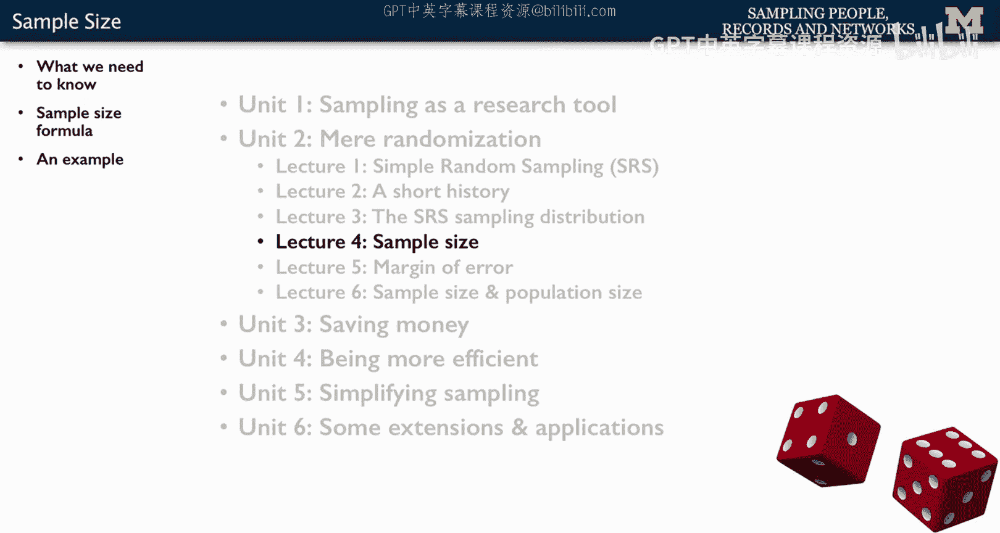

上一节我们介绍了简单随机抽样的性质，本节中我们来看看如何应用这些知识来规划一次新的抽样调查。

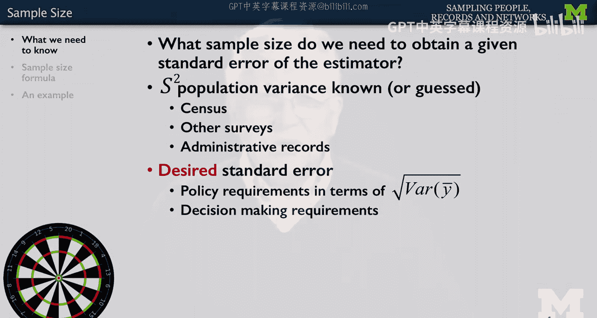

## 背景与核心问题

在规划一次新的抽样调查时，我们面临的核心问题是：为了达到一个给定的估计量标准误，我们需要多大的样本量？这需要我们从两个关键信息出发进行反向计算。

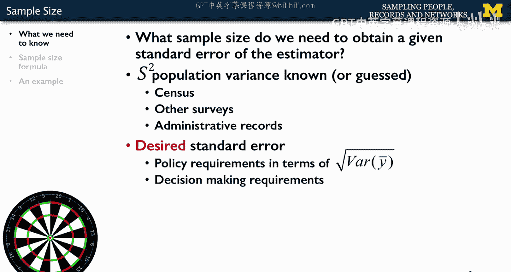

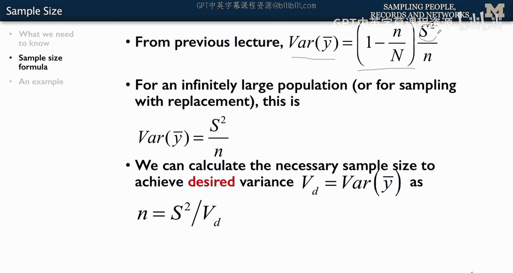

## 确定样本量的两个关键要素

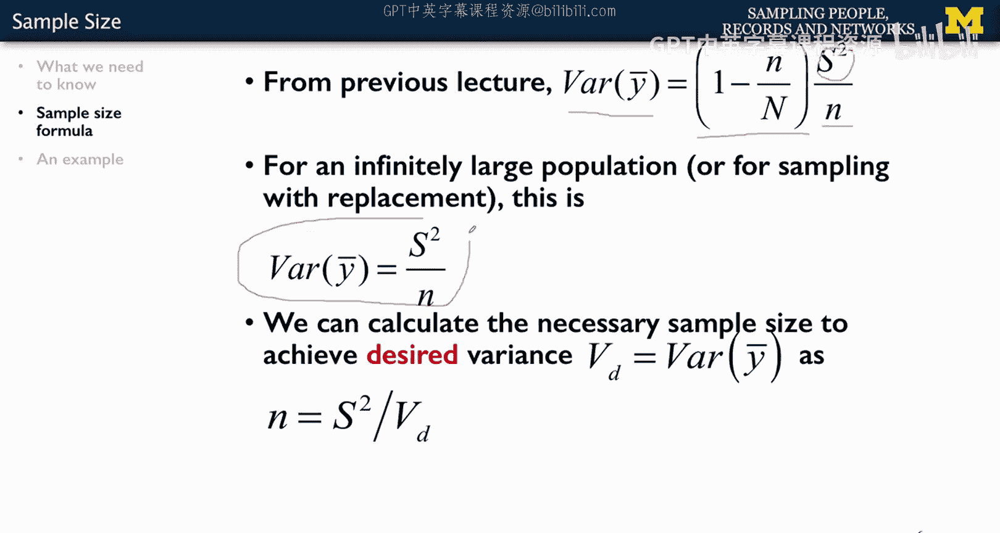

以下是确定样本量前必须获取的两项信息：

1.  **总体方差 (S²)**：我们通常不知道真实的总体方差。因此，需要从历史数据中获取其估计值。这些数据可能来自：
    *   过去的普查
    *   过去的抽样调查
    *   行政记录
    我们将利用这些数据计算方差估计值 `S²`。已发表的研究成果在此处至关重要，它们为新的调查计划提供了基础数据。

2.  **目标精度 (V_d)**：我们需要明确期望的估计精度，即可以接受的标准误或抽样方差有多大。这通常由数据后续的决策需求驱动。例如，某些决策需要非常精确的估计，而另一些情况下，可以接受较低的精度。

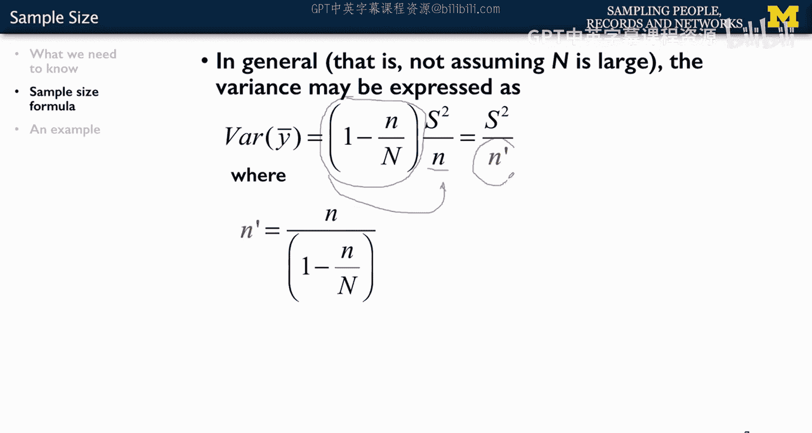

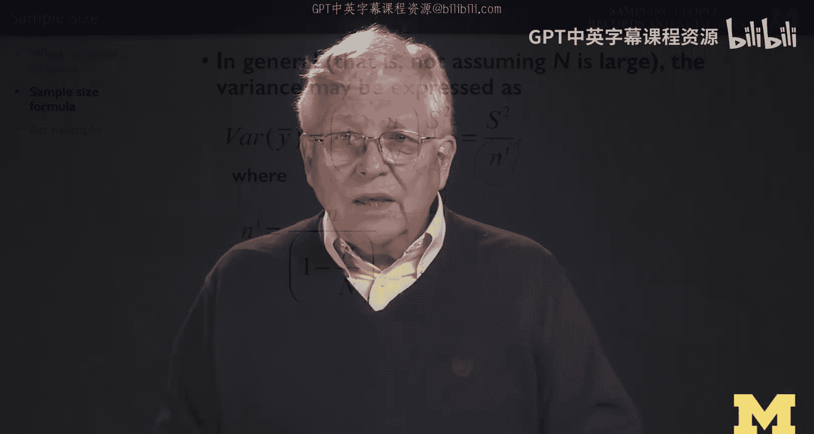

## 样本量计算公式与推导过程

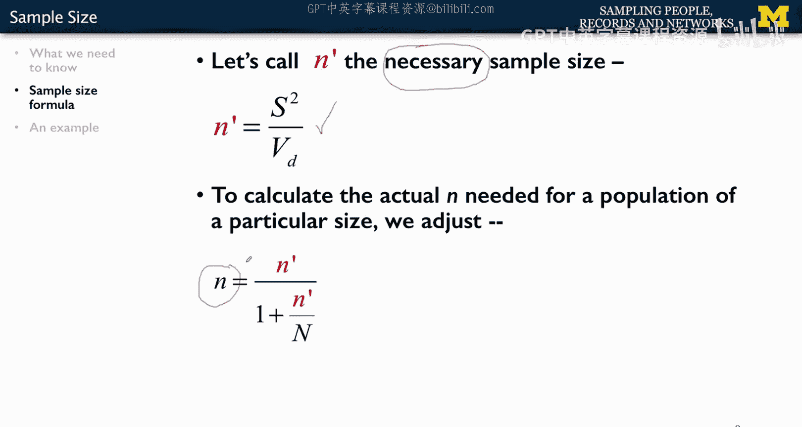

回顾简单随机抽样中样本均值的**抽样方差公式**：
`Var(ȳ) = (1 - n/N) * (S²/n)`
其中，`n` 是样本量，`N` 是总体大小，`S²` 是总体元素方差。

为了简化初始计算，我们暂时忽略有限总体校正因子 `(1 - n/N)`。当样本量 `n` 相对于总体 `N` 很小时（例如小于1%），这个因子接近1，影响甚微。简化后的公式为：
`Var(ȳ) ≈ S²/n`

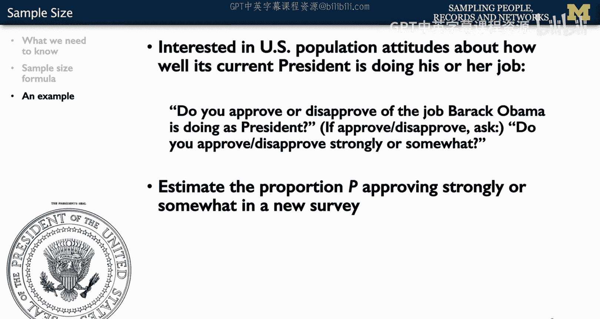

我们的目标是让抽样方差达到一个**期望的水平**，记为 `V_d`。因此，可以建立方程：
`S² / n = V_d`
由此，可以解出**初始的必要样本量** `n'`：
`n' = S² / V_d`

然而，我们最终需要的是考虑有限总体校正后的真实样本量 `n`。通过代数转换，可以得到调整公式：
`n = n' / (1 + n'/N)`
或者另一种常见形式：`n = N * n' / (N + n')`

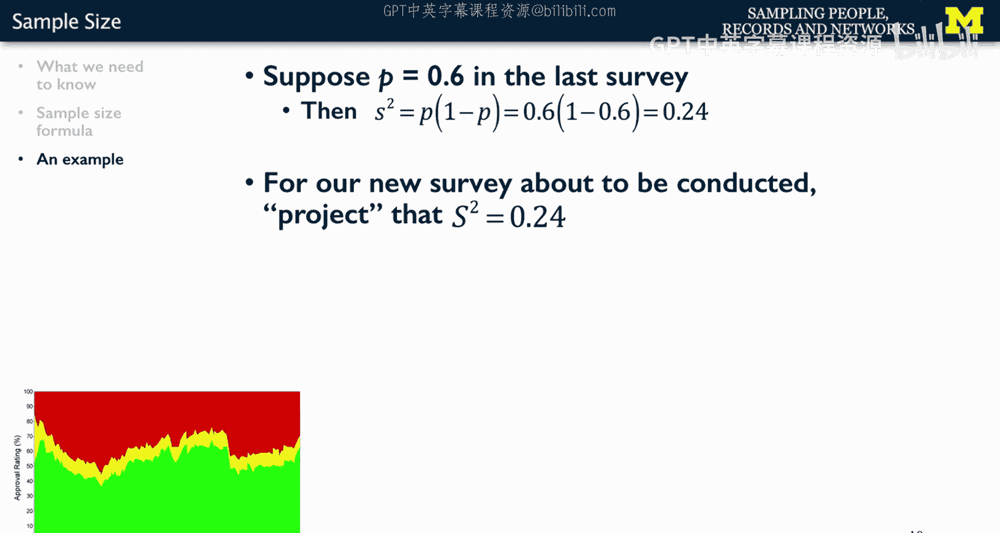

计算过程总结为两步：
1.  计算初始样本量：`n' = S² / V_d`
2.  根据总体大小进行调整：`n = n' / (1 + n'/N)`

## 实例演示：总统支持率调查

假设我们要进行一项新的调查，估计美国民众对总统工作的支持率（“强烈赞成”或“有些赞成”的比例）。

**步骤一：获取总体方差估计值 (S²)**
根据历史调查数据，假设前任总统在类似时期的支持率约为60%（即 `p = 0.6`）。对于比例估计，其元素方差可近似为：
`S² = p * (1 - p) = 0.6 * 0.4 = 0.24`
我们将使用 `S² = 0.24` 作为计划依据。

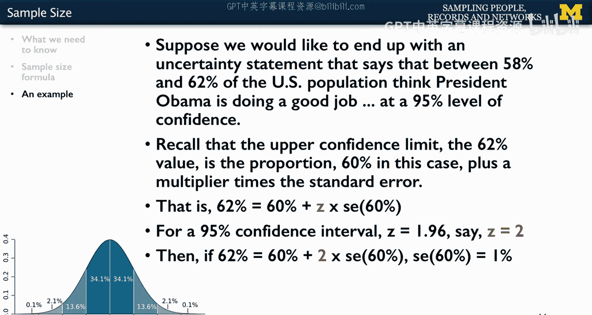

**步骤二：确定目标精度 (V_d)**
假设我们希望最终估计值的95%置信区间为 `[58%, 62%]`，即点估计为60%，半宽（误差范围）为2%。

*   首先，将百分比转换为比例：半宽 `B = 0.02`。
*   对于95%置信区间，Z值约为 `1.96`（简化为 `2` 以便计算）。
*   标准误 `SE` 与半宽的关系为：`B = Z * SE`。因此，期望的标准误 `SE_d = B / Z = 0.02 / 2 = 0.01`。
*   目标抽样方差 `V_d` 是标准误的平方：`V_d = (SE_d)² = (0.01)² = 0.0001`。

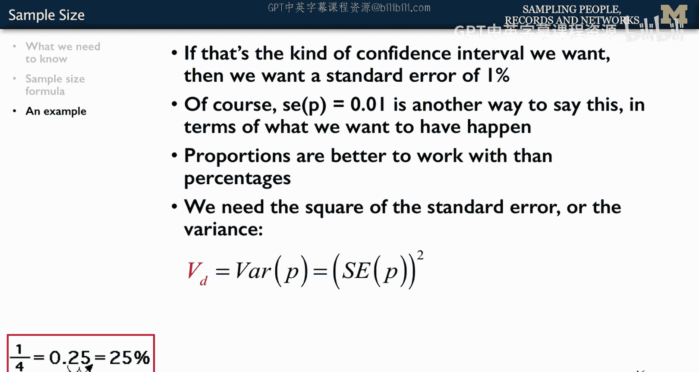

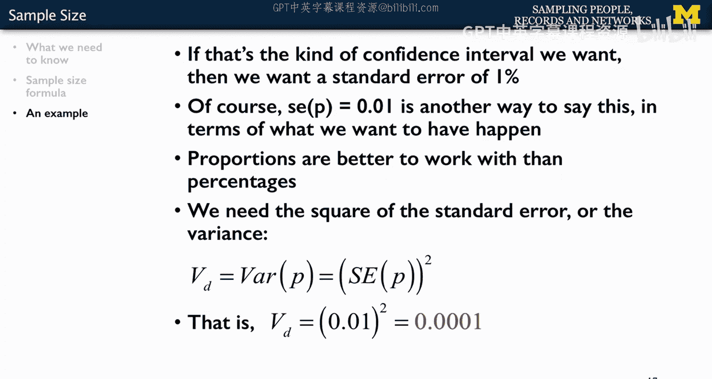

**步骤三：计算样本量**
1.  计算初始样本量 `n'`：
    `n' = S² / V_d = 0.24 / 0.0001 = 2400`
2.  进行有限总体校正。假设美国合格选民总数 `N ≈ 250,000,000`。
    `n = n' / (1 + n'/N) = 2400 / (1 + 2400/250,000,000) ≈ 2400 / (1 + 0.0000096) ≈ 2399.97`
    调整后的样本量约为2400。由于总体 `N` 极大，校正因子几乎为1，因此调整前后样本量几乎没有变化。

在这个例子中，我们最终确定的样本量约为 **2400**。

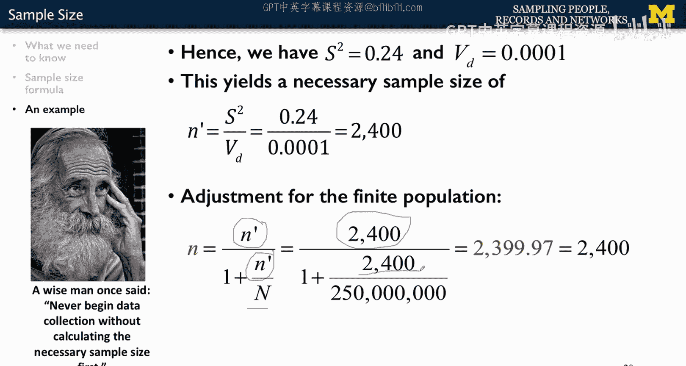

## 总结与预告

本节课中我们一起学习了为简单随机抽样确定样本量的完整流程。核心在于反向工作：首先根据历史数据估计总体方差 `S²`，然后根据决策需求确定目标精度 `V_d`（通常源于期望的置信区间宽度），接着利用公式 `n' = S² / V_d` 计算初始样本量，最后通过 `n = n' / (1 + n'/N)` 根据总体大小进行调整。

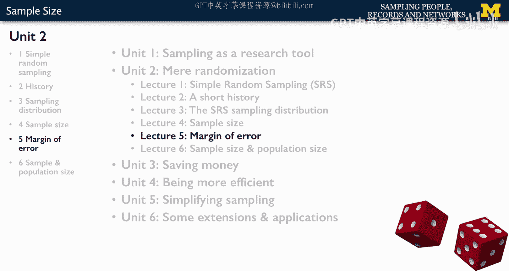

我们注意到，当总体规模非常大时，有限总体校正的影响微乎其微，样本量主要取决于方差和精度要求。这引出了两个更深层的问题：是否有更直接的方法从置信区间宽度计算样本量？以及样本量与总体规模的关系究竟如何？我们将在接下来的两讲中分别探讨“误差范围”的直接应用，以及样本量与总体规模关系的深入分析。