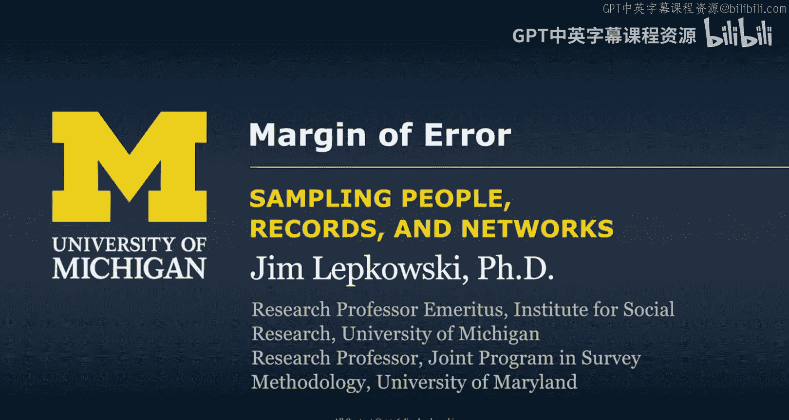
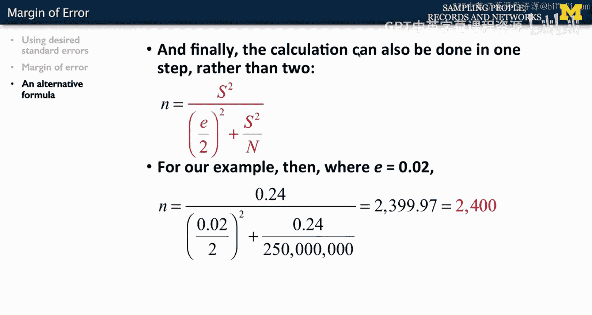

# 密歇根大学《调查数据收集和分析（2-6：方法、社调问卷设计、抽样、缺失数据、分析）｜Survey Data Collection and Analytics》 p94 15_2.5 误差范围.zh_en -BV1fw4m1e7Zh_p94-

Hello， again。Welcome to our lectures on sampling people， records and networks。

 My name is Jim Lepowski， and we're continuing our discussion here in unit 2 on mere randomization。

 That is sampling from people records or networks when really。

 the only device we're using is randomization。😊，In order to determine what elements。

Fall into the sample。We've been talking about in lecture 4 about sample size and we're moving to lecture 5 here。

 an extension of that discussion， we're going to be looking at a label here that's common in the press。

 it's common in everyday usage margin error Now our focus here is we want to understand what margin error is。

 but we also want to understand how it can be used in calculating sample size。

We're going to talk about again， what we've learned in the past about using desired standard errors as a way of determining sample size。

And we'll reframe that in the context of a margin of error。And then in the end。

 we'll come up with an alternative formula for calculating sample size。

It's an extension of what we've done already。So， there's nothing really。Dramatically new here。

 but we're going to introduce a couple of pieces of terminology that will make it a little bit more useful to you as you look at these sample designs and think about how to draw these samples。

Recall that what we did in calculating sample size for simple random samples before was to deal with two quantities to begin with。

 initially， we need to know what the variances of the population elements。 The population variance。

 some would call that。 That's the numerator of this formula that we see in front of us。

 that has an S squared in it， that S squared is the variability of the values for the characteristic were're interested in。

 across the elements in the population。 Now， that may not be known to us exactly， matter of fact。

 very seldom would be known to us exactly。 We will calculate it from other sources of information。

 for example， when we're dealing with proportions， you'll recall that we were able to calculate an estimate of that population variance。

By taking the proportion times 1 minus the proportion。

 And it's a very good approximation to that population variance。

 We don't actually need the element values themselves。

 but merely the mean when we're dealing with characteristics that are zeros and ones。

 You are going to。 You think President Obama is doing a good job。

 You don't think President Obama is doing a good job。Okay。

 so we need to know that population variance， we'll get that from past data or a calculation around a proportion。

The second piece， the denominator is the desired level of precision。

 We were calling that things like the desired sampling variance。 So it's a V for variance。

 sub D for desired。That's a tricky part。 I mean， it's hard enough to think about getting the population variance。

 But then we also have to think in advance， what kind of。Varance do we want for our estimate。

 So we're dealing with a proportion。 We need to specify how large the standard error of that proportion would be。

 how large the sampling variance would be。Taking the ratio of those two quantities gives us a provisional sample size and prime。

And then we can adjust or see whether an adjustment for population size matters。As matter of fact。

 our last lecture in this series will deal with this formula in a little more detail。

 And so the the second formula there shown at the bottom takes the N prime。

 the provisional value and divides it by one plus N prime over capital N where capital N is the population size。

 And again， with simple random sampling。 We know that population size。

 we have the count of the elements in the list。That's what we need in order to do our sampling。

All right， that's what we were doing before。We actually talked about an example that looked at desired levels of precision that denominator then。

In terms of a comp intervalable。How wide a constant interval do we want。

 So so a way to re expresspress this would be able to turn to someone and say， well。

 if you had an estimate of this particular character a proportion of around 。6。

 and you were to have a 95% constant interval rule that went from 0。58 to 0。62。

Would that be satisfactory？And if their response is， yes， that should be O。 Now。

 we've specified a desired width of acomp interval。 And from that。

 we can work backwards to getting a standard air because the upper limit and the lower limit both depend on the standard air of the。

Estimate itself。So we can see in the upper formula there。The lower limit and the upper limit。

 the lower limit is the we'll deal with proportion。 Still， the proportion minus a multiplier。

 a multiplier reflecting the distributional properties of our sampling distribution。

 Z for the normal distribution times the standard air and the upper limit is。

 is that that proportion plus z times that standard error。

 So if we know what those upper and lower limits are。

 we can back out what that standard error will be。 But what we'll look at that。

So for a 95% comp interval， that Z value would ordinarily be 1。96。

 there's a modification to it when we have smaller sample sizes。

 but we're not going to deal with that here。 We're just going to assume that our sample sizes are large enough that 1。

96 is a standard value。 Actually， many people will round that to two。

 Make our life a little bit easier。 That is we're going to take two times the standard error and we're going to subtract it from the proportion and add it to the proportion。

 And this is where we begin to talk about margins of error。As a matter of fact。

 going on with the example I was beginning to to lay out。

 supposeose our lower 95% limit and upper 95% limit for proportion were 。58 and 0。62。 Now。

 because these comp intervals are symmetric， right。

 We're adding and subtracting the same thing from the middle value。

 We know what that proportion is already。 It's right in the middle。 It's 0。6。That。Distance now。

 between the lower limit in the middle， the upper limit in in the middle。

Is often referred to in literature as a margin of error。 Now， some literatures。

 the more statistical literatures don't often deal with this。

 this kind of terminology appears more in the social science literature and political science or polling kinds of work。

But as that distance， we'll call it E from the upper limit to the middle or the lower limit to the middle。

And in most practice， margins of error are almost exclusively talked about with respect to proportions or percentages。

 So here we're doing a proportion 0。58 to 0。62 is the limits， a proportion of 0。6。

 but we could express it in terms of percentages as well。In a few areas of application。

 this distance is also sometimes called the precision。

People who work in auditing where they're drawing samples of records that they're going to check and see whether。

What they've paid was actually what they should have paid。

And so they're going to be drawing a sample of records and then looking at them and doing a calculation of the difference between what they paid and what they should have paid。

Often because they're concerned that they've been overpaying。

But they will often use the term rather than margin of error for these kinds of things， precision。

But there's a variety of terminology， it is not uniform。

 it's not standard in its across its application across many different types of problems。

But to continue on then， we want that 95 per cent comp interval。

 We're going to deal with that margin of error， the distance from the middle to the upper lower limit。

 So we're going to calculate that margin of error when we know that comps interval by taking the upper limit。

62， subtracting the lower limit 。58 and dividing by 2。 that will give us that distance。

So we don't even need to know calculate the middle。

 we can just simply take that total spread of the comps interval and divide by two。Now。

 that margin error in our particular case is 0。02。Now， that margin of error is2，95% co interval。

 rounding 1。962 times the standard error。So now we know that two times the standard error is 0。02。

 which means the standard error is 0。01， and we're back in the realm we were before in calculating sample sizes。

 Once we know that desired standard error that drives this interval of that nature。

 we can square it to get a desired sampling variance and continue on with our sample size calculation。

Now you may see this kind of thing or you may have seen it in newspaper reportings。

 reporting on election outcomes or expected election outcomes。

 where they're talking about the margin of error。They never talk about the standard error。

 They talk about the margin of error。 So they'll say something like President Obama's approval rating now stands at 60% plus or-2% cent。

 the plus or minus the 2 per cent is the margin of error and the plus or minus adding。

 subtracting from the 60 per cent and。A pretty sizable share of readers understand what that means or they have an interpretation for it。

 it makes sense to them， it's saying， well， they're getting 60% in this poll。

 but there's some uncertainty because it's a sample。And so that uncertainty is modest。

 it's only 2% on a rate of 60%。And they can form their own assessment。

 their own evaluation of whether this is a good number or not so good。

 So if this happened to be plus or -5 per cent， they'd feel like there's a lot more uncertainty there than plus or -2 per cent。

So it helps the public understand the uncertainty that comes with using randomized selection random samples。

Okay， so the public's got used to forming these 95% cop intervals from this kind of a statement。

What we're going to do is go backwards now， we're going to determine what kind of sample size we need to to achieve a certain level of precision in advance of doing our survey。

 we're going to specify what we want as an outcome。 and then based on that specification。

 calculate what sample size we achieve it。So in our particular case now， our margin of error is 0。02。

The standard error is half of that。Two times the standard error is the margin of error。

 So we're going to divide the margin of error by 2。02 divided by 2 is 0。01。

 and that is the standard error。 Now， in our funny notation here。

 that's the square root of the desired variance。 So I know this notation is a little bit hard to keep track of。

 but just follow the logic will lay it out in several steps in next couple of slides。

 So the desired variance， which is what we need in that sample size calculation。Is 。01 squared or 。

0001。Now， that allows us then to calculate a sample size taking the population variance S squared。

 which would be the proportion in our particular case，0。6 times 1 minus06。 That's the S squared。

 or at least our our calculation of a value that's reasonable to use there。

 And then we're going to divide by that desired variance，00001。

Sometimes though what you'll see are sample size formulas that are based on E。

 rather than converting E to a standard error and then an variance in using the one formula。

 others prefer to write out a formula that is just based on E， so don't worry about standard errors。

 don't worry about these precision levels， just figure out what that margin of error is that you want to have and then use the following formula。

This leads to confusion。 People will have been trained with one formula。

 and then they're starting a job in a new firm。 and that firm doesn't use that approach。

 They use a slightly different one。 They may use the formula formulation that I've been giving us。

And so then it's some confusion here。 So so let's just sort of con。Deconfuse this。

 sort this out a little bit。And talk about then the necessary sample size。

 that n prime now as S squared again in the numerator。 But for the denominator。

 what we've got there is the margin of error divided by 2。

 which is the standard error we want squared。So now we can just write that simply as the formula S squared over the quantity E over 2 squared。

 and we would then adjust this to account for the finite population size。

 we would take that n prime and divide it by 1 plus n prime over n。All right。

 so that might be one form we would see it。Sometimes what we're going to see though is another formula。

 they take the two in the denominator of the denominator。

They square it and they put it up in the numerator。

 So sometimes you'll see the formula written as4 or something like that， 1。

96 squared times S squared over e squared。Okay， well。

 we can see that's just an algebraic restatement of the problem。 Nothing has changed。

 we certainly aren't going to change our adjustment down below。

So that's another way it's sometimes written。Well， wouldn't you know it。

 other people prefer to go back to the origins， they say， well。

 really suppose we don't have a 95% comp interval， but a 90%。

 Well then you don't want to put four in there， you don't want to divide e by 2。

 we want to divide by the appropriate multiplier。 so if it's a 90% comp interval。

 that multiplier is really about 1。64。So let's write this then z squared。

 whatever that multiplier is。That's substituted for4。

 And we've got z squared S squared over E squared。 same formula。

 different way of expressing it depending on where you're starting。

 This is a little more general formula。 So it's not necessarily for 95% comp intervals。Oh。

 some then get fancier still and they say， well， look at we're really doing proportions。

 that S squared is p times 1 minus p。 So we're going to put that in there。

 So we got z squared times p times 1 minus p over e squared Oh， this is getting confusing。

 I mean it's a different expression。 And someone learns that expression。

 and they come across the one that I've been presenting here。 They get a little bit confused。

 there's even further variation here。 Sometimes they'll put in the z squared and they'll say， look。

 it's z squared for the 1 minus alpha over 2 level。 the alpha level is the part of the comp interval。

 So a 95% comp interval， that corresponds to an alpha of 0。05。

 a 5% type point error rate And so that error is going to be divided by two and put in each tail and there's a cut point there。

 And we want to use that z value， that cut point directly， but it's z squared for the one minus。

Over 2 point times P times1 minus P over e score。 What， you get the idea。 A variety of formulas。

 Why do they do that， Why can't we just have one， It depends on the application。

 It depends on preference sometimes， and it's hard to。

Come up with just one expression that everybody agrees with。Okay。

 but youre getting the idea that margins of error are built around the idea of compf intervals。

 there are different ways to calculate the sample size based on them。

 but they could follow this basic structure。Now， it's also possible that we could do that calculation rather than doing in two steps。

 we could do it all in one step。So to go back to the formula that I had。

 that was s squared over the quantity E over 2 squared。That gets us the sample size。

 the provisional sample size preliminary。 And then we adjust it。

 We can also do the calculation S squared over the quantity E over 2 squared plus S squared over capital N in the denominator。

 Now we don't have to do that further adjustment。 This will give us the result of first calculating the provisional value。

 And then adjusting it for the population size。 So one step instead of two。

And as we do this kind of thing， again， we can substitute for S squared。

 We can take that two squared out of the denominator of the denominator。

It will be more complicated the expression there in different ways of writing this。

 and so you may encounter formulas that look a little bit different than what I'm doing here。

 but they're all revolving around the same basic idea。Well， let's go back to our example now。

 So in our example where that margin of error was 。

02 and the actual proportion or the proportion we think that we're going to get in our survey is around 0。

6。Then our S squared value， p times 1 minus p is 0。6 times1 minus 0。6，0。6 times 0。24。

And so you see the 0。24 in the numerator， the 0。24 in the numerator of the second term of the denominator。

Our margin of error is 0。02， divided by2 squared。 And then， oh， yes， our population size。

250 persons who were eligible to vote or eligible to give a rating，18 years of age and older。

And so our sample size comes out to be 2399。97。 we've round that up to 2400。

Okay， margin of error。 that's the margin of error applied in the sample size calculation。

Let's do one more thing with simple random sampling。

 and that is this population size keep popping up。How important is it， does it drive anything。

 does it create anything new here， could we ignore that？Well。

 let's look at the relationship between sample size and population size in the last lecture in this series on mere randomization on simple random sampling。

Thank you。