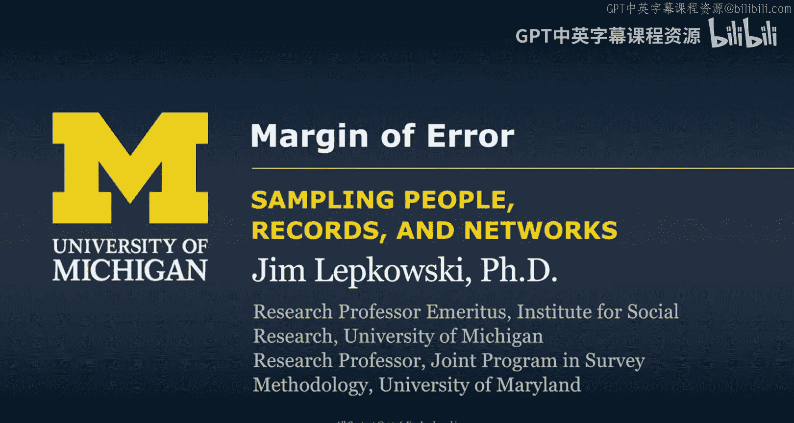
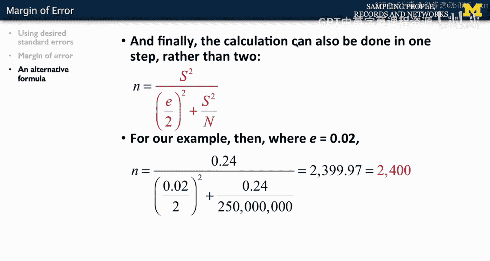

# 调查数据收集与分析：2-5：误差范围 📊

## 概述
在本节课中，我们将学习“误差范围”这一概念。误差范围是调查和民意测验报告中常见的术语，它描述了样本估计值的不确定性。我们将了解误差范围是什么，它与置信区间的关系，以及如何利用它来计算所需的样本量。这本质上是我们之前样本量计算讨论的延伸，但使用了更贴近实际应用的术语。

## 从置信区间到误差范围
上一节我们介绍了通过设定期望的精度（如标准误）来计算样本量。本节中，我们来看看如何将这种精度要求转化为更直观的“误差范围”。

置信区间为我们提供了一个估计值的可能范围。对于一个比例（例如支持率），其95%置信区间通常表示为：
**下限 = p̂ - Z * SE(p̂)**
**上限 = p̂ + Z * SE(p̂)**
其中，`p̂` 是样本比例，`SE(p̂)` 是标准误，`Z` 是标准正态分布的分位数（对于95%置信区间，Z ≈ 1.96，常近似为2）。

误差范围（通常记为 **E**）就是这个区间宽度的一半，即从点估计值 `p̂` 到区间任一边界的距离。因此：
**E = Z * SE(p̂)**

在新闻报道中，你常会看到这样的表述：“支持率为60%，误差范围为±2%”。这里的±2%就是误差范围 `E`，它帮助公众理解抽样带来的不确定性。

## 利用误差范围计算样本量
既然误差范围源于标准误，我们就可以反向操作，通过设定期望的误差范围来计算所需的样本量。

计算过程分为两步：
1.  将期望的误差范围 `E` 转化为期望的标准误：`SE_desired = E / Z`。
2.  将期望的标准误平方，得到期望的抽样方差 `V_desired`，然后代入我们熟悉的样本量公式。

对于简单随机抽样，估计一个比例所需的初始样本量 `n'` 公式为：
**n' = S² / V_desired**
其中，`S²` 是总体方差。对于比例问题，`S²` 可以用 `p(1-p)` 来估计，这里的 `p` 是我们对总体比例的预先估计（例如，根据以往数据或假设为0.5以获得最保守的样本量）。

将 `V_desired = (E / Z)²` 代入，我们得到基于误差范围的样本量公式：
**n' = S² / (E / Z)² = Z² * S² / E²**

如果总体规模 `N` 不是无穷大，我们还需要进行有限总体校正，得到最终样本量 `n`：
**n = n' / (1 + n' / N)**

有时，你可能会看到将校正一步完成的公式：
**n = (Z² * S²) / (E² + (Z² * S² / N))**

以下是不同形式的样本量计算公式，它们本质上是等价的：
*   **基于标准误**：`n' = S² / V_desired`
*   **基于误差范围（分步）**：`n' = S² / (E/Z)²`
*   **基于误差范围（合并）**：`n' = Z² * S² / E²`
*   **针对比例的具体形式**：`n' = Z² * p(1-p) / E²`

请注意，这些公式可能因教科书或应用领域的不同而略有差异，但核心逻辑是一致的。

## 计算示例
假设我们要调查一项支持率，我们预先估计比例 `p` 约为0.6，希望误差范围 `E` 为0.02（即±2%），置信水平为95%（`Z=1.96`），总体规模 `N` 为2500人。

首先，计算总体方差的估计值 `S²`：
`S² = p(1-p) = 0.6 * 0.4 = 0.24`

接着，计算初始样本量 `n'`：
`n' = Z² * S² / E² = (1.96)² * 0.24 / (0.02)² ≈ 2304.96`

最后，进行有限总体校正：
`n = n' / (1 + n' / N) = 2304.96 / (1 + 2304.96 / 2500) ≈ 2304.96 / 1.922 ≈ 1199.7`

因此，我们大约需要抽取 **1200** 个样本，才能在95%的置信水平下，使对0.6左右比例的估计误差范围在±0.02以内。

## 总结
本节课中，我们一起学习了误差范围的概念及其应用。我们了解到：
1.  误差范围是置信区间宽度的一半，直观地表示了抽样估计的不确定性。
2.  它可以通过公式 **E = Z * SE(p̂)** 与标准误联系起来。
3.  在调查设计阶段，我们可以通过设定期望的误差范围 `E`、置信水平（决定 `Z` 值）和对总体比例的预先估计 `p`，来反推所需的样本量。
4.  核心计算公式为 **n' = Z² * p(1-p) / E²**，并根据总体大小决定是否需要进行有限总体校正。

掌握利用误差范围计算样本量的方法，能帮助你在设计调查时，更清晰地向他人说明精度目标，并做出更合理的资源规划。下一讲，我们将深入探讨总体规模在样本量计算中的具体影响。