# 密歇根大学《调查数据收集和分析（2-6：方法、社调问卷设计、抽样、缺失数据、分析）｜Survey Data Collection and Analytics》 p95 16_2.6 样本量与总体规模.zh_en -BV1fw4m1e7Zh_p95-

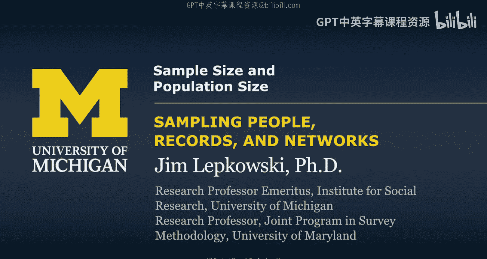

Recall that in our recent lectures about simple random sampling。

 we've been dealing with the issue of sample size。 And we started out talking about sample size and sort of reverse。

Solving the problem backwards， going backwards from what we want to what we need to get there。

And then we talked a little bit about a question about whether we could simplify that process when what we're starting with as an outcome is a constant or a margin of error is a summary measure。

Well， in this lecture， this is our sixth lecture in the series on simple random sampling。

 where we're going to be talking about sample size and its relationship to population size。

 we're going to be addressing the question of whether there is such a relationship because we kept going back in those previous two lectures and adjusting sample size for population size。

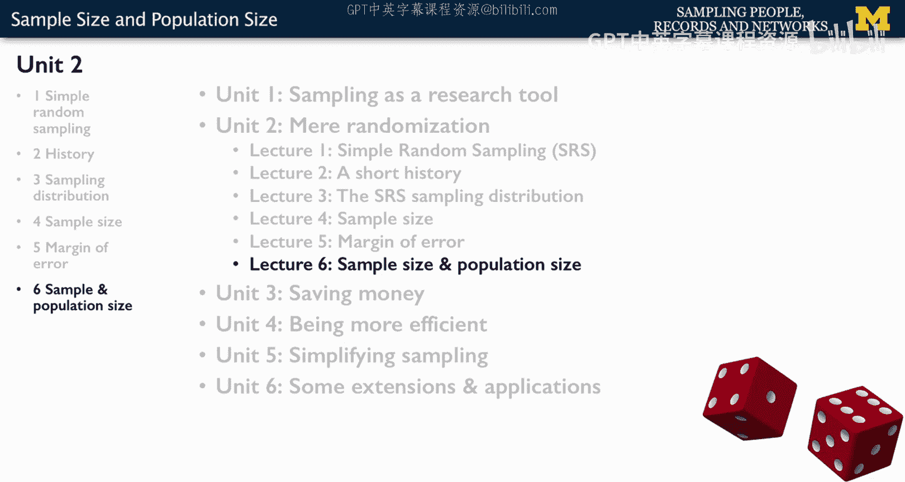

Well， what role does that play in the calculation， what would I find if I started thinking about whether or not population size and sample size are related？

And there are two results here that we're going to see that we'll sort of summarize at the end that are important for you to keep in mind。

 These are kind of take home messages about simple， random sampling。

We're going to do this in a series of parts， we're going to talk about sample size， revisit it。

 and particularly the version that deals with margin of error the margin of error basis for calculating sample size。

 and we'll return to looking at the leadership approval rating。

 but now what we're going to do is look at leadership approval across a bunch of countries。

The same phenomena across a bunch of countries where the population sizes are quite different。

 So we're going to talk about China， People's Republic of China， about the US。

 about the Republic of Ireland。 I'll tell you why that one in a moment about the Seychelles and about Tuval tiny island in the Pacific。

 the Seychelles being in the Indian Ocean。And then we're going to talk about the wrong idea about the way to think about sample size and population size and how what we've just been going through。

Corrects those ideas。So here's our revisit。 recall that our sample size。

 for a simple random sample to be calculated for a given margin of error had this formula here。

 And I know the formulas， that this is not much fun to look at。

 But I just want to do a quick review here。 our， our sample size was determined by in the numerator and S squared。

And in the denominator， an S squared over capital N。

 Now that's that piece in the denominator is the finite population adjustment。

But the part that's really driving this， driving the sample size is to take that margin of error。

 Remember， that's the half width of a comps interval。Divided by 2， this is for a 95% cough interval。

 So this is quite specific and squaring that and adding that to that denominator quantity。

 So for in our previous example， where we had a margin of error of 0。02。 Remember。

 the cos interval went from 0。58 to 0。62。 The margin of error， the half with the plus or minus was 0。

02。 for a 95% coughf interval。 And so then we estimated our sample size by taking our S squared。

 which was 0。24 for that proportion of 0。6。24 divided by 250 million in the nominator for the finite population correction。

 and then that 0。02 divided by 2 squared， and we got a sample size of 2399。97。

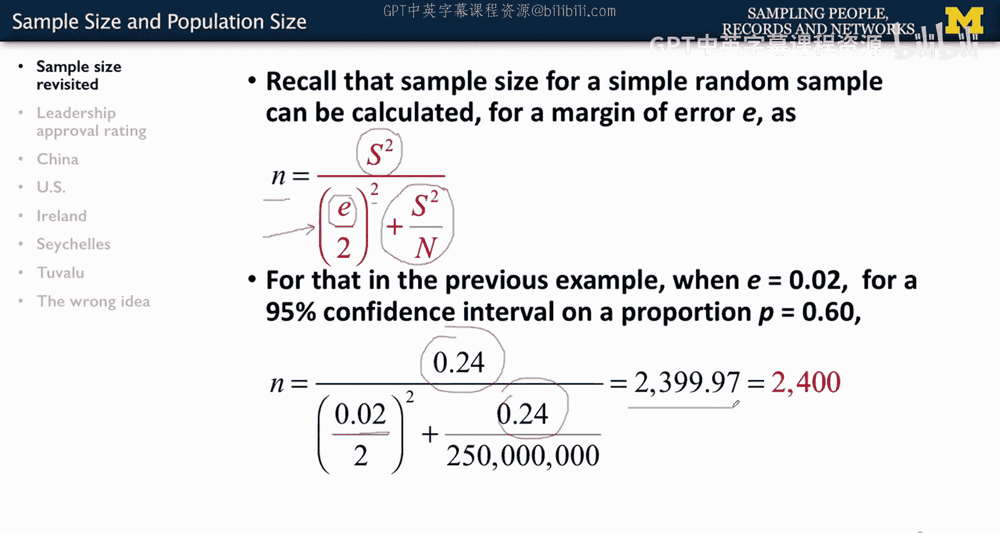

Or 2400， We're going to round that up。 we would ordinarily。

 but we always round those sample sizes up。So there we have our calculation。

 that's our calculation formula， and that denominator has a term that is the result of the finite population correction。

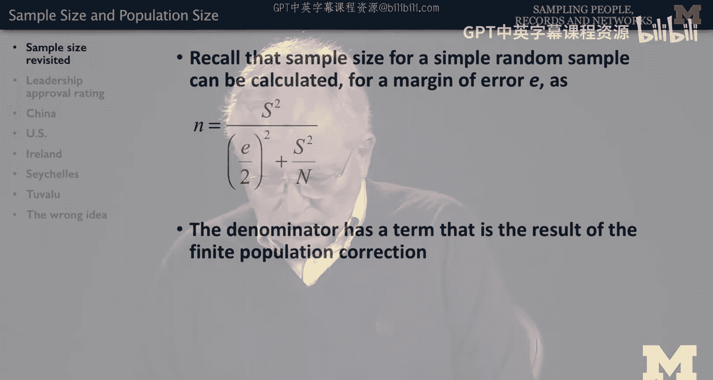

But that term。Made almost no difference It didn't make any difference in the in the example。

 It didn't change our sample size at all。That's a little odd。 I would think， as I mentioned before。

 that maybe that sample size should get bigger and bigger as the population size gets bigger。

 But here weve got a great big one。 it's not changed it at all。 What's going on here。

So does that denominator thing ever make a difference at all。

 and that's the question we want to deal with， and then we'll look at what difference it makes as we change population sizes and then come back to think a little bit more about how that affects our thinking about design。

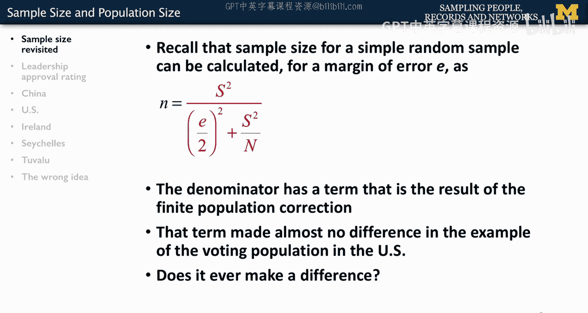

Okay， so let's look at presidential or we'll say leadership approval we're going to ask the same kind of question we asked before about President Barack Obama about whether or not you approve of the job that the current leader of the country is doing and whether you strongly or somewhat approve or strongly or somewhat disapprove。

And we're going to have some sequence of values here。

 the lower left then past data we've been asking this question。

 And we want to figure out what sample size to use for the next time we do this in order to achieve a particular level of precision。

But here， the problem is a little bit different。 We're not sure what the approval rating will be in each of these countries。

 The one cited for President Barack Obama。 This is in the latter part of his of his term as president after almost eight years in office。

 And it was surprisingly high。 most presidents at that point in an office have approval ratings that are somewhat lower。

 And he has a had a pretty high one， But we may be asking in the middle of someone's term in the United States。

 we may be asking later in the term for someone else and get a lower approval rating in a different country or maybe this countrys a very enthusiastic about their their leadership and and give a very high proportion。

 What should we do in a case like that， where we're uncertain about what value might actually be there for the P and thereby the S squared。

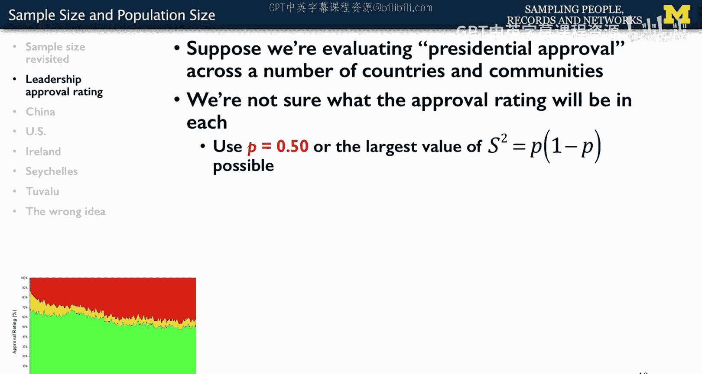

Here， what we're going to do is what's referred to as being somewhat conservative。

It turns out that the largest value of S squared that you can get for all the possible values of the proportion now。

 the proportion could go from virtually 0 to virtually 1。 But if you take all of those values from。

 let's say 0。01 to 0。99。 And you were to calculate the S squared for 。01。02。03 all the way up to 0。

99， the largest value of S squared would occur when the proportion is at 0。5。

And so let's be a little conservative。 We know that's going to be in the numerator of our calculation。

 Let's use as large a value as possible there， because we're not sure whether it's going to be really small or really large approval rating。

 We're going to use the worst case， which would be approval rating of 50%。 Now， that's worst case。

 not for the leader， but for our sample size calculation。 So let's use 0。5 here。

 So we're going to alter our calculations a little bit。 And so what we're going to do is。

And up possibly， or actually， in most cases， specifying a sample size that is larger than is needed because we're unsure what that proportion will be。

And so in this particular case， our s squared will be on the basis of a proportion of 0。50。25。

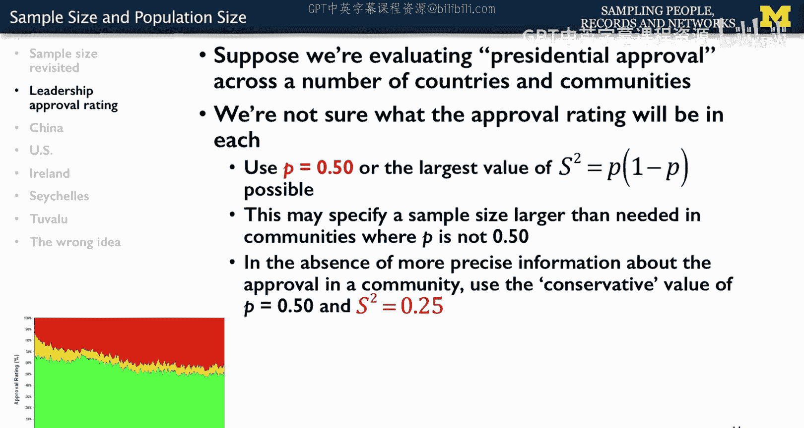

All right， that's our basic frameworkraing。And we're going to get the same kind of comp interval But we want a width of 0。

02。 We want a margin of error of 0。02 in all these calculations。

 And so let's turn China to a population like that in the People's Republic of China。

A population of 1。4 billion people， but among voters， maybe it's about 800 million。 Okay。

 just a round number。 It's not exact， but a round number。

And for a 95 per cent confidence interval with a margin of error 。02。

 we would need a sample a variance。 Now， our variance calculation will be a value of 00001。

So what sample size would go with that？Well， we're going to do a calculation then in which we take that formula that we were just looking at。

 that S squared over the margin of error divided by  two squared plus S squared over n。

And substitute in our values And in our particular case， in our substitution of values we have。

 in this particular case， our 。25， not， not 。24， but 。25， the worst case scenario。

We have our capital N in our denominator， and then we have our margin of error adjusted for the。

Z value。And when we do the calculation， we get 24，99，2500。

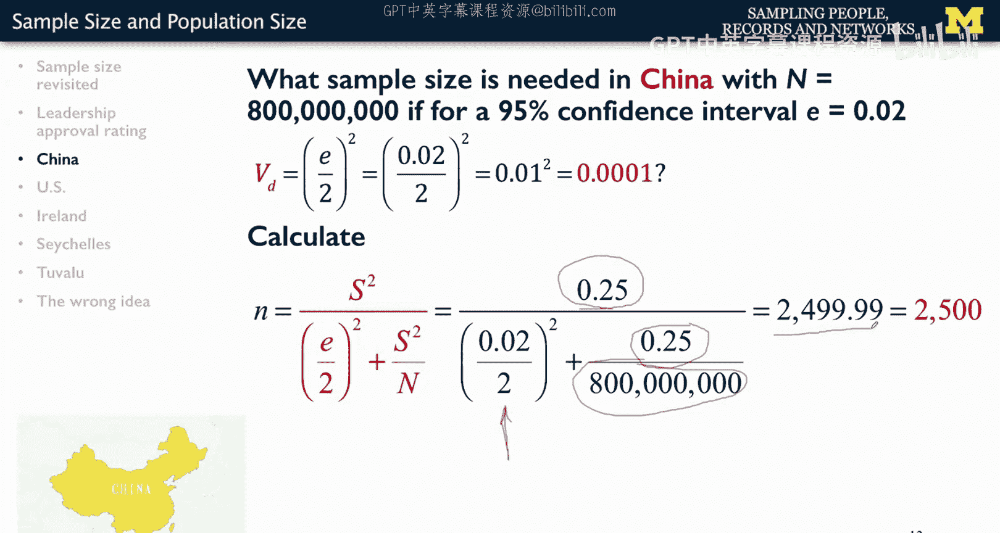

Now， if we didn't do the population adjustment， the finite population correction in this case。

 we'd have exactly 2，500。Whether we're talking about an infinitely large population or the People's Republic of China。

 which is virtually the same thing。 As far as this is concerned。

 it's 2500 is the sample size that we need。All right。 Well， then what about in a country that's。

Smaller， a quarter the size of that。 the United States with about 315，320 million people。

 but about 250 million who would be 18 years of age and older voting voting age。

 What about their approval rating，95% cent confidence for that margin of error 。02。

 What sample size do we need in this case。 And so we plug things back in again。

 We put in everything except all we do in this particular case is alter what we did for China by putting in。

250 million in that denominator。 That's our finite population correction。

And we see that lo and behold， our sample size still comes out to be 2500。

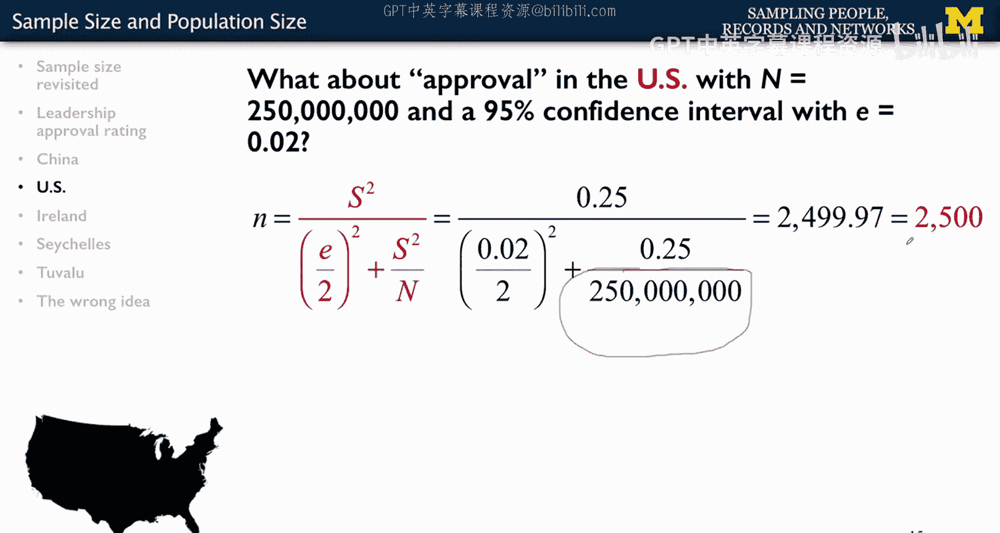

So even though the sample size， the population size is one quarter the size of China。

 we need the same sample size。Now， this， I know， doesn't seem fair。 If you're Chinese。

 this certainly doesn't seem fair。 You should have a larger。've got more people。

 but that's not the issue here。 It is to achieve the same level of precision。

 We need the same sample size。Regardless of the population size， well。I' I'm exaggerating。

 Surely it must make a difference if we， if we change this to go something smaller。

 And so let's go to something much smaller。 Let's go to the population of Ireland。

 I chose Ireland because I have a good friend to helped me develop material that I've modified here in these notes。

 we've taught together。 and he's from Ireland。Speaks of a lovely Irish accent。

 My wife loves this accent。 My mother， her family was from Ireland。 So Ireland。

 there's good motivation for doing this。 But here， Ireland's a much smaller country。

 about 4 million people， about 3。2 million voting age and in Ireland。

 and when we do this calculation for Ireland now this is dramatically smaller compared to China。

 we see that our sample size calculation is affected a little bit by that population size。

 Now when we put in 3200000。😊。

In our finite population， our sample size comes out to 2498。04， 2499， we save one case。

It's still 2500， as far as we're concerned， even down to something the size of Ireland compared to these other population giants in our world。

 I mean， I didn't do India， but it's same kind of thing there。

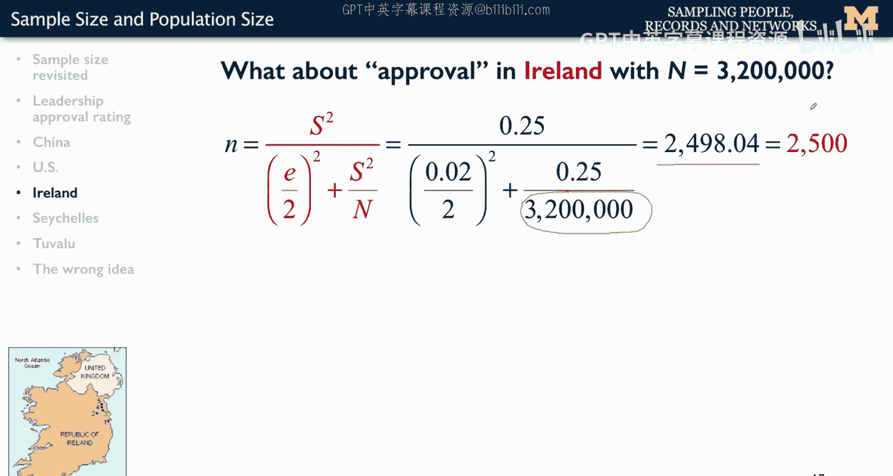

Well， when does it make a difference， Well， let's go for something much smaller。

 Let let's look at a place like the Seychelles in the Indian Ocean。

 where there's probably about 80000 is the voting population size in the Seychellells。

 just a round number。 I know it's not exact。 But here we have this island country。

 much smaller in size and now we're going to go and do the same calculation。

 but now using 80000 in that denominator。 now， my population size， it makes a difference。

 My sample size drops from 2500 to 2425。 I've saved 75 cases。

Now that's the effect of the finite population correction。

 it actually decreases the sample size as the population size goes down。

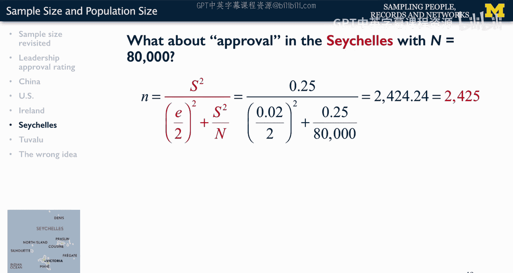

But， really。75 cases not going to make a lot of difference in terms of cost。

 And so I'm really still at about 2500。Well， let's go to some of the smaller countries in the world。

 Let's go to another island country Tuval in the Pacific in Micronesia。

 And here with a population of about 12000 and voting in number 18 and older。

 let's say 800014 to 150008000 voters when we do the calculation。 Now I see a dramatic drop。 Now。

 I've gone from 2500 to 1900。 Now it makes a difference。 But notice。

 we're really getting down there in terms of population size。

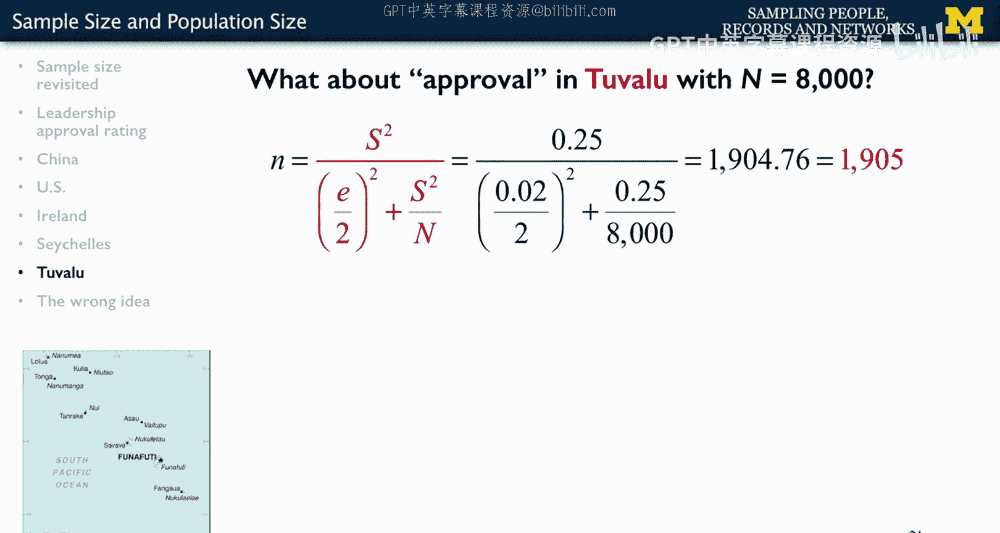

Most of the population sizes we dealt with， the ones that we four out of five。

 it didn't really make a difference。 That is here's a summary。

Sample size depends on population size， but not in an expected way。 First of all。

 it doesn't increase。 The sample size doesn't increase， as the population size does。

And above a certain limit of populace says it basically is the same。 It's unaffected。If anything。

 if we get to small population sizes， that sample size drops。

 We actually save money for the smaller populations。 But the Chinas， the United States， the Indias。

 the Russias， the Brazils， you know， these large countries。

 even down to Ireland is basically the same sample size。Now， why do we even bring this up？

Because there are textbooks out there that claim that sample size should be determined as a fraction of the population。

 say 10 per cent。And that's what I've got the drawing in the lower left fraction。

 that's how you determine sample size I actually had a call one years ago from somebody who was about to conduct a survey in a province of Canada and they were being told that they should calculate the sample size as a certain fraction of the population of that province。

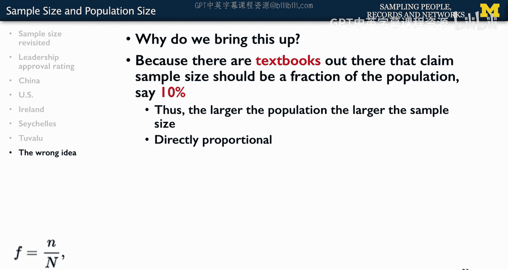

And they were saying， this is enormous in size。 Is that really the we we calculate sample size。

 And when we went through this kind of an exercise， it turned out to be quite a bit different。

The larger the population。The larger the sample size。

 that's what would be if it would would happen if we were doing a fraction like that。

It directly proportional to the population size。 And that's kind of the lay understanding。

 That's how people think about this。

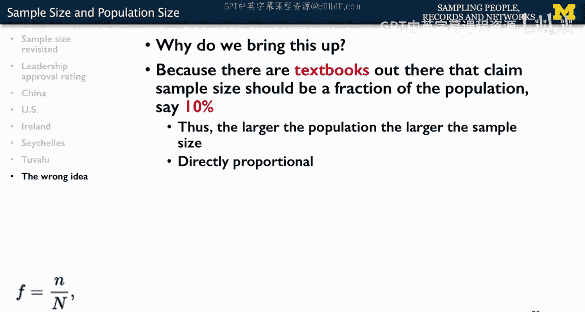

Yes， the larger the population should be a larger sample。 matter of fact。

 you probably heard this sometimes， here it is， this is the common sense perception。

How can a sample size of only 800 or 2500 represent the entire voting public of 250 million in the US。

 I chose 800 because a lot of the political polls， that go during elections in the United States and in other countries are not much larger than 800。

800，11200， maybe 2000， maybe 2500， but they're small in size。

 How can that represent the entire population when the population is so large。

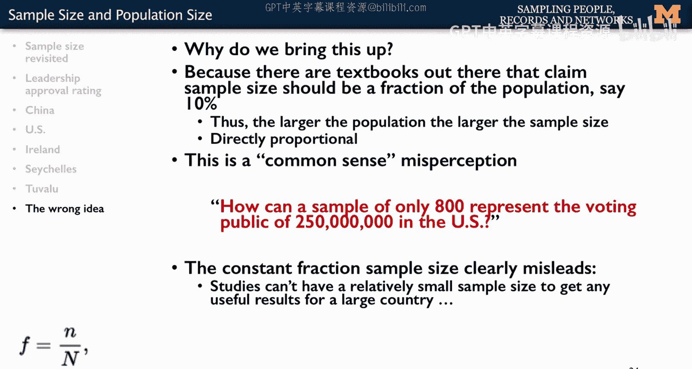

That is based on the misperception that population size determine sample size。

 And what we've just seen is that it doesn't。 It's basically unrelated until we get to very small populations。

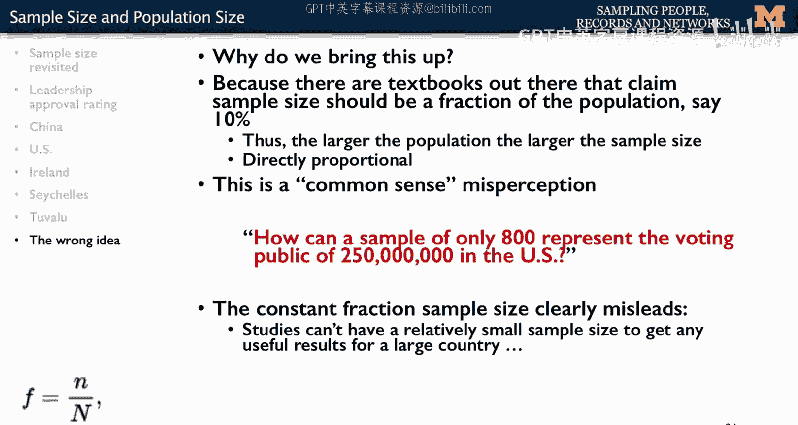

Okay， so keep that in mind then as you're thinking about this。

 sample size determination is something that is not based on the size of the population and shouldn't be done on the basis of a fraction like that。

Well， that's it for simple random sampling。 We've had a lot of formulas here。

 We're going to move on to talking about cluster samples next， and the unit is labeled saving money。

 Cluster samples are about saving money。

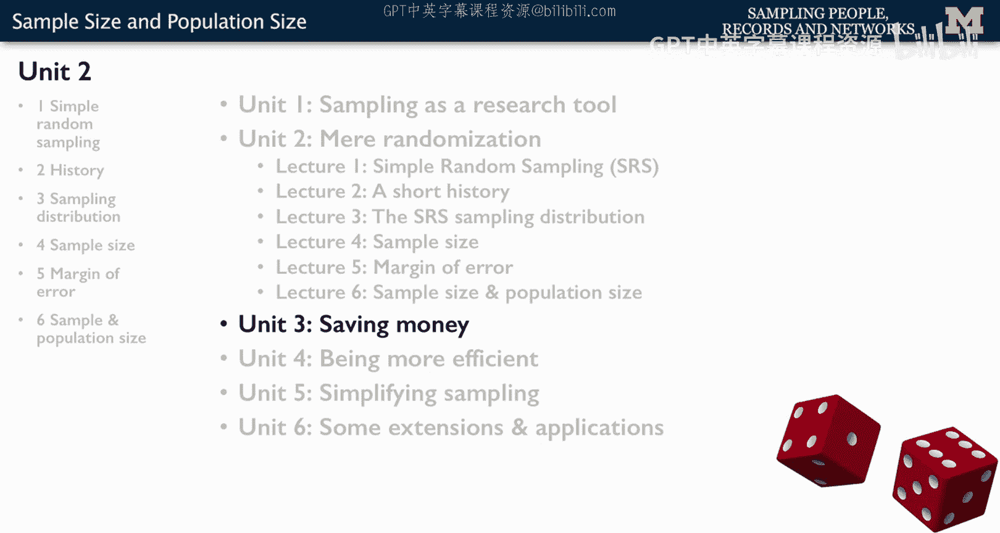

You're not going to need to memorize the formulas you've got here。

 You've got a reference back to them now。 you've got these notes。

 but hopefully when you look at them， you'll see them not as formulas。

 but as distilled representations of a set of ideas and principles about how to deal with the numbers。

 the data we get from simple randomum samples and then how to think backwards。

 how to go back to the beginning from an end point and figure out what we need in order to draw a sample that's going to give us a certain level of quality in our results。

So let's turn next to cluster sampling as we move into unit three about saving money， thank you。

