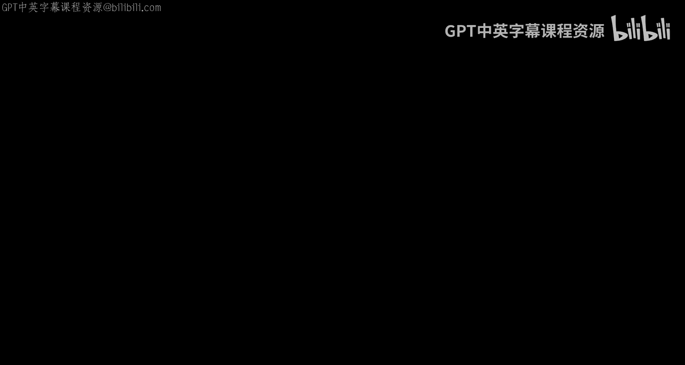
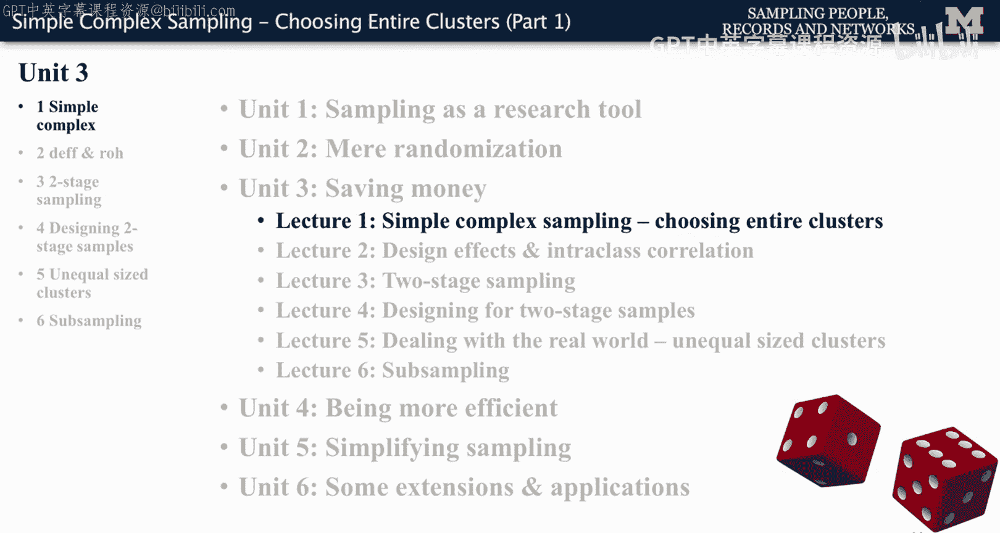

# 密歇根大学《调查数据收集和分析（2-6：方法、社调问卷设计、抽样、缺失数据、分析）｜Survey Data Collection and Analytics》 p96 17_3.1 简单复合抽样：整群抽样(上).zh_en -BV1fw4m1e7Zh_p96-

Sampling is ultimately a practical activity， at least the way we're presenting it here。

 it's not a theoretically driven activity， and that's something we've mentioned in our previous lectures。

So welcome to unitt 3。EnitledSaving Mo。Certainly saving money is a practical kind of thing to do and what we're doing here in this unit is introducing and discussing sampling techniques that are usually labeled cluster sampling。

And the purpose that I picked out to highlight here to help you remember what these are about is sampling techniques that are designed to reduce the cost of our data collection。

And this cost reduction， as we'll see， comes about for a couple of reasons。

 but it's the primary motivation for doing this kind of thing。

It will be something that we talk about as we move through this in terms of how we're going to save money and then also how we draw our samples in order to take advantage of certain features that we found in materials that are available。

So what we're going to do is look at some different kinds of materials as we talk about saving money。

And talk about six topics here， six lectures。Starting with this lecture on simple， complex sampling。

 well that's kind of a。Putting the two words together that don't make much sense。

 But you recall that we talked about complex sampling as being any kind of sampling that isn't simple。

 Well， obviously， where the simple sampling had to do with simple random sampling。

 selection only using randomization。 not using any other kind of technique。

 And so what we're going to do here is introduce a different technique， in addition to randomization。

And that will make this complex sampling。 We're going to be choosing clusters and we'll talk about what clusters are and how they're selected。

 But then we're also going to talk about what the implications are for the results that we have。

 and that will move us into the second lecture。 So the simple complex sampling complex samples involve clusters and randomization。

 We're only going to do a simple version of that to begin with。And then in lecture2。

 we're going to talk about the impact of that on our ability make to draw inferences about the population itself。

 recall the things that we were doing in simple random sampling， having to do with comps intervals。

 Well， comps intervals are affected by changing， adding in this additional feature of cluster sampling。

Letecture three then we'll move to something that is a little more complex， complex sampling。

 two stage sampling， where we will take clusters and then not take all the elements within them。

 but a subs sampleample。And lecture 4， we'll talk about how to design such samples。

 how we think about the determination of the number of clusters and how many elements to take per cluster。

Then in lecture 5， we're going to deal with unequal sized clusters。

 something we won't talk about up to that point， we're going to keep these equal in size and then finally some issues concerning subsampling and that'll be the range of topics we talk about here for cluster sampling there's a lot of other topics we can talk about as even with simple random sampling。

But our purpose is to cover the major points of emphasis here。 again。

 the dice are showing here in our display， this is still probability sampling that we're talking about。

And it will be this choosing entire clusters， as we'll illustrate with an example， a simple example。

 something we can see and get our minds around。And we're going to talk about this in four steps。

 we're going to talk about a population， what happens when we do simple random sampling on that population。

 oh and that population will be clustered。Now it's not something that we're going to create。

 but something that' is already there， and then we'll do simple random sampling and ignoring the clustering。

 then we'll turn to cluster sampling and then talk about what impact that has on sampling variance。

 Well what we know is standard errors， what we know as the input factor to margins of error。

 the input factor to the cuff intervals in there width。

So let's turn to then our population and here it is。 imagine that what we're doing。

 This is just a stylized version of a Google Earth image of a neighborhood in some community。

 that happens to have housing units， those little green boxes there。

 the housing units looking top down their're roofs and there we have them organized into blocks。

 The blocks are bounded by streets。 we can see Main Street and  Elm Street and so on in this part of town as well as first Street and second street and so on。

 and each block now is the same size， but that's not the relevant portion here。

 What is important is that each block contains the same number of housing units every one of these blocks。

 you can see them numbered there from one to，34 they're not numbered across a row they're kind of numbersed in a winding fashion through all the way to 18。

 there's 18 blocks here。And every one of those 18 blocks have。8 housing units on them。

And our goal is to draw a sample of housing units because I don't know。

 we work for a housing agency and a government。We work for some kind of company that deals with housing and maybe home improvements。

Were interested in understanding some of the characteristics of these housing units。 Now。

 there may be something else we're interested in。 it may be that we're interested in the people who live in these housing units and their characteristics。

 So it's not。Clear what we're going to use this for。

 but it is clear that this is useful to us because the housing unit is the sampling unit。

 it's the element that we're interested in。And we may be measuring something about each housing unit such as the square footage。

 it may be the number of rooms that they have， it may be a household characteristic such as the household income or the number of persons in the household。

 things like that。But here's our population， now let's see there's eight。

Housing units per block and 18 blocks，8 times 18 is 144，144 housing units in our population。

 So were our capital in here is 144。It's divided up in this way。

 just for us for illustration purposes。In reality， what we probably would see is not an image like this。

 but what we might see is a list of the blocks。We might have a list of the blocks and not of the housing units。

So this is kind of stylized to help us understand what's going on。 But in this particular case。

 let's assume for the time being that for this population， which is all neatly organized。

 And as far as we're concerned， all we want to do is sample housing units。 that is。

 it's just a visual representation of the list。 Here's the list。

 The list are the address for each of these elements in the population， there's 144 elements there。

 And you can see that I've just arranged them here by sequential address number and street name。

Now that isn't how they're organized on the list in the blocks。

 so those housing units that are on Main Street in many and actually in most numbering systems that are used by postal systems。

 which is where a lot of the numbering of the addresses come from。

The the numbers are odd numbers on one side and even on the other now this is not uniformly the case。

 but we'll say that that's the case here and so 101 Main Street is on the east side of the street but 104 main Street is on the west side so they're block faces there we just mix them all together because it does matter to us it's just a list of each of the housing units by their address。

Now， we're interested in some characteristic for these housing units。

 and I'm going to talk in general now and we're going to use the symbols that we've looked at before。

 but we should be a little more comfortable with them now。

We're interested in some characteristic for each of these housing units。

 each of these population elements， and let's say it's square footage or square meters。

' just a conversion factor of 10 right so 10 square feet is a square meter roughly and so we're interested in understanding something because we're thinking about a business in which we're working on home improvements we're thinking about from a government system in terms of the usable living space in housing units but square footage and so for every one of these housing units that's there how large it is in terms of usable space。

And we could possibly get this from records， we'd still have to look it up。

 or we can get it by visiting each of the housing units and collecting the data。

But there's a mean that we're interested in the average number of square feet per housing unit in this part of our community。

And that's our y bar there's also the variability of those living space measurements。

 the S squared that we've talked about before， that element variance。

 of course its square root is the standard deviation and gets us back to the same things S squared is measured in square feet squared or square meters squared。

Double square。 but the scale we want is on square meters or square feet。

 So we take the square root of that to get a standard deviation。 That's all the same。

 even though they're organized in clusters， nothing， none of this has changed。

 That's still what we're interested in in estimating。 Now， in our particular case。

 we might draw a simple random sample。 And the simple random sample could look like this。 Now。

 I didn't do the sampling according to block。 I just went through and drew a simple random sample of the 144 addresses。

 And I think there are 24 of them here。24 addresses。

 So I've taken a sampling fraction of one in six of them，16 of the housing units。

 and they're sampled at random。 and they're scattered across the blocks， Curly。

 there's a few blocks there that don't have any。 And that's because I didn't force it。

To come from the block， simple random sampling won't force us to select a housing unit from every block。

 As matter of fact， a simple random sample from this one could have been the first three blocks。

 all the housing units。 all 24 housing units there or the last three or any any selected set of three or could have been that we've gotten four per block。

 and half the blocks have them and the other half of the blocks don't whatever it is。

 We would have a variety of simple random sampling representations。

 But here's one where we've just chosen them from the list。

 And then we've plotted them on the visualization。Okay， they're scattered all over。Now。

 in order to do this sample， we had to have the list。

And we now face another problem when we go to collect our data。

 if we're going door by door to the sample addresses， we have to visit each of them。

Those two things are cost components that most of the time we don't think seriously about。

 but they can be substantial cost factors in conducting a survey。But let's deal with the one。

 the list。If I had to， if I didn't have the list already assembled。

 and there are lots of cases where we don't have this。

 lots of instances in in countries around the world where we don't have lists of addresses。

 there are countries where their address registries。

 Sometimes the address registries are built off of some kind of a person re system。

So the population is required to register with a local police authority and there they if they're going to live in that address for a certain length of time。

 they have to go to the local police jurisdiction and fill out a form and say that that's where they're residing now。

In some cases， that's a formal registration and that's their official place of residence for not only such things as might be voting behavior。

 but also for employment eligibility， some countries that that means you can only work in this community if you live in this community。

But however， it's assembled， it's some kind of registration system like that。And in those countries。

 you can get access to such lists in some， but not all。

So you have this collection of a large number of countries， most of the countries。

 not just the majority， but virtually 90% of them， where you don't have address lists like this。

 So what are you going to do then if you want to do a simple random sample。 Well。

 one thing you could do is build your own list for this particular one， I'm going to employ some。

 my graduate students， going to send them around block by block and have them go on each block and list all the addresses by hand。

Well， on a laptop on， on some kind of device that has a place for them to register in a spreadsheet。

 But make sure that they get all the addresses there and then bring that back and do the simple end of sample。

 And then here's the。The result。 but that list creation activity is going to cost money。

Now I shouldn't say this， but graduate students are cheap。

 well they're less expensive than some employees， they're more expensive than interviewers， frankly。

 because of a variety of things that you have to pay for for graduate students。

 but there's a cost incurred for doing that listing。Every penny that you spend， every every dollar。

 every euro that you spend on the listing is taking away from the data collection costs and so if we can avoid that。

 we would。Well， it turns out that in this particular case。

 we not only we don't have the address list， I know I gave it to you。

 but now let's imagine not having that address list。And what we have is just a list of the blocks。

Where would we get a list of the blocks。 Well， in virtually every country。

 there is a list of blocks or blocklike units that is used in a census operation。

 A census of population， a census of housing， sometimes a census of establishments of businesses。

 an economic census， even agricultural censuses will have this where the country is divided into areas that are bounded by streets。

 In this case， in an urban location， generally bounded by streets。

 but by rivers or smaller waterways， by railroad by major highways and so on。

 and they divide the area， the land area up into these smaller units that they may call blocks or enumeration areas。

 in the enumeration areas is the key。 They're interested in counting all the population。

 counting all the housing units。 So they're going to count them by those land areas to keep track of it and make assignments。

 Now， they're spending the money to。the list say well， well， there we go。 It's available。

 Now they don't release the addresses， even in countries that have very well developed census systems。

 they don't list that the individual addresses， oftentimes for confidentiality reasons。

And so they provide you with the blocks， they'll give you a list of the blocks。

 they'll show you their geographic location， but they won't tell you where the housing units are on them。

So in that case， then we've got the cluster。 we've got the grouping， but we don't have the addresses。

And in that case like that， we would have to get the addresses。 spend that money。

 reduceuce our data collection capability， the number， the sample size。

 because we've had to invest in it。 Now， for a small case like this，18 blocks。It's not a big deal。

 But if you're talking about an entire country and I'll take the United States where there are tens of thousands of blocks in the census operation。

Going and listing all the housing in in each is a huge task and something we're just not going to do。

We'd spend so much money creating that list， we'd never have enough money to do the survey。 frankly。

 we would not get enough money to even do the listing。

And there's potential to buy addresses from commercial sources。

 but sometimes they're very expensive or they're incomplete。So building a list is a huge deal。

 Ma the frame is a huge deal。 And if we can do this by a different technique。

 we can maybe get away with a little bit of an advancement and reduce our costs of data collection。

 Oh， when we go to make our data collection， we've got to go to all these blocks now。

 And maybe we could reduce this by going to a subset of blocks。Well， in any case。

 let me just add one additional thing here。The simple random sampling， if you recall。

 if we're computing the sample mean from these 24 sample housing units。

There is a sampling variance from the sampling distribution。 You recall in unit 1。

 we've talked about this。 And in unit 2， we've talked about sampling distributions。

 We even talked about the variability of the means from the sampling distribution And here's the sampling variance of the mean for a simple random sample of size lowercase n in our case 24。

 with a 1 minus F， the sampling fraction， lowercase n over capital N 24 over 144，1，6。

Divided by 24 times that element variance。 And of course， we don't know how to compute this。

 We do know that it's an exact representation of the sampling variance theoretically because of the definition and the algebraic transformation into this form。

 but we do not know S squared。But what we can do is go back to。

 and I'm going to go back to our representation for this kind of thing。

 you remember this very busy display。Where we have a population。 and afraid remember are seven steps。

 I've got six of them here。 So there was the population specification。 That's the light blue box。

 And then the frame is the dark blue box that overlays it。 and then sample， sample sample。

 we only do one sample， but we imagine then doing all possible samples of a certain size。

 simple random samples from this frame。 and each case computing and estimate。

 that's the fours that are shown there。 And then finally。

 imagining the sampling distribution and the variability of those means across all possible samples。

 and that's our number five， that sampling distribution。

 I'm just following through the things that we've seen before。Out of that。

 we were able to derive an expression for the sampling variance that didn't involve having to know all the means。

Only having one mean， we can calculate a standard error from the sample by computing the 1 minus F divided by n。

 just as we saw before。 But now multiplying by the sample analog to that element variance。

 the variability of the。Sample values， lowercase S squared， and we get a standard error。Okay。

 simple random sampling。A visual representation of what it would mean physically geographically with a given sampling variance。

 And in this particular case， then we have to be worried about when our population is distributed geographically like this。

 we can't afford to create an element frame。 if we don't have one。

 nor could we afford to visit all the lowercase and elements drawn randomly from the entire area because it be scattered instead of a few blocks in the city。

 an entire city， the blocks in a metropolitan area than includes a central city and a number of suburban areas around it。

 a province or a state。 Now now it's getting to be much larger in scale and the travel costs begin to mount。

And we'd like to reduce those。 So we're going to use cluster selections to reduce those two costs。

 First， we're going to identify clusters and select those。

 and then only list the elements in the selected clusters。 I mean， it's the obvious thing to do。

 There's no theoretical justification。 It's just a practical one。

 So we're going to reduce our listing to only a sample of the blocks of the clusters。

 And then when we go to those particular blocks， we reduce our travel costs because we're going to a much smaller number of blocks。

 the simple random sample will scatter our sample across a large number of blocks。

 perhaps as many blocks as number of elements in the sample。Okay。

So we're assuming that the cluster list is available and in a case like blocks。

 it is in many cases for the kinds of samples that we're interested in doing。

 there are clusters like this that are readily available， we don't create them。

 but we grab them from another source， oftentimes administrative sources。Such as the census。

And then we go to the cluster list， make a selection， and we select the elements within them。

The last point highlighted in red here， though， is important to keep in mind。

 This particular illustration is very artificial。 I've created it so that the blocks are all equal in numbers in terms of housing units。

 That doesn't happen in the real world。 They're seldom equal in size。

 And so we are going to have to deal with that。 But that's one of our upcoming lectures。

 as as you recall。 here， we're just going to deal with the equal size clusters。Okay。

Heres the cluster sampling alternative I've combined two steps。

 because I should have shown you one display that highlighted blocks 1。

9 and 16 as having been selected at random。A simple random sample of the clusters first。

 not of the elements， but of the clusters。 And then when we get to those three blocks。

 we list all the housing units。 And in this case， we take all。

 This is what I mean by the simple complex。 The clusters are all equal in size。

 We sample the clusters， and then we take all the elements within them。 That's only one possibility。

 We're going to talk about sub sampling。 Two stage sampling in another lecture coming up that in the third lecture。

This is with a visual representation， and this looks quite different than simple randomum sampling gets concentrated。

And in many cases， when we look at this， it's a little bit troubling， we think。

 well but wait a minute。 supposeupp that what you've gotten is block 16 and block 16 was all the big houses。

 As my wife calls them the Mc Mansions， the really big things that people aspire to。

 And they've got really large square footage measures for each one。

And the other two blocks are typical。1 and 9 are typical or smaller。

 Don't you have a bias when you do this。 No， you don't have a bias because you've got to keep in mind that all of those blocks had an equal chance of being selected。

 including the large one。So there's no bias in this。

 What's going to happen is the variance is going to increase because we。

 when we get block 16 with the large measures， a larger average size。

 iss going to boost our mean for that particular sample above the others that don't included and those samples that don't include block 16 have an average that is lower。

 And remember， our variance is about what happens in the sample from sample to sample not what happens for a particular sample。

 but from sample to sample。 And we're going to need a way to calculate variance that takes that into account。

 Well， the red formula at the bottom does that。 we'll talk more about this in the next unit。

 but this is the sampling variance of the mean for a simple random sample。

 simple random sample now of clusters of lowercase a clusters。 a being capital A being 18 here。

 lowercase A here being 3， Only three clusters selected1。

It's the same thing we've seen before the same sampling fraction。

 but then you'll notice it's multiplied by an S squared with a little subscript A。

And we'll see that what this represents is the variability among cluster。Characteristics。

 not not the element values， now the cluster characteristics。

And what's happened here is then when we look at the sampling distribution。

 I'm going to go back now to our display。 you know， this one that's so busy for our purposes。

 Now I've added something to it。 You can see some some fine cross hatching here in in the display。

 And in in the population， it's clusters。 in the frame， it's clusters。

 Then we draw the sample from each of these， and we compute a mean for one sample。 Of course。

 we can conceptualize this as having many possible samples。 Now。

 I haven't written the right number for the total number of possible samples there。

 It should be capital A choose lowercase A。 But I just wanted to repeat that here to remind us that that's how we did this before for elements。

 But now for clusters， we've got to do it for all possible cluster samples。And when we do that。

 that standard error that you see in the lower right changes。 It is now based on in the denominator。

 the number of random events in my sample， which is only 3， not not 24， but 3。

3 random selections of the clusters。 and then we take everything。 There's no sampling at that。

 Take everything step。 It's， it's a census。And then the S sub a squared is going to be variability among cluster characteristics。

So we've made this shift in the sampling from a costly element sample that's going to cost us money。

 both in terms of list assembly and travel to go to the different locations。

2 one in which we sample we have two lists， actually in our illustration 4 we have the list of the blocks。

 the 18 blocks of which we sample three。 And then we add three more lists by going to each of the blocks and sampling the housing in this case taking all。

Okay。Let's， let's stop at this point。 where we need a little bit of a break here， but it's。

 it's now dealing with our cost of choosing entire clusters we've。

Reduced our listing problem from 18 blocks and have to be listed to just three。And our travel。

 our travel in the previous one， I think we had to travel to 15 or 16 of the of the 18 blocks。 Now。

 we only have to travel to three of them。 Now， it's not a big cost savings here。

 but you can imagine in larger scale， larger populations that being an important issue。

Okay， so let's take a break from this right now。 we're going to come back and pick this illustration up and elaborate this a little bit more in understanding what happens when we sample clusters in the next part of lecture1。

 Thank you。