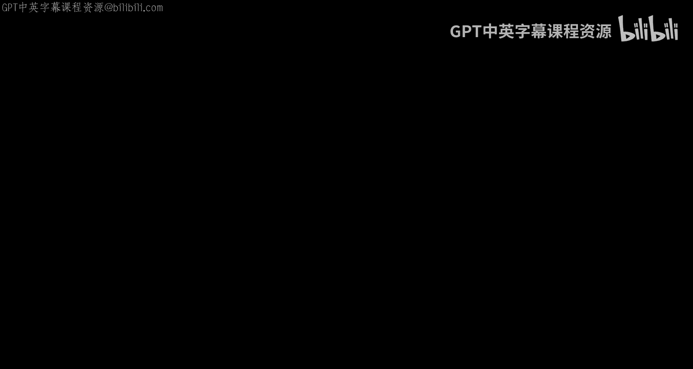
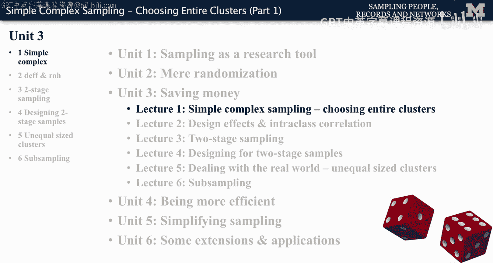

# 调查数据收集和分析：3.1：简单复合抽样：整群抽样(上) 🏘️

在本节课中，我们将学习一种旨在降低数据收集成本的抽样技术——整群抽样。我们将从一个简单的例子入手，理解其基本概念、操作步骤以及它与简单随机抽样的区别。

## 概述

抽样本质上是一项实践活动。在本单元中，我们将介绍并讨论通常被称为“整群抽样”的技术。选择这种技术的主要动机是为了降低数据收集的成本。我们将通过一个具体的例子，逐步了解整群抽样的原理和操作。

## 从简单随机抽样到复合抽样

上一节我们介绍了简单随机抽样，它只使用随机化进行选择。本节中，我们将引入一种在随机化之外的新技术，这使得抽样变得“复合”。我们将选择“群”，并讨论什么是群、如何选择群，以及这对我们的结果有何影响。

## 一个示例总体

为了理解整群抽样，我们首先需要定义一个总体。想象一个社区的鸟瞰图，其中包含许多住房单元（用绿色小方块表示）。这些住房单元被街道划分为不同的街区。

*   总共有 **18个街区**。
*   每个街区恰好包含 **8个住房单元**。
*   因此，总体中的住房单元总数 **N = 18 × 8 = 144**。

我们的目标是抽取一个住房单元样本，以了解其某些特征（例如，居住面积、房间数量或家庭收入）。总体均值（`Ȳ`）和元素方差（`S²`）是我们感兴趣的关键参数。

## 简单随机抽样的挑战

假设我们采用简单随机抽样，直接从144个地址列表中随机抽取24个住房单元（抽样比为1/6）。样本点会分散在各个街区。

然而，这种方法面临两个主要的成本挑战：

1.  **列表成本**：在许多情况下，我们可能没有现成的、完整的住房单元地址列表。创建这样一个列表（例如，派人逐街记录所有地址）成本高昂。
2.  **访问成本**：由于样本单元地理分布分散，访员需要前往许多不同的街区进行数据收集，交通成本很高。

## 整群抽样的解决方案

整群抽样提供了一种降低上述成本的实用方法。其核心思想是利用现成的“群”列表（例如，人口普查中使用的街区列表），而不是元素列表。

以下是整群抽样的操作步骤：

1.  **获取群列表**：我们有一个包含所有18个街区的列表（这通常可以从人口普查等行政来源获得）。
2.  **抽取群样本**：我们从18个街区中，随机抽取3个街区（例如，街区1、9、16）。这相当于对“群”进行了简单随机抽样。
3.  **处理群内元素**：对于每个被抽中的街区，我们列出其内部所有的住房单元（本例中为全部8个），并对它们进行调查。这相当于在群内进行了一次普查。

通过这种方式，我们将列表工作从18个街区减少到仅3个街区，同时将实地访问的地点也从可能遍布全城集中到了仅3个街区，从而显著降低了成本。

## 整群抽样的影响

从视觉上看，整群样本（集中在少数几个街区）与简单随机样本（分散在各处）截然不同。这引发了一个问题：如果恰好抽中了一个全是“豪宅”的街区，样本均值会不会有偏差？

答案是：**不会产生偏差**。因为每个街区被抽中的概率是相同的，包括那个“豪宅”街区。偏差与某个特定样本的结果无关，而是与抽样方法是否系统性地高估或低估总体参数有关。

然而，整群抽样确实会影响估计的**方差**（即抽样误差）。当我们抽中一个特殊街区时，该样本的均值可能会显著偏离总体均值。由于我们只抽取了少数几个群，样本之间的差异可能会变大。

简单随机抽样均值的抽样方差公式为：
`Var(ȳ_srs) = (1 - f) * S² / n`
其中 `f = n/N` 是抽样比。

而在整群抽样（本例为“群内全部调查”）中，均值的抽样方差公式变为：
`Var(ȳ_cluster) = (1 - f_a) * S_A² / a`
其中：
*   `a` 是抽取的群数量（本例为3）。
*   `f_a = a/A` 是群的抽样比（3/18）。
*   `S_A²` 是**群间方差**，衡量的是各街区平均特征（如街区平均居住面积）的变异程度，而非单个住房单元特征的变异。

**关键转变**：我们的随机性来自于对**群**的选择（仅3次随机事件），而不是对**元素**的选择（24次）。因此，计算标准误时，分母是群的数量 `a`，方差度量也变成了群水平的方差 `S_A²`。

## 本节总结

本节课我们一起学习了整群抽样的基本概念。我们了解到，当缺乏元素列表或实地访问成本过高时，整群抽样是一种降低成本的实用方法。其操作分为两步：首先随机抽取“群”，然后处理被抽中群内的所有元素。虽然这种方法不会引入偏差，但会改变估计量的方差性质，方差大小取决于群与群之间的差异程度。在下一节中，我们将更深入地探讨整群抽样对方差的具体影响。