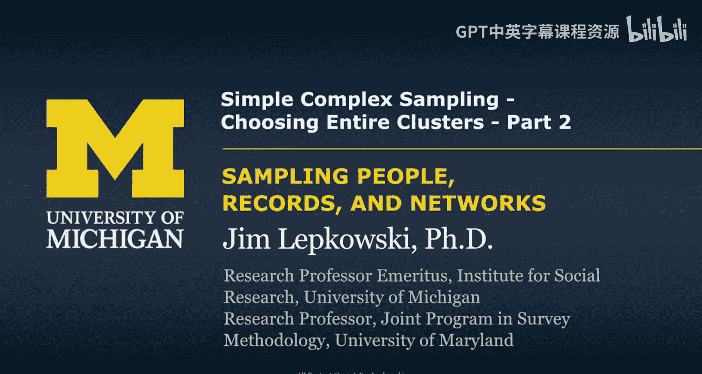
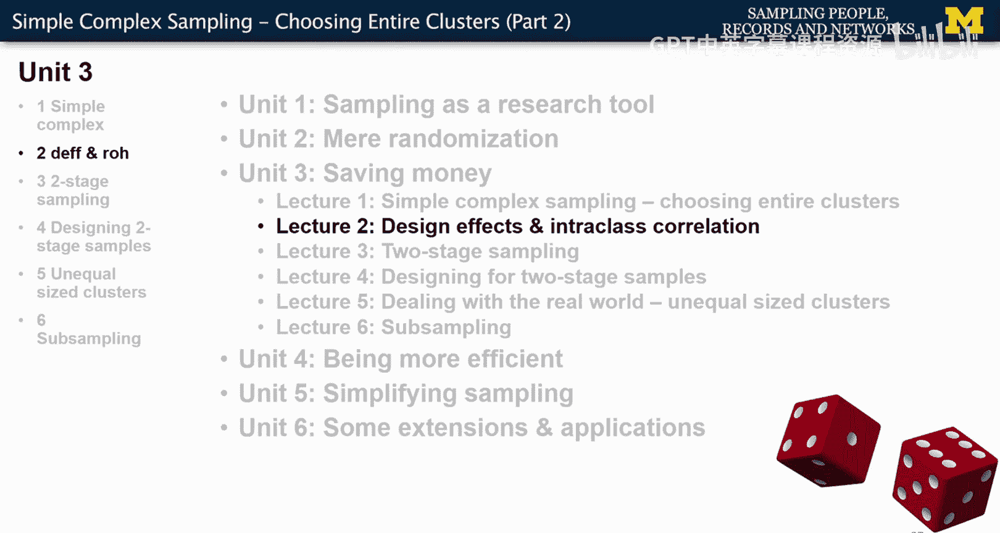

# 密歇根大学《调查数据收集和分析（2-6：方法、社调问卷设计、抽样、缺失数据、分析）｜Survey Data Collection and Analytics》 p97 18_3.1 简单复合抽样：整群抽样(下).zh_en -BV1fw4m1e7Zh_p97-

Money， money， money， that's what we were talking about before， although it didn't seem that way。

 So sometimes people will say about this particular topic， it's not very practical。

 And I think they're getting bound up in formulas and things。

 when they and they miss the point of why these things are being done。

 So here we are in lecture 1 of unit 3 in which we're talking about saving money we're talking about complex sampling now cluster sampling。

 but a simple form of it， where the clusters are all equal in size and they also have the property that when we sample them。

 we're going to take all the elements that are there on a given sample cluster。

But we had looked at this particular problem and within the context of our lecture so we're still in lecture one here。

 but now what we're going to do is move back to if you recall our sampling distribution problem。

And see the consequences of dealing with this。 And so what we're going to do is expand our example and talk a little bit about a different example and add some additional notation for a second and changed the example。

 so we've been doing 2 no 18 blocks right with eight housing units each in our previous illustration and drew a sample and then looked at the different visual representations of what the sample would look like if we had drawn the elements directly。

 simple random sampling versus drawing the elements only after having selected clusters。

Let's try another illustration， something that involves schools to illustrate something that happens for the calculations here and I borrow something from the work of a colleague it's a slightly different version of what's been done but it has to do with sampling clusters that are equal in size and suppose that we've got a population of thousand clusters。

 not 18 but a thousand so it's a bigger problem and we've decided that what we can afford to do is draw a sample of10 of those and then go and collect all data about all the elements within them so I put this in the context of the following so suppose that we're doing work for a school district。

 a management of a geographical management area where there's a set of schools and it's a fairly large school district and they're interested in studying what's going on in elementary school classrooms the early year classrooms with respect to the immunization history of the children。

 they've had some concerns about outbreaks of childhood diseases among the student population。

And they've decided they want to do a sample and go in and make sure they understand what fraction of their children are fully immunized。

 Now， they could do this at the beginning of the school year and require the parents to bring in the records。

 but they've tried doing that， and it gets to be quite complicated。

 The parents can't find the records。 They've got a lot of。Data to manage， in this case。

 they've got  a thousand classrooms， they have a list of those thousand classrooms。

 but they don't have a list of the children within them。So again， they faced the problem。

 they could go and try and build the list of the children。

 but that would take a bit of time and so they've decided to sample 10 of the classrooms and then go and examine all of the children within those classrooms now there are 24 children in each classroom。

 so in the population there are 24，000 children in this grade level。

But there are in the sample then 240，1 in 100，1 to 100th of the population will be in the sample。

1/10 no，1，100th of the classrooms， and then taking all of the students within。

Now we're going to refer to the capital A here that 1000 as those classrooms as primary sampling units。

 because in the previous example we had blocks， those were the primary sampling units。

 they were the sampling units at the first stage of selection。

 so the PSUs as theyre going to be referred to。In their classrooms。

 as shown in the lower left illustration here。Now， when we've drawn the sample。

 we go and make our measurements and in this particular case。

 the record shows the following and I've organized this or this illustration is organized by classroom。

 here are the1 sample classrooms， the fractions of each classroom where the children are fully immunized。

Just put them in order。 this isn't in the selection order。

 This is in order by by the fraction from lowest to highest。9 and 24。

 about one third of the kids are immunized to 21 and 24， where virtually all of them are immunized。

Now， from our point of view， what we want to know is what's the overall fraction We don't want to know by classroom。

 but this is what's coming about because of our randomized selection。 we selected classrooms。

 This is what the classrooms look like to do our estimates。

 we don't have to worry about the classrooms。 we can just add up the numerators there。

 So the 9 plus 11 plus 13 plus 15 and so on。 and that sums up to 160 immunized children。

And that's out of 240， so our rate proportion immunized is 0。6723。Now that。

numberumber that we've got is our sample estimate。 we're going to use that to project to the population for dealing with immunizations in this particular case。

This kind of cluster sampling， one stage， if you will， or simple cluster sampling。

 taking taking all that estimate that we just computed is unbiased。 Oh， the process is unbiased。

 let me say that that in little different terms， The mean in this case is unbiased for the population mean because this particular process is unbiased for the mean。

 So on average， if we did this again and again， drew all possible samples of 10 classrooms from the 1000 and computed this proportion in all cases。

 A mean。And average them across all a possiblele samples， we would get the true population value。Now。

 that's also true of simple random sampling remember for simple random sampling without replacement now we're going to get the build the whole list of the 24。

000 expensive operation for us。And compute the sample proportion。 And that sample proportion。

 we know when we sample 240 at random without replacement from the 24000 will be unbiased。

And we also know from that previous work that there's a sampling variance that goes with it。

 and we can estimate the sampling variance from just the sample data。

 And as a string of formulas there， three expressions， the sampling variance。

 lowercase V A R of the proportion I that one minus F Sd over。 And。

 I guess I should have put the lowercase N under the1 minus F。

 We are familiar with that kind of an expression。 And to the right of it。

 I wrote the version of that formula， the algebraic equivalentvalence that involves proportions。

 that will just be more convenient for us to use。That involves the p times 1 minus p divided by n minus1 times 1 minus F。

Now， again， these are， you recall。Sort of two step processes。

 We took the definition of the sampling variance， did some algebraic manipulation to get the 1 minus F cap squared over N。

And then said， but we don't know capital S squared。

 but we can estimate it from the data 1 minus F lowercase S over n。 And the last step， by the way。

 lowercase S squared for proportions。Can be written as P times 1 minus p times n over n minus1 leading to that last expression。

That's the long story of what that represents， so we just put it in compact form so it didn't have to have multiple slides here。

Now， what we have is not this。 What we have is a simple random sample of lowercase a。3， I'm sorry。

 10 equal size clusters from capitalplan A equal 1000。And our randomization， as we noted。

 occurs at the cluster level。 the formula that we see there the middle for the estimated sampling variance for simple random samples。

 is 240 random events。Here we have 10。And so now， because the randomization occurs at that level。

 we're going to deal with the P。The characteristics of the clusters。

 what is that for the child It's immunized or not immunized， a1 or a 0。 for the cluster。

 It's the fraction of the children who are immunized or the proportion。 So we have a P now。

 some alpha， Al for each of the clusters， A going with capital A number of clusters in the population。

 lowercase， A number of clusters in our sample， alpha to index， the clusters。

 going from1 to 10 in our particular sample。 So those 10 fractions。That we've got。

Unlike in simple random sampling and cluster sampling。

 we're going to treat this sample as a sample of lowercase A from capital A。

 lowercase A is the number of sample clusters in our case 10 from capital A 1000。

 it's a simple random sample， and when we do that。The sampling variance。

 we go back through all of the things we talked about before for the sampling variance。

 as we've seen here。 This is the sample analog in which we have expression involves the expression lower case V AR of our proportion。

As opposed to the capital VR that we were looking at before。And we have。

3 similar elements to what we had before for simple random sampling。

 a finite population correction 1 minus F。A divisor by the number of random events in the sample。

 In this case， the sample size is 10， not 20240， but 10。Clus， that's where the randomization。

 that's all the random numbers we used。And then that gets multiplied by an S squared。

 But in this case， that S squared is built around those cluster proportions that we just introduced in the last slide P sub alphas。

 And their variability relative to their average。 The overall proportion happens to be the average of those individual cluster proportions。

 So we compute that variability dividing by a minus-1。 There are a differences。

 square differences there。 And it's an S sub a squared that we're dealing with。

 And we put it into our sampling variance formula。 It's a bit of a mess。

 It's got our1 minus f over a。 and our S sub a squared expression。

But when we want to move on to talk about comps intervals， standard errors。

 we just take the square root of that sample of variance。 It's the same thing that we've done before。

Now， just to illustrate the calculations to go back to the results that we had before。

 our SMmaA squared， I put it out in front now， the one divided by 10 minus-1。

 that's one divided by the 10 random events minus1， and then inside of the big square brackets。

 there's the fraction in the first strtum versus the fraction overall。

That's for the first of the clusters， the fraction in the second cluster compared to the fraction overall。

 in each case squared and so on。 And we get a number 。028160。

Not clear what that number means until we go two steps further with it。

 If we put that one minus S sub a squared， then into our expression for1 minus F， let's see F is 0。

01， right，1% of the population is in the sample。So that's 0。

99 times that S sub a squared divided by 10。 We get a number that is 0。002760。

 which is our sampling variance of the mean。But that's on the squared scale。On the original scale。

 when we take the square roots to get our standard error。We see that our standard error is 0。05。0525。

 but 0。05。 Now， that relates directly to our estimate of sampling variance。

 which was of the fraction of children or immunized that 。67。

 This is the standard error on that estimate of 。67。 It's on the same scale。 Now。

 we can we can we can envision it。 We can even think about a cough interval that goes with that。

 so that we can take 1。96 times that 。05 Add and subtract it from the 。67。

 We'd have a cough interval that goes from about， Well， let's see  two times 。05 is 0。1。

 This goes from about 。57 to about 0。77。 Now we can relate it to the actual estimate for our cluster sample。

But there's an important adjustment that we need to make to this。

 We have only 10 degrees of freedom here，10 random events， the 240 in the sample。

 that was a much larger number， when we did our first samples of size 20。

 it was a little bit larger number here we're going to going to introduce the idea of a different multiplier in these comps intervals we were using。

 for example， for the 95% comp interval， the Z value， the value of 1。

96 that I just cited which is appropriate for a type1 error rate of 5%。Well， here。

 because the degrees of freedom are so limited， that turns out that that 1。

96 was only appropriate if we had large sample sizes。 Now。

 how large is large is an interesting issue for this particular purpose。

Instead of about 100 where things start to make the most sense， the 1。96 works just fine。

But when you get down to smaller number， certainly 10。 we've got to make an adjustment here。

 because what happens is that the S sub a squared is introducing so much variability because it's built around only 10 square differences。

 And it may sound like a lot to you。 but from the point of view of the sampling distribution。

 it's problematic。 That normal distribution doesn't work that well。

 And so they introduce the idea of a T distribution。 Now。

 I don't have time to go into where the t distribution comes from。 Actually。

 if you're interested in it， a little bit of homework， I suggest。

 and you might want to write this down。 You look up a little bit of the history about the T distribution because it involves beer。

It involves the Guinness brewweery in Dublin Ireland and a man there named William Gossett。

 who was faced with this kind of a problem of small sample sizes。 He was doing testing of beer。

 all things。 And it LED to the development of the T distribution。 So that's a separate issue here。

 but it has to do a small sample sizes。 and we have small sample sizes here。

 So we're going to modify this。 the comp center build on a standard really does depend on the number of random events for its stability。

 And in this case， it's not lowercase N， its lowercase A。

 And so our degrees of freedom is really much smaller than our sample size。 And as a result。

 we're going to use the T distribution because it takes into account that added variability having fewer random events in the sample。

So that t distribution now has two things。 the normal distribution， the Z had just one。

 what's your type 1 error rate。 Is it 0。05。 Okay， here's the number 1。96 is it 0。1， oh here it is 1。

64。 So there's a specific number that goes with that regardless of the sample size。

 but for the T we have to do not only that error rate but also the sample size。

 and that sample size is referred to as degrees of freedom in this particular case is one use of application of that term。

 if you've heard it before， but for our purposes， we think of degrees of freedom as random events in our sample in this case。

 lowercase a so that that T is substituted， as you can see in our expression here in red in the very first line。

 that t is introduced as the multiplier instead of the normal。

 and so we have our proportion minus t with 1 minus alpha over2 and a minus1 degrees of freedom times that standard error。

 that's the lower limit in the course。Upper limit，It's the same proportion。

 It's the same standard error， but the multiplier of the T distribution has changed。

 and we end up with a T value that is larger than the corresponding normal value， the Z value。

 So for 100 degrees of freedom， for example， if a were 100。That T value is going to be around 1。98。1。

97 in that range， not quite 1。96。 So it inflates this a little bit。

 and it depends on how far you're willing to depart from what that underlying value is。

 That's why actually some people win their cops intervals for 95% cops intervals。

 will just use the multiplier of two。 They round that 1。96 up。

 They don't really worry that much about degrees of freedom。

 that's actually when we talk about margin of error with。

 what happens with the margin of error kind of calculation。Okay， so for our case。

 just to finish off the illustration， the calculation， the 95% confidence interval involves our 0。67。

And it involves， as well， our T value and our standard error at oops。

 And I can see we have a typo here。 This should be 0。05 as our standard error for both of these。

 It's right on the right hand side， but wrong on the left hand side。And when we do the calculation。

 the t value here is not 1。96， but with 9 degrees of freedom，10-1， it's 2。26。 So about 12%。

13% larger than the normal value。 So these things are going to be bumped out。

 And we can see now our cops interval goes same calculation from 055 to 079。

And that's a little wider comps interval that also takes into account this added variability due to the fact that we have limited degrees of freedom。

 limited number of random events in our sample。Okay。

 this is the same thing we did for simple random sampling right we did a calculation of an estimate。

 then we calculated a sampling variance for that estimate using our 1 minus Fs squared over n and then a standard error and a cough center same thing here for cluster sampling。

 but what we've done is changed how we calculated that standard error。Okay。

That's the basics for the cluster sampling， the type we're doing the simple， complex sampling。

 equal size clusters。How does it compare to what happened for simple random sampling？

 And so in our next lecture， what we're going to do is a comparison。

 a contrast of what would happen if we had done a simple randomum sample to what we're doing with a cluster sample。

 And so join me again then for lecture too， as we continue our consideration of complex or cluster sampling and saving money。

 Thank you。

