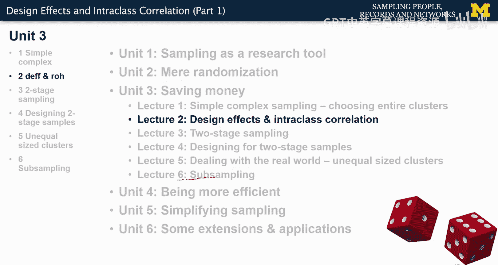

# 密歇根大学《调查数据收集和分析（2-6：方法、社调问卷设计、抽样、缺失数据、分析）｜Survey Data Collection and Analytics》 p98 19_3.2 设计效应与组内相关(上).zh_en -BV1fw4m1e7Zh_p98-

Hello and welcome back to our continuing discussion about cluster sampling here in unit3 of our six unit session on sampling people。

 records and networks。In this lecture， the second of our lectures on cluster sampling。

 we're going to be talking about the effect， the impact of cluster sampling on our estimation。

And as we do this， we're going to take the simple， complex sampling ideas that we just developed in lecture one and compare and contrast them to what we find in simple random samples of the same size。

 and we will have in this particular case then some new expression， some new terminology。

 even some new tools to use in helping us design samples。

 design effects and intraclass correlation that we will describe as we go along。

Now as we do this in the lectures， there are three parts to this about so called design effects。

 which I've abbreviated in the upper left as DEFF， we'll see that abbreviation in a minute。

And Ro R O H that we'll describe in a minute。 And then we have some calculations。

 And between design effect and row or somewhere in the middle of the row。

 we're going to take a little break and then come back to the rest of it to finish off discussing Roe in calculation。

 So let's begin by talking about the idea of comparing a cluster sample to a simple random sample。

 And I just grab this image here， because when we do comparisons。

 there are all sorts of things that we do in the way of comparisons。

 here's a comparison of heights of building。 Now， this doesn't include the really tall buildings in the Persian Gulf today。

 But we might be looking at the comparison of the height of buildings such as the Taipei 101 in Taiwan。

 and the Petros towers in Malaysia， the Sears Tower in the United States， the Jin Mao building。

 which has been superseded， but in Shanghai and the Empire StateBuild in the United States。

 And then I put this one in here just because this relates to。My background。

 we where this being recorded here at the University of Michigan， is very near to Detroit。

 and Detroit sits on big salt deposits。 not well known for this， but those salt mines go way down。

 almost to the depth， It's equivalent to the building。

 So we would compare these in terms of this measure。

 What we're going to do is the same thing for cluster sampling。

 we need a way to compare cluster samples to simple random。 We need some quantitative measure。

 We're going to use the sampling variance， because if you recall for cluster samples。

 simple cluster samples。 They're unbiased for the mean。Just like simple random samples。

 So whether we have a simple random sample or a cluster sample， On average。

 we're getting the right answer。 there's no effective design there。

 but those sampling variances are computed in different ways for simple random samples based on element variability for cluster samples based on cluster variability。

 And so we need a way to take that quantified statement and compare between the two。

So we're going to be comparing precision， Well， precision you recall would involve standard errors。

But it's， it's really that measure of precision our sampling variance we're going to be doing。

 We need to make sure that there's some commonality in the comparison。

 I don't want to compare a simple random sample of 1000 to a cluster sample of 240。

 that wouldn't make sense。 So we're going to put them on the same basis。 the equal sample size。

 not equal cost。 S random samples will be much more expensive than cluster samples。

 So if we had to have equal cost， then cluster samples will have much better precision simple random samples。

But when we have equal sample size， what we find is that cluster samples have much larger variances than simple random samples。

All right so we're going to compare sampling variances in this particular case。Now。

 if you recall our illustration in lecture 2， where we had 10 classrooms， each with 24 children。

 selected from 1000 classrooms， So the total population had 24000 children。

 We selected 240 children across the school classrooms and did that by taking 10 classrooms of 24。

 And then we asked each of those children are obtained for each of the children。

 their immunization history and 160 of them。 Turn out were fully immunized。

 That proportion is an unbiased estimate of the population proportion among all 24000 children。Now。

 we could have at that point， done a simple random sample， though， instead。

 And I suppose we got the same basic resolve or something neighboring that and then calculated the simple random sampling variance。

 And so here's the calculation from a simple random sample of the same size of 240。 Actually。

 it uses the results from our cluster sample。 we didn't draw a separate sample。

 What we're going to do is treat our cluster sample both as a cluster sample。

 We know what that variance is。 and we'll come back to it in a minute。

And as a simple random sample of the same size， and just take the data and ignore the clustering in it and calculate the variance。

Now， that allows us then from one sample to get the two estimates that we need to compare。

 and here's the sampling variance from the cluster， not the cluster sample。

 but the simple random sample。Now probably don't remember what we had before。

 but we're going to compare what we had for the cluster sample。

 and as we see it here that we have this quantity that involves the variance of the mean。

Where what we're going to do is take that variance of the proportion actually， rather than a mean。

 although I think about them in the same way， and compare it to the variance of a simple random sampling for the same estimate。

So we're taking a ratio variances。 we won't take a difference when you're comparing building height。

 you'd say  well， this one's 250 feet taller than the other。But what we're doing here is saying， no。

 no， this one is 6% larger， or this one is 100% larger by taking the ratio。

And we're going to label this where we're comparing the variance of the proportion for our cluster sample for a sample of 240。

 That's that numerator I circled to the variance of a simple randomum sample of the same size 240 school children。

 the sampling variance in the denominator。And that's what we're going to label as the design effect。

 design effect。 And we're using an abbreviation here。

 This was invented by a social scientist who was among statisticians known as a statistician and among social scientists known as a sociologist。

And he came from that different tradition， statisticians would treat this not as a single symbol。

 they might use something like a delta。Or maybe just to denote that it's on the squared scale。

 a delta squared。they're going to go with the Greek letter， why Greek， well。

 classical reasons but as spare a notation as possible。

 whereas the social science community tends to prefer Menomic devices， memory devices。

 So here D for design EFF for effect， de， which is a ratio of variances for that sample proportion P。

All right， same sample size numerator and denominator And at the last line there at the very bottom of our display。

 we see the ratio you probably didn't recall that the sampling variance we computed from our sample of size 240 was 0。

00276 and for the simple random sampling equivalent。

 taking the same data and treating it as a simple random sample came out to be 0。0009。

 Those numbers are hard to taking differences here would be a real headache。

 This is the scale we're getting for a sample of this size of involving proportions。

 This is what variances would tend to look like。But what's important is the ratio。

 and we notice that the cluster sampling variance is three times larger than the simple random sampling variance。

A threefold increase， the same sample size。Much reduced cost。Now。

 you could raise the question at this point。 Well， why would I do the cluster sample if I'm going to lose invariance compared I'd rather do the simple random sample for the same sample size。

 No， you wouldn't， because the simple random sample would cost much more money to build the list necessary to select it。

 Now， if you already get that list assembled。 That's a different matter。 But here。

 we don't have the list assembled。 And that's what happens in most of these cases with cluster sampling。

 We have a list assembly cost。 And that list assembly cost could be 10fold higher。

 let's say it is 10fold higher。 It costs 100 times as much to assemble that list of all of the names as it does to get a list of1 thousand classrooms。

 select 10 of them and then go to those classrooms and get the classroom rosters for those 10。

And if it's 1 hundred0fold difference。A threefold loss in precision from cluster sampling is nothing。

 We're still ahead by 33 to 1。So we're willing to suffer this loss because we save so much money。

 Now， we don't often do that calculation。 sit down often， I don't think I've ever done it at all。

 It's just so obvious that the cost would be so much less with a cluster sample。

 And I haven't even mentioned the travel cost to go from classroom to classroom。

 So it's not about cost here。 It's about variance and equal sample sizes。

 We lose in precision on that comparison， but it's a convenient kind of comparison。

 It's not about now getting these things so that we we can compare this on the basis of of the same budget。

 That's typically not done， although it could be done。All right。Now。

 this design effect comes up all over the place in the literature。

 and it comes up in many different ways。 For example， one way that it comes up is the following。

 That design effect is a ratio of variances。 Well， you know， if I multiply both sides of it。

 If I multiply the right hand side and left hand side by the simple random sampling variance。

 I get the variance of the proportion， just the numerator the one side is equal to the design effect times the simple random sampling variance。

 That is the design effect can be thought of as an adjustment on what happens in simple random sampling。

 In this case， as I said， a threefold increase in the variance of compared to simple random sampling。

And that sometimes is used by people to assess the impact of the cluster sampling on their design when they're looking at the analysis。

 They've done simple random of sampling calculations。 and they say。

 but I think the design effects here， based on other calculations are a factor of 2 or3。

 They're going to take the simple end of sampling variances and inflate them correspondingly。

That's one way to use and that's a little bit crude。

 Typically you just want to compute the design effect and be done with it to know exactly what that increase in variance was。

 but actually this expression is much more useful in designing new surveys。

 which is in the next lectures that are coming up in lectures 3 and four in this series so we'll come back to this。

 we're going to take that design effect and use it as an adjustment factor for simple random sampling variances in order to build up projections of what sampling variance would look like for cluster samples。

Now， the design effect is a function of the differences between clusters。

 if you remember the design effect the numerator that cluster variance is variability among cluster characteristics。

 and so what we're doing is comparing variability for cluster characteristics to variability for element characteristics。

In that design effect is greater than one， the clusters are more variable than the elements。Why。

 you know， if the elements happen to be， I've got this little silly illustration of sheep down here。

 but if the elements happen to be you know， tufts of wool taken from each of the sheep。

 we can see there are big differences between white sheep and black sheep。

 And that's what's going on here。 We're getting bigger differences between than we're getting within。

 There's not an even uniform distribution of color of of the wool across those sheep。

So what we're contrasting here is heterogeneity between the clusters。

 That's the term that's used based on the on the Greek， hetero for between， if you will and。

That is what's in the numerator of our variances。If we have heterogeneity between。

 that is we have very great differences between like those sheep。

 it also implies something that's very important， and that is homogeneity。Within。

So the maximum contrast that we've got right there is between black and white sheep。

 which is also the difference between black and white。Tfts of wool。 And so that homogeneity within。

 if it's high， means that there's also great differences between this is kind of the essence of the social sciences Anyway。

 it is particularly sociology in studying groups and group differences。

 But if you study group differences， you're also studying the extent to which within groups。

 there's homogeneity。 the elements are more like one another within the group than they arelike those that are coming from different groups。

So the more different clusters are from one another。

 the more similar are the elements within clusters one to another。Now， this is observed empirically。

 they revealed that this design effect is a function of indeed。

The extent to which the elements within the clusters are are like one another。 Oh， they're also。

 it turns out， related to how large the clusters are。 So it's not just one factor。 it's2。

And so there is a measure of this within cluster correlation that we're going to be developing called intra cluster correlation。

 intra， much like the difference between intra and intra。Comparisons。

 I drive on highways in the United States and you'll pass vehicles and they'll say the intratrastate Commerce Commission。

Between state， it's a federal agency that regulates what goes on between the states as opposed to interstate within state commerce。

 where things don't pass outside the state borders。 Well， that's what we're dealing with here。

 we're dealing with the intro the within kind of thing in the cluster phenomena。

 and we're going to measure that in terms of a correlation。

 the extent to which the elements resemble one another。 Well now for correlation。

 we typically would use the symbol are。For relations， right。

 correlation has that built into the middle。 But again， remember the statisticians。

 They prefer the Greek symbol here。 They prefer that Greek letter for the letter R row。

 I hope that doesn't look like a P。 It's meant to look like that Greek letter row。

So they're capitalizing on the same sound， but that kind of thing is spelled RHO。

 we live in a university environment in which there's housing here for a community called the Greek community organized by the students。

And they have these Greek letters on the they're called the Greek community because their houses are named with typically two three letter sequences of Greek letters。

 And so you'll see Ro used in that lettering。 In that case， though， see。

 we've got something that's spelled R， O H。 Well， that's because， again。

 this was specified by a social scientist。 that social scientist wanted a memory device。

 And he wanted us to remember what this thing was。 So the the term R O H is a memory device。

 rather than R H O， The Greek letter。 It's a memory device， and it stands for rates， R A T E。Or R of。

Hmogeneity。Beginning with the letter H， just a rearrangement of the letters of， of Ro。

So it's to remind us that what we're dealing with here is not the Greek letter。

 concept that's outside of our understanding， it's dealing with the homogeneity within the clusters。

 which is a direct reflection of the heterogeneity among them that's driving that variance。

So the rate of homogeneity is a part of this and our design effect then is given as a factor as a part of this。

 and it is built up in terms of the rate of homogeneity and the number of elements per cluster Now A was the number of elements。

 the number of clusters B going alphabetically is done in this particular notation So the number of elements we've selected per cluster in our case all 24 students in the classroom。

 but we will do some subampling in our next lecture。So in this particular case。

 then that design effect is driven by， if you will， a one。That's simple random sampling。

 That's the base that's there by how many elements we take per cluster and by the rate of homogeneity within the clusters。

 those three factors。Given that， that allows us then to estimate that homogeneity， what is it。

 what we expect to be a number that's less than one。 and indeed。

 we can manufacture an estimate by taking the design effect expression we just were looking at and deriving。

 backing out of it that rate of homogeneity， we subtract 1 from the design effect and divide by B -1。

 and we see that here our rate of homogeneity is 0。088。

So we've got a result now that tells us what the homogeneity is and the consequences of it when we have 24 elements per cluster selected。

Okay， let's take a little break from this， we're going to resume and talk about homogeneity a little bit further and the consequences of homogeneity in our next part of lecture2。

 thank you。

