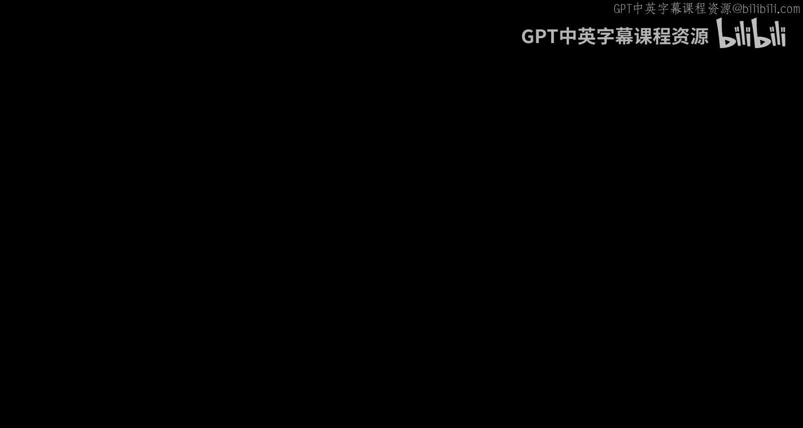
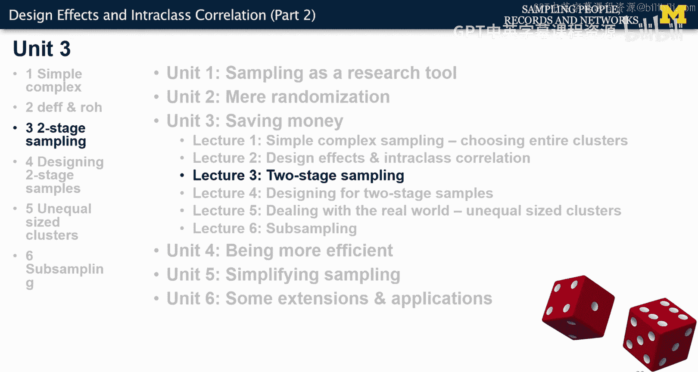

# 密歇根大学《调查数据收集和分析（2-6：方法、社调问卷设计、抽样、缺失数据、分析）｜Survey Data Collection and Analytics》 p99 20_3.2 设计效应与组内相关(下).zh_en -BV1fw4m1e7Zh_p99-

Welcome back to the second part of our lecture， second lecture on cluster sampling on saving money in survey sampling when sampling people。

 records or networks， where we have in order to get at the people or the records or the networks。

 We have them grouped into these kinds of groups that we're calling clusters。

 they're called clusters because that's what we use in our sample selection。

 there's no it's a generic。Meta term that we're using to apply to these。

 It's how we're using these particular groupings in our sample selection And you recall that we have been discussing complex sampling the cluster sampling as in addition to the random sampling to make our designs go from simple random selection to complex random selection。

 we start out with equal size clusters and taking all the elements and that's what we're still dealing with here and in this particular lecture we're moving to discuss the design effects and interclass correlation more about interclass correlation and row。

And so we had just in the last lecture part of this lecture talked about how the design effect is driven by three factors。

 The simple random of sampling variance is a base of one。

 The number of elements we select per cluster we were calling that lowercase B in our particular illustration 24 and the rate of homogeneity。

 RO H， Let's talk a little bit more about RO H。 Where' is it coming from。

 How does this homogeneity arise。Well， for the school children in the classroom。

 why would there be differences between the classrooms that would be bigger on average than they are among the children themselves in terms of their characteristics with respect to immunization status。

 And this row is a property of the clusters that's reflecting something important that is more of a substantive rather than statistical property。

It's not statistics Its introducing this。 It's how the kids get to school。

 Most of the schools are drawing their children from the neighborhood around them。

Then what's happening when we see differences between classrooms in schools。

 but also classrooms across schools is that we're seeing differences across neighborhoods。Well。

 what would make for differences across neighborhoods in an immunization status。

We can answer that question from our own understanding。

 We understand that these neighborhoods would differ in terms of the income level。Of the families。

 the educational level of the parents， and these factors could influence immunization status because low incomee households would have potentially less access to health care might be let prone to might also have higher costs for health care and certainly as a fraction of their expenditures and then think about this differently because of the cost access as well as cost。

They also may come from educational backgrounds where this kind of thing has not been emphasized in their history。

Oh， but wait a minute， Why are there income and education differences across the neighborhoods。

That's a broad social phenomena， a structural element in our societies。 Neighbhoods are not the same。

Oftentimes， the differences between neighborhoods have to do with the economics。

 The housing stock is different at different neighborhoods。

And that housing stock will cost different amounts of money。

 There's oftentimes homogeneity in housing stock when than a given neighborhood。

 and that draws people with similar incomes and educational backgrounds to purchase those homes or rent those homes Par will also choose neighborhoods where they can afford to to live than perhaps have the reputation of having schools with higher quality education。

All these factors are going on， And there're what's creating these differences among the classrooms。

And that kind of thing is not a statistical phenomenon。

A substantive phenomenon that's having an impact on our statistics。All right， so row。

 this idea that people group together in groupings where they're more alike and therefore different between each other。

Leads to homogeneity within these groupings， a homogeneity that is almost always positive。

 People are more like one another， a positive correlation than they are different from one another within the same clusters。

 Now， this is the typical。 I'm not saying this always exists， but this is the typical situation。

And so Ro is positive。 Now， it's coming about then because of factors such as in the environment。

They may be exposed to certain things in the environment that are different。

 It may be because of self selection。 They've chosen to live in this neighborhood because of the income that they have and the housing that they can afford。

 They may have chosen to live there because of the schools and the nature of the schools and they've chosen to be in that neighborhood with other people who are also have similar concerns or are making similar choices with respect to education。

It also is due to the interaction among the subjects。

 it may be that in that community they talk with one another and in that neighborhood they have similar concerns about immunization。

 its dangers， the complications or its benefits。And that interaction tends to change their attitudes and make them more alike with respect to their attitudes。

 All of these things are leading to differences between and homogeneity within。 So Roe is， as I said。

 more substantive than statistical。Now， that simple random sample of size 240 and the cluster sample can be thought of then because of this。

 and that's 240 independent selections。And yes， we had 10 independent selections of clusters。

 but there's an equivalency here that we might draw。 It's a little hard to imagine。

 but just think about it this way， I'm closing my eyes to try and imagine it because it's a little bit complicated。

If I had a simple random sample of size 240 and I was in the cluster sample losing in precision。

 what would be the cluster sample equivalent to that simple random sample？ That is。

 how many elements I could I have in that cluster sample that would after I factor out that homogeneity and that increase in variance be the equivalent of the 240 in the simple random sample。

 And here's another use of that design effect。There's a term called effective sample size。

So the 240 simple random sample size is when divided by 3。029， that design effect we calculated。79。

 about one third is large。That is， our cluster sample would be the equivalent of a simple random sample of size 79。

Not 240， and that now begins to give us some impact。

 some notion of the impact of the cluster sampling on our outcomes。

So that effective sample size is another measure built around the design effect that we can use to assess the effect of the cluster sampling on our results。

Let's look at two illustrations just to look at this row just a little bit more。

 Suppose that instead of the distribution that we saw in the last lecture for those 1 classrooms。

 we had this distribution where we can see quite clearly here that these cluster samples are really unevenly divided。

 We're seeing that we have three of these where we have no immunizations occurring at all。

 And we have six of them where everybody's immunized。

 And then because of the numerator has to add to 160， we've got one that's sort of in between。

Now that's huge difference between。 in matter of fact。

 that's the largest difference between we could get in this case。

 it's almost sort of perfect heterogeneity and perfect homogeneity within。

So started the calculation here， calculated the S of a squared0222。

 If you remember our S of a squared， well， maybe you don't。

 But you go back and look at it when we had the other distribution was around 0。027。

Something like that。 Well， here， it's much larger。 Well， that's what we would expect。

 And the variance used to be 00027。 Now， 。022， if you will，2178。

 So our variances have gone up a lot because of this。

Virtually perfect heterogeneity between and homogeneity within。The design effect。

 if I compare this now to a simple random sample of size 240， the same one that we had before。

 this design effect is 24。 It's virtually the number of elements in the cluster。 In matter of fact。

 that's the largest the design effect could be， is 24。And row of the effect sample size now is 10。

 In other words， because of the perfect homogeneity。

 Every time I take another element out of the cluster because I have this perfect homogeneity。

 I'm not learning anything new。The first one tells me everything I need to know about the cluster。

 with the exception of one cluster here。 When I take the first element， If it's a 0。

 they're not immunized。 I know the other 23 are not immunized in this situation。 So really， the 10。

Random events are the effective sample size in this particular case。 This is the extreme， now。

And row is one。 row is virtually one。 Per homogene。 That's the contrast。 That's the nature of this。

 this phenomena。But now let's compare it to a different case that we probably wouldn't expect to see in practice either。

 And that is where all the rates are the same。 Always two thirds。

16 of 24 every cluster is a microcosm of the population。In a case like this。

 we get some ridiculous kinds of results。 We get no variance。

 no sampling variance or no element variance or cluster variance S sub a squared design effect is 0。

 an effective sample size that's not defined， but here， row is actually slightly negative。

You need a weird situation like this to get a negative row。rowow， as I said， tends to be positive。

 It's very seldom negative because it would take some unusual distributions like this。 This。

 This is beyond what would happen， even if you allocated the children at random across those classrooms。

 You wouldn't expect to see the same number in every classroom。 This is kind of a weird case。

 They can come up in practice。 They unusual， more often。

 you would see a negative row because of estimation issues that are beyond what we can do in this particular course。

 But nonetheless， we can get that negative value there。Okay。

 now let's just go through this one more time。 And this time。

 let's try and do some estimation from a little different perspective。

 supposeuppose that what I've been doing is reading articles in journals about a particular phenomenon I'm interested in studying。

 Or maybe it's the area I'm working in。 And I've come across an article in which they describing a characteristic that I'm very interested in that they estimate in the population is 40%。

4 is is the fraction of of the population that has as characteristic。

 and that's based on a sample a sample survey in which they had 2400 people in the sample。

 It turned out to be a one stage cluster sample with 60 clusters。

 Each of 40 elements each and the clusters we selected with simple random samples。

And so I've looked at the journal article is very interesting to me。

 And I think I'd like to replicate this。 I'd like to understand a little bit more about this。

 But first of all， it's a cluster sample。 What's the impact of this cluster sampling on the outcomes？

 And it turns out that in the paper， they gave us a standard error for that proportion。

 the square root of the sampling variance。 So I squared it。

And there you see it that that sampling variance is 0。00021795。

 Okay I just the actual value is around 0。015 for the standard error。

 so I squared it and got that number。How much of that standard error。

 How much of that variance is due to cluster sampling， What's the design effect and row， Well。

 now I'm going to need to construct the simple random sampling equivalent。 I don't have the data。

 but I could do it because it's a proportion。 if you recall， by doing the following。

 computeute the simple random sampling variance， step 1 in this calculation。 P times 1 p over n -1。

 I'm going to ignore the  one minus Actually， I'm rounding it to 1。 The sampling fraction here。

 It turned out that the paper was based on a sample of persons 18 years of age and older in a province in a state。

 There werent a lot of them。 There were millions of them。 And I just have a sample of 2400。

 So that sampling fraction is fairly small1 minus that sampling fractions close to 1 P times 1 P over n-1 is sufficient。

All right。 If I could calculate that， then I could calculate the design effect because I already know the actual variance。

 And so in this particular case， I've got my actual variance 。00021795 and step 2。

 And I'm going to divide it by that P times 1 minus P。 And then I would have my design effect。 Oh。

 and I could calculate the row by backing that out。 that's the steps I could use in the process。

 So let's go through and do those calculations。 Here's the simple random sampling variance。😊，The P。

 the proportion is 0。4。 Time 1 minus proportion is 0。6， divided by 2400。 Well，0。4 times 06 is 0。24。

 I get a sampling variance。 simpleim random sample。 Now， a 。0001。 much smaller than what I had。

 than before。 How much smaller Well， here's the design effect。 the design effect。

 when I put that into that simple random sampling variance into thenominator is 2。17952。18。

And now I can calculate my row value as well， that homogeneity that's driving this is 0。0302。03。

And I'd let you follow through on the calculations， make sure that we've done them correctly。

 and now I now understand something that's going on here。

The cluster sampling is doubling the variance compared to a simple amount of sample of the same size。

 It's being driven by a homogeneity value that's fairly small but positive。

 but because that is a fairly large cluster size is being magnified by 40 or 40 -1 to give us the design that design effect of 2。

18。All right， I've gotten a better understanding of the nature of what the impact of the design is。

Well， there are two directions that we should go at this point。

 One of them is to talk about which we'll do in the next lecture。

 what happens when we do sub samplingling instead of taking all what happens if we take a sub samplele in each of the sample clusters。

And then secondly， how can we use this kind of background in this context to try and design the next sample。

 I'm now interested in this study。 I think I want to replicate it。

 I have a particular population in mind， a different 1。

 I want to be able to estimate what's going to happen in that population before I even do it so that I can go to my sponsor and tell them。

 look， here's the sample I'm going to do。 Here's the size。 Here's its cost。

 And this is what I expect to get。

And getting that sample size and this is what I expect to get is an important part of the design process and one that we're going to look about。

 look at how we're going to deal with in lecture 4。

 But nu lecture 3 now we'll look at two stage sampling next。 Thank you。

