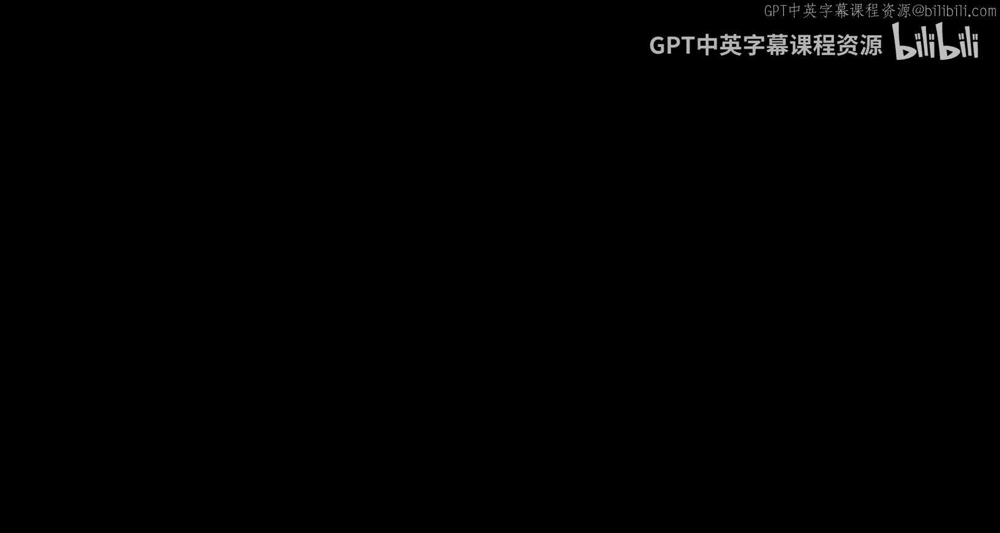
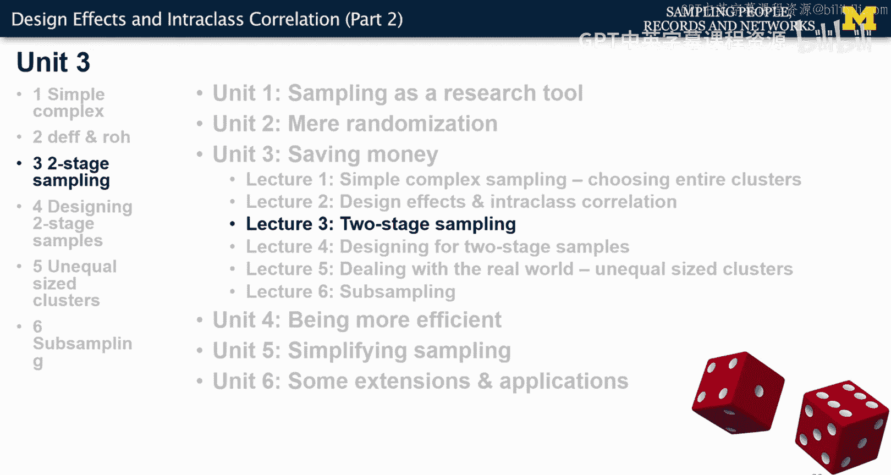

# 调查数据收集与分析：3.2：设计效应与组内相关（下）📊

在本节课中，我们将继续探讨整群抽样。我们将深入了解组内同质性（ROH）的来源及其对设计效应的影响，学习如何计算有效样本量，并通过一个实际案例来演示如何从已发表的研究中反推设计效应和ROH值。

---

## 组内同质性的来源

上一节我们介绍了设计效应受三个因素驱动。本节中，我们来看看其中最关键的因素——组内同质性（ROH）——是如何产生的。

ROH并非一个纯粹的统计现象，它更多地反映了现实世界中的实质性社会结构。以学校班级中的儿童免疫状况为例，班级间的差异往往大于班级内的差异。这主要是因为：

*   **环境因素**：不同社区在经济水平、父母教育程度上存在差异，这些因素会影响家庭获取医疗服务的成本与意识，从而导致免疫状况的社区差异。
*   **自我选择**：家庭会根据其收入水平选择能负担得起的社区住房。同时，家长也可能为了特定质量的学校而选择社区，这使得具有相似经济背景和教育观念的群体聚集在一起。
*   **群体互动**：同一社区的居民会相互交流，关于免疫的利弊、风险的态度会相互影响并趋于一致。

所有这些因素共同导致了“群间异质性”和“群内同质性”。因此，ROH通常是**正值**，意味着群内个体彼此相似的程度高于随机分布的情况。

---

## 有效样本量

理解了ROH的影响后，我们可以从一个新角度衡量整群抽样的效果：有效样本量。

简单随机抽样样本量为240。在整群抽样中，由于同质性的存在，我们的估计精度会下降。那么，这个整群样本在精度上相当于多大的简单随机样本呢？答案可以通过设计效应计算得出，我们称之为**有效样本量**。

其计算公式为：
`有效样本量 = 实际样本量 / 设计效应`

在我们之前的例子中，设计效应为3.029。因此，240人的整群样本，其有效样本量为：
`240 / 3.029 ≈ 79`

这意味着，尽管我们调查了240个个体，但由于群内同质性的存在，我们获得的信息量仅相当于一个79人的简单随机样本。这直观地展现了整群抽样对估计效率的折损。

---

## 理解ROH的极端情况

为了更好地理解ROH和设计效应的范围，我们来看两种理论上的极端分布情况。

以下是第一种极端情况：群间差异极大，群内完全同质。

*   **情景描述**：假设10个班级中，有3个班级的免疫率为0%，6个班级为100%，1个班级为某个中间值（以确保总数为160人）。这代表了最大的群间异质性和群内同质性。
*   **计算结果**：此时，群间方差 `S_a²` 变得非常大，设计效应接近**24**（即每个群的大小）。有效样本量降至**10**（即群的数量）。ROH值接近**1**（完全同质）。这表示，在同一个群内调查第一个个体后，其余个体的信息几乎是冗余的。

以下是另一种极端情况：所有群完全一致。

*   **情景描述**：所有10个班级的免疫率恰好都是2/3（即每班24人中有16人免疫）。每个班级都是总体的一个完美缩影。
*   **计算结果**：此时，群间方差 `S_a²` 为**0**，设计效应也为**0**，有效样本量无定义。ROH值会是一个**轻微的负值**。这种情况在实践中极为罕见，它需要一种不自然的完美均匀分布。

通过这两个例子可以看出，**ROH通常为正值**，负值仅在非常特殊且不现实的情况下出现。

---

## 案例实操：从文献中反推设计效应

在实际研究中，我们常需要评估他人研究中整群抽样的影响。假设我们读到一篇论文，其信息如下：

*   **研究结果**：某特征在总体中的比例为 **P = 0.4 (40%)**。
*   **样本设计**：采用单阶段整群抽样，共抽取 **60个群**，每个群包含 **40个个体**，总样本量 **n = 2400**。
*   **报告数据**：该比例的标准误为 **0.015**。

我们想知道该研究的设计效应和ROH是多少。以下是推算步骤：

**步骤1：计算简单随机抽样下的理论方差**
公式为：`Var_srs = P * (1 - P) / n`
代入数值：`0.4 * 0.6 / 2400 = 0.0001`

**步骤2：计算实际抽样方差**
将报告的标准误平方：`0.015² = 0.000225`

**步骤3：计算设计效应**
公式为：`Deff = Var_actual / Var_srs`
代入数值：`0.000225 / 0.0001 = 2.25`

**步骤4：计算ROH值**
利用公式 `Deff = 1 + (b - 1) * ROH` 反推，其中 `b` 是群规模（40）。
`ROH = (Deff - 1) / (b - 1) = (2.25 - 1) / (40 - 1) ≈ 0.032`

通过以上计算，我们得出结论：这篇论文采用的整群抽样设计，使其估计的方差增大了约**2.25倍**，这由**约0.032**的组内同质性所驱动。尽管ROH值看起来很小，但乘以较大的群规模（39）后，对设计效应产生了显著影响。

---

## 总结与预告

本节课中，我们一起深入学习了组内同质性（ROH）的社会学实质来源，掌握了用**有效样本量**直观衡量整群抽样效率损失的方法，并通过案例演练了如何从已有研究中**反推设计效应和ROH值**。

我们了解到，ROH通常为正值，它反映了现实社会中的聚集模式，会增大抽样方差、降低估计效率。在设计调查时，必须考虑其影响。

至此，关于“等规模整群且群内全部调查”的内容已介绍完毕。接下来的课程将探讨更现实的情况：**两阶段抽样**，即先从总体中抽取一部分群，再从每个被抽中的群中抽取一部分个体进行调查。我们将在下一讲中详细讨论。