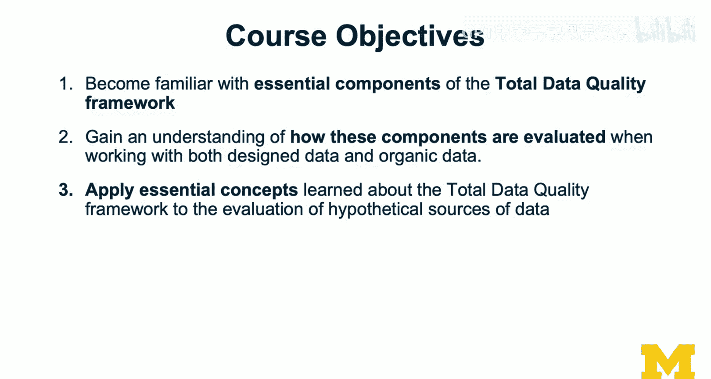

# 02：全数据质量框架体系导论 🎯

在本节课中，我们将学习课程一的主要目标，并对全数据质量框架体系有一个初步的认识。

欢迎来到课程一的导论部分。这是一个简短的讲座。

我们将讨论本课程的目标。本课程有三个主要目标。

第一个目标是熟悉全数据质量框架的核心组成部分。这意味着我们将花时间了解相关的概念和定义。

第二个目标是理解在分析**设计型数据**和**有机数据**时，如何评估这些组成部分。这涉及到如何衡量框架中不同维度的质量。

第三个目标是将这些核心概念应用于对假设数据源的评估。我们将通过一些实际应用案例，以非常实用的方式运用这些概念。

以上就是本课程的主要目标。我们很高兴你能加入，并准备开始学习。

---

上一节我们介绍了课程的整体目标，本节中我们来看看全数据质量框架的具体构成。该框架旨在系统化地理解和提升数据质量。

以下是全数据质量框架的几个核心组成部分：

*   **数据质量维度**：这些是衡量数据质量的特定方面，例如**准确性**、**完整性**、**一致性**和**时效性**。
*   **生命周期阶段**：数据在其生命周期中会经历不同阶段，包括**收集**、**存储**、**处理**和**使用**。每个阶段都可能引入质量问题。
*   **质量评估方法**：这涉及用于测量和监控上述维度的具体技术和指标。

---

为了更具体地理解，我们可以通过一个简单的公式来思考数据质量的一个维度——准确性。数据准确性可以表示为：

**准确性 = (正确记录数) / (总记录数)**

这个公式提供了一种量化的方式来评估数据的正确程度。

---

在应用框架时，区分数据来源至关重要。**设计型数据**是指通过调查、实验等有目的、有计划的方式收集的数据。而**有机数据**则是在日常运营或用户交互中自然产生的数据，例如交易日志或社交媒体动态。

评估这两种数据时，关注点可能不同。对于设计型数据，我们可能更关注收集过程的严谨性；对于有机数据，则可能更关注其一致性与及时性。

---

本节课中我们一起学习了课程一的三个核心目标：熟悉全数据质量框架的组成部分、学习如何评估设计型与有机数据的质量，以及将概念应用于实际数据源评估。掌握这个框架是系统化管理和提升数据质量的第一步。